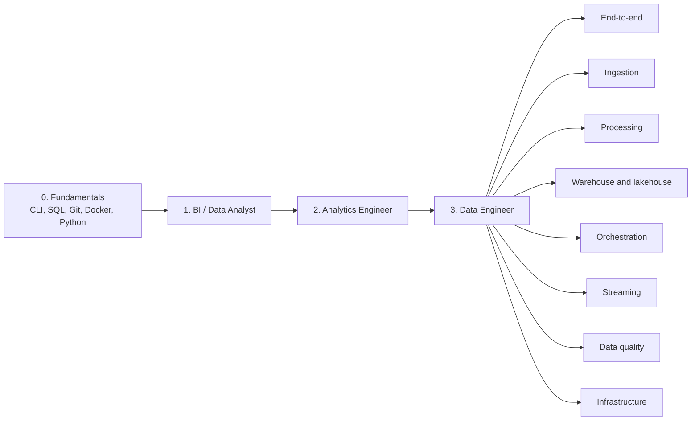

# Surfalytics Projects

Hands-on data projects from the [Surfalytics](https://surfalytics.com) community. Each project is a small, real build. You finish it at your own pace and show it in your portfolio.

Every project has the same structure: a project card, an architecture diagram, and assignments with a "Done when" checklist.

## Roadmap

How to use it:

1. Start with the fundamentals. You need them for every track.
2. Pick the track for your target role. Each track builds on the one before it.
3. Inside a track, go from **Base** to **Middle** to **Senior**. See the [levels](CONTRIBUTING.md#levels).
4. Prefer projects with status **Ready**. **In progress** projects work but have planned parts. **Draft** projects are outlines.

## 0. Fundamentals

The fundamentals are CLI, SQL, Git, Docker and Python. They are in the Surfalytics fundamentals course on [surfalytics.com](https://surfalytics.com). Do them first.

Practice project in this repo:

| Level | Project | Main tools | Cost | Status |
|---|---|---|---|---|
| Base | [Getting Started with Git and CI/CD](dataops-projects/01_git_and_ci_cd/) | Git, GitHub, GitHub Actions, ... | Free | Ready |

## 1. BI / Data Analyst

Build dashboards and semantic models. Run a BI server.

| Level | Project | Main tools | Cost | Status |
|---|---|---|---|---|
| Base | [End-to-End Power BI Dashboard with Microsoft Fabric](bi-projects/01_bi_dashboard_with_microsoft_fabric/) | Microsoft Fabric, Lakehouse, Dataflow Gen2, ... | Free trial | Ready |
| Base | [Open Source BI with Metabase](async-projects/03-Open-Source-BI-with-Metabase/) | Metabase, PostgreSQL, Docker, ... | Free | In progress |
| Middle | [BI Admin with Tableau Server](async-projects/02-BI-admin-with-Tableau/) | Tableau Desktop, Tableau Server, Tableau Public, ... | Free trial | Ready |
| Middle | [KPI Dashboard with Looker and Snowflake](bi-projects/02_looker_snowflake/) | Looker, LookML, Snowflake, ... | Free trial | Ready |

## 2. Analytics Engineer

Model data with dbt and SQLMesh. Add tests, documentation and CI. Prepare for the interview.

| Level | Project | Main tools | Cost | Status |
|---|---|---|---|---|
| Base | [dbt Fundamentals with Postgres and GitHub Actions](de-projects/18_dbt_intro/) | dbt Core, PostgreSQL, Neon, ... | Free | Ready |
| Base | [Getting Started with SQLMesh](de-projects/19_sqlmesh_intro/) | SQLMesh, DuckDB, Python | Free | In progress |
| Middle | [Analytics Engineering Mock Interview](ae-projects/01_mock_ae_interview/) | SQL, DuckDB, dbt, ... | Free | Ready |
| Middle | [End-to-End Analytics with dbt and Looker](async-projects/01-end-to-end-analytics-with-dbt-and-looker/) | Neon Postgres, Docker, DBeaver, ... | Free | Ready |
| Middle | [dbt Core, Snowflake and Docker Pipelines](de-projects/02_dbt_core_snowflake/) | dbt Core, Snowflake, Docker, ... | Free trial | Draft |

## 3. Data Engineer

Build and run data platforms. Pick a focus area, or do the end-to-end projects to see the whole picture.

### End-to-end

| Level | Project | Main tools | Cost | Status |
|---|---|---|---|---|
| Middle | [Data Warehouse on Azure and Snowflake](async-projects/04-azure-data-warehouse/) | Azure Data Factory, Azure SQL Database, Azure Cosmos DB, ... | Free trial | Ready |
| Middle | [End-to-End ETL Pipeline with AWS](de-projects/11_end_to_end_de_project_with_aws/) | Python, Adzuna API, AWS Lambda, ... | Free trial | Draft |

### Ingestion

| Level | Project | Main tools | Cost | Status |
|---|---|---|---|---|
| Base | [Move Data Between PostgreSQL and Snowflake with Python and pandas](de-projects/08_db_to_db_python/) | Python, pandas, SQLAlchemy, ... | Free trial | Ready |
| Base | [Getting Started with Airbyte and Data Ingestion](de-projects/14_airbyte_data_ingestion/) | Airbyte, abctl, Docker, ... | Free | Draft |
| Middle | [Data Ingestion Patterns: From API to Snowflake](async-projects/06-data-ingestion-patterns/) | Python, Docker, AWS S3, ... | Free trial | Ready |
| Middle | [Snowflake Data Loading: Azure Blob with COPY INTO and Snowpipe](de-projects/27_snowflake_data_loading/) | Snowflake, Azure Blob Storage, Azure Event Grid, ... | Free trial | In progress |

### Processing

| Level | Project | Main tools | Cost | Status |
|---|---|---|---|---|
| Base | [Spark ML Logs Transformer with Unit Tests](de-projects/10_spark_transformations_with_tests_framework/) | Python, PySpark, pytest, ... | Free | Ready |
| Base | [Apache Spark Basics with PySpark and Docker](de-projects/06_spark_projects/) | Apache Spark, PySpark, Python, ... | Free | In progress |
| Base | [Getting Started with Polars](de-projects/17_polars_intro/) | Python, Polars, PyArrow, ... | Free | In progress |
| Base | [Introduction to PyArrow](de-projects/13_pyarrow_intro/) | Python, PyArrow, pandas, ... | Free | In progress |
| Base | [Trino 101: Distributed SQL Query Engine](de-projects/05_trinodb/) | Trino, Docker, Java, ... | Free | In progress |
| Middle | [Databricks Job with a Python Wheel Task](de-projects/20_wheel_in_databricks/) | Databricks, PySpark, Python, ... | Free trial | In progress |

### Warehouse and lakehouse

| Level | Project | Main tools | Cost | Status |
|---|---|---|---|---|
| Base | [Google BigQuery Overview: Partitioning and Clustering](de-projects/12_bigquery-overview/) | Google BigQuery, SQL | Free | Ready |
| Base | [Getting Started with Databricks](async-projects/05-getting-started-with-databricks/) | Databricks Free Edition, Apache Spark, PySpark, ... | Free | In progress |
| Base | [Snowflake Data Warehouse and Hex Notebooks](de-projects/03_snowflake_hex/) | Snowflake, Snowflake CLI, SnowSQL, ... | Free trial | Draft |
| Middle | [Getting Started with Apache Iceberg](de-projects/15_apache_iceberg_intro/) | Apache Iceberg, Dremio Cloud, AWS S3, ... | Free trial | Draft |
| Middle | [Getting Started with Snowflake and Apache Iceberg](de-projects/16_snowflake_and_iceberg_lakehouse/) | Snowflake, Apache Iceberg, AWS S3, ... | Free trial | Draft |

### Orchestration

| Level | Project | Main tools | Cost | Status |
|---|---|---|---|---|
| Base | [Getting Started with Apache Airflow](de-projects/22_airflow_intro/) | Apache Airflow, Docker, Python, ... | Free | Draft |
| Middle | [Airflow ETL: Adzuna API to Databricks Delta](de-projects/26_airflow_docker_databricks_etl/) | Apache Airflow 3, Docker, Databricks Free Edition, ... | Free | Ready |

### Streaming

| Level | Project | Main tools | Cost | Status |
|---|---|---|---|---|
| Senior | [Data Streaming Mastery](async-projects/07-data-streaming-mastery/) | Apache Kafka, Schema Registry, Kafka Connect, ... | Free | Ready |

### Data quality

| Level | Project | Main tools | Cost | Status |
|---|---|---|---|---|
| Base | [Data Quality Checks with Soda Core and Snowflake](de-projects/07_soda_core_snowflake/) | Soda Core, SodaCL, Python, ... | Free trial | Ready |
| Middle | [Data Quality Checks with Databricks DQX](de-projects/24_databricks_dqx_demo/) | Databricks Free Edition, Databricks DQX, PySpark, ... | Free | Ready |
| Middle | [dbt Observability with Elementary](de-projects/09_elementary_dbt/) | dbt Core, Elementary, Snowflake, ... | Free trial | In progress |

### Infrastructure

| Level | Project | Main tools | Cost | Status |
|---|---|---|---|---|
| Base | [Terraform 101](dataops-projects/02_terraform_101/) | Terraform, AWS EC2, AWS S3, ... | Free trial | In progress |
| Middle | [Metabase on AWS ECS Fargate](dataops-projects/03_metabase_on_aws_ecs/) | AWS VPC, AWS IAM, Amazon RDS for PostgreSQL, ... | Paid (~$2.5/day) | Ready |
| Middle | [Docker in Azure with CI/CD](de-projects/04_docker_in_azure/) | Docker, Docker Compose, PostgreSQL, ... | Free trial | Draft |
| Senior | [Azure Databricks in a Private VNet (No Public IP)](de-projects/01_azure_databricks_vnet_ssc/) | Azure Databricks, Azure Virtual Network, Azure Data Lake Storage Gen2, ... | Free trial | Draft |

## Repository layout

Folders keep their original names, so old links still work. The roadmap above is the main way to find a project.

| Folder | What is inside |
|---|---|
| [`async-projects/`](async-projects/) | Self-paced projects, built for the Surfalytics community |
| [`bi-projects/`](bi-projects/) | BI and dashboard projects |
| [`ae-projects/`](ae-projects/) | Analytics Engineer projects |
| [`de-projects/`](de-projects/) | Data Engineer projects |
| [`dataops-projects/`](dataops-projects/) | Git, CI/CD, Terraform and cloud deployment |

## Contributing

To add a project, copy [TEMPLATE.md](TEMPLATE.md) and follow [CONTRIBUTING.md](CONTRIBUTING.md). We discuss projects in Discord. The idea comes from [MakeOverMonday](https://www.makeovermonday.co.uk/) in the Tableau community.
