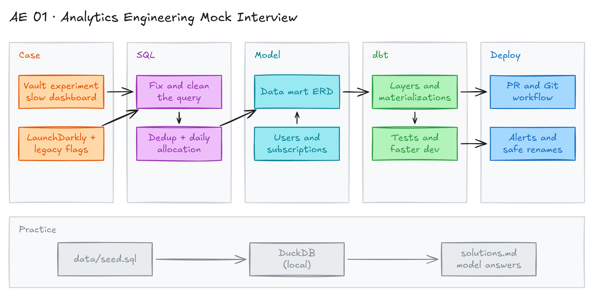

# Analytics Engineering Mock Interview



## Project card

| Level | Roles | Duration | Cost | Status |
|---|---|---|---|---|
| Intermediate | Analytics Engineer, Data Analyst | 5 assignments, ~1-2 h each | Free | Ready |

## Goal

This is a mock interview case for an Analytics Engineer role. A fintech company tracks an experiment for a new feature with a slow ad-hoc dashboard. You review the SQL, design a data mart, plan the dbt project, and explain how you ship and support it.

## What you will learn

- Read, clean up and fix a messy SQL query.
- Deduplicate events and build a daily grain (one row per user per day).
- Design a data mart for experiment analysis.
- Plan dbt layers, materializations and tests.
- Explain a Git workflow, alerts and safe changes to mart tables.

## Who it is for

- **Analytics Engineer**: practice a full AE interview loop, from SQL to deployment.
- **Data Analyst**: practice SQL and data modeling questions before you move to an AE role.

## Tools and services

| Tool | Used for | Free option |
|---|---|---|
| SQL | Fix and improve the experiment query | yes |
| DuckDB | Run the query and your answers on sample data, on your laptop | yes |
| dbt | Plan models, materializations and tests | yes (dbt Core) |
| Git | Branch, commit and sync your work | yes |
| LaunchDarkly | Source of feature flag events (context only) | not needed |

## Architecture

The diagram is at the top of this page. Source file: [`images/architecture.excalidraw`](images/architecture.excalidraw). Open it at [excalidraw.com](https://excalidraw.com) to copy or edit it.

This is an interview, not a pipeline. The diagram shows the interview stages.

Interview flow:

1. **Case:** read the business context and propose a full solution.
2. **SQL:** review, fix and improve the dashboard query.
3. **Model:** design a data mart for experiment analysis.
4. **dbt:** plan the dbt layers, materializations and tests.
5. **Deploy:** describe the pull request, Git workflow, alerts and support process.

## Dataset

There is no dataset to download. The case uses these tables:

- **Source:** fintech data warehouse (fictional).
- **Tables / entities:**
  - `partner_directpush_launchdarkly_events`: new feature flag events from LaunchDarkly.
  - `legacy_feature_flag_events`: events from the old feature flag system.
  - Users and subscriptions: not given. Assume they exist and use them in your model.
- **Size:** millions of transactions per day. The production experiment data has 14 billion rows.

### Practice with sample data

The folder [`data/`](data/) has a small fictional copy of these tables: [`data/seed.sql`](data/seed.sql). It has the same problems as production: two flag systems, duplicate entries, one inactive row and a second experiment. It also has `users` and `subscriptions` for Assignment 3.

1. Install [DuckDB](https://duckdb.org/docs/installation/) (one file, no server).
2. Load the data:

   ```bash
   duckdb vault.duckdb < data/seed.sql
   ```

3. Open DuckDB and run SQL:

   ```bash
   duckdb vault.duckdb
   ```

4. Paste the query from Assignment 2. It fails. Finding out why is part of the task.

| Table | Rows | What is inside |
|---|---|---|
| `partner_directpush_launchdarkly_events` | 10 | New flag system, from 2025-01-03 |
| `legacy_feature_flag_events` | 6 | Old flag system, until 2025-01-02 |
| `users` | 10 | One row per user |
| `subscriptions` | 11 | Tier history (Standard, Plus, Premium). `valid_to` is empty for the current tier |

## Prerequisites

- Good SQL: CTEs, joins, window functions, `GROUP BY`.
- Basic dbt: models, sources, tests, materializations.
- Basic Git.
- DuckDB to run the SQL locally. Optional, but it makes Assignment 2 much easier.
- New to Git, CLI or Docker? Start with [Surfalytics Module 0](https://www.youtube.com/watch?v=LJIiCLu2gr8&list=PLNCDg7zJiXhP5Z_-TXUdorz2n7sjYHHKE&index=1).

## Assignments

Work at your own pace. Each assignment shows the expected time. Practice with a friend: one person is the interviewer, one is the candidate. Answer out loud first. Then write your answer down.

Model answers are in [solutions.md](solutions.md). Try each assignment first, then compare.

### Assignment 1: Business case (~1 h)

**Goal:** Propose a full solution for a slow experiment dashboard.

**Context:**

- You join a fintech company. The data warehouse processes millions of transactions every day.
- The product team launched a new feature: **money vaults**. A vault is a separate space for savings. It keeps savings apart from the spendable account, for example for emergency funds.
- The company runs experiments to measure the impact of new features.
- The feature flag system moved to LaunchDarkly. The experiment data structure changed completely.
- To keep tracking the vaults metrics, product analysts built a quick ad-hoc dashboard in a BI tool with custom SQL.
- The product manager watches this dashboard. It is shared with the whole company at the weekly all-hands meeting.
- It works as an MVP, but it is slow to load. Users cannot slice the key metrics in a flexible way.

**Steps:**

1. Read the context.
2. Answer the question: **How would you build a complete solution that fixes these problems?**
3. Cover data sources, modeling, the BI layer, testing and ownership.

**Deliverable:** A short written answer (bullets) or a simple diagram.

**Done when:**

- [ ] You name the main problems: speed, flexibility, two source systems.
- [ ] Your solution moves the logic from the BI tool into modeled tables.
- [ ] You can explain your answer in 5 minutes.

**Hints:** Compare with the [model answer](solutions.md#assignment-1-business-case).

### Assignment 2: SQL challenge (~2 h)

**Goal:** Understand, fix and improve the SQL query behind the vault experiment dashboard.

**Steps:**

1. **Understand the query:** explain what it does. You can clean up the code as part of your explanation.
2. **Improve readability:** rewrite the query so it is clear and easy to maintain.
3. **`UNION` vs `UNION ALL`:** explain the difference.
4. **Deduplicate experiment entries:** some users enter the same experiment variation many times. Keep only the first entry of each user into each experiment.
5. **Convert timestamps to dates:** show dates, not timestamps.
6. **Optimize for performance:** suggest ways to make the query run faster.
7. **Track experiment allocation over time:** show how users are assigned to each experiment group over time. Return one row per user per day.

The query used in the BI tool:

```sql
WITH directpushlaunchdarklyevents AS(
   SELECT event_id,
		event_contextkeys_user,
    event_creationdate,
 event_key AS experiment_name,
       event_variationname AS experiment_variation_name,
event_value AS experiment_variation_description,
 CASE
  WHEN LOWER(event_value)='t' THEN TRUE
 WHEN LOWER(event_value)='f' THEN FALSE
 END AS is_experiment_variation
FROM partner_directpush_launchdarkly_events
  WHERE is_active='Y'
),

legacyfeatureflagevents AS (
SELECT id AS event_id,
  user AS event_contextkeysuser,
"timestamp" as event_creationdate,
 key AS experiment_name,
variation_name AS experiment_variation_name,
   NULL AS experiment_variation_description,
 value::BOOLEAN AS is_experiment_variation
FROM legacy_feature_flag_events
),

union_all_rows AS (
SELECT * FROM directpush_launchdarkly_events
   UNION ALL
SELECT * FROM legacy_feature_flag_events
),

final AS (
  SELECT experiment_name,
is_experiment_variation,
 created_on,
COUNT(DISTINCT union_all_rows.event_contextkeys_user) AS num_users
 FROM union_all_rows
GROUP BY 1, 2,3
)

SELECT experiment_name,
 created_on,
 CASE WHEN is_experiment_variation=TRUE THEN num_users END AS num_user_true,
CASE WHEN is_experiment_variation=FALSE THEN num_users END AS num_user_false
 FROM final
WHERE experiment_name='vault-launch'
 GROUP BY 1,2,3
ORDER BY num_user_true DESC, num_user_false DESC;
```

**Deliverable:** A cleaned-up query, a deduplicated version, and a daily version (one row per user per day).

**Done when:**

- [ ] You found the errors in the query (CTE names, column names, `GROUP BY`).
- [ ] Your queries run on the sample data in DuckDB.
- [ ] Your query keeps only the first entry per user per experiment.
- [ ] Your daily query has one row per user per day.
- [ ] You can explain `UNION` vs `UNION ALL`.
- [ ] You list at least 3 performance ideas.

**Hints:**

- The query has bugs on purpose. Compare CTE names with the names in `FROM`. Look for `created_on`.
- For deduplication, use `ROW_NUMBER()` or `QUALIFY`.
- For one row per user per day, join to a date spine.
- Check your numbers: on the sample data, 9 users enter `vault-launch`. 5 are in treatment and 4 in control.
- Model answers: [solutions.md](solutions.md#assignment-2-sql-challenge).

### Assignment 3: Data modeling (~1.5 h)

**Goal:** Design a data mart that makes experiment data easy for analysts to use.

The mart must scale over time. It must be the single source of truth for experiment analysis.

**Steps:**

1. Solve these 3 problems in your design:
   - **Performance:** the current dashboard takes one hour to load. The product manager opens it long before the weekly pod meeting.
   - **Subscription tier breakdown:** analysts need to see experiment allocation across the 3 subscription tiers to check for bias. The current query groups all users together, so this is not possible.
   - **Historical allocation:** engineers need to track how users move into control and test groups over time. The current query shows only the latest distribution.
2. Assume there are raw sources for users and subscriptions. Use them in your model.
3. Draw an ERD: facts, dimensions, keys and grain of each table.

**Deliverable:** An ERD with the grain of each table.

**Done when:**

- [ ] Each table has a clear grain and a primary key.
- [ ] Analysts can slice by subscription tier.
- [ ] Engineers can see allocation by day.
- [ ] The dashboard reads from small, pre-aggregated or well-modeled tables.

**Hints:** Test your model on the sample data: build the daily table with the tier for each day. Is the allocation balanced across tiers? Model answer: [solutions.md](solutions.md#assignment-3-data-modeling).

### Assignment 4: dbt implementation (~1.5 h)

**Goal:** Turn your ERD into a dbt implementation plan.

**Steps:**

1. **Model architecture and layers:** which models do you create? Where do they go in the dbt project (staging, intermediate, marts)?
2. **Materializations:** which materialization do you choose for each model? What are the trade-offs?
3. **Testing strategy:** which tests do you add, and where?
4. **Faster development and QA:** production has **14 billion rows**. The nightly run takes **3 hours**. How do you make local testing and QA faster?

**Deliverable:** A list of dbt models with layer, materialization and tests.

**Done when:**

- [ ] Each model has a layer and a materialization.
- [ ] You explain when to use `incremental` and why.
- [ ] You have tests for keys, not-null fields and accepted values.
- [ ] You have at least 2 ideas to speed up development (for example, limit data in dev, defer to production).

**Hints:** Model answer: [solutions.md](solutions.md#assignment-4-dbt-implementation). Docs: [dbt materializations](https://docs.getdbt.com/docs/build/materializations), [dbt data tests](https://docs.getdbt.com/docs/build/data-tests), [dbt defer](https://docs.getdbt.com/reference/node-selection/defer).

### Assignment 5: Development, deployment and support (~1 h)

**Goal:** Explain how you ship the dbt models and keep them stable.

Your dbt models are ready. It is time to open a pull request.

**Steps:**

1. **Pull request size:** how do you keep a PR not too large and not too small?
2. **Git workflow:** write the Git commands to:
   - Create a new branch.
   - Commit your changes.
   - Sync your branch with the latest `main`.
   - Push your changes to the remote repository.
   - Update your local branch with changes from the remote branch.
3. **Monitoring and alerts:** where do test failure alerts go? Describe the error handling process: who fixes failures, and how fast a fix must be deployed.
4. **Downstream stability:** you need to rename tables or columns in the **mart layer**. How do you keep downstream dashboards and queries working?

**Deliverable:** Git commands and short answers for each point.

**Done when:**

- [ ] Your Git commands work in a real repo.
- [ ] You define an owner and a time to fix for failures.
- [ ] You have a plan for renames (for example, keep old names as views for a period, use dbt model versions or contracts).

**Hints:** Model answer: [solutions.md](solutions.md#assignment-5-development-deployment-and-support). Docs: [dbt model versions](https://docs.getdbt.com/docs/collaborate/govern/model-versions), [dbt model contracts](https://docs.getdbt.com/docs/collaborate/govern/model-contracts).

## Final result

- Written answers for all 5 parts.
- A cleaned-up SQL query and an ERD.
- Put the SQL and the ERD in a GitHub repo.
- Optional: build the models as a small dbt project with [dbt-duckdb](https://github.com/duckdb/dbt-duckdb) on the sample data.
- Interview pitch: "I fixed a slow experiment dashboard. I moved the logic from the BI tool into a dbt mart with a daily grain per user. Analysts can now slice by subscription tier, and the dashboard loads fast."

## Clean up

Nothing to clean up. To start again, delete `vault.duckdb` and load `data/seed.sql` again.

## Resources

- [dbt best practices: how we structure our dbt projects](https://docs.getdbt.com/best-practices/how-we-structure/1-guide-overview): staging, intermediate and marts layers.
- [dbt incremental models](https://docs.getdbt.com/docs/build/incremental-models): useful for large event tables.
- [LaunchDarkly experimentation](https://docs.launchdarkly.com/home/experimentation): how feature flag experiments work.

## Community solutions

Share your repo in Discord. We add the best ones here.
