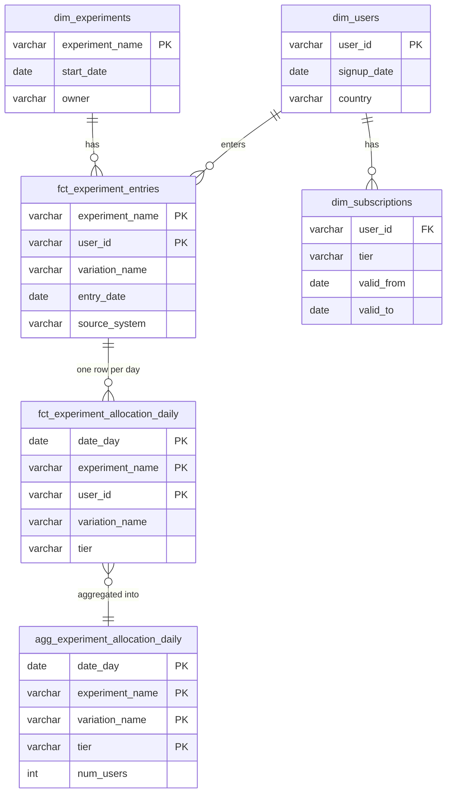

# Model answers: AE mock interview

Try each assignment yourself first. Then compare. There is more than one good answer. These are examples of strong answers, not the only answers.

All SQL here runs on the sample data in DuckDB. See [Practice with sample data](README.md#practice-with-sample-data).

## Assignment 1: Business case

A strong answer covers these points:

- **Problems:** the dashboard is slow, the logic lives in the BI tool, two flag systems have different structures, and nobody owns the data.
- **Sources:** stage both flag systems (LaunchDarkly and legacy) into one common shape: user, experiment, variation, entry time, source system.
- **Modeling:** move the logic from the BI tool into dbt. Build a clean entries table and a daily allocation mart. Add users and subscription tiers.
- **BI layer:** the dashboard reads a small, pre-aggregated table. Analysts slice by date, experiment, variation and tier.
- **Quality:** dbt tests on keys and accepted values, source freshness, and a check for sample ratio mismatch (unexpected group sizes).
- **Ownership:** one owner for the mart, alerts in a team channel, documentation in dbt docs.

## Assignment 2: SQL challenge

### Bugs in the original query

| # | Bug | Effect |
|---|---|---|
| 1 | `union_all_rows` reads `directpush_launchdarkly_events`, but the CTE is `directpushlaunchdarklyevents` | Query fails |
| 2 | The second branch reads the raw table `legacy_feature_flag_events`, not the CTE | Wrong columns in the union |
| 3 | `event_contextkeysuser` vs `event_contextkeys_user` | Inconsistent names. `UNION` uses the first branch names, so this hides the problem |
| 4 | `created_on` does not exist | Query fails. It should be the date of `event_creationdate` |
| 5 | `user` is not quoted | In Postgres and Snowflake, `user` returns the current database user, not the column |
| 6 | The final `GROUP BY 1,2,3` groups by the `CASE` columns | Two rows per date (one with treatment, one with control) instead of one |
| 7 | The experiment filter is at the end | The query reads and aggregates all experiments first. Slow |
| 8 | No deduplication | A user who enters twice on different days is counted twice |
| 9 | Values other than `t`/`f` become `NULL` | Unknown values disappear without an error |

### Steps 1-2 and 5: clean query with dates

```sql
-- Fixed and readable version of the dashboard query.
-- Users who entered each group of 'vault-launch', per day.
with launchdarkly_events as (
    select
        event_id,
        event_contextkeys_user as user_id,
        event_creationdate as entered_at,
        event_key as experiment_name,
        event_variationname as variation_name,
        case lower(event_value)
            when 't' then true
            when 'f' then false
        end as is_treatment,
        'launchdarkly' as source_system
    from partner_directpush_launchdarkly_events
    where is_active = 'Y'
),

legacy_events as (
    select
        id as event_id,
        "user" as user_id,
        "timestamp" as entered_at,
        key as experiment_name,
        variation_name,
        value::boolean as is_treatment,
        'legacy' as source_system
    from legacy_feature_flag_events
),

all_events as (
    select * from launchdarkly_events
    union all
    select * from legacy_events
)

select
    experiment_name,
    cast(entered_at as date) as entry_date,
    count(distinct case when is_treatment then user_id end) as num_users_treatment,
    count(distinct case when not is_treatment then user_id end) as num_users_control
from all_events
where experiment_name = 'vault-launch'
group by experiment_name, entry_date
order by entry_date;
```

### `UNION` vs `UNION ALL`

- `UNION` removes duplicate rows. It needs a sort or hash step, so it is slower.
- `UNION ALL` keeps all rows. It is faster.
- Use `UNION ALL` here. The two systems have different event IDs, so there are no exact duplicates. Remove logical duplicates on purpose with `ROW_NUMBER()`, not by accident with `UNION`.

### Step 4: keep only the first entry

```sql
-- Fixed and readable version of the dashboard query.
-- Users who entered each group of 'vault-launch', per day.
with launchdarkly_events as (
    select
        event_id,
        event_contextkeys_user as user_id,
        event_creationdate as entered_at,
        event_key as experiment_name,
        event_variationname as variation_name,
        case lower(event_value)
            when 't' then true
            when 'f' then false
        end as is_treatment,
        'launchdarkly' as source_system
    from partner_directpush_launchdarkly_events
    where is_active = 'Y'
),

legacy_events as (
    select
        id as event_id,
        "user" as user_id,
        "timestamp" as entered_at,
        key as experiment_name,
        variation_name,
        value::boolean as is_treatment,
        'legacy' as source_system
    from legacy_feature_flag_events
),

all_events as (
    select * from launchdarkly_events
    union all
    select * from legacy_events
),

first_entries as (
    select
        user_id,
        experiment_name,
        variation_name,
        is_treatment,
        source_system,
        cast(entered_at as date) as entry_date
    from all_events
    qualify row_number() over (
        partition by user_id, experiment_name
        order by entered_at
    ) = 1
)

select
    experiment_name,
    entry_date,
    count(case when is_treatment then 1 end) as num_users_treatment,
    count(case when not is_treatment then 1 end) as num_users_control
from first_entries
where experiment_name = 'vault-launch'
group by experiment_name, entry_date
order by entry_date;
```

Result on the sample data: 9 users. 5 in treatment, 4 in control. `u09` is not counted, because its only row is inactive.

### Step 6: performance ideas

- Filter by experiment and date **before** the union and the aggregation.
- Select only the columns you need. Avoid `SELECT *`.
- Deduplicate once in a stored table. Do not run `COUNT(DISTINCT)` over billions of rows on every dashboard load.
- Store the result as an incremental table. Process only new events each run.
- Partition or cluster the event tables by event date and experiment.
- Let the dashboard read a small pre-aggregated table, not raw events.

### Step 7: one row per user per day

```sql
-- Fixed and readable version of the dashboard query.
-- Users who entered each group of 'vault-launch', per day.
with launchdarkly_events as (
    select
        event_id,
        event_contextkeys_user as user_id,
        event_creationdate as entered_at,
        event_key as experiment_name,
        event_variationname as variation_name,
        case lower(event_value)
            when 't' then true
            when 'f' then false
        end as is_treatment,
        'launchdarkly' as source_system
    from partner_directpush_launchdarkly_events
    where is_active = 'Y'
),

legacy_events as (
    select
        id as event_id,
        "user" as user_id,
        "timestamp" as entered_at,
        key as experiment_name,
        variation_name,
        value::boolean as is_treatment,
        'legacy' as source_system
    from legacy_feature_flag_events
),

all_events as (
    select * from launchdarkly_events
    union all
    select * from legacy_events
),

first_entries as (
    select
        user_id,
        experiment_name,
        variation_name,
        is_treatment,
        cast(entered_at as date) as entry_date
    from all_events
    qualify row_number() over (
        partition by user_id, experiment_name
        order by entered_at
    ) = 1
),

date_spine as (
    select cast(d as date) as date_day
    from generate_series(date '2025-01-01', date '2025-01-06', interval 1 day) as t(d)
),

user_days as (
    select
        s.date_day,
        e.user_id,
        e.experiment_name,
        e.variation_name,
        e.is_treatment
    from date_spine as s
    inner join first_entries as e
        on e.entry_date <= s.date_day
)

select
    date_day,
    user_id,
    experiment_name,
    variation_name
from user_days
where experiment_name = 'vault-launch'
order by date_day, user_id;
```

In production, generate the date spine from the first entry date to today, for example with `dbt_utils.date_spine`.

## Assignment 3: Data modeling



| Table | Grain (one row per) | Solves |
|---|---|---|
| `fct_experiment_entries` | user and experiment | Deduplication, one source of truth for both flag systems |
| `fct_experiment_allocation_daily` | user, experiment and day | Historical allocation |
| `agg_experiment_allocation_daily` | day, experiment, variation and tier | Fast dashboard, tier breakdown |
| `dim_subscriptions` | user and tier period (SCD type 2) | Tier on each day, not only today |

Example query for the tier breakdown:

```sql
-- Fixed and readable version of the dashboard query.
-- Users who entered each group of 'vault-launch', per day.
with launchdarkly_events as (
    select
        event_id,
        event_contextkeys_user as user_id,
        event_creationdate as entered_at,
        event_key as experiment_name,
        event_variationname as variation_name,
        case lower(event_value)
            when 't' then true
            when 'f' then false
        end as is_treatment,
        'launchdarkly' as source_system
    from partner_directpush_launchdarkly_events
    where is_active = 'Y'
),

legacy_events as (
    select
        id as event_id,
        "user" as user_id,
        "timestamp" as entered_at,
        key as experiment_name,
        variation_name,
        value::boolean as is_treatment,
        'legacy' as source_system
    from legacy_feature_flag_events
),

all_events as (
    select * from launchdarkly_events
    union all
    select * from legacy_events
),

-- Grain of user_days: one row per user, experiment and day.
first_entries as (
    select
        user_id,
        experiment_name,
        variation_name,
        cast(entered_at as date) as entry_date
    from all_events
    qualify row_number() over (
        partition by user_id, experiment_name
        order by entered_at
    ) = 1
),

date_spine as (
    select cast(d as date) as date_day
    from generate_series(date '2025-01-01', date '2025-01-06', interval 1 day) as t(d)
),

user_days as (
    select
        s.date_day,
        e.user_id,
        e.experiment_name,
        e.variation_name,
        sub.tier
    from date_spine as s
    inner join first_entries as e
        on e.entry_date <= s.date_day
    left join subscriptions as sub
        on sub.user_id = e.user_id
        and s.date_day >= sub.valid_from
        and (sub.valid_to is null or s.date_day < sub.valid_to)
)

select
    date_day,
    tier,
    count(case when variation_name = 'treatment' then 1 end) as users_treatment,
    count(case when variation_name = 'control' then 1 end) as users_control
from user_days
where experiment_name = 'vault-launch'
group by date_day, tier
order by date_day, tier;
```

On the sample data, every Premium user from 2025-01-03 is in treatment. This is the kind of bias analysts want to find.

## Assignment 4: dbt implementation

| Model | Layer | Materialization | Why |
|---|---|---|---|
| `stg_launchdarkly__events` | staging | view | Rename and clean columns. Cheap |
| `stg_legacy_flags__events` | staging | view | Same shape as the LaunchDarkly model |
| `stg_app__users`, `stg_app__subscriptions` | staging | view | Clean source columns |
| `int_experiment_events_unioned` | intermediate | view or ephemeral | Union of both systems |
| `fct_experiment_entries` | marts | incremental (`merge` on `experiment_name` + `user_id`) | 14B rows. Process only new events |
| `fct_experiment_allocation_daily` | marts | incremental (`delete+insert` by `date_day`) | Grows every day. Rebuild only recent days |
| `dim_subscriptions` | marts | snapshot (SCD type 2) | Keep tier history |
| `agg_experiment_allocation_daily` | marts | table | Small. The dashboard reads it |

Tests:

- `unique` and `not_null` on primary keys.
- `dbt_utils.unique_combination_of_columns` on the grain of each fact table.
- `accepted_values` on `variation_name` (`control`, `treatment`) and `tier`.
- `relationships` from `user_id` to `dim_users`.
- `source freshness` on the LaunchDarkly events.
- Optional: a custom test for sample ratio mismatch, for example a warning when one group is more than 10% bigger than planned.

Faster development and QA:

- In dev, read only recent data, for example `where event_date >= current_date - 7` when `target.name == 'dev'`.
- Use `--defer --state` and `--select state:modified+`. Build only changed models and read the rest from production.
- Use `dbt clone` to copy production tables into a dev schema. On Snowflake, Databricks and BigQuery this is a zero-copy clone.
- Use incremental models, so dev runs process little data.
- In CI, build only modified models in a temporary schema (Slim CI).

## Assignment 5: Development, deployment and support

**Pull request size:** one logical change per PR. For example: staging models first, marts second. Keep refactors and renames in separate PRs.

**Git workflow:**

```bash
# Create a new branch
git switch -c feature/vault-experiment-mart

# Commit your changes
git add models/
git commit -m "Add experiment entries and daily allocation models"

# Sync your branch with the latest main
git fetch origin
git rebase origin/main      # or: git merge origin/main

# Push your changes
git push -u origin feature/vault-experiment-mart

# Update your local branch with changes from the remote branch
git pull --rebase
```

**Monitoring and alerts:**

- Test failures go to a team channel, for example `#data-alerts` in Slack.
- `error` tests stop the run. `warn` tests only notify.
- The model owner (set in `meta.owner`) fixes the failure.
- Agree on a time to fix, for example before the next business morning, and always before the weekly all-hands.
- If the fix takes longer, roll back and tell the dashboard users.

**Downstream stability when you rename:**

- Use dbt [model contracts](https://docs.getdbt.com/docs/collaborate/govern/model-contracts) to lock column names and types.
- Use dbt [model versions](https://docs.getdbt.com/docs/collaborate/govern/model-versions). Ship `v2` next to `v1` and set a `deprecation_date` on `v1`.
- Or keep a view with the old name that points to the new table for a transition period.
- Check lineage and exposures to find every dashboard that uses the model. Tell the owners before the change.
