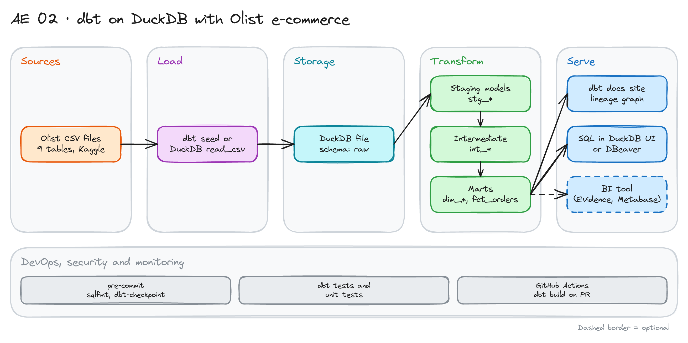

# dbt on DuckDB with Olist E-commerce

> **Draft.** The outline and the plan are ready. We have not run every command yet.

## Project card

| Level | Roles | Duration | Cost | Status |
|---|---|---|---|---|
| Middle | Analytics Engineer, Data Engineer | 5 assignments, ~2-4 h each | Free | Draft |

## Goal

You model a real e-commerce dataset with dbt on a local DuckDB file. You decide the grain of each table. You build a star schema, add tests and docs, and run the project in CI. Nothing runs in the cloud and nothing costs money.

## What you will learn

- Load raw CSV files into DuckDB and declare them as dbt sources.
- Write staging, intermediate and mart models with clear naming.
- Pick the grain of a fact table and write it down.
- Add generic tests, singular tests and dbt unit tests.
- Answer business questions with SQL on top of the marts.
- Run `dbt build` in GitHub Actions on every pull request.

## Who it is for

- **Analytics Engineer**: you practice dimensional modeling on messy, real data.
- **Data Engineer**: you see how dbt and DuckDB work together on a laptop.

## Tools and services

| Tool | Used for | Free option |
|---|---|---|
| dbt Core + `dbt-duckdb` | Models, tests, docs | Yes |
| DuckDB | Local analytical database | Yes |
| Python 3.10+ and `uv` or `venv` | Run dbt | Yes |
| DBeaver or DuckDB UI | Explore the data | Yes |
| GitHub Actions | CI | Yes |
| pre-commit, `sqlfmt` | Code style | Yes |

## Architecture

The diagram is at the top of this page. Source file: [`images/architecture.excalidraw`](images/architecture.excalidraw). Open it at [excalidraw.com](https://excalidraw.com) to copy or edit it.

Data flow:

1. Download the Olist CSV files from Kaggle.
2. Load them into the `raw` schema of a DuckDB file.
3. Staging models clean and rename the columns. One model per source table.
4. Intermediate models join orders, items and payments.
5. Marts hold `dim_customers`, `dim_products`, `dim_sellers`, `fct_orders` and `fct_order_items`.
6. dbt docs and SQL queries serve the results.

## Dataset

- **Source:** [Olist Brazilian E-Commerce Public Dataset](https://www.kaggle.com/datasets/olistbr/brazilian-ecommerce) on Kaggle. You need a free Kaggle account. Check the license on the page.
- **Tables:** customers, orders, order items, order payments, order reviews, products, sellers, geolocation, product category translation.
- **Size:** about 100,000 orders from 2016 to 2018. About 120 MB of CSV. Skip `geolocation` at first. It has 1 million rows and you do not need it.

## Prerequisites

- Python, Git and a terminal.
- A GitHub account.
- Do first: [dbt Fundamentals with Postgres and GitHub Actions](../../de-projects/18_dbt_intro/).
- New to Git, CLI or Docker? Start with [Surfalytics Module 0](https://www.youtube.com/watch?v=LJIiCLu2gr8&list=PLNCDg7zJiXhP5Z_-TXUdorz2n7sjYHHKE&index=1).

## Assignments

Work at your own pace. Each assignment shows the expected time.

### Assignment 1: Set up dbt and load the raw data (~2 h)

**Goal:** Run `dbt debug` against DuckDB and query the raw tables.

**Steps:**

1. Create a repo and a Python environment. Install `dbt-duckdb`.
2. Write `profiles.yml` with a `dev` target that points to a `.duckdb` file.
3. Download the CSV files. Load them into the `raw` schema (use `read_csv` or dbt seeds).
4. Declare the tables in `sources.yml`.

**Deliverable:** A repo with `dbt_project.yml`, `sources.yml` and a README with run steps.

**Done when:**

- [ ] `dbt debug` passes.
- [ ] You can `select count(*)` on each raw table.
- [ ] The `.duckdb` file is in `.gitignore`.

### Assignment 2: Staging models (~3 h)

**Goal:** One clean staging model per source table.

**Steps:**

1. Write `stg_orders`, `stg_order_items`, `stg_customers`, `stg_products`, `stg_sellers`, `stg_payments`, `stg_reviews`.
2. Rename columns, cast types, parse timestamps.
3. Fix the product category names with the translation table.
4. Add `unique`, `not_null`, `accepted_values` (order status) and `relationships` tests.

**Deliverable:** Staging models with a `_stg.yml` file.

**Done when:**

- [ ] `dbt build --select staging` passes.
- [ ] Every primary key has `unique` and `not_null`.
- [ ] You found at least one data quality issue and wrote it down.

**Hints:** Reviews can have more than one row per order. Check it before you join.

### Assignment 3: Marts and grain (~4 h)

**Goal:** Build a star schema. Write the grain of each table.

**Steps:**

1. Build `fct_orders` (one row per order) and `fct_order_items` (one row per item).
2. Build `dim_customers`, `dim_products`, `dim_sellers`.
3. Add a surrogate key to each dimension.
4. Write the grain in the model description.

**Deliverable:** Mart models with descriptions.

**Done when:**

- [ ] The sum of `payment_value` in the mart equals the sum in the raw table.
- [ ] No fan-out: `fct_orders` has one row per `order_id`.
- [ ] Every mart model has a grain in its description.

### Assignment 4: Tests, unit tests and docs (~3 h)

**Goal:** Make the project safe to change.

**Steps:**

1. Add a singular test: delivered orders must have a delivery date.
2. Add a custom generic test, for example `positive_value`.
3. Add one dbt unit test for the delivery delay logic.
4. Run `dbt docs generate` and open the lineage graph.

**Deliverable:** Tests in the repo and a screenshot of the lineage graph.

**Done when:**

- [ ] `dbt build` passes with all tests.
- [ ] The unit test fails when you break the logic on purpose.
- [ ] Docs show a description for every mart column you use.

### Assignment 5: Business questions and CI (~3 h)

**Goal:** Answer three questions. Run the project on every pull request.

**Steps:**

1. Write SQL for these questions:
   - Which sellers deliver late most often?
   - What is revenue by product category per month?
   - How does the review score change with the delivery delay?
2. Add pre-commit with `sqlfmt`.
3. Add a GitHub Actions workflow that runs `dbt build` on pull requests.

**Deliverable:** A `analyses/` folder with the three queries and a green CI run.

**Done when:**

- [ ] The three queries run on the marts only, not on raw tables.
- [ ] CI is green on a pull request.
- [ ] A failing test makes CI red.

## Final result

- A dbt project with a star schema, tests, docs and CI.
- Put the repo on GitHub. Add the architecture diagram and the lineage screenshot to the README.
- Interview answer: "I modeled the Olist e-commerce data with dbt on DuckDB. I set the grain for each fact table, tested it, and ran dbt build in CI."

## Clean up

Nothing to clean up. Delete the `.duckdb` file if you want the disk space back.

## Resources

- [dbt-duckdb](https://github.com/duckdb/dbt-duckdb): the adapter docs.
- [dbt unit tests](https://docs.getdbt.com/docs/build/unit-tests): how to write them.
- [DuckDB documentation](https://duckdb.org/docs/): reading CSV and Parquet.

## Community solutions

Share your repo in Discord. We add the best ones here.

- <Name>: <link>
