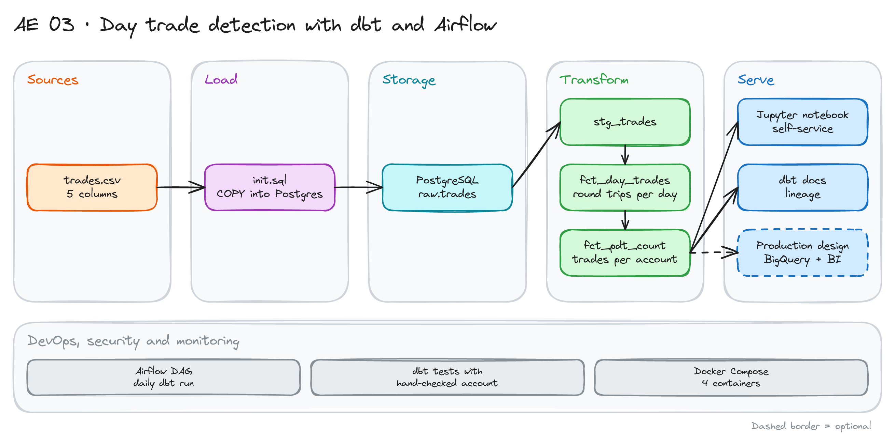

# Day Trade Detection with dbt, Airflow and Jupyter

> **Draft.** The outline and the plan are ready. We have not run every step yet.

## Project card

| Level | Roles | Duration | Cost | Status |
|---|---|---|---|---|
| Middle | Analytics Engineer, Data Engineer | 5 assignments, ~3-4 h each | Free | Draft |

## Goal

A broker must know how many day trades each account makes. A day trade is a buy and a sell of the same symbol on the same day. Accounts with too many day trades in a short period need a warning. You get a file of trades. You solve it in two ways: a notebook for fast answers, and a dbt model that Airflow runs every day. Then you design how it would work in production.

## What you will learn

- Turn a business rule into SQL and write down the edge cases.
- Build a dbt model chain from a raw table to a metric.
- Validate a result by checking one account by hand.
- Run dbt from an Airflow DAG in Docker Compose.
- Compare a self-service notebook with a managed pipeline.
- Draw a production design for the same problem.

## Who it is for

- **Analytics Engineer**: you practice business rules, tests and validation.
- **Data Engineer**: you see how dbt, Airflow and Postgres work together in containers.

## Tools and services

| Tool | Used for | Free option |
|---|---|---|
| PostgreSQL | Raw and model tables | Yes |
| dbt Core + `dbt-postgres` | Models, tests, docs | Yes |
| Apache Airflow | Daily schedule | Yes |
| Jupyter (pandas) | Self-service analysis | Yes |
| Docker Compose | 4 containers: db, dbt, airflow, jupyter | Yes |

## Architecture

The diagram is at the top of this page. Source file: [`images/architecture.excalidraw`](images/architecture.excalidraw). Open it at [excalidraw.com](https://excalidraw.com) to copy or edit it.

Data flow:

1. `trades.csv` loads into `raw.trades` when the Postgres container starts.
2. `stg_trades` cleans types and adds the trade date.
3. `fct_day_trades` counts day trades per account, symbol and day.
4. `fct_pdt_count` sums day trades per account over a window.
5. A notebook and dbt docs show the result. Airflow reruns dbt every day.

## Dataset

You generate the data. Use a script with a fixed seed.

- **Columns:** `account_id`, `symbol`, `side` (`buy` or `sell`), `qty`, `timestamp`.
- **Size:** 100 accounts, 10 symbols, 5 trading days, about 10,000 rows.
- **Edge cases to add on purpose:** a buy and a sell with the same timestamp, one buy split into two sells, a short sale (sell first, buy back later the same day), a position held over several days, a buy with no sell.

## Prerequisites

- Docker, SQL, Git.
- Do first: [dbt Fundamentals with Postgres and GitHub Actions](../../de-projects/18_dbt_intro/).
- New to Git, CLI or Docker? Start with [Surfalytics Module 0](https://www.youtube.com/watch?v=LJIiCLu2gr8&list=PLNCDg7zJiXhP5Z_-TXUdorz2n7sjYHHKE&index=1).

## Assignments

Work at your own pace. Each assignment shows the expected time.

### Assignment 1: Define the rule and generate trades (~3 h)

**Goal:** One clear rule, written down, and a test file.

**Steps:**

1. Read your broker's rule for day trades. Write it in 5 lines.
2. Pick a simple counting rule. Suggestion: for one account, symbol and day, day trades = the smaller of the number of buys and the number of sells.
3. List the edge cases and say how your rule treats each one.
4. Write the generator and create `trades.csv`.

**Deliverable:** `RULES.md` and `trades.csv`.

**Done when:**

- [ ] Each edge case has a written decision.
- [ ] The file has all edge cases at least once.
- [ ] You picked one account and counted its day trades by hand.

### Assignment 2: Self-service solution in Jupyter (~3 h)

**Goal:** A first answer with pandas.

**Steps:**

1. Start the Jupyter and Postgres containers.
2. Load the trades. Count day trades per account and day.
3. Add a rolling 5-business-day total.
4. Save `pdt_count.csv`. Compare with your hand count.

**Deliverable:** A notebook and the CSV.

**Done when:**

- [ ] The hand-checked account matches.
- [ ] The notebook runs top to bottom without errors.
- [ ] You wrote what is hard to repeat in a notebook.

### Assignment 3: dbt models (~4 h)

**Goal:** The same logic in SQL, with tests.

**Steps:**

1. Declare `raw.trades` as a dbt source.
2. Write `stg_trades`, `fct_day_trades` and `fct_pdt_count`.
3. Add tests: not null, accepted values for `side`, positive `qty`.
4. Add a singular test with the hand-checked account and its expected count.

**Deliverable:** The dbt project and a green `dbt build`.

**Done when:**

- [ ] The result equals the notebook result for every account.
- [ ] The singular test fails when you change the logic.
- [ ] Every model has a description and a grain.

### Assignment 4: Run it with Airflow (~3 h)

**Goal:** dbt runs every day without you.

**Steps:**

1. Add the Airflow container to Docker Compose.
2. Write a DAG with two tasks: `dbt build` and `dbt docs generate`.
3. Run the DAG. Break a model on purpose. See the failure and the logs.
4. Fix it and rerun.

**Deliverable:** The DAG file and screenshots of a green and a red run.

**Done when:**

- [ ] The DAG runs daily and on manual trigger.
- [ ] A failing test makes the DAG fail.
- [ ] Credentials come from environment variables.

### Assignment 5: Production design (~2 h)

**Goal:** A short design for a real platform.

**Steps:**

1. Draw the design: source systems, ingestion, warehouse, dbt, orchestration, BI.
2. Choose a warehouse (BigQuery or Snowflake). Say why.
3. List what changes: incremental models, alerts, access control, cost.

**Deliverable:** A diagram and a 1-page note.

**Done when:**

- [ ] The note names the grain of the production table.
- [ ] It says how you handle late trades.
- [ ] It lists at least three risks.

## Final result

- A rule, a notebook, a tested dbt model and an Airflow DAG, plus a production design.
- Put the repo on GitHub. Add the diagram and the validation table for one account.
- Interview answer: "I turned a trading rule into a tested dbt model. I validated it against a hand count and ran it daily with Airflow."

## Clean up

Run `docker compose down -v`. Nothing else to clean up.

## Resources

- [dbt tests](https://docs.getdbt.com/docs/build/data-tests): generic and singular tests.
- [Running dbt with Airflow](https://docs.getdbt.com/docs/deploy/deployment-tools): options and patterns.
- [Apache Airflow documentation](https://airflow.apache.org/docs/): DAG basics.

## Community solutions

Share your repo in Discord. We add the best ones here.

- <Name>: <link>
