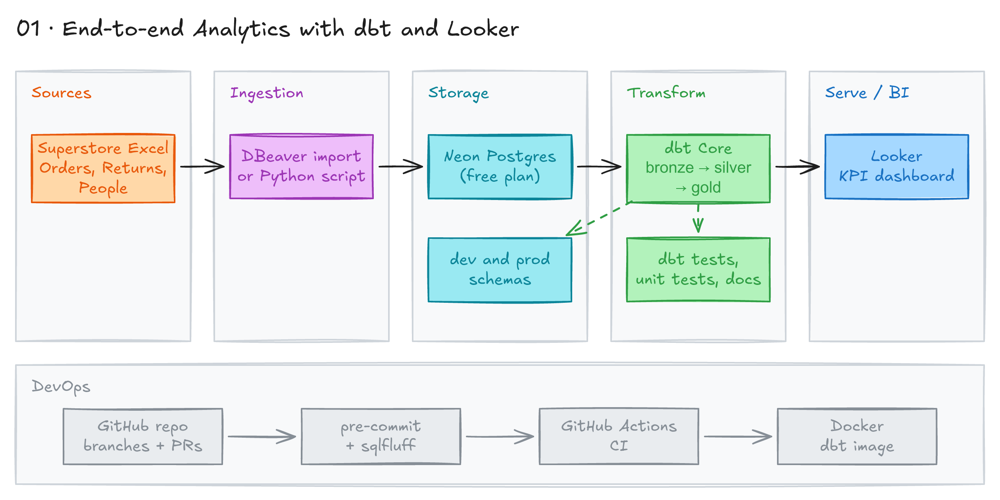

# End-to-End Analytics with dbt and Looker



## Project card

| Level | Roles | Duration | Cost | Status |
|---|---|---|---|---|
| Intermediate | Analytics Engineer, Data Engineer, BI Developer | 8 assignments, ~1-8 h each | Free | Ready |

## Goal

A business has sales data in Excel files. You will load it into a Postgres data warehouse. You will build bronze, silver and gold layers with dbt, and a star schema for reporting. At the end you add CI/CD, run dbt in Docker, and build a Looker dashboard.

## What you will learn

- Load raw files into a Postgres data warehouse.
- Build a dbt project with dev and prod targets, tests, docs and packages.
- Use the medallion architecture (bronze, silver, gold) and a star schema.
- Compare dbt materializations and incremental strategies.
- Build an SCD Type 2 dimension with dbt snapshots.
- Set up pre-commit, GitHub Actions and Slim CI with `state:modified+` and `--defer`.

## Who it is for

- **Analytics Engineer**: this is the daily work: dbt models, tests, docs and CI.
- **Data Engineer**: you practice warehouse layers, Docker and CI/CD for dbt.
- **BI Developer**: you build the data model behind the dashboard, not only the dashboard.

## Tools and services

| Tool | Used for | Free option |
|---|---|---|
| [Neon](https://neon.com) (serverless Postgres) | Data warehouse | yes (Free plan, no credit card) |
| DBeaver | SQL client, data load, ER diagrams | yes |
| dbt Core + `dbt-postgres` | Transformations, tests, docs | yes |
| pre-commit, sqlfluff, sqlfmt | Lint and format code | yes |
| GitHub + GitHub Actions | Code, pull requests, CI | yes |
| Docker | dbt container | yes |
| Looker | BI dashboard | no (shared instance, credentials in Discord) |

## Architecture

The diagram is at the top of this page. Source file: [`images/architecture.excalidraw`](images/architecture.excalidraw). Open it at [excalidraw.com](https://excalidraw.com) to copy or edit it.

Data flow:

1. Superstore Excel files (`data/Orders.xls`, `data/People.xls`, `data/Returns.xls`) are the source.
2. You load them with DBeaver into Neon Postgres, schema `stg` (raw tables).
3. dbt Core builds bronze, silver and gold models in Neon Postgres. Gold is a star schema: `fct_sales` plus `dim_*` tables.
4. pre-commit and GitHub Actions check every pull request. CI runs dbt in a Docker container against a CI schema.
5. Looker connects to the gold layer and shows the dashboard.

## Dataset

- **Source:** Sample Superstore dataset. Files are in this repo: [`data/`](data/).
- **Tables / entities:**
  - `orders`: one row per order line (`data/Orders.xls`).
  - `returns`: returned orders (`data/Returns.xls`).
  - `people`: regional managers (`data/People.xls`).
- **Size:** about 10,000 order rows. All files are under 4 MB.

## Prerequisites

- GitHub account.
- Software: VS Code (or similar IDE), Git, Python 3.11+, Docker Desktop, DBeaver Community.
- A free [Neon](https://neon.com) account. You create it in Assignment 2.
- Discord access to Surfalytics, for the shared Looker instance.
- Basic SQL. New to Git, CLI or Docker? Start with [Surfalytics Module 0](https://www.youtube.com/watch?v=LJIiCLu2gr8&list=PLNCDg7zJiXhP5Z_-TXUdorz2n7sjYHHKE&index=1).

## Assignments

Work at your own pace. Each assignment shows the expected time.

### Assignment 1: Create the project repo (~1 h)

**Goal:** Create a GitHub repo for the project and make your first pull request.

**Steps:**

1. Create a new GitHub repo for this project.
2. Clone it to your machine. Open it in VS Code or a similar IDE.
3. Create a new branch.
4. Add a `README.md` file with a short description of the project.
5. Commit, push, and open a pull request. Merge it.

**Deliverable:** A GitHub repo with `README.md`, merged through a pull request.

**Done when:**

- [ ] The repo exists on GitHub.
- [ ] `README.md` was added from a branch, not directly to `main`.
- [ ] The pull request is merged.

**Hints:** See [Module 0](https://surfalytics.com/surfalytics/2023-06-04-Module00.html). Ask for help in Discord in `#ask-anything`.

### Assignment 2: Load the data into Postgres (~3 h)

**Goal:** Connect to Postgres and load the 3 Superstore tables into the `stg` schema.

**Steps:**

1. Copy the 3 files into a `data/` folder in your repo: `data/Orders.xls`, `data/People.xls`, `data/Returns.xls`.
2. Create a free Postgres database on Neon.
   1. Sign up at [neon.com](https://neon.com). The Free plan has no time limit and needs no credit card.
   2. Create a new project. Name it `surfalytics-dw`. Pick the region closest to you. Use the latest Postgres version.
   3. Neon creates a default database `neondb` and an owner role for you. We use this database.
   4. Click **Connect** on the project dashboard. Turn off **Connection pooling** to get a direct connection.
   5. Copy the host, database, role (user) and password. Keep them private.

   Free plan limits:
   - 1 GB storage per project. Superstore needs only a few MB.
   - Compute stops after 5 minutes without queries. The next query starts it again in a few seconds.

3. Connect with DBeaver.
   1. Open DBeaver.
   2. Click **New Database Connection** (toolbar, top left), or **Database > New Database Connection**.
   3. Select **PostgreSQL**. Click **Next**.
   4. Enter the connection details from the Neon **Connect** window:

      | Field | Value |
      |---|---|
      | Host | `ep-xxxx-xxxx.<region>.aws.neon.tech` (no `-pooler` in the name) |
      | Port | `5432` |
      | Database | `neondb` |
      | Username | the role from Neon, for example `neondb_owner` |
      | Password | the password from Neon |

   5. Open the **SSL** tab. Check **Use SSL**. Set **SSL mode** to `require`. Neon accepts only SSL connections.
   6. Click **Test Connection**, then **Finish**.
4. Create the schema for raw data:

   ```sql
   CREATE SCHEMA stg;
   ```

5. Create 3 tables in `stg` with DDL (`CREATE TABLE ...`): `orders`, `returns`, `people`.
6. Load the data from the Excel files into these tables.
7. Write all SQL and steps in a markdown file. Commit it in a pull request.

**Deliverable:** A pull request with the `data/` folder and a markdown file with your DDL and load steps.

**Done when:**

- [ ] You can connect to your Neon database in DBeaver.
- [ ] `stg.orders`, `stg.returns`, `stg.people` exist and have rows.
- [ ] Row counts match the Excel files.
- [ ] The DDL and steps are in your repo.

**Hints:**

- DBeaver can import CSV: right-click the table > **Import Data**. Save each Excel file as CSV first.
- You can also run DDL in the **SQL Editor** in the Neon console.
- Connection error about SSL? Check that SSL mode is `require`.
- Column names for `orders` (from the source file): `Row_ID, Order_ID, Order_Date, Ship_Date, Ship_Mode, Customer_ID, Customer_Name, Segment, Country_Region, City, State, Postal_Code, Region, Product_ID, Category, Sub_Category, Product_Name, Sales, Quantity, Discount, Profit`.
- You can name the schema `raw` instead of `stg`. Then raw = bronze source, and dbt builds the next layers.

### Assignment 3: Set up dbt Core with dev and prod (~3 h)

**Goal:** Create a dbt project with sources, first staging models, and dev and prod targets.

**Steps:**

1. Install dbt Core and the Postgres adapter:

   ```bash
   python -m venv .venv
   source .venv/bin/activate
   pip install dbt-postgres
   ```

2. Run `dbt init` in the same repo.
3. Define your source tables in `models/sources.yml` (the file name is your choice). Point them to the `stg` schema.
4. Create one staging model per source table in `models/stg/`. Each model reads one source table.
5. Add a `config` block at the top of each model. Set `alias` and `materialized`.
6. Add 2 technical columns to each model:
   - `dwh_id`: a unique key. Use the `dbt_utils.generate_surrogate_key` macro.
   - `etl_timestamp`: the load time. Use `current_timestamp`.
7. Define `dev` and `prod` targets in `profiles.yml`. Each target writes to its own schema. Example for Neon:

   ```yaml
   superstore:            # must match `profile:` in dbt_project.yml
     target: dev
     outputs:
       dev:
         type: postgres
         host: ep-xxxx-xxxx.<region>.aws.neon.tech
         port: 5432
         user: neondb_owner
         password: "{{ env_var('NEON_PASSWORD') }}"
         dbname: neondb
         schema: dev
         sslmode: require
         threads: 4
       prod:
         type: postgres
         host: ep-xxxx-xxxx.<region>.aws.neon.tech
         port: 5432
         user: neondb_owner
         password: "{{ env_var('NEON_PASSWORD') }}"
         dbname: neondb
         schema: prod
         sslmode: require
         threads: 4
   ```

   Set the password in your shell with `export NEON_PASSWORD=...`. Do not commit passwords.
8. Run the models in each target:

   ```bash
   dbt build --select model_name --profiles-dir . --target dev
   dbt build --select model_name --profiles-dir . --target prod
   ```

**Deliverable:** A pull request with the dbt project and 3 staging models.

**Done when:**

- [ ] `dbt debug` passes.
- [ ] 3 staging models exist, one per source table.
- [ ] Each model has `dwh_id` and `etl_timestamp`.
- [ ] Models build in the dev schema and in the prod schema.

**Hints:**

- `dbt_utils` is a package. Add it to `packages.yml` and run `dbt deps`. See [dbt-utils](https://github.com/dbt-labs/dbt-utils?tab=readme-ov-file#generate_surrogate_key-source).
- Read about the medallion architecture (bronze, silver, gold). You will use it in the next assignment.

### Assignment 4: Medallion layers, incremental strategies, pre-commit (~4 h)

**Goal:** Organize models into layers, compare materializations, and check code with pre-commit locally and in CI.

**Steps:**

1. Read [dbt naming conventions and medallion architecture](https://i-spark.nl/en/blog/dbt-naming-conventions-and-medallion-architecture/). In dbt, the layers are just folders:

   ```text
   dbt/models/
     bronze/
     silver/
     gold/
   ```

   | Layer | What it holds |
   |---|---|
   | Bronze | Raw data from sources. Light cleaning. Ready for basic reports. |
   | Silver | Joins across datasets, history, standard calculations. |
   | Gold | Business metrics and models ready for executive reports. |

2. Move your initial load models to `dbt/models/bronze/`.
3. Copy one bronze model and build it in 3 ways. Read [incremental strategy](https://docs.getdbt.com/docs/build/incremental-strategy).
   - a) view (`materialized='view'`)
   - b) full table reload (`materialized='table'`)
   - c) incremental (`materialized='incremental'`)
4. `dbt-postgres` supports 3 incremental strategies: `append`, `merge`, `delete+insert`. Build the incremental model with each one.
5. Compare the SQL that dbt runs for each option. Look in `target/run/` and in `logs/dbt.log`. Write the differences in markdown.
6. Add a `.pre-commit-config.yaml` to the repo. Check YAML files, trailing whitespace and SQL.
7. Add a GitHub Actions workflow that runs pre-commit on every pull request.

**Deliverable:** A pull request with layer folders, the 3 model variants, a markdown comparison, pre-commit config and a GitHub Actions workflow.

**Done when:**

- [ ] Models are in `bronze/`, `silver/`, `gold/` folders.
- [ ] View, table and incremental versions build.
- [ ] All 3 incremental strategies are tested and documented.
- [ ] `pre-commit run --all-files` passes locally.
- [ ] The GitHub Actions check runs on your pull request.

**Hints:**

```bash
pip install pre-commit
pre-commit install
pre-commit run --all-files
```

### Assignment 5: dbt tests, docs and best practices (~6 h)

**Goal:** Add tests, docs, metadata and a split profile setup. Learn what dbt does under the hood.

**Steps:**

dbt:

1. Check that you can run models in both dev and prod.
2. Add a [source freshness](https://docs.getdbt.com/reference/resource-properties/freshness) check. It is not very useful for this data, but good to know.
3. Add more [data tests](https://docs.getdbt.com/docs/build/data-tests). Add at least one of each type (generic and singular).
4. Check your dbt version. Upgrade to 1.8 or newer. Add a [unit test](https://docs.getdbt.com/docs/build/unit-tests): a test on dummy input data.
5. In `dbt_project.yml`, configure your folders. Add [`meta`](https://docs.getdbt.com/reference/resource-configs/meta#assign-owner-and-favorite_color-in-the-dbt_projectyml-as-a-config-property) tags (for example, owner). You can also set `meta` in a model.
6. Move descriptions to a central place with [docs blocks](https://docs.getdbt.com/reference/resource-properties/description#use-a-docs-block-in-a-description). Reference them from model YAML files.
7. Build the docs. Check model descriptions, column definitions and the DAG.
8. Make sure you understand the dbt DAG: the dependencies between models.
9. Split the profiles into 2 folders:
   - `conf/`: prod profile.
   - `conf_local/`: dev profile.

   Run with the path to the profile folder:

   ```bash
   dbt run --select model_name --profiles-dir ./conf/
   ```

10. Delete everything in `logs/`. Run a model. Read what dbt writes there.
11. Open `target/`. Compare the `compiled/` and `run/` subfolders.
12. Try each command: `dbt run`, `dbt test`, `dbt build`, `dbt compile`. Write down what each one does.
13. Add a tag and an alias to each model. Alias = a friendly table name, set in the model `config` ([custom aliases](https://docs.getdbt.com/docs/build/custom-aliases)). Set tags in `dbt_project.yml` ([tags](https://docs.getdbt.com/reference/resource-configs/tags#use-tags-to-run-parts-of-your-project)).
14. Read about [dbt artifacts](https://substack.com/home/post/p-141116365). They are the metadata behind dbt docs. Review your own `manifest.json` and `catalog.json`.
15. Read about [defer](https://docs.getdbt.com/reference/node-selection/defer). It uses artifacts. You will use it in Assignment 7.
16. Generate and open the docs:

    ```bash
    dbt docs generate
    dbt docs serve
    ```

CI/CD:

1. Add a pull request template to GitHub (`.github/pull_request_template.md`).
2. Make sure the GitHub Actions workflow runs the same `.pre-commit-config.yaml` on pull request open and update.
3. Add more checks to pre-commit. Use the example below.

Pre-commit example:

```yaml
# Pre-commit that runs locally
fail_fast: false

repos:
  - repo: https://github.com/pre-commit/pre-commit-hooks
    rev: v4.5.0
    hooks:
      - id: trailing-whitespace
      - id: check-yaml

  - repo: https://github.com/pre-commit/mirrors-prettier
    rev: v3.1.0
    hooks:
      - id: prettier
        files: '\.(yaml|yml)$'
  - repo: https://github.com/tconbeer/sqlfmt
    rev: v0.21.2
    hooks:
      - id: sqlfmt
        name: SQL formatter
        language_version: python
        additional_dependencies: [".[jinjafmt]"]

  - repo: https://github.com/psf/black
    rev: 24.1.1
    hooks:
      - id: black
        language_version: python3.11

  - repo: https://github.com/pycqa/flake8
    rev: 3.7.9
    hooks:
      - id: flake8

  - repo: https://github.com/dbt-checkpoint/dbt-checkpoint
    rev: v1.2.0
    hooks:
      - id: check-model-has-description
      - id: check-model-has-tests-by-group
        args: ["--tests", "not_null", "--test-cnt", "1", "--"]
      - id: check-model-has-tests-by-group
        args:
          [
            "--tests",
            "unique",
            "unique_combination_of_columns",
            "--test-cnt",
            "1",
            "--",
          ]
      - id: check-macro-has-description
        files: ^(macros/).*$
  - repo: https://github.com/sqlfluff/sqlfluff
    rev: 2.3.5
    hooks:
      - id: sqlfluff-fix
        args: [--config, "./conf_local/.sqlfluff", --show-lint-violations]
        additional_dependencies:
          ["dbt-core==1.7.4", "dbt-snowflake==1.7.1", "sqlfluff-templater-dbt"]
```

> Note: this example is from a Snowflake project. Use your own versions and `dbt-postgres` instead of `dbt-snowflake`.

**Deliverable:** A pull request with tests, unit test, docs blocks, `meta` and tags, split profiles, PR template and the extended pre-commit.

**Done when:**

- [ ] `dbt build` passes in dev and prod.
- [ ] There is at least one generic test, one singular test and one unit test.
- [ ] `dbt source freshness` runs.
- [ ] `dbt docs serve` shows descriptions and the DAG.
- [ ] Profiles are in `conf/` and `conf_local/`.
- [ ] Each model has a tag and an alias.
- [ ] The pull request uses your PR template and CI passes.

### Assignment 6: Star schema in the gold layer (~8 h)

**Goal:** Build silver and gold layers. The gold layer is a star schema with one fact table and several dimensions.

**Steps:**

1. Add a [dbt seed](https://docs.getdbt.com/docs/build/seeds) (CSV file) for a `calendar` table. Use any calendar CSV.
2. Pick 1-2 packages from [dbt Hub](https://hub.getdbt.com/). Add them to `packages.yml`. Run `dbt deps`. Use them in a model.
3. Make sure every bronze model has `unique_key` and `etl_timestamp`.
   - `unique_key`: use the [`generate_surrogate_key`](https://github.com/dbt-labs/dbt-utils?tab=readme-ov-file#generate_surrogate_key-source) macro.
   - `etl_timestamp`: use `current_timestamp`.
4. Add a `unique` test for `unique_key` in the model YAML files.
5. Build a silver model in `silver/`:
   - Keep the same columns.
   - Join the `calendar` table.
   - Add new columns, for example with `CASE`.
   - `LEFT JOIN` `people` and `returns`. Think about why it must be a `LEFT JOIN`.
   - Only joins. No metrics or aggregations yet.
   - Keep `etl_timestamp` and `unique_key`. Add tests.
6. Build the dimension tables in `gold/`. You can generate each ID as a sequence.
   - `dim_product`: product information and `product_id`.
   - `dim_customer`: customer information and `customer_id`.
   - `dim_shipping`: shipping information and `shipping_id`.
   - `dim_geo`: geo information and `geo_id`.
7. Build the fact table `fct_sales`. It holds only surrogate keys and metrics. Example columns:
   - `product_id`
   - `customer_id`
   - `shipping_id`
   - `geo_id`
   - `date_id` (to join `calendar`)
   - `sales_amt`
   - `orders_number`
   - `items_number`
   - more metrics, for example `profit` or shipping cost. Try window functions for harder metrics.
8. Add business tests for metrics and dimensions. Examples:
   - Sales amount is positive.
   - Product category is in an `accepted_values` list.
   - Think in business terms: which tests prove the data is correct?
9. Build `dbt docs` again. Check the DAG.
10. Draw the logical and physical data model (star schema). Use DBeaver, Lucidchart or any tool.
11. Make sure CI runs pre-commit with dbt and SQL linting. Share your pull request in Discord and ask for a code review.

Optional: add more than one fact table.

**Deliverable:** A pull request with the seed, silver model, 4 dimensions, `fct_sales`, tests, and a data model diagram.

**Done when:**

- [ ] `calendar` seed loads with `dbt seed`.
- [ ] At least one dbt Hub package is used.
- [ ] Silver model joins `calendar`, `people` and `returns`.
- [ ] 4 `dim_*` tables and `fct_sales` build and pass tests.
- [ ] `fct_sales` has only keys and metrics.
- [ ] The data model diagram is in the repo.
- [ ] Someone in Discord reviewed your pull request.

**Hints:** The gold layer aggregates data to the grain of the dimensions. Dimension values live in the `dim_*` tables. The fact table only has IDs and metrics.

### Assignment 7: Defer, Makefile, SCD Type 2 and Looker (~6 h)

**Goal:** Add `--defer` and a Makefile, make `dim_product` an SCD Type 2 dimension, and build a Looker dashboard.

You should now have: a dbt project in GitHub, pre-commit locally and in CI, and dev and prod copies of your models. You can change code safely without breaking prod.

**Steps:**

1. Use [defer](https://docs.getdbt.com/reference/node-selection/defer). Example:

   ```bash
   dbt run --target dev --defer --state ./prod_artifacts/ --select fact_mrr_time_series
   ```

   - `--target dev` runs against DEV.
   - If an upstream table is missing in DEV, the run fails.
   - `--defer` tells dbt to use the PROD table instead. You do not need to build all of DEV. This saves money, storage and time.
   - `--state ./prod_artifacts/` tells dbt where the prod artifacts are. dbt reads table names and schemas from there.

2. Create the `prod_artifacts/` folder and fill it with prod artifacts:

   ```bash
   dbt docs generate --target prod
   rm ./prod_artifacts/catalog.json
   rm ./prod_artifacts/manifest.json
   mv ./target/catalog.json ./target/manifest.json ./prod_artifacts/
   ```

3. Add a `Makefile` with shortcuts for CLI commands. Read [what is a Makefile](https://medium.com/data-engineer-things/what-is-a-makefile-and-how-i-use-it-in-a-dbt-project-703b922be2ef). Example for the commands above (recipe lines must start with a tab):

   ```makefile
   prod-artifacts:
   	dbt docs generate --target prod
   	rm ./prod_artifacts/catalog.json
   	rm ./prod_artifacts/manifest.json
   	mv ./target/catalog.json ./target/manifest.json ./prod_artifacts/
   ```

   Run it with `make prod-artifacts`.

4. Make `dim_product` an SCD Type 2 dimension. Read [SCD with dbt snapshots](https://sarathd.medium.com/slowly-changing-dimensions-using-dbt-snapshots-2a46727f0d39).
   - SCD Type 1 overwrites the old value.
   - SCD Type 2 keeps both versions and adds validity columns. Reports pick the version by sales date.
   - Test it: insert a new order with a changed product name, from `Xerox 1999` to `Xerox v2`. Update the table name, columns and values for your setup. Example:

   ```sql
   INSERT INTO <YOUR TABLE> (
     Row_ID, Order_ID, Order_Date, Ship_Date, Ship_Mode, Customer_ID, Customer_Name, Segment, Country_Region, City, State, Postal_Code, Region, Product_ID, Category, Sub_Category, Product_Name, Sales, Quantity, Discount, Profit
   ) VALUES (
     93, 'CA-2019-149587', '2019-01-31', '2019-02-05', 'Second Class', 'KB-16315', 'Karl Braun', 'Consumer', 'United States', 'Minneapolis', 'Minnesota', 55407, 'Central', 'OFF-PA-10003177', 'Office Supplies', 'Paper', 'Xerox 1999', 12.96, 2, 0, 6.2208
   );
   ```

   - After the change, both `Xerox 1999` and `Xerox v2` must exist in `dim_product`.

5. Create a physical data model of your fact and dim tables. Use a free trial of SQLDBM, or DBeaver [custom diagrams](https://dbeaver.com/docs/dbeaver/Custom-Diagrams/).
6. Build a Looker dashboard for end users.
   - Use the Surfalytics [Rock Your Data](https://rockyourdata.looker.com/login) Looker instance. Ask for credentials in Discord.
   - Create your own connection to your Postgres warehouse. Then create a new Looker project.
   - You can connect the Looker project to your own Git repo.
   - Follow the [Looker project](../../bi-projects/02_looker_snowflake/README.md).
   - See an [example from Maksim](https://medium.com/@kazarmax/creating-a-superstore-kpi-dashboard-using-looker-and-snowflake-73fec857132d).

**Deliverable:** A pull request with `Makefile`, the snapshot for `dim_product`, the physical model, and a screenshot or link to your Looker dashboard.

**Done when:**

- [ ] `dbt run --defer --state ./prod_artifacts/` works in dev.
- [ ] `make prod-artifacts` works.
- [ ] `dim_product` has 2 rows for the changed product, with valid-from and valid-to dates.
- [ ] The physical data model is in the repo.
- [ ] The Looker dashboard shows data from your gold layer.

**Hints:**

- SCD Type 2 is a very common interview question. Be ready to explain it.
- Looker connects to Neon over the internet. In the Looker connection, use the host, database, user and password from the Neon **Connect** window. Turn on SSL.

### Assignment 8: dbt in Docker and Slim CI (~6 h)

**Goal:** Run dbt in a Docker container. Use it in GitHub Actions to build and test only changed models in a CI schema.

A VM that runs 24/7 just for dbt costs a lot. If it fails, your ETL is down. So dbt usually runs in containers. See [Just Enough Docker](https://www.youtube.com/watch?v=MCY9Jw_Sa4g) from Module 0.

**Steps:**

1. Run dbt in a container on your machine. Build your own image with `dbt-core` and `dbt-postgres`, or use a [pre-built image](https://github.com/dbt-labs/dbt-core/pkgs/container/dbt-postgres):

   ```bash
   docker pull ghcr.io/dbt-labs/dbt-postgres:1.8.2
   ```

2. Run dbt commands from the container against your Postgres warehouse.
3. Build a CI workflow in GitHub Actions. The flow:
   - You create a feature branch and change `model_b`.
   - You open a pull request to `main`.
   - The pull request starts a GitHub Action.
   - The action creates a dedicated CI schema and runs `dbt build -s 'state:modified+' --defer --state path/to/artifacts --target ci_schema`.
   - This builds and tests only the changed models and their downstream models.
   - If all models build, the pull request can be approved.
   - The CI schema can be dropped after the run.
4. Read about the [state method](https://docs.getdbt.com/reference/node-selection/methods). This is the key part. You can also use [dbt clone](https://docs.getdbt.com/reference/commands/clone) to clone prod models.

Example workflow (a sketch, not complete; fill in the missing parts):

```yaml
name: CI_action

on:
  pull_request:
    branches:
      - main

jobs:
  CI_job:
    runs-on: ubuntu-latest

    # ... checkout, set up Python or the dbt container, set up profiles ...

    steps:
      - name: Copy manifest.json prod artifacts
        run: |
          <command>

      - name: Run dbt debug
        run: |
          dbt debug --target pr

      - name: Run dbt deps
        run: |
          dbt deps --target pr

      - name: Run dbt build
        run: |
          if [ -f "./manifest.json" ]; then
            dbt build -s 'state:modified+' --defer --state ./ --target pr
          else
            dbt build --target pr
          fi
```

**Deliverable:** A `Dockerfile` or run script for dbt, and a CI workflow that builds changed models on each pull request.

**Done when:**

- [ ] `dbt build` runs inside a container on your machine.
- [ ] A pull request starts the CI workflow.
- [ ] CI builds and tests only `state:modified+` models in a CI schema.
- [ ] A failing model blocks the pull request.

**Hints:**

- The container connects to the same Neon host as your laptop. Pass `NEON_PASSWORD` with `docker run -e NEON_PASSWORD=...`.
- Store the Neon host, user and password in GitHub Actions secrets. Pass them to dbt as environment variables. Never commit them.
- Optional: use a [Neon branch](https://neon.com/docs/introduction/branching) for CI. A branch is a full copy of your database that is ready in seconds. Run CI there and delete the branch after the run.

## Final result

- A GitHub repo with the raw data, a dbt project (bronze, silver, gold), tests, docs, pre-commit and CI.
- A star schema: `fct_sales` and 4 dimensions, with `dim_product` as SCD Type 2.
- A Looker dashboard on top of the gold layer.
- For GitHub and LinkedIn: share the repo, the DAG screenshot, the data model and the dashboard.
- Interview pitch: "I loaded Superstore data into Postgres and modeled it with dbt in bronze, silver and gold layers. The gold layer is a star schema with an SCD Type 2 product dimension. Every pull request runs linting and Slim CI in Docker, and Looker reads the gold layer."

## Clean up

- **Neon:** the Free plan costs nothing, so you can keep the project for your portfolio. To remove it, open the project **Settings** and click **Delete project**. To remove only test data:

  ```sql
  DROP SCHEMA dev CASCADE;
  DROP SCHEMA ci CASCADE;  -- if you created a CI schema
  ```

- **Docker:** delete the dbt image.

  ```bash
  docker rmi ghcr.io/dbt-labs/dbt-postgres:1.8.2
  ```

- **Looker:** delete your connection and project if you do not need them.

## Resources

- [dbt incremental strategy](https://docs.getdbt.com/docs/build/incremental-strategy): how `append`, `merge`, `delete+insert` work.
- [dbt data tests](https://docs.getdbt.com/docs/build/data-tests) and [unit tests](https://docs.getdbt.com/docs/build/unit-tests): test types in dbt.
- [dbt defer](https://docs.getdbt.com/reference/node-selection/defer): run dev models on top of prod tables.
- [dbt node selection methods](https://docs.getdbt.com/reference/node-selection/methods): `state:modified` and others.
- [How we sped up our CI runs by 10x using Slim CI](https://discourse.getdbt.com/t/how-we-sped-up-our-ci-runs-by-10x-using-slim-ci/2603): Slim CI in practice.
- [How to create CI/CD pipelines for dbt Core](https://paulfry999.medium.com/v0-4-pre-chatgpt-how-to-create-ci-cd-pipelines-for-dbt-core-88e68ab506dd): step-by-step GitHub Actions setup.
- [dbt naming conventions and medallion architecture](https://i-spark.nl/en/blog/dbt-naming-conventions-and-medallion-architecture/): folder layout for layers.
- [dbt-checkpoint](https://github.com/dbt-checkpoint/dbt-checkpoint): pre-commit hooks for dbt.

## Community solutions

Share your repo in Discord. We add the best ones here.

- Aizhan: https://github.com/aizhannna/data-projects/tree/main
