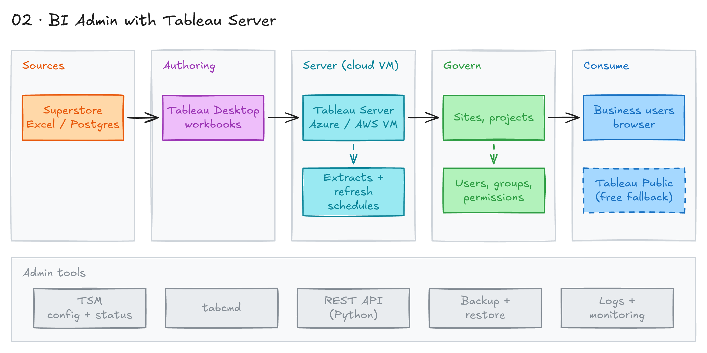

# BI Admin with Tableau Server



## Project card

| Level | Roles | Duration | Cost | Status |
|---|---|---|---|---|
| Intermediate | Data Analyst, BI Developer | 4 assignments, ~4-8 h each | Free trial | Ready |

## Goal

Most companies run a BI server. Few have a dedicated BI Admin, so a Data Analyst or BI Developer often does this job. In this project you plan, install, secure, and automate a Tableau Server for a fictional e-commerce company.

## What you will learn

- Core Tableau Desktop concepts: data sources, live vs extract, LOD, parameters.
- How to plan licenses, groups, projects, and permissions for 60 users.
- How to size and install Tableau Server on a cloud VM.
- How to publish workbooks and data sources, and schedule extract refreshes.
- How to automate admin work with `tabcmd`, Python (TSC), and the REST API.
- How to back up, monitor, and troubleshoot a BI server.

## Who it is for

- **Data Analyst**: you will often be the person who "owns" the BI server. This project shows you how.
- **BI Developer**: admin skills (security, performance, automation) are common interview topics.

## Tools and services

| Tool | Used for | Free option |
|---|---|---|
| Tableau Desktop | Build workbooks and publish them | trial (14 days) / student license |
| Tableau Server | Host dashboards, users, permissions | trial (14 days) |
| Tableau Public | Publish a portfolio dashboard | yes |
| Azure / AWS / GCP | VM to run Tableau Server | trial credits |
| RDP / SSH client | Connect to the VM | yes |
| tabcmd | Command line admin tasks | yes (with Server) |
| Tableau Server Client (Python) | Admin scripts in Python | yes |
| Tableau REST API | Admin automation over HTTP | yes (with Server) |

## Architecture

The diagram is at the top of this page. Source file: [`images/architecture.excalidraw`](images/architecture.excalidraw). Open it at [excalidraw.com](https://excalidraw.com) to copy or edit it.

Data flow:

1. Superstore data (Excel file or database) is the source.
2. You build workbooks in Tableau Desktop on your laptop.
3. You publish workbooks and data sources to Tableau Server on a cloud VM (Windows or Linux).
4. Tableau Server refreshes extracts on a schedule and applies groups, projects, and row-level security.
5. Users open dashboards in the browser. You manage the server with TSM, `tabcmd`, Python (TSC), and the REST API.
6. You also publish one portfolio dashboard to Tableau Public.

## Dataset

- **Source:** Sample - Superstore. It ships with Tableau Desktop. It is also in [project 01](../01-end-to-end-analytics-with-dbt-and-looker/data/).
- **Tables / entities:** Orders, People, Returns.
- **Size:** about 10,000 order rows.

## Prerequisites

**License.** Tableau is a paid product. Plan your license before you start.

| Option | What you get | Notes |
|---|---|---|
| Tableau Server trial | Full Server for 14 days | Download from [Tableau Server releases](https://www.tableau.com/support/releases/server). |
| Tableau Desktop trial | Full Desktop for 14 days | Download from [tableau.com](https://www.tableau.com/products/desktop/download). |
| [Tableau for Students](https://www.tableau.com/academic/students) | Desktop license for 1 year | Needs a student ID. Ask someone with a student ID, or use an old one if it is still valid. |
| [Tableau Public](https://public.tableau.com/) | Free Desktop app + free hosting | Free fallback. Data is public. No Server admin features. |
| Coursera Tableau courses | Some courses gave a license in the past | [Data Visualization and Communication with Tableau](https://www.coursera.org/learn/analytics-tableau), [Fundamentals of Visualization with Tableau](https://www.coursera.org/learn/data-visualization-tableau). |

**Tip:** Do Assignments 1-2 without a trial (Tableau Public is enough). Start the Server trial only when you begin Assignment 3. Then do Assignments 3 and 4 inside the same 14-day window.

Other things you need:

- A cloud account with free credits: Azure, AWS, or GCP.
- An RDP client (Windows VM) or SSH (Linux VM).
- Python 3 for Assignment 4.
- New to Git, CLI or Docker? Start with [Surfalytics Module 0](https://www.youtube.com/watch?v=LJIiCLu2gr8&list=PLNCDg7zJiXhP5Z_-TXUdorz2n7sjYHHKE&index=1).

## Assignments

Work at your own pace. Each assignment shows the expected time.

Document every step with screenshots. Use a `README.md` in your GitHub repo or a blog post on Medium.

### Assignment 1: Tableau basics and research (~5 h)

**Goal:** Learn the key Tableau concepts and choose your setup.

**Steps:**

1. Start the free course [Data Visualization and Communication with Tableau](https://www.coursera.org/learn/analytics-tableau). Focus on Tableau Desktop.
2. Answer these questions in your repo:
   - What is Tableau Desktop? How do you download it?
   - What options exist for Tableau Server? (Tableau Cloud vs self-hosted, Windows vs Linux.)
   - What are the [minimum hardware requirements](https://help.tableau.com/current/server/en-us/server_hardware_min.htm) for Tableau Server?
   - Which cloud (Azure, AWS, GCP) will you use for the Server VM? Why?
3. Create a [Tableau Public](https://public.tableau.com/) account. Tableau Public is a Tableau Server that Tableau manages for you.
4. On Tableau Public, find a Superstore dashboard you like. Download it. You will rebuild it in Assignment 2.
5. Make sure you understand these concepts:
   - Desktop / client
   - Dimension / measure, continuous / discrete
   - Data source / data model
   - Live connection / extract
   - Workbook / view / dashboard / story
   - Filters, sets, parameters
   - Calculated fields, LOD calculations

**Deliverable:** `research.md` with your answers and the link to the dashboard you chose.

**Done when:**

- [ ] All questions in step 2 have short answers.
- [ ] You have a Tableau Public account.
- [ ] You picked a Superstore dashboard to rebuild.
- [ ] You decided how you will get a license.

### Assignment 2: Rebuild a dashboard and plan the BI server (~6 h)

**Goal:** Publish a portfolio dashboard and write the requirements for the company BI server.

**Steps:**

1. Rebuild the Superstore dashboard from scratch. Use it as a model, do not copy it. Example of a [good result](https://public.tableau.com/app/profile/waqar.ahmed.shaikh/viz/SuperstoreOverviewDashboard_17090332693110/HomeLM).
2. Publish it to Tableau Public. Publishing to Tableau Public works the same way as publishing to Tableau Server.
3. Read about dashboard design. These two books are a must for a data career:
   - [The Big Book of Dashboards](https://www.tableau.com/big-book-dashboards)
   - [Information Dashboard Design](https://www.amazon.ca/Information-Dashboard-Design-At-Glance-dp-1938377001/dp/1938377001)
4. Use these company facts for the plan:

   | Fact | Value |
   |---|---|
   | Employees | 600 |
   | BI users | 60 (10%) |
   | Developers (Tableau Desktop) | 5: 3 in Data team, 1 in Product, 1 in Marketing |
   | Power users (create content on Server) | 10 |
   | Viewers (interact with dashboards) | 45 |
   | Departments | Product, Marketing, Sales, Finance, Customer Service, Engineering |

5. Read about [Tableau license types](https://help.tableau.com/current/blueprint/en-us/bp_license_management.htm). Map each user type to a license (Creator, Explorer, Viewer). Optional: estimate the license cost.
6. Write a role-based access plan. Create groups and roles. Assign users to them. Use a markdown table or a spreadsheet.
7. Define one project (folder) per department. Assign groups. Example: only Marketing users can see the Marketing project.
8. Plan [user filters](https://help.tableau.com/current/pro/desktop/en-us/publish_userfilters.htm) for Sales. Example: a Vancouver sales user sees only Vancouver data.
9. Size the server. Use the [minimum hardware requirements](https://help.tableau.com/current/server/en-us/server_hardware_min.htm) for Test and for Production. Pick a VM size. Use the cloud price calculator (for example, [Azure Pricing Calculator](https://azure.microsoft.com/en-us/pricing/calculator/)). Assume $200 of free credits. How many days can the Dev VM run?

**Deliverable:** Tableau Public link and `bi-server-plan.md` with licenses, groups, projects, user filters, and VM sizing.

**Done when:**

- [ ] Your dashboard is live on Tableau Public.
- [ ] Every one of the 60 users has a license type and a group.
- [ ] Every department has a project with group permissions.
- [ ] The Sales user filter is described.
- [ ] You have a VM size and a cost estimate for the credits.

### Assignment 3: Install Tableau Server and publish content (~8 h)

**Goal:** Install Tableau Server on a cloud VM and apply your security plan.

Start the 14-day Server trial now.

**Steps:**

1. Create a VM in the cloud that meets the [minimum hardware requirements](https://help.tableau.com/current/server/en-us/server_hardware_min.htm). Windows is easier. Linux is harder but good practice.
2. Connect to the VM. Windows: use an [RDP client](https://support.microsoft.com/en-us/windows/how-to-use-remote-desktop-5fe128d5-8fb1-7a23-3b8a-41e636865e8c). Linux: use SSH.
3. [Download Tableau Server](https://www.tableau.com/support/releases/server). Optional: install an older version first, so you can practice an upgrade later.
4. Follow the [install guide](https://help.tableau.com/current/server/en-us/install_config_top.htm).
5. Open the Tableau Server URL. Log in as the admin user.
6. Create groups and projects from your plan. Set permissions.
7. Add several users (local login and password). Log in as each one. Check that they see only what they should.
8. Publish from Tableau Desktop in three ways. Note the difference:
   1. Workbook with a live connection.
   2. Workbook with an extract. Schedule an extract refresh on the Server.
   3. Data source published on its own. Then a workbook that uses this published data source. Others can now reuse the data source.
9. Publish workbooks to different department projects (Marketing, Finance, Product).
10. Try these features:
    - [Data-driven alerts](https://help.tableau.com/current/server/en-us/data_alerts_admin.htm)
    - [Row-level security](https://help.tableau.com/current/server/en-us/rls_options_overview.htm)
    - [Sites](https://help.tableau.com/current/server/en-us/sites_intro.htm): create a second site.
    - [Certified data sources](https://help.tableau.com/current/pro/desktop/en-us/datasource_recommended.htm)
    - [Customize the server](https://help.tableau.com/current/server/en-us/customize.htm)
    - Send a dashboard to a Slack or Telegram channel with a webhook.
    - [Ask Data](https://www.tableau.com/learn/whitepapers/preparing-data-nlp-in-ask-data), if your version still has it.
11. Review the [Tableau features A to Z](https://www.tableau.com/blog/26-tableau-features-know-a-to-z) list. Check which ones you tried.

**Deliverable:** Screenshots and notes in your repo: install steps, groups, projects, permissions, and the three publish types.

**Done when:**

- [ ] Tableau Server runs and you can log in as admin.
- [ ] Groups, projects, and permissions match your plan.
- [ ] Test users see only their department content.
- [ ] You published a live workbook, an extract workbook with a schedule, and a published data source.
- [ ] Row-level security or a user filter works for Sales.

**Hints:** Typical BI Admin duties are good interview topics. They apply to most BI tools: create users, install updates, monitor performance and usage, manage security, write onboarding docs, run weekly office hours, and run a quarterly BI survey.

### Assignment 4: Automation, backup, and monitoring (~8 h)

**Goal:** Automate admin tasks and build a "Day in the Life of a BI Admin" playbook.

**Steps:**

1. **tabcmd.** Learn [tabcmd](https://help.tableau.com/current/server/en-us/tabcmd.htm). Write scripts to:
   - Publish a workbook.
   - Export a view to PDF.
   - Create users and groups.
   - Refresh an extract.
2. **Python (TSC).** Install [Tableau Server Client](https://tableau.github.io/server-client-python/):

   ```bash
   pip install tableauserverclient
   ```

   Write scripts to list workbooks and owners, download workbooks, manage users, and check server status.
3. **REST API.** Use the [Tableau REST API](https://help.tableau.com/current/api/rest_api/en-us/REST/rest_api.htm). Build a small app that signs in, lists sites, gets workbook info, and changes permissions.
4. **Backup and restore.** Read [backup and restore](https://help.tableau.com/current/server/en-us/backup_restore.htm).
   - Run a backup:

     ```bash
     tsm maintenance backup -f my_backup -d
     ```

   - Schedule regular backups.
   - Test a restore in a separate environment, if you can.
   - Write a retention policy and a disaster recovery plan.
5. **Monitoring.** Set up [server monitoring](https://help.tableau.com/current/server/en-us/monitor_server.htm):
   - Configure email alerts for system events.
   - Use [Admin Views](https://help.tableau.com/current/server/en-us/adminview.htm): Traffic to Views, Background Tasks for Extracts, Stats for Load Times, Server Disk Space.
   - Optional: install the [Resource Monitoring Tool (RMT)](https://help.tableau.com/current/server/en-us/rmt-intro.htm).
6. **Logs and troubleshooting.** Read the [logs overview](https://help.tableau.com/current/server/en-us/logs_working_with.htm). Collect logs:

   ```bash
   tsm maintenance ziplogs -d
   ```

   Check the Server Status page, Background Tasks, and Queue Status. See [troubleshooting](https://help.tableau.com/current/server/en-us/logs_loc.htm).
7. **Performance.** Use the Performance Recorder on a slow dashboard. See [workbook performance tips](https://help.tableau.com/current/pro/desktop/en-us/performance_tips.htm). Read about [server processes](https://help.tableau.com/current/server/en-us/processes.htm): topology, cache, extract refresh strategy.
8. **Sites and branding.** [Add sites](https://help.tableau.com/current/server/en-us/sites_add.htm). Move content between sites. [Customize](https://help.tableau.com/current/server/en-us/customize.htm) the logo and sign-in page.
9. **Final exercise.** Combine the above:
   - Scripts that check server health, make a daily report, manage user access, and run routine maintenance.
   - A monitoring dashboard: performance, user activity, extract refresh status, disk space.
   - A "Server Health Check" workbook: performance, usage, security audit, capacity planning.
   - A disaster recovery plan: backup steps, restore steps, contacts, escalation.

**Deliverable:** A "BI Admin Playbook" in your repo: scripts, backup and DR plan, monitoring dashboard screenshots, and best practices.

**Done when:**

- [ ] At least one `tabcmd` script and one Python (TSC) script work.
- [ ] One REST API call sequence works (sign in, list sites).
- [ ] You made a backup file with `tsm maintenance backup`.
- [ ] You collected logs with `tsm maintenance ziplogs`.
- [ ] The monitoring dashboard and the playbook are in your repo.

**Hints:** Know the other deployment options for interviews: [Tableau Server on Windows](https://help.tableau.com/current/server/en-us/install_config_top.htm), [Tableau Server on Linux](https://help.tableau.com/current/offline/en-gb/tableau_server_linux.pdf), [Tableau Cloud](https://www.tableau.com/products/cloud-bi). Also read about [distributed and high availability installs](https://help.tableau.com/current/server/en-us/distrib_ha.htm).

## Final result

- A Superstore dashboard on Tableau Public.
- A BI server plan: licenses, groups, projects, user filters, VM sizing.
- A working Tableau Server install with security, documented with screenshots.
- A BI Admin Playbook with scripts, backup, monitoring, and DR plan.
- Interview pitch: "I planned and installed Tableau Server for a 60-user company. I set up groups, projects, and row-level security. I automated user management and backups with tabcmd, Python, and the REST API."

## Clean up

- Stop the VM when you do not use it. A stopped VM costs less.
- When you finish, delete the VM, its disks, public IP, and network resources. On Azure, delete the whole resource group.
- Check the billing page the next day. Make sure nothing still runs.

## Resources

- [Tableau Server help](https://help.tableau.com/current/server/en-us/admin.htm): official admin docs.
- [Tableau Blueprint](https://help.tableau.com/current/blueprint/en-us/bp_overview.htm): how to plan a Tableau rollout.
- [Tableau Server Certified Associate](https://www.tableau.com/learn/certification/server-certified-associate): admin certification.
- [Tableau Community Forums](https://community.tableau.com/): ask other admins.

## Community solutions

Share your repo in Discord. We add the best ones here.

- <Name>: <link>
