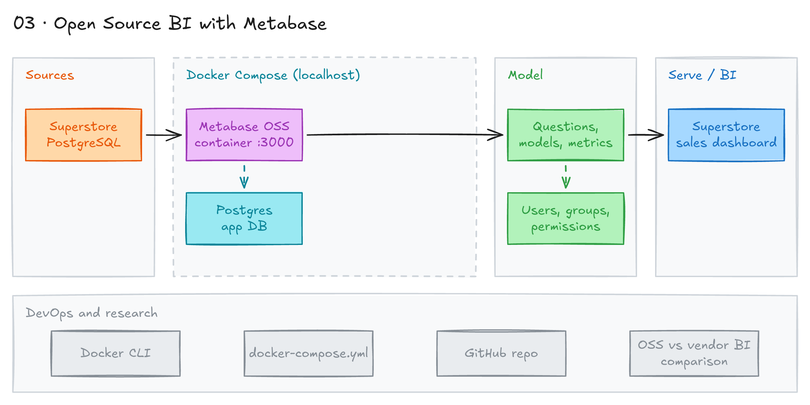

# Open Source BI with Metabase



## Project card

| Level | Roles | Duration | Cost | Status |
|---|---|---|---|---|
| Beginner | Data Analyst, BI Developer | 4 assignments, ~2-4 h each | Free | In progress |

## Goal

You joined a startup. It has a Superstore database in PostgreSQL and no budget for a vendor BI tool. You will run open-source Metabase, build a sales dashboard, and decide when open-source BI is the right choice.

## What you will learn

- How to run Metabase with Java, Docker, and Docker Compose.
- How to connect Metabase to PostgreSQL.
- How to build questions and dashboards in Metabase.
- How to manage users, groups, and permissions.
- Pros and cons of open-source BI vs vendor BI (Tableau, Looker, Power BI).

## Who it is for

- **Data Analyst**: small companies often use free BI tools. You may need to set one up yourself.
- **BI Developer**: you should know when open-source BI fits, and how to run it.

## Tools and services

| Tool | Used for | Free option |
|---|---|---|
| Metabase OSS | BI tool: questions and dashboards | yes |
| PostgreSQL | Superstore data and Metabase app database | yes |
| Docker / Docker Compose | Run Metabase and Postgres | yes |
| Java 11+ | Run Metabase as a JAR (optional) | yes |

The three most popular open-source BI tools:

| Tool | Development style | Link |
|---|---|---|
| Redash OSS | SQL-based | [redash.io](https://redash.io/) |
| Metabase OSS | SQL-based and no-code | [Metabase on Docker](https://www.metabase.com/docs/latest/installation-and-operation/running-metabase-on-docker) |
| Apache Superset | Python-based | [superset.apache.org](https://superset.apache.org/) |

Each one also has a managed cloud version. This project uses **Metabase**.

## Architecture

The diagram is at the top of this page. Source file: [`images/architecture.excalidraw`](images/architecture.excalidraw). Open it at [excalidraw.com](https://excalidraw.com) to copy or edit it.

Data flow:

1. Superstore data lives in PostgreSQL (local, in Docker, or in the cloud).
2. Metabase runs in a Docker container on your laptop.
3. Metabase stores its own settings (users, questions, dashboards) in a separate Postgres app database.
4. Metabase queries the Superstore database.
5. Users open dashboards in the browser at `http://localhost:3000`.

## Dataset

- **Source:** Superstore dataset in PostgreSQL from [Surfalytics Module 02](https://github.com/surfalytics/analytics-course/tree/main/02_getting_started_with_databases/02_connecting_databases).
- **Tables / entities:** Orders, People, Returns.
- **Size:** about 10,000 order rows.

## Prerequisites

- Docker Desktop installed.
- Superstore in PostgreSQL. Follow [Module 02](https://github.com/surfalytics/analytics-course/tree/main/02_getting_started_with_databases/02_connecting_databases).
- Optional: Java 11+ if you want to run Metabase as a JAR.
- New to Git, CLI or Docker? Start with [Surfalytics Module 0](https://www.youtube.com/watch?v=LJIiCLu2gr8&list=PLNCDg7zJiXhP5Z_-TXUdorz2n7sjYHHKE&index=1).

## Assignments

Work at your own pace. Each assignment shows the expected time.

### Assignment 1: Install and run Metabase (~2 h)

**Goal:** Get Metabase running on your machine. Try all three install options.

**Steps:**

1. **Option 1: Java (needs Java 11+).** Download the JAR and run it:

   ```bash
   # Download the JAR file
   wget https://downloads.metabase.com/v0.47.8/metabase.jar

   # Run Metabase
   java -jar metabase.jar
   ```

2. **Option 2: Docker.** See the [Metabase Docker docs](https://www.metabase.com/docs/latest/installation-and-operation/running-metabase-on-docker).

   ```bash
   docker pull metabase/metabase:latest

   docker run -d -p 3000:3000 --name metabase metabase/metabase

   # Watch the logs until Metabase is ready
   docker logs -f metabase
   ```

   Metabase opens at `http://localhost:3000`.

   To use another port, for example `12345`:

   ```bash
   docker run -d -p 12345:3000 --name metabase metabase/metabase
   ```

3. **Option 3: Docker Compose (preferred).** This setup uses Postgres as the Metabase app database. The same pattern works in production. Save this as `docker-compose.yml`:

   ```yaml
   services:
     metabase:
       image: metabase/metabase:latest
       container_name: metabase
       hostname: metabase
       volumes:
         - /dev/urandom:/dev/random:ro
       ports:
         - 3000:3000
       environment:
         MB_DB_TYPE: postgres
         MB_DB_DBNAME: metabaseappdb
         MB_DB_PORT: 5432
         MB_DB_USER: metabase
         MB_DB_PASS: mysecretpassword
         MB_DB_HOST: postgres
       networks:
         - metanet1
       healthcheck:
         test: curl --fail -I http://localhost:3000/api/health || exit 1
         interval: 15s
         timeout: 5s
         retries: 5
     postgres:
       image: postgres:latest
       container_name: postgres
       hostname: postgres
       environment:
         POSTGRES_USER: metabase
         POSTGRES_DB: metabaseappdb
         POSTGRES_PASSWORD: mysecretpassword
       networks:
         - metanet1
   networks:
     metanet1:
       driver: bridge
   ```

   Start it:

   ```bash
   docker compose up -d
   docker compose ps
   ```

4. Open `http://localhost:3000`. Create the admin account.
5. Decide where Superstore Postgres will run. Pick one:
   - Postgres with Superstore on your laptop. Metabase in Docker connects to it.
   - Add a Superstore Postgres service to the Docker Compose file.
   - Postgres in the cloud: a free [Neon](https://neon.com) project (no credit card). Load Superstore as in [project 01, Assignment 2](../01-end-to-end-analytics-with-dbt-and-looker/README.md#assignment-2-load-the-data-into-postgres-3-h). In Metabase, turn on SSL for the connection.

**Deliverable:** `docker-compose.yml` in your repo and a screenshot of the Metabase home page.

**Done when:**

- [ ] Metabase runs and opens at `http://localhost:3000`.
- [ ] You created the admin account.
- [ ] You know where your Superstore Postgres will run.

**Hints:** Stop the Option 2 container before you start Option 3. Both use port 3000. If Metabase in Docker must reach Postgres on your laptop, use host `host.docker.internal`, not `localhost`.

### Assignment 2: Connect Superstore and build a dashboard (Planned) (~4 h)

**Goal:** Connect Metabase to Superstore and build a sales dashboard.

**Steps:**

1. In Metabase, go to Admin settings > Databases. Add the Superstore Postgres database.
2. Build 4-6 questions with the query builder. Examples: sales by month, profit by region, top 10 products, return rate.
3. Write at least 2 questions in the SQL editor.
4. Combine the questions into a "Superstore Sales" dashboard. Add a date filter and a region filter.
5. Use the [dashboard docs](https://www.metabase.com/docs/latest/dashboards/introduction) for help.

**Deliverable:** Dashboard screenshot and your SQL in the repo.

**Done when:**

- [ ] Superstore is connected in Metabase.
- [ ] The dashboard has at least 4 charts and 2 filters.
- [ ] Filters change all charts.

### Assignment 3: Users, groups, and permissions (Planned) (~3 h)

**Goal:** Run Metabase like a small production setup with access control.

**Steps:**

1. Run Metabase with Docker Compose and the Postgres app database (Assignment 1, Option 3). Add Superstore Postgres to the same Compose file.
2. Create groups, for example Sales, Marketing, Finance. Add test users.
3. Set data and collection [permissions](https://www.metabase.com/docs/latest/permissions/introduction). Each group sees only its own collection.
4. Log in as a test user. Check what they can see.
5. Restart the stack with `docker compose down` and `docker compose up -d`. Check that dashboards and users are still there.

**Deliverable:** Final `docker-compose.yml` and a permissions table in the repo.

**Done when:**

- [ ] Metabase and both Postgres databases start with one command.
- [ ] Each group sees only its collection.
- [ ] Content is still there after a restart.

### Assignment 4: Open-source vs vendor BI (Planned) (~2 h)

**Goal:** Compare BI tools and know when to choose open source.

**Steps:**

1. Read the docs or try a quick start for [Apache Superset](https://superset.apache.org/) or [Redash](https://redash.io/).
2. Compare Metabase, Superset or Redash, and Tableau or Power BI. Use these points: cost, setup effort, features, security, scaling, support.
3. Write a short pros and cons doc. Add 2-3 use cases where open-source BI is a good fit.

**Deliverable:** `oss-vs-vendor-bi.md` in your repo.

**Done when:**

- [ ] The doc has a comparison table.
- [ ] The doc lists pros and cons for open source and for vendor BI.
- [ ] The doc has at least 2 use cases.

## Final result

- Metabase and Postgres running with Docker Compose.
- A Superstore sales dashboard with filters.
- Groups and permissions for departments.
- A short doc comparing open-source and vendor BI.
- Interview pitch: "I deployed Metabase with Docker Compose and a Postgres app database. I built a Superstore sales dashboard and set up group permissions. I can explain when open-source BI is a better choice than Tableau or Power BI."

## Clean up

Local project. Stop and remove the containers when you finish:

```bash
# Docker Compose setup (add -v to also delete the data volumes)
docker compose down

# Single container from Option 2
docker stop metabase
docker rm metabase
```

If you used a Neon project, you can keep it (Free plan) or delete it in the project **Settings**.

## Resources

- [Metabase docs](https://www.metabase.com/docs/latest/): official docs.
- [Running Metabase on Docker](https://www.metabase.com/docs/latest/installation-and-operation/running-metabase-on-docker): install options and app database settings.
- [Metabase Learn](https://www.metabase.com/learn/): free tutorials on questions and dashboards.
- [Apache Superset](https://superset.apache.org/) and [Redash](https://redash.io/): other open-source BI tools.

## Community solutions

Share your repo in Discord. We add the best ones here.

- <Name>: <link>
