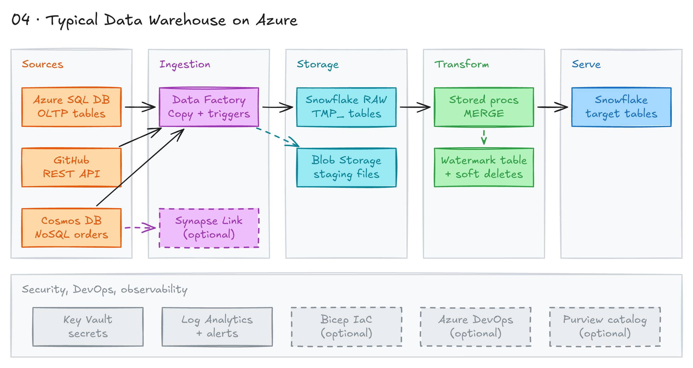

# Data Warehouse on Azure and Snowflake



## Project card

| Level | Roles | Duration | Cost | Status |
|---|---|---|---|---|
| Intermediate | Data Engineer, Analytics Engineer | 4 assignments, ~4-6 h each | Free trial | Ready |

## Goal

A company keeps its data in Azure: a SQL database, a NoSQL database and an external API. Analysts need all of it in one data warehouse. You will build ingestion pipelines with Azure Data Factory (ADF) that load this data into Snowflake, first as a full load, then as an incremental load.

## What you will learn

- Create Azure resources: Resource Group, Azure SQL, Blob Storage, Key Vault, ADF.
- Build ADF pipelines with linked services, datasets and the Copy activity.
- Build an incremental load with a watermark table and `MERGE`.
- Write Snowflake stored procedures for upserts and soft deletes.
- Ingest JSON from a REST API and from Cosmos DB.
- Monitor pipelines with Log Analytics and alert rules.

## Who it is for

- **Data Engineer**: this is a typical cloud ingestion stack. You build real batch pipelines.
- **Analytics Engineer**: you learn how raw data gets into the warehouse and how incremental logic works.

## Tools and services

| Tool | Used for | Free option |
|---|---|---|
| Azure Data Factory | Orchestration and Copy activity | trial |
| Azure SQL Database | Source relational database | trial |
| Azure Cosmos DB (NoSQL API) | Source NoSQL database | trial |
| Azure Blob Storage | Staging files for ADF and JSON dumps | trial |
| Azure Key Vault | Store passwords and keys | trial |
| Azure Log Analytics / Azure Monitor | Pipeline logs and alerts | trial |
| Azure Synapse Analytics (Synapse Link) | Analytics layer on top of Cosmos DB | trial |
| Snowflake | Target data warehouse, stored procedures | trial |
| GitHub REST API | External API source | yes |
| Azure Bicep, Azure DevOps, Azure Purview | Optional extras: IaC, CI/CD, data catalog | trial |

## Architecture

The diagram is at the top of this page. Source file: [`images/architecture.excalidraw`](images/architecture.excalidraw). Open it at [excalidraw.com](https://excalidraw.com) to copy or edit it.

Data flow:

1. Sources: Azure SQL (`orders`, `customers`, `products`), Cosmos DB (`orders_container`) and the GitHub REST API.
2. ADF reads secrets from Key Vault and reads each source with a Copy activity.
3. ADF stages the data as files in Blob Storage.
4. ADF loads the files into Snowflake `TMP_` tables in the `RAW` database.
5. A Snowflake stored procedure merges `TMP_` tables into final tables and writes a row to the watermark table.
6. ADF sends run logs to Log Analytics. Alert rules email you when a pipeline fails.

## Dataset

- **Source:** sample data. The SQL `INSERT` scripts and JSON documents are on this page.
- **Tables / entities:** `customers`, `products`, `orders` (Azure SQL), `orders` documents (Cosmos DB), commits (GitHub API).
- **Size:** about 10-20 rows per table. Small on purpose.

## Prerequisites

- An Azure account. New accounts get free credits.
- A Snowflake trial account. You can get up to 6 months of trial through [this Coursera course](https://www.coursera.org/learn/intro-generative-ai-course-snowflake).
- Basic SQL.
- New to Git, CLI or Docker? Start with [Surfalytics Module 0](https://www.youtube.com/watch?v=LJIiCLu2gr8&list=PLNCDg7zJiXhP5Z_-TXUdorz2n7sjYHHKE&index=1).

## Assignments

Work at your own pace. Each assignment shows the expected time.

### Assignment 1: Set up Azure and Snowflake, full load from Azure SQL (~5 h)

**Goal:** copy the Azure SQL `orders` table into Snowflake `RAW.azure_sql.orders` with ADF.

**Steps:**

1. Create Azure resources. Follow the [Azure naming convention](https://learn.microsoft.com/en-us/azure/cloud-adoption-framework/ready/azure-best-practices/resource-naming).
   - Resource Group. Put all resources of this project in it.
   - Azure SQL Database (with a SQL Server).
   - Azure Key Vault for credentials.
   - Azure Blob Storage for ADF staging.
   - Azure Data Factory.
2. In Snowflake, create the target database and schema:

   ```sql
   CREATE DATABASE IF NOT EXISTS RAW;
   CREATE SCHEMA IF NOT EXISTS RAW.azure_sql;
   ```

3. In Azure SQL, create the source tables:

   ```sql
   CREATE TABLE customers (
       customer_id INT PRIMARY KEY,
       name VARCHAR(100),
       email VARCHAR(100),
       created_at DATETIME
   );

   CREATE TABLE products (
       product_id INT PRIMARY KEY,
       name VARCHAR(100),
       category VARCHAR(50),
       price DECIMAL(10,2),
       created_at DATETIME
   );

   CREATE TABLE orders (
       order_id INT PRIMARY KEY,
       customer_id INT,
       product_id INT,
       quantity INT,
       total_price DECIMAL(10,2),
       created_at DATETIME,
       updated_at DATETIME
   );
   ```

4. Insert sample data. `orders` has different `updated_at` values. You need them later for incremental loads.

   ```sql
   INSERT INTO customers (customer_id, name, email, created_at) VALUES
   (1, 'Alice Johnson', 'alice.j@example.com', '2023-01-10 08:23:45'),
   (2, 'Bob Smith', 'bob.smith@example.com', '2023-01-12 14:11:09'),
   (3, 'Charlie Davis', 'charlie.d@example.com', '2023-01-15 09:37:22'),
   (4, 'Diana Cruz', 'diana.c@example.com', '2023-02-01 17:02:18'),
   (5, 'Ethan Lee', 'ethan.l@example.com', '2023-02-10 11:45:30');

   INSERT INTO products (product_id, name, category, price, created_at) VALUES
   (101, 'Laptop Pro 15"', 'Electronics', 1499.99, '2023-01-01 10:05:10'),
   (102, 'Wireless Mouse', 'Accessories', 29.99, '2023-01-03 15:25:40'),
   (103, 'Noise Cancelling Headphones', 'Electronics', 199.95, '2023-01-05 12:14:50'),
   (104, 'Office Desk', 'Furniture', 299.99, '2023-01-08 09:09:09'),
   (105, 'LED Monitor 24"', 'Electronics', 159.99, '2023-01-09 18:30:00');

   INSERT INTO orders (order_id, customer_id, product_id, quantity, total_price, created_at, updated_at) VALUES
   (1001, 1, 101, 1, 1499.99, '2023-01-11 10:15:23', '2023-01-11 12:45:30'),
   (1002, 2, 102, 2, 59.98, '2023-01-13 08:20:40', '2023-01-15 09:10:15'),
   (1003, 3, 103, 1, 199.95, '2023-01-16 14:50:10', '2023-01-18 16:22:55'),
   (1004, 4, 104, 1, 299.99, '2023-02-02 13:14:00', '2023-02-02 13:14:00'),
   (1005, 5, 105, 2, 319.98, '2023-02-12 11:11:11', '2023-02-14 15:01:20'),
   (1006, 1, 102, 3, 89.97, '2023-03-01 07:07:07', '2023-03-04 08:08:08');
   ```

5. In ADF, create linked services:
   - Azure SQL Database. Read the password from Key Vault.
   - Azure Blob Storage.
   - Snowflake. Read the password from Key Vault.
6. Create datasets: source = Azure SQL `orders`, sink = Snowflake `RAW.azure_sql.orders`.
7. Create a pipeline with a Copy Data activity. Turn on staging and point it to Blob Storage.
8. Run the pipeline. This is a full load.

**Deliverable:** screenshot of a successful ADF run and a `SELECT` from `RAW.azure_sql.orders`. Export the pipeline JSON to your repo.

**Done when:**

- [ ] All Azure resources are in one Resource Group.
- [ ] No passwords are typed into linked services. They come from Key Vault.
- [ ] `RAW.azure_sql.orders` has 6 rows.

**Hints:** give ADF's managed identity access to Key Vault (role `Key Vault Secrets User`). Allow Azure services in the Azure SQL firewall.

### Assignment 2: Incremental load with a watermark table (~6 h)

**Goal:** load only new and changed rows from Azure SQL into Snowflake. The pipeline must be safe to run many times (idempotent).

**Steps:**

1. For each table (`orders`, `customers`, `products`), create two Snowflake tables:
   - `TMP_` table: raw increment. Truncate it before each load.
   - Final table: clean data plus the audit column `etl_timestamp_utc`.

   Example for `orders`. Repeat for the other two tables.

   ```sql
   CREATE OR REPLACE TABLE raw.azure_sql.tmp_orders (
       order_id INT,
       customer_id INT,
       product_id INT,
       quantity INT,
       total_price DECIMAL(10,2),
       created_at DATETIME,
       updated_at DATETIME
   );

   CREATE OR REPLACE TABLE raw.azure_sql.orders (
       order_id INT PRIMARY KEY,
       customer_id INT,
       product_id INT,
       quantity INT,
       total_price DECIMAL(10,2),
       created_at DATETIME,
       updated_at DATETIME,
       etl_timestamp_utc TIMESTAMP_LTZ DEFAULT CURRENT_TIMESTAMP()
   );
   ```

2. Create the `config` schema, the watermark table and a procedure to insert into it:

   ```sql
   CREATE SCHEMA IF NOT EXISTS raw.config;

   CREATE OR REPLACE TABLE raw.config.watermark (
       pipeline_name STRING,
       schema_name STRING,
       table_name STRING,
       last_created_at TIMESTAMP_NTZ,
       last_updated_at TIMESTAMP_NTZ,
       pipeline_start_ts TIMESTAMP_NTZ,
       pipeline_end_ts TIMESTAMP_NTZ,
       source STRING,
       target STRING
   );

   CREATE OR REPLACE PROCEDURE raw.config.sp_insert_watermark(
       p_pipeline_name STRING,
       p_schema_name STRING,
       p_table_name STRING,
       p_last_created_at TIMESTAMP_NTZ,
       p_last_updated_at TIMESTAMP_NTZ,
       p_pipeline_start_ts TIMESTAMP_NTZ,
       p_pipeline_end_ts TIMESTAMP_NTZ,
       p_source STRING,
       p_target STRING
   )
   RETURNS STRING
   LANGUAGE SQL
   AS
   $$
       INSERT INTO raw.config.watermark (
           pipeline_name, schema_name, table_name,
           last_created_at, last_updated_at,
           pipeline_start_ts, pipeline_end_ts,
           source, target
       )
       VALUES (
           p_pipeline_name, p_schema_name, p_table_name,
           p_last_created_at, p_last_updated_at,
           p_pipeline_start_ts, p_pipeline_end_ts,
           p_source, p_target
       );
       RETURN 'WATERMARK INSERTED SUCCESSFULLY';
   $$;
   ```

3. Create a merge procedure. It merges the `TMP_` table into the final table on the primary key. Repeat for `customers` and `products`.

   ```sql
   CREATE OR REPLACE PROCEDURE raw.azure_sql.sp_merge_orders()
   RETURNS STRING
   LANGUAGE SQL
   AS
   $$
   MERGE INTO raw.azure_sql.orders AS target
   USING raw.azure_sql.tmp_orders AS source
   ON target.order_id = source.order_id
   WHEN MATCHED THEN
       UPDATE SET
           customer_id = source.customer_id,
           product_id = source.product_id,
           quantity = source.quantity,
           total_price = source.total_price,
           created_at = source.created_at,
           updated_at = source.updated_at,
           etl_timestamp_utc = CURRENT_TIMESTAMP()
   WHEN NOT MATCHED THEN
       INSERT (order_id, customer_id, product_id, quantity, total_price,
               created_at, updated_at, etl_timestamp_utc)
       VALUES (source.order_id, source.customer_id, source.product_id,
               source.quantity, source.total_price, source.created_at,
               source.updated_at, CURRENT_TIMESTAMP());
   $$;

   CALL raw.azure_sql.sp_merge_orders();
   ```

4. Build the ADF pipeline with these activities:
   1. Lookup: read the last timestamps for this table from `raw.config.watermark`. Save them to ADF variables.
   2. Copy: query Azure SQL with `WHERE updated_at > <last watermark>`. Pre-copy script: `TRUNCATE TABLE` on the `TMP_` table. Sink: the `TMP_` table.
   3. Script or stored procedure activity: `CALL raw.azure_sql.sp_merge_orders()`.
   4. Lookup: read the new max `created_at` and `updated_at` from the final table.
   5. Call `raw.config.sp_insert_watermark` with ADF variables, not hard-coded values. Example of the call:

      ```sql
      CALL raw.config.sp_insert_watermark(
          'orders_pipeline',
          'raw.azure_sql',
          'orders',
          '2023-01-15 00:00:00',
          '2023-01-18 00:00:00',
          CURRENT_TIMESTAMP(),
          CURRENT_TIMESTAMP(),
          'azure_sql',
          'snowflake_raw'
      );
      ```

5. Use parameters for pipeline name, table name and schema. One pipeline should work for all three tables.
6. Test the pipeline:
   1. Make sure the new tables are empty.
   2. Insert a first watermark row with an old date:

      ```sql
      INSERT INTO raw.config.watermark (
          pipeline_name, schema_name, table_name,
          last_created_at, last_updated_at,
          pipeline_start_ts, pipeline_end_ts,
          source, target
      )
      VALUES (
          'orders_pipeline', 'raw.azure_sql', 'orders',
          '2000-01-15 00:00:00', '2000-01-18 00:00:00',
          CURRENT_TIMESTAMP(), CURRENT_TIMESTAMP(),
          'azure_sql', 'snowflake'
      );
      ```

   3. Run the pipeline in Debug mode. Fix errors.
   4. Add new rows in Azure SQL. Run again. Only the new rows should load.

      ```sql
      INSERT INTO orders (order_id, customer_id, product_id, quantity, total_price, created_at, updated_at) VALUES
      (1017, 6, 106, 1, 499.99, '2023-03-06 10:10:10', '2023-03-06 10:12:15'),
      (1018, 7, 107, 2, 159.98, '2023-03-07 11:15:20', '2023-03-07 12:00:00'),
      (1019, 8, 108, 1, 349.99, '2023-03-08 14:45:50', '2023-03-08 15:20:10'),
      (1020, 9, 109, 1, 229.99, '2023-03-09 09:35:05', '2023-03-09 10:10:20'),
      (1021, 10, 110, 3, 299.97, '2023-03-10 13:50:40', '2023-03-10 14:15:55');

      INSERT INTO products (product_id, name, category, price, created_at) VALUES
      (106, 'Standing Desk', 'Furniture', 499.99, '2023-02-20 10:10:10'),
      (107, 'Bluetooth Keyboard', 'Accessories', 79.99, '2023-02-22 13:25:00'),
      (108, '4K Ultra HD Monitor', 'Electronics', 349.99, '2023-02-24 15:45:15'),
      (109, 'Ergonomic Chair', 'Furniture', 229.99, '2023-02-26 09:55:30'),
      (110, 'Webcam HD 1080p', 'Accessories', 99.99, '2023-02-28 17:05:45');

      INSERT INTO customers (customer_id, name, email, created_at) VALUES
      (6, 'Fiona Gallagher', 'fiona.g@example.com', '2023-03-01 09:30:25'),
      (7, 'George Martin', 'george.m@example.com', '2023-03-02 16:45:50'),
      (8, 'Hannah Price', 'hannah.p@example.com', '2023-03-03 14:20:35'),
      (9, 'Ian Wright', 'ian.w@example.com', '2023-03-04 11:15:05'),
      (10, 'Julia Roberts', 'julia.r@example.com', '2023-03-05 13:40:55');
      ```

7. Add a Schedule trigger (for example, daily at 02:00 UTC).
8. Set up monitoring:
   - Data Factory → Monitoring → Diagnostic settings. Send `PipelineRuns` and `ActivityRuns` logs to Log Analytics.
   - Azure Monitor → Alerts → Create alert rule. Resource: your Data Factory. Condition: metric `Pipeline failed runs`. Action group: email.

**Deliverable:** pipeline JSON and all SQL scripts in your repo. Screenshot of the watermark table after two runs.

**Done when:**

- [ ] The second run loads only the 5 new orders.
- [ ] Running the pipeline twice in a row does not create duplicates.
- [ ] The watermark table has one row per run.
- [ ] A failed run sends you an email.

**Hints:**

- Use `MERGE` because old orders can change (`updated_at` moves). For event tables that never change, `DELETE+INSERT` is a simpler option.
- ADF trigger types are a common interview question:

| Trigger type | When to use |
|---|---|
| Schedule | Fixed schedule, for example daily at 02:00 UTC |
| Tumbling window | Fixed time windows that do not overlap, for example hourly loads |
| Storage event | Start when a file lands in Blob Storage |
| Manual | Ad-hoc runs and tests, from the UI or API |
| Dependency (tumbling window) | Start after another pipeline window finishes |

### Assignment 3: Soft deletes and REST API ingestion (~4 h)

**Goal:** flag customers deleted in the source. Load JSON from the GitHub API into Snowflake.

**Steps:**

1. Add delete columns to the final `customers` table:

   ```sql
   ALTER TABLE raw.azure_sql.customers
   ADD COLUMN is_deleted BOOLEAN DEFAULT FALSE,
   ADD COLUMN deleted_ts TIMESTAMP_LTZ;
   ```

2. Switch `customers` to a full load into `tmp_customers`. Soft deletes only work when `TMP_` has the full source.
3. Replace the merge procedure. It upserts rows, then flags rows that are missing in `TMP_`:

   ```sql
   CREATE OR REPLACE PROCEDURE raw.azure_sql.sp_merge_customers()
   RETURNS STRING
   LANGUAGE SQL
   AS
   $$
   BEGIN
       -- Step 1: upsert
       MERGE INTO raw.azure_sql.customers AS target
       USING raw.azure_sql.tmp_customers AS source
       ON target.customer_id = source.customer_id
       WHEN MATCHED THEN
           UPDATE SET
               name = source.name,
               email = source.email,
               created_at = source.created_at,
               is_deleted = FALSE,
               deleted_ts = NULL,
               etl_timestamp_utc = CURRENT_TIMESTAMP()
       WHEN NOT MATCHED THEN
           INSERT (customer_id, name, email, created_at,
                   is_deleted, deleted_ts, etl_timestamp_utc)
           VALUES (source.customer_id, source.name, source.email, source.created_at,
                   FALSE, NULL, CURRENT_TIMESTAMP());

       -- Step 2: flag soft deletes
       UPDATE raw.azure_sql.customers
       SET is_deleted = TRUE,
           deleted_ts = CURRENT_TIMESTAMP()
       WHERE is_deleted = FALSE
         AND customer_id NOT IN (SELECT customer_id FROM raw.azure_sql.tmp_customers);

       RETURN 'CUSTOMERS MERGED';
   END;
   $$;
   ```

4. Test: delete one `customer_id` in Azure SQL. Run the pipeline. Check that the row has `is_deleted = TRUE`.
5. Test the GitHub API in your terminal:

   ```bash
   curl -s "https://api.github.com/repos/octocat/Hello-World/commits?per_page=100"
   ```

6. In ADF, create a REST linked service and dataset:
   - URL: `https://api.github.com/repos/octocat/Hello-World/commits?per_page=100`
   - Method: `GET`
   - Copy the response to Blob Storage as a JSON file.
7. Load the JSON file into a Snowflake table with a `VARIANT` column (Copy activity or `COPY INTO`).
8. Parse it with `LATERAL FLATTEN`. Extract commit SHA, author, date and message into a view or table.

**Deliverable:** updated procedure, ADF pipeline JSON and the parsing SQL in your repo.

**Done when:**

- [ ] The deleted customer is still in Snowflake with `is_deleted = TRUE`.
- [ ] If the customer comes back in the source, `is_deleted` goes back to `FALSE`.
- [ ] GitHub commits are in Snowflake as rows with typed columns.

**Hints:** a multi-statement Snowflake SQL procedure needs a `BEGIN ... END` block. The GitHub API has a rate limit of 60 requests per hour without a token.

### Assignment 4: Cosmos DB to Snowflake (~5 h)

**Goal:** load JSON documents from Cosmos DB into Snowflake with the same watermark pattern.

Cosmos DB is a NoSQL document database for OLTP apps. Data teams often treat it as a source and copy it to an analytics system. Read the [Cosmos DB overview](https://learn.microsoft.com/en-us/azure/cosmos-db/introduction).

**Steps:**

1. Azure Portal → Create a resource → **Azure Cosmos DB for NoSQL**.
   - Resource Group: the project group.
   - Account name: for example `cosmos-dw-week4`.
   - Capacity mode: Provisioned throughput. Turn on the free tier discount if offered.
2. Data Explorer → New Container:
   - Database: `orders_db`
   - Container: `orders_container`
   - Partition key: `/customer_id`
   - Throughput: 400 RU/s
3. Add 5-10 documents with different `id`, `customer_id`, `status` and `order_date`:

   ```json
   {
     "id": "order_1001",
     "customer_id": "cust_01",
     "product_id": "prod_01",
     "quantity": 2,
     "total_price": 199.98,
     "order_date": "2023-03-05T14:30:00Z",
     "status": "Shipped"
   }
   ```

4. In Snowflake, create schema `RAW.cosmosdb` with tables `tmp_orders` and `orders`. Write a merge procedure for them.
5. In ADF, create a Cosmos DB linked service (account key from Key Vault) and a dataset on `orders_db.orders_container`.
6. Create a pipeline: Copy Cosmos DB → `RAW.cosmosdb.tmp_orders`, then merge, then write the watermark. Use the system field `_ts` or `order_date` as the watermark.
7. Optional: turn on [Synapse Link for Cosmos DB](https://learn.microsoft.com/en-us/azure/cosmos-db/configure-synapse-link). Query the container from Synapse and load from there. Read [what Synapse Link is](https://learn.microsoft.com/en-us/azure/cosmos-db/synapse-link) first.

**Deliverable:** Cosmos DB setup screenshot, pipeline JSON and Snowflake SQL in your repo.

**Done when:**

- [ ] `orders_container` has at least 5 documents.
- [ ] `RAW.cosmosdb.orders` has the same rows.
- [ ] A new document in Cosmos DB loads on the next run with no duplicates.
- [ ] Optional: a Synapse query reads live data from the container.

**Hints:** check the Microsoft docs before you start Synapse Link. Microsoft is moving this feature toward Fabric Mirroring, and new accounts may not have it.

### Optional extras

- **Azure Bicep:** describe all resources as code. Deploy with `az deployment group create`.
- **Azure DevOps:** keep ADF in Git (Repos). Deploy with Pipelines.
- **Azure Purview:** scan Azure SQL and Snowflake. Look at lineage.

## Final result

- Four ADF pipelines that load Azure SQL, the GitHub API and Cosmos DB into Snowflake.
- Incremental loads with a watermark table, `MERGE` and soft deletes.
- Alerts on failed runs.
- GitHub: SQL scripts, pipeline JSON, architecture diagram and screenshots. LinkedIn: a short post with the diagram.
- Interview pitch: "I built batch ingestion on Azure with Data Factory into Snowflake. Loads are incremental and idempotent. They use a watermark table and `MERGE` stored procedures. I also handled soft deletes and JSON from an API and Cosmos DB."

## Clean up

Azure and Snowflake charge you after the free credits end. Cosmos DB, Azure SQL and Synapse charge per hour even when idle.

1. Azure Portal → Resource groups → your project group → **Delete resource group**. This deletes everything inside it.
2. Check Cost Management the next day. Make sure no resources are left.
3. In Snowflake, suspend or drop your warehouse. Drop the `RAW` database if you do not need it.

## Resources

- [ADF Copy activity](https://learn.microsoft.com/en-us/azure/data-factory/copy-activity-overview): how copy and staging work.
- [ADF incremental copy tutorial](https://learn.microsoft.com/en-us/azure/data-factory/tutorial-incremental-copy-overview): the official watermark pattern.
- [ADF Snowflake connector](https://learn.microsoft.com/en-us/azure/data-factory/connector-snowflake): linked service settings.
- [Snowflake MERGE](https://docs.snowflake.com/en/sql-reference/sql/merge): syntax and examples.
- [Snowflake Scripting procedures](https://docs.snowflake.com/en/developer-guide/stored-procedure/stored-procedures-snowflake-scripting): how to write SQL procedures.
- [Azure naming convention](https://learn.microsoft.com/en-us/azure/cloud-adoption-framework/ready/azure-best-practices/resource-naming): resource names.

## Community solutions

Share your repo in Discord. We add the best ones here.

- <Name>: <link>
