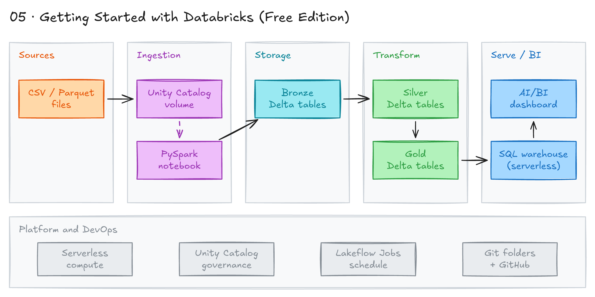

# Getting Started with Databricks



## Project card

| Level | Roles | Duration | Cost | Status |
|---|---|---|---|---|
| Base | Data Engineer, Analytics Engineer | 4 assignments, ~3-4 h each | Free | In progress |

## Goal

Learn the Databricks platform step by step. You will load files, transform them with PySpark, store them as Delta tables, query them with SQL and schedule the pipeline. Everything runs in the free Databricks Free Edition.

## What you will learn

- Navigate a Databricks workspace: notebooks, compute, Catalog, SQL editor.
- Read and write data with PySpark.
- Compare Parquet and Delta tables.
- Build a medallion pipeline (bronze, silver, gold).
- Use Unity Catalog, volumes, a SQL warehouse and a dashboard.
- Schedule a pipeline with Jobs.

## Who it is for

- **Data Engineer**: Databricks and Spark are in many job posts. This is your first hands-on step.
- **Analytics Engineer**: you learn the lakehouse and how to serve data with Databricks SQL.

## Tools and services

| Tool | Used for | Free option |
|---|---|---|
| Databricks Free Edition | Workspace, serverless compute, storage | yes |
| Apache Spark / PySpark | Read and transform data | yes |
| Delta Lake | Table format with ACID transactions | yes |
| Unity Catalog | Catalogs, schemas, tables, volumes, permissions | yes |
| Databricks SQL | SQL warehouse, SQL editor, dashboards | yes |
| Lakeflow Jobs (Workflows) | Schedule notebooks | yes |

Short background:

- **Apache Spark** is an open-source engine for distributed data processing: batch, streaming, SQL and ML.
- Spark works in memory, so it is much faster than MapReduce.
- **PySpark** is the Python API for Spark. Spark also has Scala, Java and R APIs.
- **Databricks** is a managed platform built on Spark. It adds notebooks, managed compute, Delta Lake, Unity Catalog and MLflow.
- **Delta Lake** adds ACID transactions and time travel to files in a data lake.

Read more: [Apache Spark overview](https://spark.apache.org/docs/latest/) and [What is Databricks?](https://docs.databricks.com/aws/en/introduction/).

## Architecture

The diagram is at the top of this page. Source file: [`images/architecture.excalidraw`](images/architecture.excalidraw). Open it at [excalidraw.com](https://excalidraw.com) to copy or edit it.

Data flow:

1. You upload CSV files to a Unity Catalog volume.
2. A PySpark notebook reads the files into a bronze Delta table.
3. A second notebook cleans the data into a silver table and aggregates it into a gold table.
4. A SQL warehouse queries the gold table. A dashboard shows the results.
5. A Job runs the notebooks on a schedule.

## Dataset

- **Source:** any public CSV dataset. Good options: the built-in `samples` catalog (for example `samples.nyctaxi.trips`) or the Superstore files from [project 01](../01-end-to-end-analytics-with-dbt-and-looker/data/).
- **Tables / entities:** depends on your choice. For Superstore: orders, people, returns.
- **Size:** a few MB. Small files are fine.

## Prerequisites

- A Databricks Free Edition account. Sign up below in Assignment 1. No credit card needed.
- Basic Python and SQL.
- New to Git, CLI or Docker? Start with [Surfalytics Module 0](https://www.youtube.com/watch?v=LJIiCLu2gr8&list=PLNCDg7zJiXhP5Z_-TXUdorz2n7sjYHHKE&index=1).

## Assignments

Work at your own pace. Each assignment shows the expected time.

### Assignment 1: First steps in Databricks Free Edition (~3 h)

**Goal:** create a workspace, load a file, transform it with PySpark and query it with SQL.

Databricks Community Edition was retired in 2025. Databricks Free Edition replaced it. Free Edition limits:

- Serverless compute only. You cannot create your own clusters.
- One SQL warehouse, size 2X-Small.
- Up to 5 job tasks at the same time.
- Python and SQL only. No R or Scala.
- Outbound internet access only to a list of trusted domains.
- No commercial use.

**Steps:**

1. Sign up for [Databricks Free Edition](https://login.databricks.com/?dbx_source=docs&intent=CE_SIGN_UP). See also the [Free Edition docs](https://docs.databricks.com/aws/en/getting-started/free-edition).
2. Explore the left menu: Workspace, Catalog, Compute, SQL Editor, Jobs & Pipelines.
3. Open Compute. Note that you use serverless compute and SQL warehouses, not your own cluster. Spark is already installed.
4. In Catalog, open the `workspace` catalog. Create a schema, for example `workspace.bronze`. Create a volume in it.
5. Upload a CSV file to the volume. (Older guides use DBFS for uploads. In Free Edition, use volumes.)
6. Create a notebook. Read the CSV with PySpark and do a simple transform:

   ```python
   df = (spark.read
         .option("header", True)
         .option("inferSchema", True)
         .csv("/Volumes/workspace/bronze/raw_files/orders.csv"))

   df_clean = df.dropDuplicates().withColumnRenamed("Order ID", "order_id")
   display(df_clean)
   ```

7. Save the result two times. Once as a Parquet table, once as a Delta table:

   ```python
   df_clean.write.format("parquet").mode("overwrite").saveAsTable("workspace.bronze.orders_parquet")
   df_clean.write.format("delta").mode("overwrite").saveAsTable("workspace.bronze.orders_delta")
   ```

8. Compare the two tables:

   ```sql
   DESCRIBE DETAIL workspace.bronze.orders_parquet;
   DESCRIBE DETAIL workspace.bronze.orders_delta;
   DESCRIBE HISTORY workspace.bronze.orders_delta;
   ```

9. Open the SQL Editor. Query the Delta table with the SQL warehouse. Build one simple visualization from the result.

**Deliverable:** export your notebook (`.ipynb` or `.py`) to your repo. Add screenshots of the Catalog and the SQL Editor.

**Done when:**

- [ ] You have a Free Edition workspace.
- [ ] The CSV is in a volume.
- [ ] Two tables exist: one Parquet, one Delta.
- [ ] You can explain one difference between them (for example, `DESCRIBE HISTORY` works only on Delta).
- [ ] A SQL query runs on the SQL warehouse.

**Hints:**

- Change the column names in the code to match your file. Delta does not allow spaces in column names by default.
- Find the table storage path with `DESCRIBE DETAIL` (`location` column). In Free Edition you may not have direct access to these files.
- Old tasks used an `EXTERNAL` table on your own S3 bucket. Free Edition limits outbound access, so use managed tables here.

### Assignment 2 (Planned): Delta Lake and medallion architecture (~4 h)

**Goal:** build bronze, silver and gold Delta tables with PySpark.

**Steps:**

1. Create schemas `bronze`, `silver` and `gold` in the `workspace` catalog.
2. Bronze: load raw CSV files from the volume as they are. Add `ingest_ts` and source file name columns.
3. Silver: clean the data. Fix types, remove duplicates, handle nulls. Use `MERGE` to upsert new rows.
4. Gold: build one aggregated table, for example sales by month and region.
5. Try Delta features: `DESCRIBE HISTORY`, time travel with `VERSION AS OF`, and `OPTIMIZE`.

**Deliverable:** three notebooks (bronze, silver, gold) in your repo.

**Done when:**

- [ ] Three layers exist with at least one table each.
- [ ] Running the silver notebook twice does not create duplicates.

### Assignment 3 (Planned): Unity Catalog, SQL warehouse and a dashboard (~3 h)

**Goal:** organize data in Unity Catalog and show the gold table in a dashboard.

**Steps:**

1. Learn the Unity Catalog levels: catalog → schema → table / view / volume.
2. Add table and column comments. Create a view on top of the gold table.
3. Grant `SELECT` on the gold schema to another user or group. Check the permissions in Catalog.
4. Query the gold table in the SQL Editor with the SQL warehouse.
5. Build an AI/BI dashboard with 2-3 charts.

**Deliverable:** SQL scripts in your repo and a dashboard screenshot.

**Done when:**

- [ ] Tables have comments.
- [ ] The dashboard shows data from the gold layer.

### Assignment 4 (Planned): Schedule the pipeline with Jobs (~3 h)

**Goal:** run the medallion pipeline on a schedule.

**Steps:**

1. Open Jobs & Pipelines. Create a job.
2. Add three tasks: bronze → silver → gold. Set the dependencies.
3. Add a job parameter, for example the run date. Read it in the notebooks.
4. Add a daily schedule and an email alert on failure.
5. Run the job. Check the run history and task logs.

**Deliverable:** job definition (JSON or YAML export) in your repo and a screenshot of a successful run.

**Done when:**

- [ ] The job runs all three tasks in order.
- [ ] A failed task sends you an email.

## Final result

- A Databricks lakehouse with bronze, silver and gold Delta tables.
- A dashboard on the gold layer.
- A scheduled job that refreshes the data.
- GitHub: notebooks, SQL, job definition and screenshots. LinkedIn: a short post with the diagram.
- Interview pitch: "I built a medallion pipeline in Databricks with PySpark and Delta Lake. Data is governed in Unity Catalog and served with a SQL warehouse dashboard. A Databricks job runs it every day."

## Clean up

Nothing to clean up. Free Edition does not charge you. Stop or delete the job schedule if you do not need it.

## Resources

- [Databricks Free Edition](https://docs.databricks.com/aws/en/getting-started/free-edition): what is included.
- [Free Edition limitations](https://docs.databricks.com/aws/en/getting-started/free-edition-limitations): what you cannot do.
- [Unity Catalog volumes](https://docs.databricks.com/aws/en/volumes/): how to store and read files.
- [Delta Lake on Databricks](https://docs.databricks.com/aws/en/delta/): table format docs.
- [Medallion architecture](https://docs.databricks.com/aws/en/lakehouse/medallion): bronze, silver, gold.
- [PySpark API](https://spark.apache.org/docs/latest/api/python/): Python reference.

## Community solutions

Share your repo in Discord. We add the best ones here.

- <Name>: <link>
