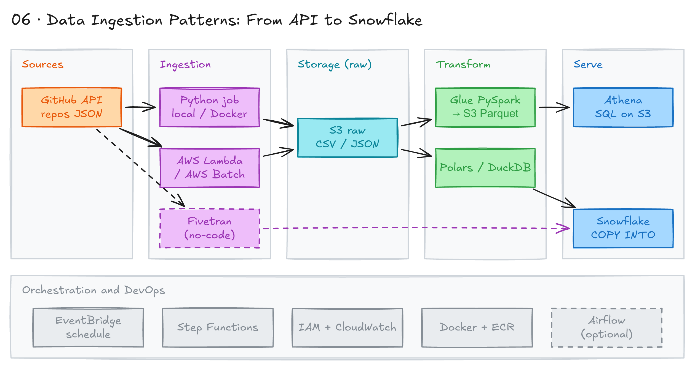

# Data Ingestion Patterns: From API to Snowflake



## Project card

| Level | Roles | Duration | Cost | Status |
|---|---|---|---|---|
| Middle | Data Engineer, Analytics Engineer | 6 assignments, ~4-8 h each | Free trial | Ready |

## Goal

You load GitHub API data into Snowflake. You do it in several ways: local Python, Docker, AWS Lambda, AWS Batch, AWS Glue and Fivetran. At the end you compare the approaches by cost, speed and effort.

**Business questions to answer:**

- What is the total number of repositories on GitHub?
- What are the top 10 most-starred repositories?
- What are the most popular repositories for one language (for example, Python or JavaScript)?
- How many public repositories and accounts does a user or organization have?
- What are the trending repositories by creation date?
- Which programming languages are most popular over time?

## What you will learn

- Extract data from a REST API with pagination, rate limits and error handling.
- Package a Python job with Docker.
- Run serverless jobs with AWS Lambda, EventBridge, Batch and Step Functions.
- Process files with Polars, DuckDB and PySpark (AWS Glue).
- Load data into Snowflake with the Python connector and `COPY INTO`.
- Compare custom code with a no-code tool (Fivetran) by cost, speed and maintenance.

## Who it is for

- **Data Engineer**: you build the same pipeline in 7 ways and learn the trade-offs.
- **Analytics Engineer**: you learn how raw data reaches the warehouse before you model it.

## Tools and services

| Tool | Used for | Free option |
|---|---|---|
| Python (`requests`, `boto3`, `pandas`) | Extract data from the GitHub API | yes |
| Docker | Run the extractor in a container | yes |
| AWS S3 | Store raw CSV and Parquet files | yes (free tier) |
| AWS Lambda + EventBridge | Run the extractor on a schedule | yes (free tier) |
| AWS Batch + Step Functions | Run and orchestrate batch jobs | yes (free tier) |
| AWS Glue + Athena | PySpark processing and SQL on the data lake | trial (small cost) |
| Polars, DuckDB | Fast local data processing | yes |
| Snowflake | Target data warehouse | trial |
| Fivetran | No-code ingestion | trial |

### Implementation approaches

| # | Approach | Tools | Assignment |
|---|---|---|---|
| 1 | Local Python to S3 (CSV) | Python, `requests`, `boto3` | 1 |
| 1 | Containerized Python to S3 | Docker | 2 |
| 2 | Serverless to S3 (CSV) | AWS Lambda, EventBridge | 3 |
| 3 | Serverless with modern libraries | AWS Lambda, Polars, DuckDB | 4 |
| 4 | Direct load to the warehouse | AWS Lambda, Snowflake | 5 |
| 5 | Scheduled batch processing | AWS Batch, Step Functions | 5 |
| 6 | Data lake with PySpark | AWS Glue, Athena | 6 |
| 7 | No-code integration | Fivetran | 6 |

## Architecture

The diagram is at the top of this page. Source file: [`images/architecture.excalidraw`](images/architecture.excalidraw). Open it at [excalidraw.com](https://excalidraw.com) to copy or edit it.

Data flow:

1. A Python job (local, Docker, Lambda or Batch) calls the GitHub API.
2. The job writes raw files (CSV) to an S3 bucket.
3. Polars, DuckDB or AWS Glue (PySpark) clean the data and write Parquet back to S3.
4. Athena queries the Parquet files in S3.
5. Data loads into Snowflake with the Python connector or `COPY INTO`. Fivetran is a no-code path from GitHub to Snowflake.
6. EventBridge and Step Functions schedule and orchestrate the jobs.

## Dataset

- **Source:** [GitHub REST API](https://docs.github.com/en/rest). Endpoint: `https://api.github.com/repositories`. Free tier.
- **Tables / entities:** repositories (id, name, full name, URL, description, stars, language, created and updated dates).
- **Size:** at least 1,000 repositories. Unauthenticated limit is 60 requests per hour. Use a GitHub token to get more.

Sample record:

```json
{
  "id": 1,
  "name": "grit",
  "full_name": "mojombo/grit",
  "html_url": "https://github.com/mojombo/grit",
  "description": "Grit is no longer maintained",
  "stargazers_count": 2000,
  "language": "Ruby",
  "created_at": "2007-10-29T14:37:16Z",
  "updated_at": "2023-01-02T15:21:22Z"
}
```

New to APIs? An API lets you ask a service for data in a safe, defined way. You do not need access to its database. Read [What is a REST API](https://docs.github.com/en/rest/about-the-rest-api/about-the-rest-api).

## Prerequisites

- AWS account (needed from Assignment 3).
- [Snowflake trial account](https://www.coursera.org/professional-certificates/snowflake-generative-ai). You get 6 months free via Coursera. Needed from Assignment 5.
- GitHub account.
- VS Code, Python 3.11, Docker Desktop, AWS CLI.
- New to Git, CLI or Docker? Start with [Surfalytics Module 0](https://www.youtube.com/watch?v=LJIiCLu2gr8&list=PLNCDg7zJiXhP5Z_-TXUdorz2n7sjYHHKE&index=1).

> Tip: Use Claude Code or Cursor to go faster. They can help with AWS CLI commands to create roles and resources.

## Assignments

Work at your own pace. Each assignment shows the expected time.

### Assignment 1: Local Python to S3 (~6 h)

**Goal:** Extract GitHub repository data with a local Python script and upload it to S3 as CSV.

**Steps:**

1. Set up accounts:
   - Sign up for the Snowflake trial. Save the connection details.
   - Create an IAM user with S3 permissions. Create an S3 bucket. Configure the AWS CLI.
   - Create a GitHub repo `data-ingestion-github-to-snowflake` with a README. Add `main` and `develop` branches.
2. Create a virtual environment ([what is venv](https://realpython.com/python-virtual-environments-a-primer/)). Poetry or uv also work.

   ```bash
   python -m venv venv
   source venv/bin/activate  # On Windows: venv\Scripts\activate
   pip install requests boto3 pandas
   pip freeze > requirements.txt
   ```

3. Create `src/extract_github_data.py`:
   - Call the GitHub API with pagination.
   - Handle rate limits (60 requests per hour without a token).
   - Add error handling and logging.
4. Add the S3 upload:
   - Use timestamped file names, for example `raw/repositories_2025-01-01T10-00-00.csv`.
   - Validate the data before upload.
5. Add data quality checks:
   - Validate the JSON structure.
   - Check required fields.
   - Add basic rules, for example `id` is not null and unique.

**Deliverable:** GitHub repo with the script, `requirements.txt`, and a README with API rate limits and data structure.

**Done when:**

- [ ] The repo has a clear structure.
- [ ] The script extracts 1,000+ repositories.
- [ ] CSV files are in the S3 bucket.
- [ ] The script handles rate limits without crashing.
- [ ] Errors are logged.
- [ ] Steps and findings are documented.

### Assignment 2: Docker containerization (~4 h)

**Goal:** Run the extractor in a Docker container with a reproducible setup.

**Steps:**

1. Add `python-dotenv` to manage secrets.

   ```bash
   pip install python-dotenv
   pip freeze > requirements.txt
   ```

2. Create a `Dockerfile`:
   - Base image: Python 3.11.
   - Working directory: `/app`.
   - Copy `requirements.txt` and install packages.
   - Copy your code.
   - Set the start command.
3. Configure the environment:
   - Put secrets in `.env`.
   - Add `.env` to `.gitignore`.
   - Commit a `.env.example` template.
4. Build and run the container:

   ```bash
   # Build the image
   docker build -t github-data-extractor .

   # Run the extractor
   docker run --env-file .env github-data-extractor

   # Open a shell inside the container to debug
   docker run -it --env-file .env github-data-extractor bash
   ```

**Deliverable:** `Dockerfile`, `requirements.txt`, `.env.example`, and README section on how to run the container.

**Done when:**

- [ ] The container runs with environment variables from `.env`.
- [ ] Data extraction works inside the container.
- [ ] Another person can run it from your README.

**Hints:** Read the [Dockerfile reference](https://docs.docker.com/reference/dockerfile/).

### Assignment 3: AWS Lambda (~6 h)

**Goal:** Run the extractor in AWS Lambda on a schedule.

**Steps:**

1. Adapt the code for the Lambda runtime:
   - Write a `lambda_handler(event, context)` function.
   - It gets data from the GitHub API and saves it to S3.
   - It returns a success message, or an error message on failure.
   - Log to CloudWatch.
   - Respect Lambda limits (timeout, memory, package size).
2. Set up IAM:
   - Create a Lambda execution role.
   - Grant S3 read and write.
   - Grant CloudWatch Logs permissions.
3. Deploy:
   - Build a deployment package.
   - Deploy with the AWS CLI.
   - Test the function locally with [AWS SAM](https://docs.aws.amazon.com/serverless-application-model/).
4. Schedule:
   - Create an EventBridge rule to run the function.
   - Add an S3 trigger if needed.
   - Add retry logic.
5. Compare run time and cost with local execution.

**Deliverable:** Lambda code, IAM policy JSON, deploy commands, and a screenshot of CloudWatch logs.

**Done when:**

- [ ] The Lambda function runs without errors.
- [ ] Data lands in S3 on schedule.
- [ ] Errors are handled and logged in CloudWatch.
- [ ] Monthly cost estimate is documented.

**Hints:** [AWS Lambda Developer Guide](https://docs.aws.amazon.com/lambda/).

### Assignment 4: Polars and DuckDB (~5 h)

**Goal:** Process the S3 files with Polars and DuckDB and compare them with pandas.

**Steps:**

1. Polars:
   - Read the CSV files from S3.
   - Fix data types (numbers as numbers, dates as dates).
   - Write the clean data back to S3.
2. DuckDB:
   - Query files in S3 directly.
   - Answer questions like "How many repositories per language?".
   - Do not load all data into memory.
3. Benchmark pandas vs Polars vs DuckDB:
   - Processing time.
   - Memory usage.
4. Add transformations:
   - Cleaning and validation.
   - Aggregations and group by.
   - Time series by creation date.
   - Data quality checks.

**Deliverable:** Processing scripts and a benchmark table in the README.

**Done when:**

- [ ] Polars pipeline reads, cleans and writes data.
- [ ] DuckDB answers at least 3 business questions.
- [ ] The benchmark table compares time and memory for all 3 tools.
- [ ] Processing does not run out of memory.

**Hints:** [Polars docs](https://pola.rs/), [DuckDB docs](https://duckdb.org/docs/), [DuckDB S3 access](https://duckdb.org/docs/extensions/httpfs/s3api).

### Assignment 5: Snowflake, AWS Batch and Step Functions (~8 h)

**Goal:** Load the data into Snowflake and orchestrate the jobs with AWS Batch and Step Functions.

**Steps:**

1. Create the Snowflake schema:
   - Database `GITHUB_DATA`.
   - Table `repositories` with columns: id, name, full name, URL, description, stars, language, created at, updated at, loaded at.

   ```sql
   CREATE DATABASE IF NOT EXISTS GITHUB_DATA;

   CREATE TABLE IF NOT EXISTS GITHUB_DATA.PUBLIC.REPOSITORIES (
       id               NUMBER,
       name             VARCHAR,
       full_name        VARCHAR,
       html_url         VARCHAR,
       description      VARCHAR,
       stargazers_count NUMBER,
       language         VARCHAR,
       created_at       TIMESTAMP_NTZ,
       updated_at       TIMESTAMP_NTZ,
       loaded_at        TIMESTAMP_NTZ DEFAULT CURRENT_TIMESTAMP()
   );
   ```

2. Connect from Python:
   - Install `snowflake-connector-python`.
   - Store account, user and password in environment variables.
   - Set the database and table.
3. Try different loading strategies:
   - Direct `INSERT` statements.
   - `COPY INTO` from S3.
   - Snowflake Connector for Python (`write_pandas`).
   - Bulk loading.
4. AWS Batch:
   - Create a compute environment.
   - Create a job definition with your Docker image.
   - Add job submission logic.
5. Step Functions:
   - Create a state machine that runs extract and load.
   - Add error handling and retries.
   - Add monitoring and alerts.

**Deliverable:** Load scripts, Snowflake DDL, Step Functions definition JSON, and a table that compares the loading strategies.

**Done when:**

- [ ] Data is in the Snowflake `repositories` table.
- [ ] Step Functions runs the pipeline end to end.
- [ ] Errors trigger retries and alerts.
- [ ] Loading strategies are compared by speed and cost.

**Hints:** [Snowflake docs](https://docs.snowflake.com/), [COPY INTO](https://docs.snowflake.com/en/sql-reference/sql/copy-into-table).

### Assignment 6: AWS Glue, Athena and Fivetran (~8 h)

**Goal:** Build a data lake path with AWS Glue and Athena, and a no-code path with Fivetran. Then compare all approaches.

**Steps:**

1. AWS Glue job with PySpark:
   - Start a Spark session.
   - Read the GitHub data from S3.
   - Select columns (id, name, stars, language and so on).
   - Convert dates to proper types.
   - Write Parquet files to S3.
   - Schedule the job.
2. Athena:
   - Create tables on the Parquet files.
   - Answer the business questions with SQL.
3. Fivetran:
   - Create a Fivetran account.
   - Set up the GitHub connector.
   - Set Snowflake as the destination.
   - Monitor the sync.
4. Compare all approaches:
   - Cost.
   - Performance.
   - Maintenance effort.
   - Scalability.

**Deliverable:** Glue job script, Athena DDL and queries, Fivetran screenshots, and a comparison report in the README.

**Done when:**

- [ ] The Glue job writes Parquet to S3.
- [ ] Athena tables return results.
- [ ] Fivetran syncs data to Snowflake.
- [ ] Data quality is the same across all methods.
- [ ] The report explains the trade-offs.

**Hints:** [AWS Glue docs](https://docs.aws.amazon.com/glue/), [Athena docs](https://docs.aws.amazon.com/athena/), [Fivetran docs](https://fivetran.com/docs).

## Final result

- One GitHub repo with 7 ingestion approaches from the GitHub API to S3 and Snowflake.
- A comparison table: cost, speed, maintenance and scale for each approach.
- Post the repo and the comparison table on LinkedIn.
- Interview pitch: "I loaded GitHub API data into Snowflake in 7 ways, from a local script to Lambda, Batch, Glue and Fivetran. I measured cost and speed for each. I can explain when to write custom code and when to buy a managed tool."
- Optional next step: run the Python job with Airflow, first locally, then on a managed Airflow service (for example, Amazon MWAA).

## Clean up

Delete cloud resources so you do not pay for them.

- **AWS:**
  - Empty and delete the S3 bucket: `aws s3 rb s3://<your-bucket> --force`.
  - Delete Lambda functions and EventBridge rules.
  - Delete the Step Functions state machine, Batch job queues and compute environments.
  - Delete Glue jobs, Glue Data Catalog tables and the Athena results bucket.
  - Delete IAM roles and users you created for this project.
- **Snowflake:**
  - Run `DROP DATABASE GITHUB_DATA;`.
  - Suspend or drop any warehouse you created.
- **Fivetran:** pause or delete the connector.
- **Docker:** remove local images with `docker rmi github-data-extractor`.

## Resources

- [GitHub API documentation](https://docs.github.com/en/rest): endpoints and rate limits.
- [AWS Lambda Developer Guide](https://docs.aws.amazon.com/lambda/): handler, limits, deployment.
- [Snowflake documentation](https://docs.snowflake.com/): loading data and connectors.
- [Polars documentation](https://pola.rs/): fast DataFrame library.
- [DuckDB documentation](https://duckdb.org/docs/): in-process SQL on files.
- [AWS Free Tier](https://aws.amazon.com/free/): what is free.
- [Snowflake Free Trial](https://signup.snowflake.com/): 30-day trial.
- [Fivetran Free Trial](https://fivetran.com/): managed connectors.
- [Docker Desktop](https://www.docker.com/products/docker-desktop/): local containers.
- [AWS Data Engineering Learning Path](https://skillbuilder.aws/learning-plan/data-engineer): AWS training.
- [Snowflake Learning Resources](https://learn.snowflake.com/): Snowflake training.

## Community solutions

Share your repo in Discord. We add the best ones here.

- <Name>: <link>
