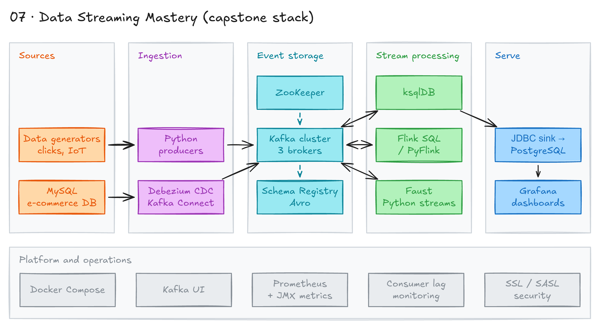
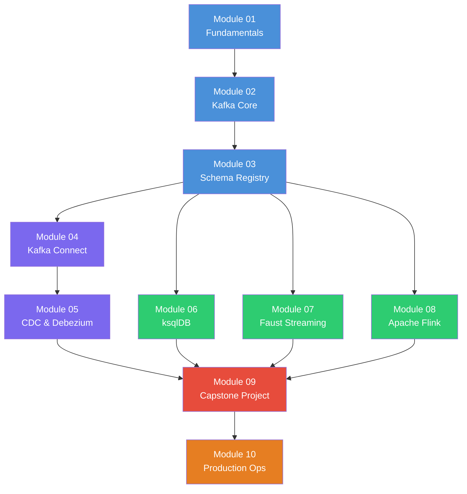

# Data Streaming Mastery



## Project card

| Level | Roles | Duration | Cost | Status |
|---|---|---|---|---|
| Senior | Data Engineer, DataOps Engineer | 10 assignments, ~3-6 h each | Free | Ready |

## Goal

You learn data streaming from Kafka basics to a production-grade real-time pipeline. Each module has a Docker environment, exercises, solutions and a quiz. In the capstone you build real-time e-commerce analytics: MySQL to Kafka to ksqlDB to PostgreSQL to Grafana.

## What you will learn

- Explain events, streaming vs batch, delivery guarantees and time semantics.
- Write Kafka producers and consumers. Use partitions, consumer groups and offsets.
- Manage schemas with Schema Registry (Avro, JSON Schema, Protobuf) and schema evolution.
- Move data with Kafka Connect and capture database changes with Debezium (CDC).
- Process streams with ksqlDB (SQL), Faust (Python) and Apache Flink.
- Monitor, secure and tune Kafka for production.

## Who it is for

- **Data Engineer**: build real-time pipelines with the tools used in industry.
- **DataOps Engineer**: learn how to monitor, secure and size a Kafka platform.

## Tools and services

| Tool | Used for | Free option |
|---|---|---|
| Apache Kafka | Event streaming backbone | yes |
| Confluent Schema Registry | Schema management (Avro, JSON Schema, Protobuf) | yes |
| Kafka Connect | Source and sink connectors, SMTs | yes |
| Debezium | Change Data Capture from MySQL | yes |
| ksqlDB | Stream processing with SQL | yes |
| Faust (`faust-streaming`) | Stream processing in Python | yes |
| Apache Flink (Flink SQL, PyFlink) | Stateful stream processing | yes |
| MySQL, PostgreSQL | Source and analytics databases | yes |
| Kafka UI | Inspect topics and consumers | yes |
| Prometheus, Grafana | Metrics and dashboards | yes |
| Docker, Python 3.10 | Run all services and scripts locally | yes |

## Architecture

The diagram is at the top of this page. Source file: [`images/architecture.excalidraw`](images/architecture.excalidraw). Open it at [excalidraw.com](https://excalidraw.com) to copy or edit it.

The diagram shows the capstone pipeline (Module 9). Data flow:

1. The e-commerce simulator writes customers, orders and status changes to MySQL.
2. Debezium (Kafka Connect) reads the MySQL binlog and publishes Avro change events to Kafka. Schema Registry stores the schemas.
3. ksqlDB joins and aggregates the streams (orders per minute, revenue per category, top customers) and writes results back to Kafka.
4. The JDBC sink connector (or a Python consumer) writes the results to PostgreSQL.
5. Grafana shows live dashboards from PostgreSQL. Prometheus collects Kafka JMX metrics. Kafka UI shows topics and consumers.

### Learning path



**Legend:** Blue = Core Kafka. Purple = Integration. Green = Stream processing. Red = Capstone. Orange = Operations.

Modules 06, 07 and 08 are three ways to process streams. You can do them in any order.

## Dataset

- **Source:** generated data. Scripts are in [`data-generators/`](data-generators/).
- **Tables / entities:**

| Generator | Sink | Default topic / DB | Used in modules |
|---|---|---|---|
| `ecommerce_simulator.py` | MySQL | `ecommerce` database (customers, products, orders, order_items, inventory_log) | 05, 09 |
| `clickstream_generator.py` | Kafka | `clickstream` topic | 02, 06, 07, 08 |
| `iot_sensor_generator.py` | Kafka | `iot-sensors` topic | 02, 03, 08 |

- **Size:** continuous stream. You control the rate with CLI options. See [`data-generators/README.md`](data-generators/README.md).

## Prerequisites

- Docker Desktop v4.20+ with Docker Compose v2.
- Python 3.10 with `pip` and `venv`. Module 07 (Faust) needs 3.10 or newer. Module 08 (PyFlink 1.17) needs 3.10 or older. Python 3.10 works for every module.
- Basic SQL: `SELECT`, `JOIN`, `GROUP BY`, window functions.
- Command line basics (bash or zsh).
- 16 GB RAM recommended (8 GB minimum). 20 GB free disk space.
- Full install steps and troubleshooting: [SETUP.md](SETUP.md).
- New to Git, CLI or Docker? Start with [Surfalytics Module 0](https://www.youtube.com/watch?v=LJIiCLu2gr8&list=PLNCDg7zJiXhP5Z_-TXUdorz2n7sjYHHKE&index=1).

### Quick start

```bash
# 1. Clone the repository
git clone <repo-url>  # then open async-projects/07-data-streaming-mastery
cd 07-data-streaming-mastery

# 2. Create a Python virtual environment
python3 -m venv .venv
source .venv/bin/activate
pip install --upgrade pip

# 3. Start Module 01
cd module-01-fundamentals
# Follow the module README for exercises

# 4. (Optional) Launch the full capstone stack
cd module-09-capstone
./setup.sh
```

### Versions used in this course

| Component | Version | Note |
|---|---|---|
| Confluent Platform (Kafka, Schema Registry, Connect, ksqlDB) | 7.5.0 | Runs Kafka with **ZooKeeper**. Kafka 4.0 removed ZooKeeper (KRaft only). The course keeps ZooKeeper so that every module uses the same stack. |
| Debezium | 2.4 (module 05), 2.5.4 plugin (module 09) | Debezium 3.x renamed some options, see module 05 |
| Flink / PyFlink | 1.17 | PyFlink 1.17 needs Python 3.10 or older |
| Prometheus / Grafana | 2.47 / 10.1 | |
| Python | 3.10 | See prerequisites |

Each module has its own `exercises/` and `solutions/` folders. Do the exercises first. Then check your work against the solutions.

### Repository structure

```text
07-data-streaming-mastery/
├── README.md                  # This file
├── SETUP.md                   # Detailed environment setup
├── data-generators/           # Shared data generators
├── module-01-fundamentals/    # Concepts and theory
├── module-02-kafka-core/      # Kafka producers and consumers
├── module-03-schema-registry/ # Schema management
├── module-04-kafka-connect/   # Connector framework
├── module-05-cdc-debezium/    # Change Data Capture
├── module-06-ksqldb/          # SQL stream processing
├── module-07-faust-streaming/ # Python stream processing
├── module-08-flink/           # Apache Flink
├── module-09-capstone/        # End-to-end project
└── module-10-production/      # Production readiness
```

## Assignments

Work at your own pace. Each assignment shows the expected time.

Each module has the same flow: read the module README, start its Docker stack, do the exercises, check the solutions, take the quiz.

> Run one module stack at a time. Several modules use the same ports (9092, 8080, 8081). Stop the old stack with `docker compose down -v` before you start the next one.

### Assignment 1: Streaming fundamentals (~3 h)

Module folder: [`module-01-fundamentals/`](module-01-fundamentals/)

**Goal:** Understand events, streaming vs batch, and the main design patterns.

**Steps:**

1. Read the [module README](module-01-fundamentals/README.md): events vs messages vs commands, event-driven architecture, delivery guarantees, time semantics, backpressure, event sourcing and CQRS.
2. No Docker needed. This is a theory module.
3. Do `exercises/01-concepts.md` and `exercises/02-architecture.md`.
4. Check your answers in `solutions/`.
5. Take `quiz.md`.

**Deliverable:** Your answers to both exercises and one architecture sketch, in your repo.

**Done when:**

- [ ] You can explain at-most-once, at-least-once and exactly-once.
- [ ] You can explain event time vs processing time.
- [ ] Both exercises are done and checked.
- [ ] Quiz is done.

### Assignment 2: Kafka core (~5 h)

Module folder: [`module-02-kafka-core/`](module-02-kafka-core/)

**Goal:** Write Kafka producers and consumers. Understand topics, partitions, consumer groups and offsets.

**Steps:**

1. Read the [module README](module-02-kafka-core/README.md).
2. Start the stack and install packages:

   ```bash
   cd module-02-kafka-core
   docker compose up -d
   pip install -r requirements.txt
   ```

3. Run the examples in `src/`: `producer_basic.py`, `producer_advanced.py`, `consumer_basic.py`, `consumer_group.py`, `consumer_manual_commit.py`.
4. Do the exercises:
   - `exercises/01-producers.md`: sensor producer, producer with retry metrics, multi-topic event router.
   - `exercises/02-consumers.md`: filter consumer, multiple consumer groups, dead letter queue (DLQ) consumer.
   - `exercises/03-partitioning.md`: partition analysis, custom geo partitioner.
5. Compare with `solutions/ex01_*.py` to `solutions/ex08_*.py`.
6. Take `quiz.md`.

**Deliverable:** 8 exercise scripts in your repo.

**Done when:**

- [ ] Producers send keyed messages to the right partitions.
- [ ] Two consumer groups read the same topic on their own.
- [ ] Failed messages go to a DLQ topic.
- [ ] Quiz is done.

### Assignment 3: Schema Registry (~4 h)

Module folder: [`module-03-schema-registry/`](module-03-schema-registry/)

**Goal:** Use Avro and JSON Schema with Schema Registry. Evolve schemas without breaking consumers.

**Steps:**

1. Read the [module README](module-03-schema-registry/README.md): formats, Avro, compatibility modes, subject naming.
2. Start the stack. Schema Registry runs at http://localhost:8081.

   ```bash
   cd module-03-schema-registry
   docker compose up -d
   pip install -r requirements.txt
   ```

3. Run the examples in `src/`: `avro_producer.py`, `avro_consumer.py`, `json_schema_producer.py`, `schema_evolution_demo.py`.
4. Do the exercises:
   - `exercises/01-avro-schemas.md`: customer profile, product catalog and clickstream schemas.
   - `exercises/02-schema-evolution.md`: add and remove fields under different compatibility modes.
5. Register and test schemas:

   ```bash
   python src/schema_registry_client.py register my-subject your_schema.json
   ```

6. Compare with `solutions/exercise_1_*.py`, `solutions/exercise_2_*.py` and `solutions/exercise_solutions.md`.
7. Take `quiz.md`.

**Deliverable:** Avro schema files and evolution scripts in your repo.

**Done when:**

- [ ] 3 schemas are registered in Schema Registry.
- [ ] You show one compatible and one incompatible schema change.
- [ ] Quiz is done.

### Assignment 4: Kafka Connect (~4 h)

Module folder: [`module-04-kafka-connect/`](module-04-kafka-connect/)

**Goal:** Move data in and out of Kafka with source and sink connectors and Single Message Transforms (SMTs).

**Steps:**

1. Read the [module README](module-04-kafka-connect/README.md).
2. Start the stack and check the Connect REST API:

   ```bash
   cd module-04-kafka-connect
   docker compose up -d
   pip install -r requirements.txt
   curl http://localhost:8083/connectors
   ```

3. Use the connector configs in `config/` (`file-source-connector.json`, `file-sink-connector.json`, `jdbc-source-connector.json`, `jdbc-sink-connector.json`) and `config/connect-management.sh`.
4. Do the exercises:
   - `exercises/01-file-connectors.md`: FileStream source and sink round trip.
   - `exercises/02-jdbc-connectors.md`: JDBC source and sink, replication check.
   - `exercises/03-smt-transforms.md`: transforms and topic routing.
5. Validate with the scripts in `solutions/` (for example `01-verify-roundtrip.py`, `02-replication-checker.py`, `03-verify-routing.py`).
6. Take `quiz.md`.

**Deliverable:** Your connector JSON configs and validation output.

**Done when:**

- [ ] File data makes a full round trip through Kafka.
- [ ] JDBC source and sink replicate a table.
- [ ] At least one SMT changes or routes messages.
- [ ] Quiz is done.

**Hints:** Use Kafka UI at http://localhost:8080 to see topics.

### Assignment 5: CDC with Debezium (~5 h)

Module folder: [`module-05-cdc-debezium/`](module-05-cdc-debezium/)

**Goal:** Capture every MySQL change as a Kafka event with Debezium.

**Steps:**

1. Read the [module README](module-05-cdc-debezium/README.md): binlog, Debezium event structure, snapshots, schema history, tombstones.
2. Start the stack, register the connector and make changes:

   ```bash
   cd module-05-cdc-debezium
   docker compose up -d
   pip install -r requirements.txt
   python src/register_connector.py
   python src/trigger_changes.py
   python src/cdc_consumer.py
   ```

   Or run everything at once with `./src/setup_and_demo.sh`.
3. Do the exercises:
   - `exercises/01-basic-cdc.md`: inspect the connector, read the snapshot, compare `before` and `after`.
   - `exercises/02-advanced-cdc.md`: event router, schema evolution, dead letter queue.
4. Compare with `solutions/01-basic-cdc-solutions.md`, `solutions/02-advanced-cdc-solutions.md` and the `exercise_*.py` files.
5. Take `quiz.md`.

**Deliverable:** CDC consumer scripts and sample change events (insert, update, delete).

**Done when:**

- [ ] The connector status is `RUNNING`.
- [ ] Inserts, updates and deletes in MySQL show up in Kafka.
- [ ] You handle a schema change (new column).
- [ ] Quiz is done.

**Hints:** Kafka UI http://localhost:8080, Connect http://localhost:8083, Schema Registry http://localhost:8081, MySQL `localhost:3306`.

### Assignment 6: ksqlDB (~4 h)

Module folder: [`module-06-ksqldb/`](module-06-ksqldb/)

**Goal:** Process streams with SQL: streams, tables, windows, joins and materialized views.

**Steps:**

1. Read the [module README](module-06-ksqldb/README.md): streams vs tables, push vs pull queries, windowing, joins.
2. Start the stack, seed topics and set up ksqlDB:

   ```bash
   cd module-06-ksqldb
   docker compose up -d
   pip install -r requirements.txt
   python src/seed_topics.py
   bash src/setup_ksqldb.sh
   python src/ksqldb_client.py
   ```

3. Run the example queries in `queries/01-create-streams.sql` to `queries/06-materialized-views.sql`.
4. Do the exercises:
   - `exercises/01-streams-tables.md`
   - `exercises/02-windowing.md`
   - `exercises/03-joins.md`
5. Compare with `solutions/*-solutions.sql` and `solutions/solutions-explanation.md`.
6. Take `quiz.md`.

**Deliverable:** Your `.sql` files for the 3 exercises.

**Done when:**

- [ ] You create a stream and a table from the same topic.
- [ ] A tumbling window aggregation returns results.
- [ ] A stream-table join enriches events.
- [ ] Quiz is done.

### Assignment 7: Faust stream processing (~4 h)

Module folder: [`module-07-faust-streaming/`](module-07-faust-streaming/)

**Goal:** Process streams in pure Python with Faust agents, tables and windows.

**Steps:**

1. Read the [module README](module-07-faust-streaming/README.md). Install `faust-streaming`, not `faust`. The original project is not maintained.
2. Start Kafka and run a worker:

   ```bash
   cd module-07-faust-streaming
   docker compose up -d
   pip install -r requirements.txt
   faust -A src.app_basic worker -l info --web-port 6066
   ```

3. Explore the examples in `src/`: `app_basic.py`, `event_producer.py`, `order_enrichment.py`, `realtime_analytics.py`, `fraud_detection.py`.
4. Do the exercises:
   - `exercises/01-basic-agents.md`: word count, message filter, multi-step pipeline.
   - `exercises/02-stateful-processing.md`: session tracker, leaderboard, moving average.
   - `exercises/03-fraud-detection.md`: velocity fraud check and fraud reporter.
5. Compare with `solutions/exercise_0*_*.py`.
6. Take `quiz.md`.

**Deliverable:** Faust apps for the 3 exercises.

**Done when:**

- [ ] An agent reads, transforms and writes to another topic.
- [ ] A windowed table keeps state.
- [ ] The fraud detector flags suspicious events.
- [ ] Quiz is done.

### Assignment 8: Apache Flink (~5 h)

Module folder: [`module-08-flink/`](module-08-flink/)

**Goal:** Build stateful stream processing with Flink SQL and PyFlink. Use watermarks and event time.

**Steps:**

1. Read the [module README](module-08-flink/README.md): architecture, checkpoints, watermarks, windows, state backends, CDC with Flink.
2. Start the Flink stack and seed data:

   ```bash
   cd module-08-flink
   pip install -r requirements.txt
   ./src/setup_flink.sh
   python src/seed_data.py   # keep it running in the background
   docker exec -it flink-sql-client /opt/flink/bin/sql-client.sh
   ```

3. Run the example SQL in `sql/01-create-kafka-tables.sql` to `sql/05-sink-to-kafka.sql`. Try the PyFlink jobs in `src/`.
4. Do the exercises:
   - `exercises/01-flink-sql.md`: order dashboard, sliding window anomaly detection, category revenue.
   - `exercises/02-pyflink.md`: order filter, customer stats, multi-sink.
   - `exercises/03-cdc-flink.md`: status tracker, CDC dashboard.
5. Compare with `solutions/exercise_*.sql` and `solutions/exercise_*.py`.
6. Take `quiz.md`.

**Deliverable:** Flink SQL and PyFlink files for the 3 exercises.

**Done when:**

- [ ] A Flink SQL job writes windowed results to a Kafka topic.
- [ ] A PyFlink job runs on the cluster.
- [ ] You can explain how the watermark handles late events.
- [ ] Quiz is done.

**Hints:** Flink web UI is at http://localhost:8081. Kafka UI is at http://localhost:8080. Logs: `docker logs -f flink-taskmanager`.

### Assignment 9: Capstone, real-time e-commerce analytics (~6 h)

Module folder: [`module-09-capstone/`](module-09-capstone/)

**Goal:** Run and extend an end-to-end pipeline: MySQL, Debezium, Kafka, ksqlDB, PostgreSQL, Grafana.

**Steps:**

1. Read the [module README](module-09-capstone/README.md).
2. Free these ports: 2181, 3000, 3306, 5432, 8080, 8081, 8083, 8088, 9090, 9092, 29092. Give Docker 8 GB RAM.
3. Run the setup:

   ```bash
   cd module-09-capstone
   pip install sqlalchemy pymysql confluent-kafka requests psycopg2-binary
   chmod +x setup.sh teardown.sh
   ./setup.sh
   open http://localhost:3000   # Grafana, login admin / admin
   ```

   The script starts all containers, registers the Debezium source and JDBC sink connectors, submits ksqlDB queries and starts the simulator.
4. Verify the pipeline:

   ```bash
   curl -s http://localhost:8083/connectors/mysql-source-connector/status | python3 -m json.tool
   ```

   - Kafka UI (http://localhost:8080) shows `ecommerce.ecommerce.*` topics.
   - Grafana shows live data.
5. Do the exercises:
   - `exercises/01-extend-pipeline.md`
   - `exercises/02-add-alerting.md`
6. Compare with `solutions/01-extend-pipeline-solution.md` and `solutions/02-add-alerting-solution.md`.
7. Take `quiz.md`.

**Deliverable:** A Grafana screenshot with live data, your pipeline changes, and a short README.

**Done when:**

- [ ] The Debezium connector is `RUNNING`.
- [ ] ksqlDB aggregations update in PostgreSQL.
- [ ] Grafana dashboard refreshes with live data.
- [ ] You added one new metric and one alert.
- [ ] Quiz is done.

### Assignment 10: Production operations (~5 h)

Module folder: [`module-10-production/`](module-10-production/)

**Goal:** Monitor, secure and tune Kafka for production.

**Steps:**

1. Read the [module README](module-10-production/README.md): metrics, security (TLS, SASL), tuning, capacity planning, multi-datacenter, disaster recovery.
2. Start the monitoring stack:

   ```bash
   cd module-10-production
   docker compose up -d
   pip install -r requirements.txt
   python src/monitoring_producer.py
   ```

   - Grafana: http://localhost:3000
   - Prometheus: http://localhost:9090
   - Kafka UI: http://localhost:8080
3. Try the scripts in `src/`: `consumer_lag_monitor.py`, `performance_test.py`, `ssl_producer.py`, `sasl_producer.py`. TLS setup is in `config/ssl-setup.sh`.
4. Do the exercises:
   - `exercises/01-monitoring.md`
   - `exercises/02-security.md`
   - `exercises/03-performance.md`
5. Compare with `solutions/01-monitoring-solutions.md`, `solutions/02-security-solutions.md` and `solutions/03-performance-solutions.md`.
6. Take `quiz.md`.

**Deliverable:** Grafana dashboard screenshot, performance test results, and a short production checklist.

**Done when:**

- [ ] Grafana shows broker metrics and consumer lag.
- [ ] A producer connects with TLS or SASL.
- [ ] You compare throughput for 2 producer configs (for example `batch.size`, `linger.ms`, compression).
- [ ] Quiz is done.

## Final result

- A local real-time analytics platform: CDC from MySQL, stream processing, PostgreSQL sink and live Grafana dashboards.
- Working code for Kafka clients, Schema Registry, Connect, Debezium, ksqlDB, Faust and Flink.
- Put the capstone on GitHub with a Grafana screenshot and the architecture diagram. Share it on LinkedIn.
- Interview pitch: "I built a real-time e-commerce pipeline. Debezium captures MySQL changes into Kafka, ksqlDB computes windowed metrics, and Grafana shows them live from PostgreSQL. I also monitored and secured the Kafka cluster with Prometheus, TLS and SASL."

## Clean up

Nothing to clean up in the cloud. Everything runs locally in Docker.

Stop each stack and delete its volumes when you finish:

```bash
# In each module folder (or the project root)
docker compose down -v

# Capstone
cd module-09-capstone
./teardown.sh
```

## Resources

- [SETUP.md](SETUP.md): install steps and troubleshooting (memory, ports, broker not ready, Schema Registry 409).
- [Data generators](data-generators/README.md): CLI options for the simulators.
- [Apache Kafka documentation](https://kafka.apache.org/documentation/): core concepts and configs.
- [Confluent Schema Registry docs](https://docs.confluent.io/platform/current/schema-registry/index.html): schemas and compatibility.
- [Debezium documentation](https://debezium.io/documentation/): CDC connectors.
- [ksqlDB documentation](https://docs.ksqldb.io/): streaming SQL.
- [faust-streaming](https://github.com/faust-streaming/faust): Python stream processing.
- [Apache Flink documentation](https://nightlies.apache.org/flink/flink-docs-stable/): Flink SQL and PyFlink.

**Getting help:**

1. Check the Troubleshooting section in [SETUP.md](SETUP.md).
2. Read the module README for known issues.
3. Open an issue in the repository if you find a bug.

## Community solutions

Share your repo in Discord. We add the best ones here.

- <Name>: <link>
