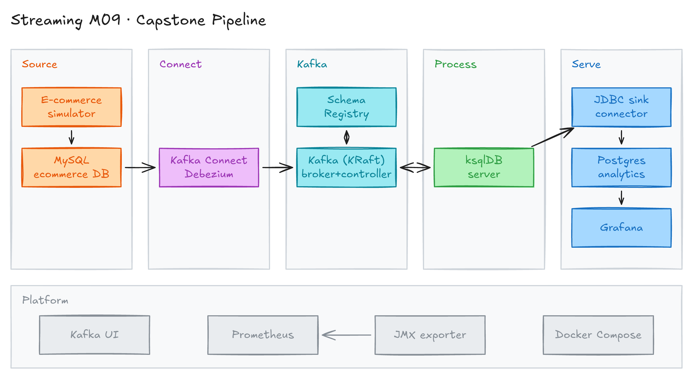
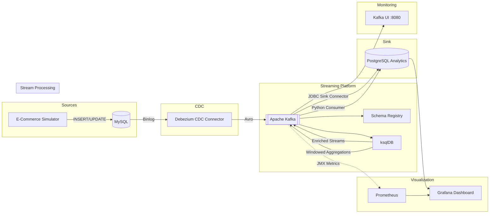

# Module 9: Capstone Project - Real-Time E-Commerce Analytics Platform



*Diagram source: [`images/architecture.excalidraw`](images/architecture.excalidraw).*

## Project Overview

This capstone project brings together every concept from the Data Streaming Mastery course into a single, production-grade real-time analytics platform. You will deploy a complete end-to-end streaming pipeline that captures changes from a transactional MySQL database, streams them through Kafka, enriches and aggregates data with ksqlDB, sinks results to PostgreSQL, and visualizes everything on a live Grafana dashboard.

An e-commerce simulator generates realistic traffic -- customer registrations, product purchases, order status transitions, cancellations, and returns -- so you can observe the entire pipeline in action.

---

## Architecture



### Component Summary

| Component | Port | Purpose |
|---|---|---|
| MySQL | 3306 | Transactional e-commerce database (source of truth) |
| Kafka Connect | 8083 | Runs the Debezium source and the JDBC sink connectors |
| Apache Kafka (KRaft: broker + controller in one node) | 9092 (host). Inside Docker: 29092 (clients), 29093 (controller), 7071 (JMX metrics for Prometheus) | Central event streaming backbone |
| Schema Registry | 8081 | Avro schema management |
| ksqlDB | 8088 | Real-time stream processing (enrichment, aggregation) |
| PostgreSQL | 5432 | Analytics sink database |
| Kafka UI | 8080 | Visual Kafka topic/consumer inspection |
| Grafana | 3000 | Real-time dashboards |
| Prometheus | 9090 | Metrics collection (Kafka broker via JMX exporter, Prometheus, Grafana) |

Containers: `module-09-kafka`, `-schema-registry`, `-kafka-connect`, `-ksqldb-server`, `-mysql`, `-postgres`, `-kafka-ui`, `-grafana`, `-prometheus`. A one-shot container `module-09-jmx-agent-init` downloads the JMX exporter agent and then exits.

### Versions used in this module

| Component | Version | Note |
|---|---|---|
| Kafka, Schema Registry, Connect, ksqlDB server | Confluent Platform 8.4.1 | Kafka runs in **KRaft** mode. No ZooKeeper. |
| Debezium MySQL connector | 3.7.1.Final | Added to Connect in `Dockerfile` from [Maven Central](https://repo1.maven.org/maven2/io/debezium/debezium-connector-mysql/3.7.1.Final/). Confluent Hub only has 3.2.x. |
| JDBC sink connector | 10.9.10 | Installed from Confluent Hub in `Dockerfile` |
| MySQL | 8.4 (LTS) | Binlog is on by default. |
| PostgreSQL | 18 | The data volume is `/var/lib/postgresql` (changed in PG 18). |
| Prometheus / Grafana | 3.16.0 / 13.2.6 | |
| JMX exporter agent | 1.0.1 | Loaded only into the broker process |
| Kafka UI | kafbat/kafka-ui v1.5.0 | |
| Python | 3.12 | `setup.sh` makes `.venv` for you |

- The `debezium/connect` image has no Confluent Avro converter, so we use `cp-kafka-connect` and add Debezium to it.
- The Connect image is built on the first `docker compose up`. **It needs internet access.**
- ksqlDB is in maintenance mode. For new stream processing work, see Flink SQL in module 08.
- Debezium 3.x renamed options. The source connector here uses `delete.tombstone.handling.mode` (it replaces `drop.tombstones` and `delete.handling.mode`).

---

## What the Pipeline Does

1. **E-Commerce Simulator** writes realistic transactions to MySQL: new customers, orders with multiple items, status transitions (pending -> confirmed -> shipped -> delivered), occasional cancellations and returns.

2. **Debezium CDC** captures every INSERT/UPDATE from MySQL binlog and publishes Avro-encoded change events to Kafka topics (`ecommerce.ecommerce.orders`, `ecommerce.ecommerce.customers`, etc.).

3. **ksqlDB** processes these streams in real time:
   - Joins orders with customers and products to create an **enriched orders** stream
   - Computes **orders per minute** (1-minute tumbling window)
   - Computes **revenue per category** (5-minute tumbling window)
   - Computes **top customers by spend** (10-minute tumbling window)
   - Maintains an **order status distribution** table

4. **JDBC Sink Connectors** (one per table; or the Python consumer) write the results to PostgreSQL analytics tables.

5. **Grafana** queries PostgreSQL every 5 seconds to display live dashboards.

---

## Prerequisites

- Docker and Docker Compose (v2+)
- Python 3.12 (`setup.sh` creates `.venv` with `uv` or `python3.12`)
- 8 GB RAM for Docker. We measured the 9 containers at about **4.5 GiB** while the simulator ran (Kafka 1.7 GiB, Connect 0.6, ksqlDB 0.6, MySQL 0.45, Kafka UI 0.43, Schema Registry 0.3, Grafana 0.3, Prometheus and Postgres under 0.1). `docker stats --no-stream` shows the numbers on your machine.
- Internet access on first start (downloads connector plugins and the JMX agent)
- Ports 3000, 3306, 5432, 8080, 8081, 8083, 8088, 9090, 9092 available

---

## Quick Start

```bash
# 1. Run the master setup script (it creates .venv with Python 3.12 and installs requirements.txt)
chmod +x setup.sh teardown.sh
./setup.sh

# 2. Open Grafana
open http://localhost:3000
# Login: admin / admin (skip password change)
```

The setup script will:
- Create `.venv` (Python 3.12) and install `requirements.txt`
- Start all Docker containers (`docker compose up -d`)
- Wait for MySQL, Schema Registry, Kafka Connect, ksqlDB, PostgreSQL and Grafana
- Register the Debezium source connector (`config/mysql-source-connector.json`)
- Wait 15 seconds, then submit the ksqlDB queries (`src/setup_ksqldb.py`, from `config/ksqldb-queries.sql`)
- Register the five JDBC sink connectors (`config/postgres-sink-*.json`, one per table). If one fails, start `src/sink_consumer.py` instead
- Start the e-commerce simulator in the background (`src/ecommerce_simulator.py`)

`src/register_connectors.py` can register both connectors by hand.

---

## How to Verify the Pipeline

### 1. Check Kafka Topics

Open Kafka UI at [http://localhost:8080](http://localhost:8080). You should see topics:
- `ecommerce.ecommerce.customers`
- `ecommerce.ecommerce.products`
- `ecommerce.ecommerce.orders`
- `ecommerce.ecommerce.order_items`
- `ecommerce.ecommerce.inventory_log`

### 2. Check Debezium Connector

```bash
curl -s http://localhost:8083/connectors/mysql-source-connector/status | python3 -m json.tool
```

Status should show `"state": "RUNNING"`.

### 3. Inspect ksqlDB

```bash
# List streams
curl -s http://localhost:8088/ksql -H 'Content-Type: application/vnd.ksql.v1+json' \
  -d '{"ksql": "SHOW STREAMS;"}' | python3 -m json.tool

# List tables
curl -s http://localhost:8088/ksql -H 'Content-Type: application/vnd.ksql.v1+json' \
  -d '{"ksql": "SHOW TABLES;"}' | python3 -m json.tool
```

### 4. Check PostgreSQL Analytics

```bash
docker exec -it module-09-postgres psql -U postgres -d analytics -c "SELECT * FROM orders_enriched LIMIT 5;"
docker exec -it module-09-postgres psql -U postgres -d analytics -c "SELECT * FROM revenue_per_minute ORDER BY window_start DESC LIMIT 5;"
```

### 5. Open Grafana Dashboard

Navigate to [http://localhost:3000](http://localhost:3000) (admin/admin). The **E-Commerce Real-Time Analytics** dashboard should auto-load with live data.

---

## Design Notes (what changed for Debezium 3.x and ksqlDB 8.x)

- **Seed order.** `mysql-init.sql` inserts one order and one item. Debezium snapshots them and registers the Avro schemas first. If ksqlDB creates a stream on an empty topic first, it registers its own schema, and Debezium then fails with "Schema being registered is incompatible".
- **Plain INT keys.** The source connector writes the row `id` as a plain integer key (`IntegerConverter` and `ExtractField$Key`). ksqlDB reads it as `id INT KEY`. This is why `include.schema.changes` is `false` and the heartbeat is off: those topics have no `id` key.
- **Key columns are not in the value.** ksqlDB stores key columns in the message key. The JDBC sink reads the primary key from the value, so the queries copy keys with `AS_VALUE()`.
- **One sink per table.** Each table has a different primary key, and `pk.fields` is one setting per connector. The keys of windowed tables cannot be read as Avro, so the sinks ignore the key (`ByteArrayConverter`, `pk.mode=record_value`).
- **Names.** ksqlDB upper-cases names (`ORDER_ID`). `quote.sql.identifiers=never` lets PostgreSQL match them to the lower-case columns.
- **Timestamps.** `FROM_UNIXTIME(WINDOWSTART)` gives a real `TIMESTAMP`. MySQL `TIMESTAMP` columns arrive as ISO strings, so the sink URL has `stringtype=unspecified` and PostgreSQL converts them.
- **No curl in the images.** The Confluent 8.x images have no `curl`, `wget` or `tar`. Healthchecks use `python3`, and the Debezium plugin is unpacked with Python in the `Dockerfile`.

---

## Troubleshooting

| Problem | Solution |
|---|---|
| Containers won't start | Ensure Docker has at least 8 GB RAM. Run `docker compose down -v` and start again. |
| Debezium connector fails | Check `curl -s http://localhost:8083/connectors/mysql-source-connector/status`. If it says "Schema being registered is incompatible", the schema was registered by ksqlDB first: run `./teardown.sh` and start again. |
| No data in Kafka topics | Verify the simulator is running: `ps aux \| grep ecommerce_simulator`. Check connector status. |
| ksqlDB queries fail | Ensure Schema Registry is up. Check ksqlDB logs: `docker logs module-09-ksqldb-server`. |
| Grafana shows "No data" | Verify PostgreSQL has data. Check the JDBC sink connector status or run the Python sink consumer manually. |
| Port conflicts | Stop other services using the same ports, or edit `docker-compose.yml` to remap them. |

---

## Tear Down

```bash
./teardown.sh
```

This stops the simulator and the sink consumer, stops all containers, and removes volumes.

---

## Key Takeaways

After completing this capstone, you have demonstrated mastery of:

1. **Change Data Capture** -- Debezium captures database changes without polling.
2. **Event Streaming** -- Kafka decouples producers from consumers and provides durable, ordered event logs.
3. **Schema Management** -- Schema Registry ensures data compatibility across the pipeline.
4. **Stream Processing** -- ksqlDB performs real-time joins, enrichment, and windowed aggregations with SQL.
5. **Data Sinking** -- JDBC Sink Connector and custom Python consumers materialize streaming results into analytical databases.
6. **Real-Time Visualization** -- Grafana dashboards provide instant visibility into business metrics.
7. **End-to-End Pipeline Orchestration** -- Docker Compose, health checks, and setup scripts bring all components together reliably.

---

## Next Steps

Proceed to [Module 10: Production Deployment](../module-10-production/) to learn how to take this pipeline to production with Kubernetes, monitoring, CI/CD, and operational best practices.
