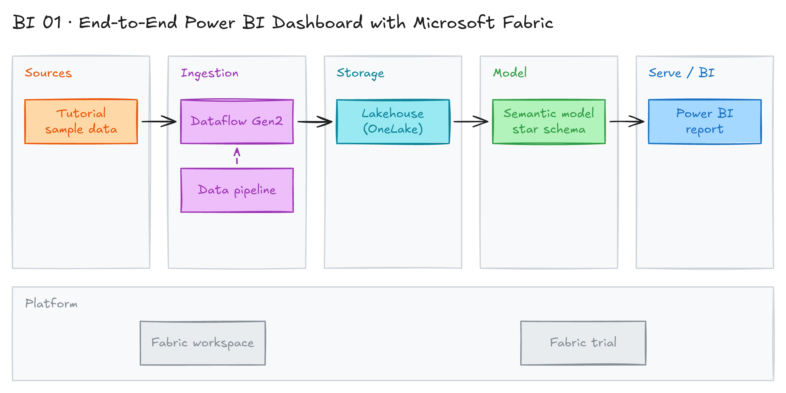

# End-to-End Power BI Dashboard with Microsoft Fabric

## Project card

| Level | Roles | Duration | Cost | Status |
|---|---|---|---|---|
| Beginner | BI Developer, Data Analyst | 4 assignments, ~1-3 h each | Free trial | Draft |

## Goal

You build a Power BI dashboard on Microsoft Fabric. You use Dataflow Gen2 and a data pipeline to load data into a Lakehouse. Then you build a dimensional model and connect Power BI to it.

## What you will learn

- Set up a Microsoft Fabric workspace and a Lakehouse.
- Ingest and transform data with Dataflow Gen2.
- Orchestrate loads with a Fabric data pipeline.
- Build a dimensional model (facts and dimensions) as a semantic model.
- Build a Power BI report on top of the Lakehouse.

## Who it is for

- **BI Developer**: build the full path from raw data to a Power BI report in one tool.
- **Data Analyst**: learn how data gets into Power BI, not only how to chart it.

## Tools and services

| Tool | Used for | Free option |
|---|---|---|
| Microsoft Fabric | All-in-one analytics platform | trial |
| Lakehouse | Store tables (Delta format in OneLake) | trial |
| Dataflow Gen2 | Low-code ingest and transform (Power Query) | trial |
| Data pipeline | Orchestrate the dataflow and other steps | trial |
| Power BI | Semantic model and report | trial |

Key terms:

- **Microsoft Fabric:** an all-in-one analytics platform. It covers data movement, data engineering, data science, real-time analytics and BI in one interface. [Overview](https://learn.microsoft.com/en-us/fabric/fundamentals/microsoft-fabric-overview).
- **Lakehouse:** one place to store and analyze structured and unstructured data. It mixes a data warehouse and a data lake.
- **Dataflow:** a visual tool to design data transformations and move data at scale.
- **Pipeline:** a set of data transformations or other steps. Often called an ETL/ELT job.
- **Dimensional model:** "fact" tables hold the measures of a business process. "Dimension" tables hold the context (who, what, where, when, why, how). It makes large data easy to query.
- **Power BI:** the BI tool from Microsoft. [Overview](https://learn.microsoft.com/en-us/power-bi/fundamentals/power-bi-overview).

## Architecture

The diagram is at the top of this page. Source file: [`images/architecture.excalidraw`](images/architecture.excalidraw). Open it at [excalidraw.com](https://excalidraw.com) to copy or edit it.

Data flow:

1. Sample source data (from the tutorial) is the input.
2. Dataflow Gen2 reads and cleans the data and writes tables to the Lakehouse.
3. A data pipeline runs the dataflow and other steps on a schedule.
4. The Lakehouse tables form a dimensional model (facts and dimensions) in a semantic model.
5. A Power BI report reads the semantic model.

## Dataset

- **Source:** sample data from the Microsoft tutorial [Fabric for Power BI users](https://learn.microsoft.com/en-us/power-bi/fundamentals/fabric-get-started).
- **Tables / entities:** see the tutorial. You build fact and dimension tables from it.
- **Size:** small sample.

## Prerequisites

- A Microsoft Fabric trial. Start it from [app.fabric.microsoft.com](https://app.fabric.microsoft.com). Fabric needs a work or school account. Personal emails (Gmail, Outlook.com) are not supported. See [Fabric trial](https://learn.microsoft.com/en-us/fabric/fundamentals/fabric-trial).
- Optional: an Azure subscription. You can start with a [free account](https://azure.microsoft.com/en-us/free/).
- [Power BI Desktop](https://learn.microsoft.com/en-us/power-bi/fundamentals/desktop-getting-started) (Windows only). Optional, the web editor is enough for this project.
- Basic SQL and Power BI.
- Basic cloud and Azure knowledge. These courses help:
  - [Introduction to Microsoft Azure Cloud Services](https://www.coursera.org/learn/microsoft-azure-cloud-services)
  - [Microsoft Azure Management Tools and Security Solutions](https://learn.microsoft.com/en-us/training/courses/az-900t00)
  - [Microsoft Azure Services and Lifecycles](https://learn.microsoft.com/en-us/training/courses/az-900t00)
- Basic Azure Data Factory is useful. Fabric pipelines work in a similar way.
- New to Git, CLI or Docker? Start with [Surfalytics Module 0](https://www.youtube.com/watch?v=LJIiCLu2gr8&list=PLNCDg7zJiXhP5Z_-TXUdorz2n7sjYHHKE&index=1).

Not everything is clear yet? That is fine. We cover these topics in the project.

## Assignments

Work at your own pace. Each assignment shows the expected time. All assignments follow the tutorial [Fabric for Power BI users](https://learn.microsoft.com/en-us/power-bi/fundamentals/fabric-get-started).

### Assignment 1: Set up Fabric (~1 h)

**Goal:** Get a Fabric workspace with a Lakehouse.

**Steps:**

1. Start a Fabric trial.
2. Create a new workspace on the trial capacity.
3. Create a Lakehouse in the workspace.

**Deliverable:** Screenshot of the workspace with the Lakehouse.

**Done when:**

- [ ] The workspace uses the trial capacity.
- [ ] The Lakehouse is created.

### Assignment 2: Ingest data with Dataflow Gen2 (~2 h)

**Goal:** Load and clean the source data into Lakehouse tables.

**Steps:**

1. Create a Dataflow Gen2 in the workspace.
2. Connect to the tutorial source data.
3. Clean the data with Power Query steps.
4. Set the Lakehouse as the destination.
5. Publish and run the dataflow.

**Deliverable:** Screenshot of the dataflow and the tables in the Lakehouse.

**Done when:**

- [ ] The tables are in the Lakehouse.
- [ ] Data types are correct.

**Hints:** [Dataflow Gen2 overview](https://learn.microsoft.com/en-us/fabric/data-factory/create-first-dataflow-gen2).

### Assignment 3: Orchestrate with a data pipeline (~1 h)

**Goal:** Run the dataflow from a pipeline on a schedule.

**Steps:**

1. Create a data pipeline.
2. Add a Dataflow activity that runs your dataflow.
3. Add a schedule.
4. Run the pipeline and check the run history.

**Deliverable:** Screenshot of a successful pipeline run.

**Done when:**

- [ ] The pipeline runs the dataflow with no errors.
- [ ] A schedule is set.

### Assignment 4: Dimensional model and Power BI report (~3 h)

**Goal:** Build a semantic model and a Power BI report on the Lakehouse.

**Steps:**

1. Create a semantic model from the Lakehouse tables.
2. Set relationships between fact and dimension tables (star schema).
3. Add measures (for example, total sales).
4. Build a Power BI report with KPIs, a trend and a breakdown.
5. Publish the report and share it in the workspace.

**Deliverable:** Screenshot of the model view and the report.

**Done when:**

- [ ] The model is a star schema: facts in the middle, dimensions around.
- [ ] The report answers at least 3 business questions.
- [ ] Filters work across all visuals.

**Hints:** [Get started creating in the Power BI service](https://learn.microsoft.com/en-us/power-bi/fundamentals/service-get-started), [Star schema guidance](https://learn.microsoft.com/en-us/power-bi/guidance/star-schema).

## Final result

- A Fabric workspace with a Lakehouse, a dataflow, a pipeline, a semantic model and a report.
- Put screenshots and a short write-up in a GitHub repo. Post the report screenshot on LinkedIn.
- Interview pitch: "I built an end-to-end BI solution in Microsoft Fabric. Dataflow Gen2 loads data into a Lakehouse, a pipeline runs it on a schedule, and Power BI reads a star schema model."

## Clean up

- Delete the workspace: **Workspace settings → Other → Remove this workspace**. This deletes all items in it.
- The Fabric trial ends on its own. You do not pay for it.
- If you created Azure resources, delete their resource group.

## Resources

- [Fabric for Power BI users](https://learn.microsoft.com/en-us/power-bi/fundamentals/fabric-get-started): the main tutorial for this project.
- [Get started with Power BI Desktop](https://learn.microsoft.com/en-us/power-bi/fundamentals/desktop-getting-started): build reports on your computer.
- [Get started creating in the Power BI service](https://learn.microsoft.com/en-us/power-bi/fundamentals/service-get-started): build reports in the browser.
- [Azure Data Factory tutorials](https://learn.microsoft.com/en-us/azure/data-factory/data-factory-tutorials#copy-and-ingest-data): pipelines in the classic Azure service.

## Community solutions

Share your repo in Discord. We add the best ones here.
