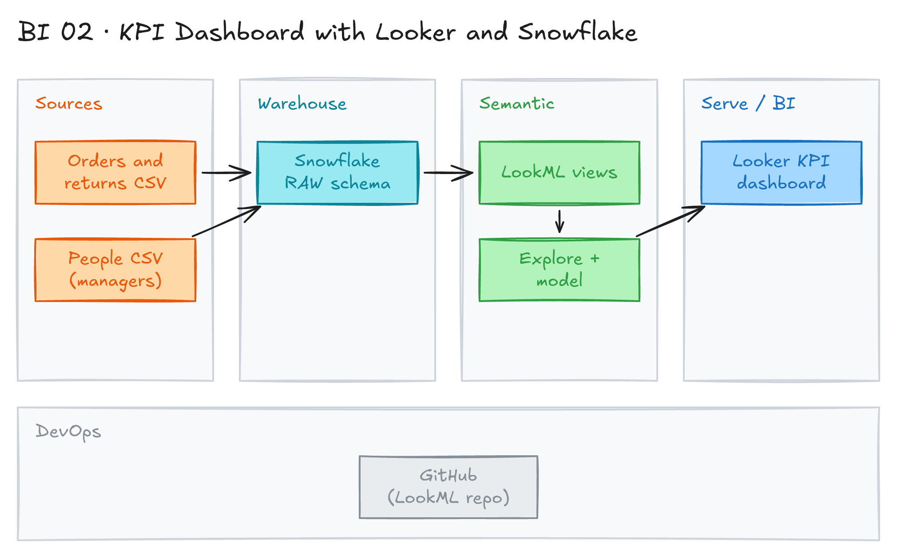

# KPI Dashboard with Looker and Snowflake



## Project card

| Level | Roles | Duration | Cost | Status |
|---|---|---|---|---|
| Intermediate | BI Developer, Analytics Engineer | 4 assignments, ~1-4 h each | Free trial | Ready |

## Goal

You build a Superstore KPI dashboard in Looker. The data is in Snowflake. You write the semantic layer in LookML: views, an explore and a model. Then you build the dashboard and keep it in Git as code.

## What you will learn

- Load CSV files into Snowflake.
- Connect Looker to Snowflake.
- Write LookML views, dimensions, measures and parameters.
- Join views in an explore and set join relationships.
- Build a dashboard with filters and save it as LookML.

## Who it is for

- **BI Developer**: learn Looker, a popular enterprise BI tool with a code-based semantic layer.
- **Analytics Engineer**: learn how a semantic layer sits on top of the warehouse.

## Tools and services

| Tool | Used for | Free option |
|---|---|---|
| Snowflake | Data warehouse | trial (30 days, $400 of usage, no credit card) |
| Looker (Google Cloud core) | BI platform from Google Cloud | trial edition (90 days, needs a Google Cloud project with billing) |
| LookML | Semantic layer as code | yes (part of Looker) |
| Git | Version control for the LookML project | yes |

Key terms:

- **Looker:** an enterprise platform for BI, data apps and embedded analytics. Today you create it in Google Cloud as **Looker (Google Cloud core)**. It is not Looker Studio (a different, free reporting tool).
- **LookML:** the Looker modeling language. It defines dimensions, measures and joins on top of SQL tables.
- **Snowflake:** a cloud data warehouse. Storage and compute are separate, so you scale them independently.

## Architecture

The diagram is at the top of this page. Source file: [`images/architecture.excalidraw`](images/architecture.excalidraw). Open it at [excalidraw.com](https://excalidraw.com) to copy or edit it.

Data flow:

1. Superstore CSV files (orders, returns, people) are the source.
2. You load the files into the Snowflake `RAW` schema.
3. Looker connects to Snowflake with the connection `superstore_snowflake_connection`.
4. LookML views, an explore and a model define the business logic.
5. The Superstore KPI dashboard reads from the explore. The LookML project lives in Git.

## Dataset

- **Source:** Superstore sample data, in [`project/source_files`](project/source_files). Files use `|` as the delimiter and have a header row.
- **Tables / entities:**

| File | Snowflake table | Content |
|---|---|---|
| [`supestore_orders.csv`](project/source_files/supestore_orders.csv) | `RAW.ORDERS` | Order lines: dates, customer, product, sales, profit |
| [`supestore_returns.csv`](project/source_files/supestore_returns.csv) | `RAW.RETURNED_ORDERS` | Returned order IDs |
| [`supestore_people.csv`](project/source_files/supestore_people.csv) | `RAW.SALES_MANAGERS` | Regional sales manager |

- **Size:** about 10,000 order lines, 800 returns, 4 managers.

## Prerequisites

- A Snowflake account. Start a [free trial](https://signup.snowflake.com/): 30 days or $400 of usage, whichever ends first. No credit card needed. See [Trial accounts](https://docs.snowflake.com/en/user-guide/admin-trial-account).
- A Looker instance. Looker has no free tier. Options:
  - Your company or school already has Looker. Ask for a developer account.
  - Create a **trial edition** instance of [Looker (Google Cloud core)](https://docs.cloud.google.com/looker/docs/looker-core-overview). It is valid for 90 days. You need a Google Cloud project with billing on, the Looker API on, and the Looker Admin role. Your project also needs Looker quota. If it has none, contact Google Cloud sales. See [Create an instance](https://docs.cloud.google.com/looker/docs/looker-core-instance-create).
- `openssl` on your computer, to create a key pair for the Looker user (macOS and Linux have it; on Windows use Git Bash).
- A GitHub account for the LookML project.
- Basic SQL.
- Optional: [`de-projects/02_dbt_core_snowflake`](../../de-projects/02_dbt_core_snowflake) to model the data with dbt first.
- New to Git, CLI or Docker? Start with [Surfalytics Module 0](https://www.youtube.com/watch?v=LJIiCLu2gr8&list=PLNCDg7zJiXhP5Z_-TXUdorz2n7sjYHHKE&index=1).

## Assignments

Work at your own pace. Each assignment shows the expected time. The finished LookML project is in [`project/`](project). Try to write it yourself first, then compare.

### Assignment 1: Load data into Snowflake (~1 h)

**Goal:** Load the 3 Superstore files into the Snowflake `RAW` schema.

**Steps:**

1. Create a database and the `RAW` schema.
2. Create a file format for `|` delimited files and the 3 tables:

   ```sql
   CREATE DATABASE IF NOT EXISTS SUPERSTORE;
   CREATE SCHEMA IF NOT EXISTS SUPERSTORE.RAW;
   USE SCHEMA SUPERSTORE.RAW;

   CREATE OR REPLACE FILE FORMAT pipe_csv
     TYPE = CSV
     FIELD_DELIMITER = '|'
     SKIP_HEADER = 1
     FIELD_OPTIONALLY_ENCLOSED_BY = '"';

   CREATE OR REPLACE TABLE ORDERS (
       ROW_ID        NUMBER,
       ORDER_ID      VARCHAR,
       ORDER_DATE    DATE,
       SHIP_DATE     DATE,
       SHIP_MODE     VARCHAR,
       CUSTOMER_ID   VARCHAR,
       CUSTOMER_NAME VARCHAR,
       SEGMENT       VARCHAR,
       COUNTRY       VARCHAR,
       CITY          VARCHAR,
       STATE         VARCHAR,
       POSTAL_CODE   VARCHAR,
       REGION        VARCHAR,
       PRODUCT_ID    VARCHAR,
       CATEGORY      VARCHAR,
       SUBCATEGORY   VARCHAR,
       PRODUCT_NAME  VARCHAR,
       SALES         NUMBER(18,4),
       QUANTITY      NUMBER,
       DISCOUNT      NUMBER(5,2),
       PROFIT        NUMBER(18,4)
   );

   CREATE OR REPLACE TABLE RETURNED_ORDERS (
       RETURNED VARCHAR,
       ORDER_ID VARCHAR
   );

   CREATE OR REPLACE TABLE SALES_MANAGERS (
       PERSON VARCHAR,
       REGION VARCHAR
   );
   ```

3. Upload the files. In Snowsight, go to **Ingestion → Add Data → Load data into a Table**. Pick the file, then the database `SUPERSTORE`, schema `RAW` and the target table. Select the file format `pipe_csv`. Select **Load**.
4. Or load from the command line. Put the files to the table stage with [Snowflake CLI](https://docs.snowflake.com/en/developer-guide/snowflake-cli/index) or SnowSQL, then copy:

   ```sql
   -- from your computer: PUT file://supestore_orders.csv @%ORDERS;
   COPY INTO ORDERS          FROM @%ORDERS          FILE_FORMAT = (FORMAT_NAME = 'pipe_csv');
   COPY INTO RETURNED_ORDERS FROM @%RETURNED_ORDERS FILE_FORMAT = (FORMAT_NAME = 'pipe_csv');
   COPY INTO SALES_MANAGERS  FROM @%SALES_MANAGERS  FILE_FORMAT = (FORMAT_NAME = 'pipe_csv');
   ```

5. Check row counts:

   ```sql
   SELECT 'ORDERS' AS t, COUNT(*) FROM ORDERS
   UNION ALL SELECT 'RETURNED_ORDERS', COUNT(*) FROM RETURNED_ORDERS
   UNION ALL SELECT 'SALES_MANAGERS', COUNT(*) FROM SALES_MANAGERS;
   ```

**Deliverable:** SQL script and row counts for the 3 tables.

**Done when:**

- [ ] `RAW.ORDERS` has 9,994 rows. Order dates are from 2016-01-03 to 2019-12-30.
- [ ] `RAW.RETURNED_ORDERS` has 800 rows (296 distinct order IDs).
- [ ] `RAW.SALES_MANAGERS` has 4 rows.

**Hints:**

- Some product names have `"` inside quotes, for example `72""H`. `FIELD_OPTIONALLY_ENCLOSED_BY = '"'` handles this.
- Postal codes look like `42420.0`. Keep them as `VARCHAR`.
- [Load data with Snowsight](https://docs.snowflake.com/en/user-guide/data-load-web-ui), [COPY INTO](https://docs.snowflake.com/en/sql-reference/sql/copy-into-table).

### Assignment 2: Connect Looker to Snowflake (~1 h)

**Goal:** Create a Looker connection and a LookML project linked to Git.

**Steps:**

1. On your computer, create a key pair. Snowflake blocks password-only sign-in for service users, so Looker uses a key:

   ```bash
   openssl genrsa 2048 | openssl pkcs8 -topk8 -inform PEM -out rsa_key.p8 -nocrypt
   openssl rsa -in rsa_key.p8 -pubout -out rsa_key.pub
   ```

2. In Snowflake, create a role, a warehouse and a service user for Looker. Paste the body of `rsa_key.pub` without the `BEGIN`/`END` lines:

   ```sql
   USE ROLE ACCOUNTADMIN;
   CREATE ROLE IF NOT EXISTS LOOKER_ROLE;
   GRANT ROLE LOOKER_ROLE TO ROLE SYSADMIN;

   CREATE WAREHOUSE IF NOT EXISTS LOOKER_WH
     WAREHOUSE_SIZE = XSMALL AUTO_SUSPEND = 60 AUTO_RESUME = TRUE INITIALLY_SUSPENDED = TRUE;
   GRANT USAGE ON WAREHOUSE LOOKER_WH TO ROLE LOOKER_ROLE;

   CREATE USER IF NOT EXISTS LOOKER_USER
     TYPE = SERVICE
     DEFAULT_ROLE = LOOKER_ROLE
     DEFAULT_WAREHOUSE = LOOKER_WH;
   ALTER USER LOOKER_USER ADD KEY PAIR looker_key PUBLIC_KEY = 'MIIBIjANBgkqh...';
   GRANT ROLE LOOKER_ROLE TO USER LOOKER_USER;

   GRANT USAGE ON DATABASE SUPERSTORE TO ROLE LOOKER_ROLE;
   GRANT USAGE ON SCHEMA SUPERSTORE.RAW TO ROLE LOOKER_ROLE;
   GRANT SELECT ON ALL TABLES IN SCHEMA SUPERSTORE.RAW TO ROLE LOOKER_ROLE;
   ```

3. In Looker, go to **Admin → Database → Connections → Add Connection**. Fill in:

   | Field | Value |
   |---|---|
   | Name | `superstore_snowflake_connection` |
   | SQL Dialect | Snowflake |
   | Hostname | `<account_identifier>.snowflakecomputing.com` |
   | Database Name | `SUPERSTORE` |
   | Default Schema | `RAW` |
   | Authentication | **Key Pair**: username `LOOKER_USER`, upload `rsa_key.p8` |
   | Additional JDBC parameters | `warehouse=LOOKER_WH` |

4. Select **Test**, then **Connect**.
5. Turn on **Development Mode**. Go to **Develop → Projects → New LookML Project**. Name it `superstore`. Use the connection `superstore_snowflake_connection` and start from a blank project.
6. In the project, select **Configure Git**. Paste the URL of an empty GitHub repo. Add the deploy key Looker shows to the repo (**Settings → Deploy keys**, allow write access).

**Deliverable:** Screenshot of a successful connection test.

**Done when:**

- [ ] The connection test passes.
- [ ] The LookML project is linked to Git.
- [ ] `rsa_key.p8` is not in any Git repo.

**Hints:** [Looker Snowflake connection](https://docs.cloud.google.com/looker/docs/db-config-snowflake), [Snowflake key-pair authentication](https://docs.snowflake.com/en/user-guide/key-pair-auth), [Set up Git for a LookML project](https://docs.cloud.google.com/looker/docs/setting-up-git-connection). Never commit passwords or keys to Git.

### Assignment 3: Build the LookML model (~3 h)

**Goal:** Write views, an explore and a model for the Superstore data.

**Steps:**

1. Create 3 views, one per table:
   - [`orders.view.lkml`](project/views/orders.view.lkml): dimensions, a `order` date group, measures `total_sales`, `total_profit`, `total_customers`, `total_orders`, and the `profit_or_sales` parameter.
   - [`returned_orders.view.lkml`](project/views/returned_orders.view.lkml): `total_returned_orders`.
   - [`sales_managers.view.lkml`](project/views/sales_managers.view.lkml): manager per region.
2. Create the explore [`superstore_explore.explore.lkml`](project/explores/superstore_explore.explore.lkml):
   - `orders` left join `returned_orders` on `order_id`.
   - `orders` join `sales_managers` on `region`.
3. Create the model [`superstore_model.model.lkml`](project/models/superstore_model.model.lkml). It uses the connection and includes all views and explores.
4. Select **Validate LookML**. Fix errors. Commit and deploy to production.

**Deliverable:** LookML files in Git.

**Done when:**

- [ ] LookML validation shows no errors.
- [ ] You can query sales by region in the explore.
- [ ] The returned orders share looks correct.

**Hints:**

- Check the primary key. One order has many lines, so `order_id` is not unique in `ORDERS`. `row_id` is.
- Check the join relationship. `order_id` repeats in `ORDERS` and in the returns file, so the join is `many_to_many`.
- A `type: yesno` dimension needs a true/false SQL expression. `RETURNED` holds the text `Yes`, so use `${TABLE}."RETURNED" = 'Yes'`.
- Use `{{ profit_or_sales._parameter_value }}` or `` to read the parameter in SQL. See [parameter](https://docs.cloud.google.com/looker/docs/reference/param-field-parameter).
- The reference views use full table names (`"SUPERSTORE"."RAW"."ORDERS"`), so they work even if the connection has no default database.
- [LookML introduction](https://docs.cloud.google.com/looker/docs/what-is-lookml), [join relationship](https://docs.cloud.google.com/looker/docs/reference/param-explore-join-relationship).

### Assignment 4: Build the KPI dashboard (~3 h)

**Goal:** Build the Superstore KPI dashboard and save it as LookML.

**Steps:**

1. Add KPI tiles: % of returned orders, total sales, total profit, customers, profit ratio, orders.
2. Add charts:
   - Sales and profit by month (area).
   - Profit or sales by state (map).
   - Profit or sales by region (column).
   - Number of orders by manager (bar).
3. Add filters: Period (month, default `2019-01`), Profit or Sales (button toggle, one value), Segment, Category, Subcategory.
4. Get the dashboard LookML: **... → Get LookML** on the user-defined dashboard. Save it in `dashboards/` and commit. Compare with [`superstore.dashboard.lookml`](project/dashboards/superstore.dashboard.lookml).

**Deliverable:** Dashboard screenshot and the dashboard LookML file in Git.

**Done when:**

- [ ] All tiles and charts show data.
- [ ] The Profit or Sales toggle changes the charts.
- [ ] Filters apply to all tiles.

**Hints:**

- Use aggregate measures (`total_sales`, `total_orders`) in KPI tiles. Table calculations run only on the rows the query returns (row limit 5000), so a sum in a table calculation can be wrong.
- [LookML dashboards](https://docs.cloud.google.com/looker/docs/building-lookml-dashboards).

## Final result

- A Snowflake database with Superstore data.
- A LookML project in Git: views, explore, model and dashboard.
- A KPI dashboard with filters. Post a screenshot on LinkedIn.
- Interview pitch: "I built a Superstore KPI dashboard in Looker on Snowflake. I wrote the semantic layer in LookML, with a parameter to switch between profit and sales. The project is in Git, so changes are reviewed like code."

## Clean up

- **Snowflake:** run:

  ```sql
  USE ROLE ACCOUNTADMIN;
  DROP DATABASE IF EXISTS SUPERSTORE;
  DROP USER IF EXISTS LOOKER_USER;
  DROP WAREHOUSE IF EXISTS LOOKER_WH;
  DROP ROLE IF EXISTS LOOKER_ROLE;
  ```

- The Snowflake trial ends after 30 days. The account is suspended. You do not pay unless you add a card and upgrade.
- **Looker trial instance:** delete it in the Google Cloud console (**Looker → select the instance → Delete**) before 90 days. Other Google Cloud services in the project can still bill you.
- **Looker at work:** delete the connection and the project.
- Delete `rsa_key.p8` and `rsa_key.pub` from your computer.

## Resources

- [Looker demo video](https://www.youtube.com/watch?v=FBlyD2nCJds): a quick look at the product.
- [BI and Analytics with Looker](https://www.skills.google/paths/28): official learning path on Google Skills.
- [Udemy course on Looker](https://www.udemy.com/course/looker-learning-tutorial-for-beginners/): beginner course.
- [Looker documentation](https://docs.cloud.google.com/looker/docs): full reference.
- [Looker (Google Cloud core) overview](https://docs.cloud.google.com/looker/docs/looker-core-overview): editions and the 90-day trial edition.
- [Snowflake trial accounts](https://docs.snowflake.com/en/user-guide/admin-trial-account): trial length, no credit card, what happens at the end.
- [Snowflake MFA rollout](https://docs.snowflake.com/en/user-guide/security-mfa-rollout): why service users cannot use a password only.
- [Looker Snowflake connection](https://docs.cloud.google.com/looker/docs/db-config-snowflake): connection settings and key-pair login.

## Community solutions

Share your repo in Discord. We add the best ones here.

- Creating a Superstore KPI dashboard using Looker and Snowflake: [Medium article](https://medium.com/@kazarmax/creating-a-superstore-kpi-dashboard-using-looker-and-snowflake-73fec857132d)
