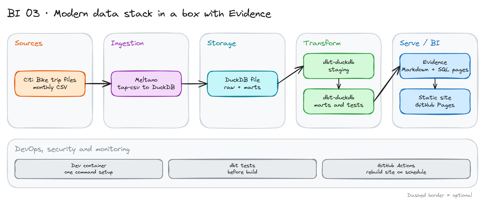

# Modern Data Stack in a Box with Evidence

> **Draft.** The outline and the plan are ready. We have not run every command yet. Check the Meltano Hub and Evidence docs for the current setup.

## Project card

| Level | Roles | Duration | Cost | Status |
|---|---|---|---|---|
| Middle | BI Developer, Analytics Engineer, Data Analyst | 5 assignments, ~3-4 h each | Free | Draft |

## Goal

You build a full BI stack on one laptop. Meltano loads bike trip data into DuckDB. dbt models it. Evidence turns Markdown and SQL into a dashboard site. GitHub Actions rebuilds and publishes the site. The whole BI layer lives in Git, like code.

## What you will learn

- Load CSV files into DuckDB with Meltano.
- Model trips into marts with dbt.
- Build report pages with Evidence: SQL blocks, charts, inputs.
- Generate one page per station with templated pages.
- Publish a static BI site with GitHub Pages.
- Rebuild the site on a schedule in CI.

## Who it is for

- **BI Developer**: you learn BI as code, with review, versions and CI.
- **Analytics Engineer**: you see how marts feed a dashboard.
- **Data Analyst**: you practice SQL-first reporting.

## Tools and services

| Tool | Used for | Free option |
|---|---|---|
| Meltano (`tap-csv`, DuckDB target) | Load files into DuckDB | Yes |
| DuckDB | Storage and query engine | Yes |
| dbt Core + `dbt-duckdb` | Staging, marts, tests | Yes |
| Evidence | Dashboards from Markdown and SQL | Yes (open source) |
| Node.js | Run Evidence | Yes |
| Dev Containers (VS Code) | Same setup on every machine | Yes |
| GitHub Actions + GitHub Pages | Build and publish | Yes |

If Meltano gives you trouble, you can load the files with `dlt` or DuckDB `read_csv` instead. Write down why you changed.

## Architecture

The diagram is at the top of this page. Source file: [`images/architecture.excalidraw`](images/architecture.excalidraw). Open it at [excalidraw.com](https://excalidraw.com) to copy or edit it.

Data flow:

1. Meltano reads the monthly Citi Bike trip files.
2. It loads them into the `raw` schema of a DuckDB file.
3. dbt builds `stg_trips`, then marts: `fct_trips`, `dim_stations`, `agg_daily_trips`.
4. Evidence queries the marts and builds pages.
5. GitHub Actions builds the static site and publishes it to GitHub Pages.

## Dataset

- **Source:** [Citi Bike system data](https://citibikenyc.com/system-data). Monthly trip files, public.
- **Fields:** ride id, bike type, start and end time, start and end station, rider type (member or casual).
- **Size:** hundreds of thousands of trips per month. Use 3 to 6 months. Pick months with the same column layout.

## Prerequisites

- Python, Node.js, Git, Docker and VS Code (or use the dev container).
- A GitHub account.
- Do first: [dbt Fundamentals with Postgres and GitHub Actions](../../de-projects/18_dbt_intro/).
- New to Git, CLI or Docker? Start with [Surfalytics Module 0](https://www.youtube.com/watch?v=LJIiCLu2gr8&list=PLNCDg7zJiXhP5Z_-TXUdorz2n7sjYHHKE&index=1).

## Assignments

Work at your own pace. Each assignment shows the expected time.

### Assignment 1: Dev container and data load (~3 h)

**Goal:** One command sets up the project. The raw trips are in DuckDB.

**Steps:**

1. Create a repo with a `.devcontainer` that installs Python, Node.js, dbt and Meltano.
2. Download 3 monthly files.
3. Configure the Meltano CSV tap and DuckDB target.
4. Run the load. Check row counts.

**Deliverable:** A repo that a teammate can open and run.

**Done when:**

- [ ] The dev container builds from scratch.
- [ ] The `raw` schema has trips from all months.
- [ ] The row count matches the sum of the CSV files.

### Assignment 2: Model with dbt (~4 h)

**Goal:** Clean marts that Evidence can read.

**Steps:**

1. Write `stg_trips`: types, timestamps, trip duration.
2. Remove bad rows (negative duration, missing stations). Count them.
3. Build `fct_trips`, `dim_stations` and `agg_daily_trips`.
4. Add tests: unique ride id, not null start time, duration range.

**Deliverable:** A dbt project with tests and a short note on removed rows.

**Done when:**

- [ ] `dbt build` passes.
- [ ] The grain of every mart is written in its description.
- [ ] The note lists how many rows you removed and why.

### Assignment 3: First Evidence dashboard (~4 h)

**Goal:** A dashboard with 4 charts and one filter.

**Steps:**

1. Create the Evidence project. Connect it to the DuckDB file.
2. Write SQL blocks for: trips per day, member versus casual, top 10 start stations, average duration by hour.
3. Add one chart per query.
4. Add a dropdown input to filter by rider type.

**Deliverable:** A running dashboard on `localhost` and a screenshot.

**Done when:**

- [ ] All 4 charts show data.
- [ ] The dropdown changes the charts.
- [ ] Every chart has a title and axis labels.

### Assignment 4: One page per station (~3 h)

**Goal:** Use templated pages to build many pages from one file.

**Steps:**

1. Create a templated page for stations.
2. Add a KPI row, a trend chart and a table of top destinations.
3. Link from the main page to the station pages.

**Deliverable:** A page for every station.

**Done when:**

- [ ] Station pages build without errors.
- [ ] Each page shows data for that station only.
- [ ] The main page links to the pages.

### Assignment 5: Publish and schedule (~3 h)

**Goal:** The site updates by itself.

**Steps:**

1. Write a GitHub Actions workflow: load, `dbt build`, build Evidence, deploy to GitHub Pages.
2. Run it on push and on a monthly schedule.
3. Make the workflow fail when a dbt test fails.

**Deliverable:** A public URL of your dashboard.

**Done when:**

- [ ] The site opens from the public URL.
- [ ] A failing dbt test stops the deploy.
- [ ] The README has the URL and the architecture diagram.

## Final result

- A BI site that is built from code, tests and CI.
- Put the repo and the live link on GitHub and LinkedIn.
- Interview answer: "I built a full stack on one machine. Meltano loads, dbt models, Evidence shows, and CI publishes. All BI work goes through pull requests."

## Clean up

Nothing to clean up. Turn off GitHub Pages if you want to remove the site.

## Resources

- [Evidence documentation](https://docs.evidence.dev): components, templated pages, deploy.
- [Meltano Hub](https://hub.meltano.com): taps and targets.
- [dbt-duckdb](https://github.com/duckdb/dbt-duckdb): the adapter docs.

## Community solutions

Share your repo in Discord. We add the best ones here.

- <Name>: <link>
