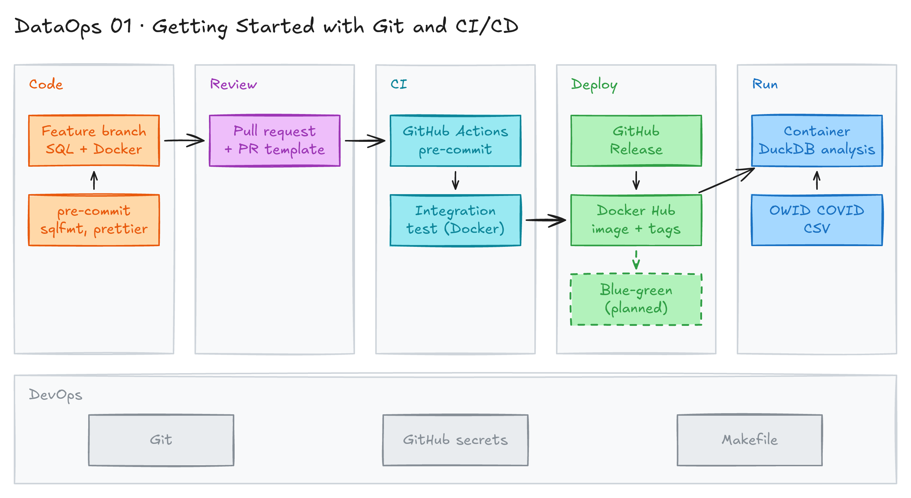

# Getting Started with Git and CI/CD



## Project card

| Level | Roles | Duration | Cost | Status |
|---|---|---|---|---|
| Beginner | Data Engineer, Analytics Engineer, DataOps Engineer | 8 assignments, ~1-3 h each | Free | Ready |

## Goal

You learn DevOps practices for data work. We call this DataOps. You take a small DuckDB analysis, put it in Docker, and protect it with code review, pre-commit hooks and CI. Then you publish the Docker image with CD and tag it with releases.

### Key terms

- **DataOps:** DevOps, Agile and Lean practices for data analytics and data engineering. Main parts:
  - Automation of ingestion, transformation and testing.
  - Collaboration between data engineers, analysts and operations.
  - Version control for pipelines, queries and models (Git).
  - CI/CD for data pipelines.
  - Monitoring and observability of data quality and pipeline health.
  - Agile: small steps, fast delivery, feedback loops.
- **CI/CD:** Continuous Integration / Continuous Deployment. Automatic test, integration and deploy of code.
- **Observability:** monitoring, tracking and logging of pipeline health, performance and errors.
- **Data quality:** accuracy, consistency and reliability of data.
- **IaC:** Infrastructure as Code. You manage servers and databases with code (Terraform, CloudFormation).
- **Version control:** tracking changes of code, config and models over time (Git).

Metrics:

- **DORA metrics:** measure DevOps/DataOps efficiency.
  - Deployment Frequency.
  - Lead Time for Changes.
  - Mean Time to Restore.
  - Change Failure Rate.
- **SLA / SLO / SLI:** Service-Level Agreement / Objective / Indicator. They define and measure reliability.
- **MTTD / MTTR:** Mean Time to Detect / Mean Time to Resolve a pipeline issue.
- **TCO:** Total Cost of Ownership of a data system.

## What you will learn

- Run a SQL analysis with the DuckDB CLI.
- Package the analysis in a Docker image and run it with `make`.
- Use branches, pull requests and a PR template for code review.
- Enforce SQL and YAML style with pre-commit hooks (`sqlfmt`, `prettier`).
- Build CI with GitHub Actions: lint checks and an integration test.
- Publish a Docker image to Docker Hub with CD and tag it from GitHub Releases.

## Who it is for

- **Data Engineer**: you ship pipelines with CI/CD, not by hand.
- **Analytics Engineer**: you learn the PR, pre-commit and CI flow that dbt projects use.
- **DataOps Engineer**: you build the base workflow: lint, test, build, publish, release.

## Tools and services

| Tool | Used for | Free option |
|---|---|---|
| Git + GitHub | Version control and pull requests | yes |
| GitHub Actions | CI/CD pipelines | yes (free minutes for public repos) |
| DuckDB CLI | Run the SQL analysis | yes |
| Docker | Package and run the analysis | yes |
| Docker Hub | Store the published image | yes (free account) |
| Make | Short commands for build and run | yes |
| pre-commit, sqlfmt, prettier | Format and check SQL and YAML | yes |

## Architecture

The diagram is at the top of this page. Source file: [`images/architecture.excalidraw`](images/architecture.excalidraw). Open it at [excalidraw.com](https://excalidraw.com) to copy or edit it.

Data flow:

1. You change SQL or code on a feature branch. pre-commit hooks check it on `git commit`.
2. You push the branch and open a pull request. A teammate reviews it.
3. GitHub Actions runs pre-commit and an integration test. The test builds the Docker image, runs it, and compares the output with the expected result.
4. After merge or a new GitHub Release, GitHub Actions builds the image and pushes it to Docker Hub with a tag.
5. Anyone can pull the image and run it. The container downloads the COVID-19 CSV and runs the DuckDB analysis.

### How the CI works

You build the CI in **your own repo**. This repo does not run these workflows, so they do not start on every pull request here. The full YAML is in Assignments 5-7.

| Workflow | Trigger | What it does | Assignment |
|---|---|---|---|
| `pre-commit.yml` | Pull request or push to `main` | Runs pre-commit hooks (whitespace, YAML, prettier, sqlfmt) on changed files | 5 |
| `verify-duckdb.yml` | Pull request or push to `main` | Builds the Docker image, runs it, and compares the DuckDB output with the expected table | 5 |
| `combined-pipeline.yml` | Pull request, push to `main`, release, manual | Joins both jobs. `needs: pre-commit` makes the test wait for the lint job. On a release it pushes the image to Docker Hub with the release tag | 5-7 |

Flow of one pull request:

1. You push a branch and open a pull request.
2. The `pre-commit` job checks only the changed files.
3. If it passes, the `verify-duckdb` job builds the image and runs the analysis.
4. The job compares the output with the expected result. A different result fails the check and blocks the merge.
5. After a GitHub Release, the pipeline builds the image again and pushes it to Docker Hub.

## Dataset

- **Source:** [Our World in Data COVID-19 dataset](https://github.com/owid/covid-19-data). File: `owid-covid-data.csv`.
- **Tables / entities:** one table `covid_data`: location, continent, date, total cases, total deaths, cases per million and more.
- **Size:** about 400,000 rows, about 90 MB.

## Prerequisites

- GitHub account.
- Docker Hub account (from Assignment 6).
- Git, Docker Desktop, Python 3.11, [DuckDB CLI](https://duckdb.org/docs/installation/), `make`, `wget`.
- New to Git, CLI or Docker? Start with [Surfalytics Module 0](https://www.youtube.com/watch?v=LJIiCLu2gr8&list=PLNCDg7zJiXhP5Z_-TXUdorz2n7sjYHHKE&index=1).

Project files in this folder:

| File | What it does |
|---|---|
| [`queries/analysis.sql`](queries/analysis.sql) | DuckDB SQL: load CSV, build summary view, export CSV, print stats |
| [`scripts/analyze_data.sh`](scripts/analyze_data.sh) | Downloads the CSV and runs the SQL in the container |
| [`.docker/Dockerfile`](.docker/Dockerfile) | Ubuntu image with the DuckDB CLI for amd64 and arm64 |
| [`makefile`](makefile) | `make build`, `make run`, `make help` |
| [`.pre-commit-config.yaml`](.pre-commit-config.yaml) | pre-commit hooks for whitespace, YAML and SQL |

## Assignments

Work at your own pace. Each assignment shows the expected time.

### Assignment 1: Local analysis with DuckDB (~1 h)

**Goal:** Run the COVID-19 analysis locally with the DuckDB CLI.

**Steps:**

1. Create a new GitHub repo. Copy the content of this folder into it. Open a terminal in the repo folder.
2. Check that DuckDB is installed. If not, [download it](https://duckdb.org/docs/installation/).

   ```bash
   duckdb --version
   # v1.1.3 19864453f7
   ```

3. Download the data:

   ```bash
   wget -O "./covid_data.csv" "https://raw.githubusercontent.com/owid/covid-19-data/master/public/data/owid-covid-data.csv"
   ```

4. Start DuckDB with a database file:

   ```bash
   duckdb analysis.db
   ```

5. Run the SQL:

   ```sql
   -- Load CSV data
   CREATE TABLE covid_data AS SELECT * FROM read_csv_auto('covid_data.csv');

   -- Total cases and deaths by location
   CREATE VIEW location_summary AS
   SELECT
       location,
       MAX(total_cases) as max_total_cases,
       MAX(total_deaths) as max_total_deaths,
       MAX(total_cases_per_million) as max_cases_per_million
   FROM covid_data
   WHERE continent IS NOT NULL
   GROUP BY location
   ORDER BY max_total_cases DESC
   LIMIT 20;

   -- Output results to CSV
   COPY (SELECT * FROM location_summary)
   TO './top_20_locations.csv'
   WITH (HEADER, DELIMITER ',');

   -- Generate some statistics
   SELECT
       COUNT(DISTINCT location) as total_locations,
       MIN(date) as earliest_date,
       MAX(date) as latest_date
   FROM covid_data
   WHERE continent IS NOT NULL;
   ```

6. Exit DuckDB (`.quit`). Delete `covid_data.csv`, `analysis.db` and `top_20_locations.csv`.

**Deliverable:** New GitHub repo with the project files. Screenshot of the statistics query result.

**Done when:**

- [ ] `top_20_locations.csv` has 20 rows.
- [ ] The statistics query shows the number of locations and the date range.
- [ ] Local data files are deleted and not committed.

### Assignment 2: Docker and Makefile (~2 h)

**Goal:** Run the same analysis in a Docker container with one command.

**Steps:**

1. Read [`.docker/Dockerfile`](.docker/Dockerfile), [`scripts/analyze_data.sh`](scripts/analyze_data.sh) and [`queries/analysis.sql`](queries/analysis.sql).
2. Build and run the container:

   ```bash
   # Build the image
   docker build -t duckdb-data-analysis -f .docker/Dockerfile .

   # Start the container and run the program
   docker run -it --rm duckdb-data-analysis

   # Start bash in the container to debug
   # docker run -it --rm duckdb-data-analysis bash
   ```

3. Add a Makefile so you do not type long commands:

   ```bash
   touch Makefile
   ```

   ```makefile
   # Define ANSI color codes
   YELLOW = \033[1;33m
   GREEN = \033[1;32m
   RESET = \033[0m

   # Target to build the Docker container
   .PHONY: build
   build:
   	@echo "$(YELLOW)Building the Docker container...$(RESET)"
   	docker build -t duckdb-data-analysis -f .docker/Dockerfile .
   	@echo "$(GREEN)Build completed successfully!$(RESET)"

   # Target to run the Docker container
   .PHONY: run
   run:
   	@echo "$(YELLOW)Starting the Docker container...$(RESET)"
   	docker run -it --rm duckdb-data-analysis
   	@echo "$(GREEN)Program executed successfully!$(RESET)"

   # Target to display help
   .PHONY: help
   help:
   	@echo "$(YELLOW)Available commands:$(RESET)"
   	@echo "  $(GREEN)make build$(RESET) - Build the Docker container."
   	@echo "  $(GREEN)make run$(RESET)   - Start the Docker container and run the program."
   ```

4. Run `make build` and `make run`.

**Deliverable:** Working Docker image and Makefile in your repo.

**Done when:**

- [ ] `make build` builds the image.
- [ ] `make run` prints the statistics table.
- [ ] The container exits with code 0.

**Hints:**

- `.PHONY` marks a target as a label, not a file. `make` always runs it, even if a file with the same name exists.
- Makefile recipes must start with a tab, not spaces.
- The SQL writes the result to `/app/output/top_20_locations.csv` inside the container.

### Assignment 3: Pull request and code review (~1 h)

**Goal:** Use a branch, a PR template and a pull request for code review.

**Steps:**

1. Add a PR template. GitHub reads it from the repo root, `docs/` or `.github/`:

   ```bash
   mkdir -p .github
   touch .github/pull_request_template.md
   ```

   ```markdown
   # Description of change

   # Links

   # Testing

   # Before Merge

   ---
   # Diligence

   - [ ] I have checked affected models for appropriate tests and metadata
   - [ ] Project has been built locally
   - [ ] Project has been tested locally
   - [ ] Each model has YAML file with model description, tests
   - [ ] dbt CI pass
   ```

2. Create a branch, commit and push:

   ```bash
   # Create the branch
   git checkout -b feature/covid-analysis

   # Check the status
   git status

   git add .

   git commit -m "Docker container"

   git push --set-upstream origin feature/covid-analysis
   ```

3. Open a pull request on GitHub. The template fills the description. Review and merge it.

**Deliverable:** A merged PR that uses the template.

**Done when:**

- [ ] The PR description shows the template sections.
- [ ] The PR is reviewed and merged to `main`.

**Hints:** You now have **code versions** and **code review** with Git.

### Assignment 4: Local code quality with pre-commit (~1.5 h)

**Goal:** Check SQL and YAML style on every `git commit`.

**Steps:**

1. Install the tools:

   ```bash
   pip3 install pre-commit shandy-sqlfmt
   ```

2. Add [`.pre-commit-config.yaml`](.pre-commit-config.yaml) to the repo root:

   ```yaml
   # Pre-commit that runs locally
   fail_fast: false

   repos:
     - repo: https://github.com/pre-commit/pre-commit-hooks
       rev: v4.6.0
       hooks:
         - id: trailing-whitespace
         - id: check-yaml

     - repo: https://github.com/pre-commit/mirrors-prettier
       rev: v3.1.0
       hooks:
         - id: prettier
           files: '\.(yaml|yml)$'

     # SQL Formatter (sqlfmt)
     - repo: https://github.com/tconbeer/sqlfmt
       rev: v0.24.0
       hooks:
         - id: sqlfmt
           name: sqlfmt
           entry: sqlfmt
           language: python
           files: \.sql$
   ```

   Check each repo's releases page for the latest `rev`.

3. Install the hooks from the repo root:

   ```bash
   pre-commit install
   # pre-commit installed at .git/hooks/pre-commit
   ```

4. Run all hooks by hand once: `pre-commit run --all-files`.
5. Make a commit. The hooks run on `git commit`. Example output:

   ```text
   git commit -m "Adding more files"
   trim trailing whitespace.................................................Passed
   check yaml...............................................................Passed
   prettier.................................................................Failed
   - hook id: prettier
   - files were modified by this hook

   sqlfmt...................................................................Failed
   - hook id: sqlfmt
   - files were modified by this hook

   1 file formatted.
   0 files left unchanged.
   dataops-projects/01_git_and_ci_cd/queries/analysis.sql formatted.
   ```

6. Add the changed files and commit again. Now all hooks pass.

**Deliverable:** `.pre-commit-config.yaml` in the repo and a commit where hooks fixed a file.

**Done when:**

- [ ] `pre-commit run --all-files` passes.
- [ ] Badly formatted SQL is fixed on commit.

**Hints:**

- The PyPI package for sqlfmt is `shandy-sqlfmt`. The `sqlfmt` package on PyPI is a different tool.
- The `mirrors-prettier` repo is archived. The pinned `rev: v3.1.0` still works. Keep the pin.

### Assignment 5: Continuous Integration with GitHub Actions (~3 h)

**Goal:** Run pre-commit and an integration test on every push and PR to `main`.

**Steps:**

1. Create the pre-commit workflow:

   ```bash
   mkdir -p .github/workflows
   touch .github/workflows/pre-commit.yml
   ```

   ```yaml
   name: Run Pre-commit Hooks

   on:
     pull_request:
       branches:
         - main
     push:
       branches:
         - main

   jobs:
     pre-commit:
       runs-on: ubuntu-latest

       steps:
         # Checkout the code and fetch all branches
         - name: Checkout code
           uses: actions/checkout@v4
           with:
             fetch-depth: 0 # Ensure the full history is fetched, not just the last commit

         # Set up Python environment
         - name: Set up Python
           uses: actions/setup-python@v5
           with:
             python-version: 3.11

         # Install dependencies and pre-commit hooks
         - name: Install dependencies
           run: |
             python -m pip install --upgrade pip
             pip install pre-commit

         # Fetch the main branch to ensure it's available for comparison
         - name: Fetch main branch
           run: git fetch origin main

         # Show pre-commit version
         - name: Run pre-commit hooks
           run: |
             pre-commit --version

         # Run pre-commit on all files changed between the current branch and main
         - name: Run pre-commit on all changed files
           run: |
             # Get the list of files changed between the current branch and main
             files=$(git diff --name-only origin/main)
             if [ -n "$files" ]; then
               pre-commit run --files $files
             else
               echo "No modified files to check."
             fi
   ```

2. Add an integration test workflow `.github/workflows/verify-duckdb.yml`. It builds the image, runs it and compares the output:

   ```yaml
   name: Verify DuckDB Output

   on:
     push:
       branches:
         - main
     pull_request:
       branches:
         - main

   jobs:
     verify-duckdb:
       runs-on: ubuntu-latest

       steps:
         # Checkout the code
         - name: Checkout code
           uses: actions/checkout@v4

         # Build the Docker container (USE YOUR PATH)
         - name: Build Docker Image
           run: |
             docker build -t duckdb-data-analysis -f .docker/Dockerfile .

         # Run the Docker container and capture the output
         - name: Run Docker Container
           id: run-container
           run: |
             # Run the container and capture output to a file
             docker run --rm duckdb-data-analysis > output.txt
             # Print the captured output
             cat output.txt

         # Verify the output matches the expected result
         - name: Verify DuckDB Output
           run: |
             # Define the expected output
             expected_output="│ total_locations │ earliest_date │ latest_date │
             │      int64      │     date      │    date     │
             ├─────────────────┼───────────────┼─────────────┤
             │             243 │ 2020-01-01    │ 2024-08-14  │
             └─────────────────┴───────────────┴─────────────┘"

             # Compare the actual output with the expected output
             actual_output=$(cat output.txt | grep -A4 "total_locations")
             if [ "$actual_output" = "$expected_output" ]; then
               echo "Output matches expected values."
             else
               echo "Output does not match expected values!"
               echo "Actual output:"
               echo "$actual_output"
               echo "Expected output:"
               echo "$expected_output"
               exit 1
             fi
   ```

3. Make the Dockerfile work on both ARM (for example, a Mac laptop) and AMD64 (the GitHub runner). [`.docker/Dockerfile`](.docker/Dockerfile) already has this step:

   ```dockerfile
   # Download and install DuckDB CLI dynamically based on system architecture
   RUN ARCH=$(uname -m) && \
       if [ "$ARCH" = "x86_64" ]; then \
           echo "Installing DuckDB CLI for x86_64 (amd64)"; \
           wget https://github.com/duckdb/duckdb/releases/download/v1.1.3/duckdb_cli-linux-amd64.zip; \
       elif [ "$ARCH" = "aarch64" ]; then \
           echo "Installing DuckDB CLI for ARM64 (aarch64)"; \
           wget https://github.com/duckdb/duckdb/releases/download/v1.1.3/duckdb_cli-linux-aarch64.zip; \
       else \
           echo "Unsupported architecture: $ARCH" && exit 1; \
       fi && \
       unzip duckdb_cli-linux-*.zip && \
       chmod +x duckdb && \
       mv duckdb /usr/local/bin/ && \
       rm duckdb_cli-linux-*.zip
   ```

4. Push and check that both workflows pass. Note that the two workflows run in parallel.
5. Chain the jobs. Replace the two files with one file `.github/workflows/combined-pipeline.yml`. `needs: pre-commit` makes the test wait for the lint job:

   ```yaml
   name: Combined Pre-commit and Verify DuckDB Output

   on:
     pull_request:
       branches:
         - main
     push:
       branches:
         - main

   jobs:
     # Pre-commit job
     pre-commit:
       name: Run Pre-commit Hooks
       runs-on: ubuntu-latest

       steps:
         - name: Checkout code
           uses: actions/checkout@v4
           with:
             fetch-depth: 0 # Ensure full history is fetched

         - name: Set up Python
           uses: actions/setup-python@v5
           with:
             python-version: 3.11

         - name: Install dependencies
           run: |
             python -m pip install --upgrade pip
             pip install pre-commit

         - name: Fetch main branch
           run: git fetch origin main

         - name: Run pre-commit hooks
           run: |
             pre-commit --version

         - name: Run pre-commit on all changed files
           run: |
             files=$(git diff --name-only origin/main)
             if [ -n "$files" ]; then
               pre-commit run --files $files
             else
               echo "No modified files to check."
             fi

     # DuckDB verification job
     verify-duckdb:
       name: Verify DuckDB Output
       runs-on: ubuntu-latest
       needs: pre-commit # Ensures this runs after pre-commit job

       steps:
         - name: Checkout code
           uses: actions/checkout@v4

         - name: Build Docker Image
           run: |
             docker build -t duckdb-data-analysis -f .docker/Dockerfile .

         - name: Run Docker Container
           id: run-container
           run: |
             docker run --rm duckdb-data-analysis > output.txt
             cat output.txt

         - name: Verify DuckDB Output
           run: |
             expected_output="│ total_locations │ earliest_date │ latest_date │
             │      int64      │     date      │    date     │
             ├─────────────────┼───────────────┼─────────────┤
             │             243 │ 2020-01-01    │ 2024-08-14  │
             └─────────────────┴───────────────┴─────────────┘"

             actual_output=$(cat output.txt | grep -A4 "total_locations")
             if [ "$actual_output" = "$expected_output" ]; then
               echo "Output matches expected values."
             else
               echo "Output does not match expected values!"
               echo "Actual output:"
               echo "$actual_output"
               echo "Expected output:"
               echo "$expected_output"
               exit 1
             fi
   ```

**Deliverable:** `combined-pipeline.yml` and a screenshot of a green run on a PR.

**Done when:**

- [ ] Pre-commit runs in CI on every PR to `main`.
- [ ] The integration test fails when the output changes.
- [ ] `verify-duckdb` starts only after `pre-commit` passes.

**Hints:**

- **Integration test:** checks that several parts (script, DuckDB, Docker) work together and give the expected result.
- **Unit test:** checks one small function alone, without external systems.
- The expected numbers (243 locations, last date 2024-08-14) depend on the source file. If your run shows other values, put your own values in `expected_output`.

### Assignment 6: Continuous Deployment to Docker Hub (~2 h)

**Goal:** After merge to `main`, build the image and push it to Docker Hub.

**Steps:**

1. Understand the idea. A production app uses the latest Docker image, not the code in `main`. So after merge we must publish a new image to a registry (Docker Hub or GitHub Container Registry).
2. Create a [Docker Hub](https://hub.docker.com/) account. Create an access token in Account settings.
3. In GitHub, go to **Settings → Secrets and variables → Actions**. Add `DOCKER_USERNAME` (your Docker Hub user) and `DOCKER_PASSWORD` (the access token).
4. Add a `publish` job to `combined-pipeline.yml`:

   ```yaml
     # Publish job
     publish:
       name: Publish Docker Image
       runs-on: ubuntu-latest
       needs: verify-duckdb # Ensures this runs after verification job

       steps:
         - name: Checkout code
           uses: actions/checkout@v4

         - name: Log in to Docker Hub
           uses: docker/login-action@v3
           with:
             username: ${{ secrets.DOCKER_USERNAME }}
             password: ${{ secrets.DOCKER_PASSWORD }}

         - name: Determine Image Tag
           id: tag
           run: |
             if [ "${{ github.event_name }}" == "push" ]; then
               echo "tag=latest" >> $GITHUB_ENV
             elif [ "${{ github.event_name }}" == "pull_request" ]; then
               echo "tag=pr-${{ github.event.pull_request.number }}" >> $GITHUB_ENV
             else
               echo "tag=dev-${{ github.sha }}" >> $GITHUB_ENV
             fi

         - name: Build Docker Image
           run: |
             docker build -t ${{ secrets.DOCKER_USERNAME }}/duckdb-data-analysis:${{ env.tag }} -f .docker/Dockerfile .

         - name: Push Docker Image
           run: |
             docker push ${{ secrets.DOCKER_USERNAME }}/duckdb-data-analysis:${{ env.tag }}
   ```

5. Merge a PR. Then test the published image on your laptop:

   ```bash
   docker pull <your-dockerhub-username>/duckdb-data-analysis:latest
   docker run --rm <your-dockerhub-username>/duckdb-data-analysis:latest
   ```

**Deliverable:** Image on Docker Hub with `latest` and `pr-<N>` tags.

**Done when:**

- [ ] A PR pushes an image with tag `pr-<N>`.
- [ ] A merge to `main` pushes the `latest` tag.
- [ ] `docker run` of the pulled image prints the statistics.
- [ ] No credentials are in the code. Only GitHub secrets.

### Assignment 7: Cut a release (~2 h)

**Goal:** Tag the Docker image with the version of a GitHub Release.

**Steps:**

1. Update `combined-pipeline.yml`. Add the `release` and `workflow_dispatch` triggers. Use the release tag as the image tag:

   ```yaml
   name: Combined Pre-commit, Verify DuckDB Output, and Publish Image

   on:
     pull_request:
       branches:
         - main
     push:
       branches:
         - main
     release:
       types:
         - published # Trigger when a release is published
     workflow_dispatch: # Manual trigger for convenience

   jobs:
     # Pre-commit job
     pre-commit:
       name: Run Pre-commit Hooks
       runs-on: ubuntu-latest

       steps:
         - name: Checkout code
           uses: actions/checkout@v4
           with:
             fetch-depth: 0

         - name: Set up Python
           uses: actions/setup-python@v5
           with:
             python-version: 3.11

         - name: Install dependencies
           run: |
             python -m pip install --upgrade pip
             pip install pre-commit

         - name: Fetch main branch
           run: git fetch origin main

         - name: Run pre-commit hooks
           run: |
             files=$(git diff --name-only origin/main)
             if [ -n "$files" ]; then
               pre-commit run --files $files
             else
               echo "No modified files to check."
             fi

     # DuckDB verification job
     verify-duckdb:
       name: Verify DuckDB Output
       runs-on: ubuntu-latest
       needs: pre-commit

       steps:
         - name: Checkout code
           uses: actions/checkout@v4

         - name: Build Docker Image
           run: |
             docker build -t duckdb-data-analysis -f .docker/Dockerfile .

         - name: Run Docker Container
           id: run-container
           run: |
             docker run --rm duckdb-data-analysis > output.txt
             cat output.txt

         - name: Verify DuckDB Output
           run: |
             expected_output="│ total_locations │ earliest_date │ latest_date │
             │      int64      │     date      │    date     │
             ├─────────────────┼───────────────┼─────────────┤
             │             243 │ 2020-01-01    │ 2024-08-14  │
             └─────────────────┴───────────────┴─────────────┘"

             actual_output=$(cat output.txt | grep -A4 "total_locations")
             if [ "$actual_output" = "$expected_output" ]; then
               echo "Output matches expected values."
             else
               echo "Output does not match expected values!"
               echo "Actual output:"
               echo "$actual_output"
               echo "Expected output:"
               echo "$expected_output"
               exit 1
             fi

     # Publish job
     publish:
       name: Publish Docker Image
       runs-on: ubuntu-latest
       needs: verify-duckdb

       steps:
         - name: Checkout code
           uses: actions/checkout@v4

         - name: Log in to Docker Hub
           uses: docker/login-action@v3
           with:
             username: ${{ secrets.DOCKER_USERNAME }}
             password: ${{ secrets.DOCKER_PASSWORD }}

         - name: Determine Image Tag
           id: tag
           run: |
             if [ "${{ github.event_name }}" == "release" ]; then
               echo "tag=${{ github.event.release.tag_name }}" >> $GITHUB_ENV
             elif [ "${{ github.ref_type }}" == "tag" ]; then
               echo "tag=${{ github.ref_name }}" >> $GITHUB_ENV
             elif [ "${{ github.event_name }}" == "push" ]; then
               echo "tag=latest" >> $GITHUB_ENV
             elif [ "${{ github.event_name }}" == "pull_request" ]; then
               echo "tag=pr-${{ github.event.pull_request.number }}" >> $GITHUB_ENV
             fi

         - name: Build Docker Image
           run: |
             docker build -t ${{ secrets.DOCKER_USERNAME }}/duckdb-data-analysis:${{ env.tag }} -f .docker/Dockerfile .

         - name: Push Docker Image
           run: |
             docker push ${{ secrets.DOCKER_USERNAME }}/duckdb-data-analysis:${{ env.tag }}
   ```

2. In GitHub, go to **Releases → Draft a new release**. Create tag `v1.0.0` and publish it.
3. Check Docker Hub. You see the tag `v1.0.0`.

**Deliverable:** A GitHub Release and a matching image tag on Docker Hub.

**Done when:**

- [ ] Publishing release `v1.0.0` pushes image tag `v1.0.0`.
- [ ] `workflow_dispatch` lets you run the pipeline by hand from the Actions tab.

**Hints:** The `release` event runs on the tag commit, not on `main`. In that case `git diff origin/main` can be empty, so pre-commit has no files to check.

### Assignment 8: Blue-green deployment (Planned) (~2 h)

**Goal:** Learn how to switch production to a new image version with no downtime.

**Steps:**

1. Build Docker images and push them to a registry (for example, GHCR).
2. Deploy to a target platform (for example, Kubernetes) in two stages:
   - **Blue:** the stable version (current production).
   - **Green:** the new version (deployment candidate).
3. Verify Green.
4. Switch traffic from Blue to Green.
5. Keep Blue for a fast rollback.

**Deliverable:** A short write-up or diagram of your blue-green flow.

**Done when:**

- [ ] You can explain how traffic moves from Blue to Green and how to roll back.

## Final result

- A GitHub repo with a Dockerized DuckDB analysis, pre-commit, a PR template and a CI/CD pipeline.
- A Docker Hub image with `latest`, `pr-<N>` and release tags.
- Post the repo and a screenshot of the green pipeline on LinkedIn.
- Interview pitch: "I built a CI/CD pipeline for a SQL analysis. Pre-commit checks style on commit. GitHub Actions runs lint and an integration test on each PR, then publishes a tagged Docker image on merge and on release."

## Clean up

- Remove local Docker images: `docker rmi duckdb-data-analysis`.
- Delete local data files: `covid_data.csv`, `analysis.db`, `top_20_locations.csv`.
- Optional: delete the Docker Hub repository and revoke the Docker Hub access token.
- No cloud resources to delete.

## Resources

- [GitHub Actions documentation](https://docs.github.com/en/actions): workflows, events, secrets.
- [pre-commit](https://pre-commit.com/): hook framework and config.
- [sqlfmt](https://sqlfmt.com/): SQL formatter for dbt-style SQL.
- [DuckDB CLI](https://duckdb.org/docs/api/cli/overview): run SQL from the terminal.
- [Dockerfile reference](https://docs.docker.com/reference/dockerfile/): build instructions.
- [docker/login-action](https://github.com/docker/login-action): log in to registries in GitHub Actions.
- [DORA metrics](https://dora.dev/): how to measure delivery performance.

## Community solutions

Share your repo in Discord. We add the best ones here.

- <Name>: <link>
