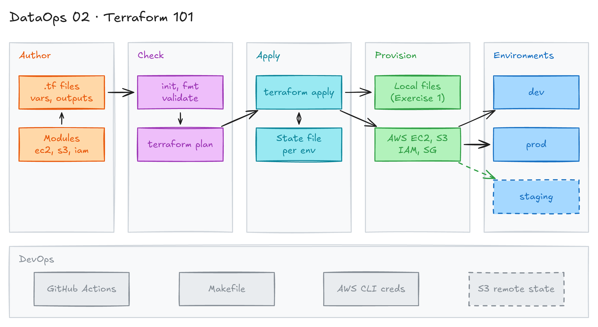

# Terraform 101



## Project card

| Level | Roles | Duration | Cost | Status |
|---|---|---|---|---|
| Base | DataOps Engineer, Data Engineer | 6 assignments, ~1-3 h each | Free trial | In progress |

## Goal

You learn Infrastructure as Code (IaC) with Terraform. You start with local resources, then create EC2, S3 and IAM in AWS. You move from one file to a clean file structure, then to dev/prod environments and reusable modules.

## What you will learn

- Terraform basics: providers, resources, variables, outputs, locals, state.
- `count`, `for_each`, conditionals, data sources, dynamic blocks, `templatefile()`.
- Create AWS EC2, S3 and IAM resources with security best practices.
- Organize Terraform code in files like a real project.
- Separate dev and prod environments with isolated state.
- Build reusable modules and run Terraform checks in CI.

## Who it is for

- **DataOps Engineer**: IaC is the base skill to build and change data platforms safely.
- **Data Engineer**: you create buckets, roles and compute for pipelines with code, not by hand.

## Tools and services

| Tool | Used for | Free option |
|---|---|---|
| Terraform (>= 1.0, validated with 1.16) | Define and create infrastructure | yes |
| `local` and `random` providers | Learn Terraform without a cloud account | yes |
| AWS EC2, S3, IAM | Real cloud resources (AWS provider `~> 6.0`) | trial (AWS Free Tier credits) |
| AWS CLI | Credentials and checks | yes |
| GitHub Actions | Run `fmt`, `validate`, `plan` on each PR | yes |
| Make | Short commands (`make help`) | yes |

### Exercise overview

| # | Exercise | Folder | Level | Cost |
|---|---|---|---|---|
| 1 | Terraform basics | [`exercises/01-basics`](exercises/01-basics/) | Beginner | Free (local only) |
| 2 | Simple AWS | [`exercises/02-simple-aws`](exercises/02-simple-aws/) | Beginner | ~$0.01/hour |
| 3 | Structured AWS | [`exercises/03-structured-aws`](exercises/03-structured-aws/) | Intermediate | ~$0.01/hour |
| 4 | Environments | [`exercises/04-environments`](exercises/04-environments/) | Intermediate | ~$0.03/hour |
| 5 | Modules | [`exercises/05-modules`](exercises/05-modules/) | Advanced | ~$0.03/hour |
| 6 | Terraform in CI | this README | Intermediate | Free |

Full guide with a skills matrix and cost table: [`exercises/README.md`](exercises/README.md).

## Architecture

The diagram is at the top of this page. Source file: [`images/architecture.excalidraw`](images/architecture.excalidraw). Open it at [excalidraw.com](https://excalidraw.com) to copy or edit it.

Data flow:

1. You write `.tf` files: providers, variables, resources, outputs, and later modules.
2. `terraform init`, `fmt` and `validate` check the code. GitHub Actions runs the same checks on each PR.
3. `terraform plan` shows the changes. `terraform apply` creates them.
4. Terraform creates local files (Exercise 1) or AWS resources: EC2, S3, IAM, security group (Exercises 2-5).
5. Terraform saves what it created in a state file, one per environment (dev, prod).
6. `terraform output` shows values like the EC2 public IP or the bucket name. `terraform destroy` deletes all.

## Dataset

No dataset. This project creates infrastructure, not data.

## Prerequisites

- [Terraform](https://developer.hashicorp.com/terraform/install) >= 1.0.
- AWS account and [AWS CLI](https://docs.aws.amazon.com/cli/latest/userguide/getting-started-install.html) (from Assignment 2).
- Basic command line skills. New to Git, CLI or Docker? Start with [Surfalytics Module 0](https://www.youtube.com/watch?v=LJIiCLu2gr8&list=PLNCDg7zJiXhP5Z_-TXUdorz2n7sjYHHKE&index=1).
- Recommended: [DataOps 01 · Git and CI/CD](../01_git_and_ci_cd/).

Project structure:

```text
02_terraform_101/
├── exercises/              # Progressive learning exercises
│   ├── 01-basics/          # Terraform fundamentals (local providers)
│   ├── 02-simple-aws/      # AWS resources in a single file
│   ├── 03-structured-aws/  # Professional file organization
│   ├── 04-environments/    # Dev/prod environment separation
│   ├── 05-modules/         # Reusable Terraform modules
│   └── README.md           # Exercises guide and learning path
├── providers.tf            # Provider configuration (same as 01-basics)
├── variables.tf            # Variable examples: string, number, bool, list, map, object
├── main.tf                 # Example resources with comments
├── outputs.tf              # Output examples
├── terraform.tfvars.example
├── Makefile                # Short commands (make help)
└── .gitignore              # Terraform-specific gitignore
```

### Key Terraform concepts

- **Provider:** a plugin to talk to a cloud, SaaS or API.
- **Resource:** one infrastructure object, for example a bucket or a file.
- **Variable:** an input that changes values without changing code.
- **Output:** a value Terraform shows after apply.
- **State:** `terraform.tfstate` stores what Terraform created. Never commit it.

### Best practices

1. Commit `.tf` files to Git.
2. Never commit `terraform.tfstate`, `*.tfvars` with secrets, or credentials.
3. Use remote state (S3, Azure Blob, GCS) in a team.
4. Run `terraform plan` before `terraform apply`.
5. Use variables, not hardcoded values.
6. Add comments and a README.
7. Run `terraform fmt` before commit.
8. Run `terraform validate` often.

## Assignments

Work at your own pace. Each assignment shows the expected time. Run `terraform destroy` at the end of each AWS assignment.

### Assignment 1: Terraform basics with local providers (~1 h)

**Goal:** Learn the Terraform workflow without a cloud account.

**Folder:** [`exercises/01-basics`](exercises/01-basics/). Full guide: [`exercises/01-basics/README.md`](exercises/01-basics/README.md). The same code is in the project root, with a [`Makefile`](Makefile).

**Steps:**

1. Read [`providers.tf`](exercises/01-basics/providers.tf), [`variables.tf`](exercises/01-basics/variables.tf), [`main.tf`](exercises/01-basics/main.tf) and [`outputs.tf`](exercises/01-basics/outputs.tf).
2. Run the workflow:

   ```bash
   cd exercises/01-basics

   # Download providers
   terraform init

   # Check syntax
   terraform validate

   # Format code
   terraform fmt

   # Preview changes
   terraform plan

   # Create resources (type "yes" to confirm)
   terraform apply

   # Show outputs
   terraform output
   ```

3. Check the files in `output/`. The code creates a random suffix, a text file with timestamp and environment, and several files with `count`.
4. Change a variable:

   ```bash
   terraform apply -var="environment=staging"
   ```

5. Use a variables file. Copy [`terraform.tfvars.example`](terraform.tfvars.example) to `terraform.tfvars`:

   ```hcl
   environment  = "prod"
   project_name = "my-terraform-project"

   tags = {
     ManagedBy = "Terraform"
     Project   = "DataOps"
     Team      = "Platform"
   }
   ```

   Then run `terraform apply`.

6. Look at state: `terraform state list`, `terraform show`.
7. Do the challenges in the exercise README: a new variable `owner_email`, a resource only in `prod`, and a `for` expression output.
8. Clean up: `terraform destroy`.

**Deliverable:** Your repo with the basics code and one solved challenge.

**Done when:**

- [ ] `terraform apply` creates the local files.
- [ ] You can explain variables, outputs, locals, `count` and `for_each`.
- [ ] `terraform destroy` removes all resources.

**Hints:** In the project root, `make setup`, `make plan`, `make apply`, `make output`, `make destroy` and `make clean` run the same steps. `make help` lists all commands.

### Assignment 2: Simple AWS resources (~1.5 h)

**Goal:** Create EC2, S3, IAM and a security group in AWS from one file.

**Folder:** [`exercises/02-simple-aws`](exercises/02-simple-aws/). Full guide: [`exercises/02-simple-aws/README.md`](exercises/02-simple-aws/README.md). Code: [`main.tf`](exercises/02-simple-aws/main.tf).

**Steps:**

1. Configure AWS credentials. Use one option:

   ```bash
   # Option A: AWS CLI
   aws configure

   # Option B: environment variables
   export AWS_ACCESS_KEY_ID="your-access-key"
   export AWS_SECRET_ACCESS_KEY="your-secret-key"
   export AWS_DEFAULT_REGION="us-east-1"

   # Option C: AWS SSO
   aws sso login
   ```

2. Get your public IP with `curl -s ifconfig.me`. Set `my_ip = "<your-ip>/32"` in `terraform.tfvars` to restrict SSH.
3. Run `terraform init`, `terraform plan`, `terraform apply`.
4. Verify the resources:

   ```bash
   terraform output ec2_public_ip
   aws s3 ls | grep terraform101
   aws iam get-role --role-name $(terraform output -raw iam_role_name)
   ```

5. Make changes and watch the plan:
   - Add an ingress rule for port 80. Open the web server.
   - Change `instance_type` from `t3.micro` to `t3.small`. Is it an update or a replacement?
   - Add an `aws_s3_object` resource.
6. Clean up: `terraform destroy`.

**Deliverable:** Screenshot of `terraform apply` output and of the resources in the AWS console.

**Done when:**

- [ ] EC2, S3 bucket, IAM role and security group exist.
- [ ] SSH is open only to your IP.
- [ ] `terraform destroy` removes all resources.

**Hints:**

- S3 bucket names are global. If the name exists, change `project_name`.
- The code uses `t3.micro` and Amazon Linux 2023. Amazon Linux 2 support ended on June 30, 2026. `t2.micro` is not Free Tier eligible for accounts created after July 15, 2025.

### Assignment 3: Structured AWS code (~2 h)

**Goal:** Organize the AWS code in files like a real project.

**Folder:** [`exercises/03-structured-aws`](exercises/03-structured-aws/). Full guide: [`exercises/03-structured-aws/README.md`](exercises/03-structured-aws/README.md).

**Steps:**

1. Read each file:
   - [`data.tf`](exercises/03-structured-aws/data.tf): data sources (existing AWS objects).
   - [`locals.tf`](exercises/03-structured-aws/locals.tf): computed values and tags.
   - [`security-groups.tf`](exercises/03-structured-aws/security-groups.tf): allowed traffic, dynamic blocks.
   - [`iam.tf`](exercises/03-structured-aws/iam.tf): EC2 permissions.
   - [`ec2.tf`](exercises/03-structured-aws/ec2.tf), [`s3.tf`](exercises/03-structured-aws/s3.tf), [`user-data.sh`](exercises/03-structured-aws/user-data.sh).
2. Create `terraform.tfvars`:

   ```hcl
   aws_region     = "us-east-1"
   environment    = "dev"
   project_name   = "myproject"
   my_ip          = "YOUR_IP_HERE/32"
   enable_http    = true
   instance_type  = "t3.micro"
   ```

3. Run `terraform init`, `terraform plan`, `terraform apply`.
4. Test: open the web server URL from `terraform output`. Check the startup logs the instance uploaded to S3.
5. Draw the dependency graph:

   ```bash
   terraform graph | dot -Tpng > graph.png
   ```

6. Clean up: `terraform destroy`.

**Deliverable:** Your structured code and `graph.png`.

**Done when:**

- [ ] Each resource type is in its own file.
- [ ] User data comes from `templatefile()`.
- [ ] S3 has encryption and a lifecycle policy. EC2 uses IMDSv2.
- [ ] You can explain how this differs from Assignment 2.

**Hints:** `dot` comes from Graphviz (`brew install graphviz`).

### Assignment 4: Dev and prod environments (~2 h)

**Goal:** Manage dev and prod with different settings and separate state.

**Folder:** [`exercises/04-environments`](exercises/04-environments/). Full guide: [`exercises/04-environments/README.md`](exercises/04-environments/README.md). Code: [`dev/`](exercises/04-environments/dev/) and [`prod/`](exercises/04-environments/prod/).

| Aspect | Dev | Prod |
|---|---|---|
| Instance | t3.micro | t3.small |
| Monitoring | Disabled | Enabled |
| Volume | 8 GB | 20 GB |
| SSH access | Open | Restricted |

**Steps:**

1. Deploy dev, then prod:

   ```bash
   cd exercises/04-environments/dev
   terraform init
   terraform plan
   terraform apply

   cd ../prod
   terraform init
   terraform plan
   terraform apply
   ```

2. Compare outputs:

   ```bash
   cd ../dev && terraform output > /tmp/dev-outputs.txt
   cd ../prod && terraform output > /tmp/prod-outputs.txt
   diff /tmp/dev-outputs.txt /tmp/prod-outputs.txt
   ```

3. Use a saved plan for prod, as a simple approval step:

   ```bash
   terraform plan -out=prod.tfplan
   # Get approval from the team
   terraform apply prod.tfplan
   ```

4. Add a `staging/` folder. Copy `dev/` and set values between dev and prod.
5. Move state to S3. Create a state bucket, uncomment the `backend "s3"` block in `main.tf`, then run `terraform init -migrate-state`.
6. Add a prod-only resource, for example a CPU alarm:

   ```hcl
   resource "aws_cloudwatch_metric_alarm" "cpu" {
     count = var.environment == "prod" ? 1 : 0
     # ...
   }
   ```

7. Clean up: `terraform destroy` in every environment folder.

**Deliverable:** dev, staging and prod folders, and remote state in S3.

**Done when:**

- [ ] Each environment has its own state.
- [ ] Prod uses a bigger instance and monitoring.
- [ ] Prod changes go through `plan -out` and `apply <plan>`.

**Hints:** Another option is Terraform workspaces. The exercise README compares both approaches.

### Assignment 5: Reusable modules (~3 h)

**Goal:** Move EC2, S3 and IAM code into modules and use them from dev and prod.

**Folder:** [`exercises/05-modules`](exercises/05-modules/). Full guide: [`exercises/05-modules/README.md`](exercises/05-modules/README.md).

> The module code is not in the repo yet. The `modules/` and `environments/` folders are empty. You write the modules yourself from the Assignment 4 code.

**Steps:**

1. Create three modules, each with `main.tf`, `variables.tf`, `outputs.tf` and a README:
   - `modules/ec2`: EC2 instance with a security group.
   - `modules/s3`: S3 bucket with security settings.
   - `modules/iam`: IAM role for EC2.
2. Call the modules from `environments/dev` and `environments/prod`:

   ```hcl
   module "web" {
     source        = "../../modules/ec2"
     instance_type = "t3.micro"
     # ...
   }
   ```

3. Deploy dev and prod:

   ```bash
   cd exercises/05-modules/environments/dev
   terraform init
   terraform plan
   terraform apply

   cd ../prod
   terraform init
   terraform plan
   terraform apply
   ```

4. Add a new tag in `modules/ec2/main.tf`. Run `plan` in both environments. Both get the change.
5. Add input validation and useful outputs to each module.
6. Clean up: `terraform destroy` in both environment folders.

**Deliverable:** Three modules and two environments that use them.

**Done when:**

- [ ] dev and prod use the same modules with different inputs.
- [ ] Each module has a README with inputs and outputs.
- [ ] A change in one module shows in the plan of both environments.

**Hints:** Modules can also come from the [Terraform Registry](https://registry.terraform.io/) or Git with a version: `source = "git::ssh://git@github.com/company/modules.git//ec2?ref=v1.0.0"`. For automated tests, look at Terratest or `terraform test`.

### Assignment 6: Terraform in CI with GitHub Actions (~2 h)

**Goal:** Check format, validate and plan on every push and PR.

**Steps:**

1. Push your Terraform code to GitHub.
2. Add `.github/workflows/terraform.yml`:

   ```yaml
   name: Terraform

   on:
     push:
       branches: [main]
     pull_request:

   jobs:
     terraform:
       runs-on: ubuntu-latest
       steps:
         - uses: actions/checkout@v7
         - uses: hashicorp/setup-terraform@v4

         - name: Terraform Init
           run: terraform init

         - name: Terraform Format
           run: terraform fmt -check

         - name: Terraform Validate
           run: terraform validate

         - name: Terraform Plan
           run: terraform plan
   ```

3. Open a PR with badly formatted code. See the check fail. Fix it with `terraform fmt`.
4. Optional: the root [`Makefile`](Makefile) has `make ci` (init, validate, fmt-check, plan). Call it from the workflow.

**Deliverable:** A workflow file and a screenshot of a green run.

**Done when:**

- [ ] The workflow runs on every PR.
- [ ] Bad formatting fails the check.

**Hints:** For AWS code, `plan` needs credentials. Use GitHub OIDC with an IAM role, or run `plan` only for the local-provider code.

## Final result

- A GitHub repo with Terraform code from basics to modules, with dev and prod.
- A CI workflow that checks every PR.
- Post the repo and your dependency graph on LinkedIn.
- Interview pitch: "I built AWS infrastructure with Terraform: EC2, S3 and IAM. I split dev and prod with separate state, moved shared code into modules, and check every change in CI with fmt, validate and plan."

## Clean up

- Run `terraform destroy` in every folder where you ran `apply`: `exercises/02-simple-aws`, `exercises/03-structured-aws`, `exercises/04-environments/dev`, `prod`, `staging`, `exercises/05-modules/environments/dev` and `prod`.
- Check in the AWS console that no EC2 instances, S3 buckets or IAM roles with your project name are left.
- Delete the S3 state bucket from Assignment 4 last.
- Local only: `make clean` removes `.terraform/` and state files.
- Set up an AWS billing alert.

## Resources

- [Terraform documentation](https://developer.hashicorp.com/terraform/docs): language and CLI.
- [Terraform tutorials](https://developer.hashicorp.com/terraform/tutorials): official step-by-step guides.
- [Terraform Registry](https://registry.terraform.io/): providers and modules.
- [AWS provider docs](https://registry.terraform.io/providers/hashicorp/aws/latest/docs): all AWS resources.
- [Terraform AWS modules](https://github.com/terraform-aws-modules): community modules.
- [Terraform best practices](https://www.terraform-best-practices.com/): code structure and naming.
- [Terraform style guide](https://developer.hashicorp.com/terraform/language/style): official style rules.
- [AWS Free Tier](https://aws.amazon.com/free/): what is free. Accounts created on or after July 15, 2025 get credits for 6 months, not 12 months of free usage.
- [EC2 Free Tier instance types](https://docs.aws.amazon.com/AWSEC2/latest/UserGuide/ec2-free-tier-usage.html): `t3.micro` is eligible for old and new accounts.
- [AWS provider v6 upgrade guide](https://registry.terraform.io/providers/hashicorp/aws/latest/docs/guides/version-6-upgrade): `data.aws_region.name` is now `region`, `aws_s3_bucket.region` is now `bucket_region`.
- [Amazon Linux 2 FAQ](https://aws.amazon.com/amazon-linux-2/faqs/): end of support on June 30, 2026. Use Amazon Linux 2023.
- [hashicorp/setup-terraform](https://github.com/hashicorp/setup-terraform): GitHub Action to install Terraform.
- [Terraform Associate certification](https://www.hashicorp.com/certification/terraform-associate): next step.

Common commands:

```bash
terraform init                       # Initialize working directory
terraform validate                   # Validate configuration
terraform fmt                        # Format code
terraform plan                       # Preview changes
terraform apply                      # Apply changes
terraform show                       # Show current state
terraform state list                 # List resources
terraform output                     # View outputs
terraform destroy                    # Destroy all resources
terraform apply -refresh-only        # Refresh state (replaces terraform refresh)
terraform import <type>.<name> <id>  # Import an existing resource
terraform state rm <address>         # Remove from state (does not delete the resource)
terraform force-unlock <LOCK_ID>     # Release a stuck state lock
```

Troubleshooting:

| Error | Fix |
|---|---|
| `terraform: command not found` | [Install Terraform](https://developer.hashicorp.com/terraform/install). |
| Terraform not initialized / provider not found | Run `terraform init`. Check `providers.tf`. |
| AWS credentials not configured | Run `aws configure` or set environment variables. |
| Bucket name already exists | S3 names are global. Change `project_name`. |
| State lock error | Another run is active or crashed. Use `terraform force-unlock <LOCK_ID>`. |
| Permission errors | Check your cloud credentials and IAM permissions. |

## Community solutions

Share your repo in Discord. We add the best ones here.

- <Name>: <link>
