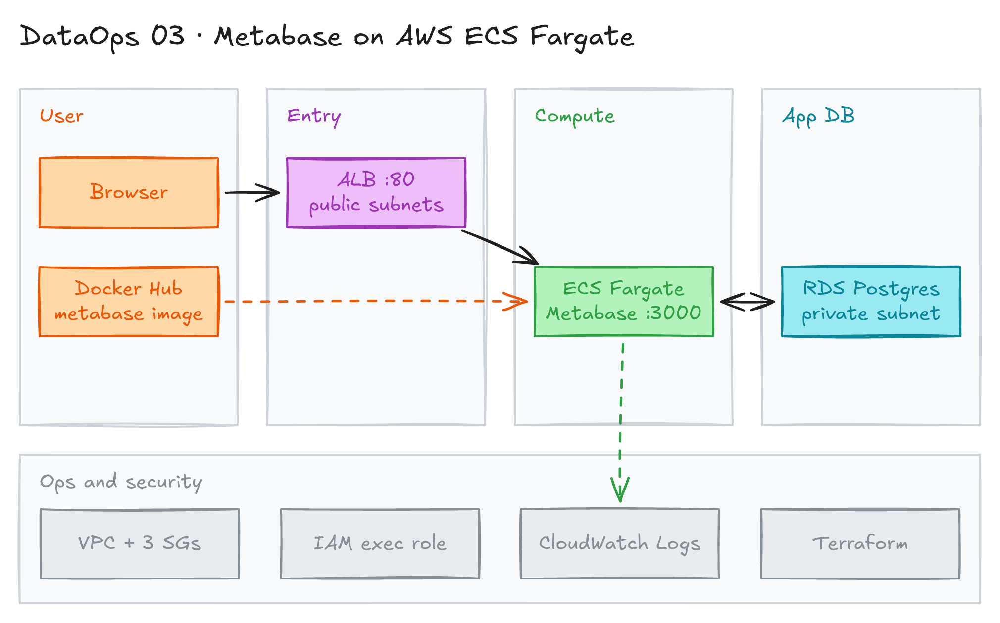
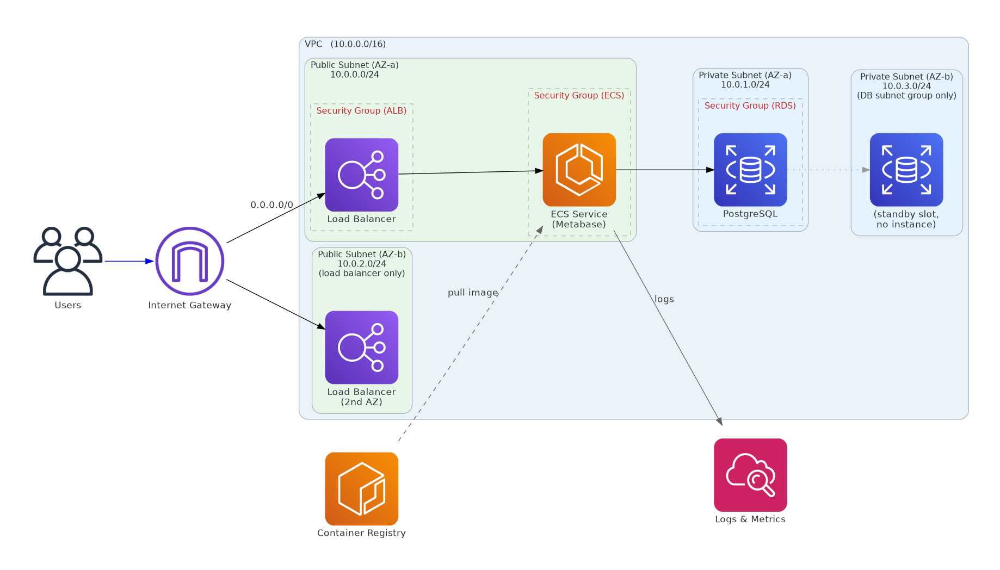

# Metabase on AWS ECS Fargate



## Project card

| Level | Roles | Duration | Cost | Status |
|---|---|---|---|---|
| Middle | DataOps Engineer, Data Engineer, BI Developer | 4 assignments, ~1-3 h each | Paid (~$2.5/day) | Ready |

## Goal

You deploy Metabase, an open-source BI tool, on AWS. Metabase runs as a container on ECS Fargate behind a load balancer. Its application database is RDS PostgreSQL in a private subnet. First you build it by hand in the AWS Console. Then you build the same setup with Terraform.

## What you will learn

- Build a VPC with public and private subnets in 2 Availability Zones.
- Use security groups to allow only the traffic you need.
- Run a Docker container on ECS Fargate from a public Docker Hub image.
- Put an Application Load Balancer in front of a container.
- Read container logs in CloudWatch.
- Deploy the same infrastructure as code with Terraform.

## Who it is for

- **DataOps Engineer**: deploy and run a BI tool on cloud infrastructure.
- **Data Engineer**: learn the AWS network and container basics behind most data platforms.
- **BI Developer**: self-host Metabase instead of using a paid SaaS plan.

## Tools and services

| Tool | Used for | Free option |
|---|---|---|
| AWS VPC | Network: subnets, route tables, internet gateway | yes |
| AWS IAM | Task execution role for ECS | yes |
| Amazon RDS for PostgreSQL | Metabase application database | Free Tier credits (new accounts) |
| Amazon ECS + Fargate | Run the Metabase container | no |
| Application Load Balancer | Public HTTP entry point | no |
| Amazon CloudWatch Logs | Container logs | yes (small usage) |
| Metabase | Open-source BI tool (`metabase/metabase:v0.65.4` image, Java 25) | yes |
| Terraform | Infrastructure as code | yes |

## Architecture

The diagram is at the top of this page. Source file: [`images/architecture.excalidraw`](images/architecture.excalidraw). Open it at [excalidraw.com](https://excalidraw.com) to copy or edit it.

Detailed AWS diagram:



Data flow:

1. A user opens `http://<alb-dns-name>` in the browser.
2. The Application Load Balancer (public subnets, port 80) forwards the request to the Metabase task on port 3000.
3. The ECS Fargate task (1 vCPU, 2 GB) runs the `metabase/metabase` image. It pulls the image from Docker Hub through its public IP (no NAT gateway).
4. Metabase stores its settings, users and questions in RDS PostgreSQL in a private subnet (port 5432).
5. The task sends logs to CloudWatch Logs (`/ecs/metabase-task`).

## Dataset

- **Source:** none. Metabase creates its own application tables in RDS.
- **Tables / entities:** Metabase metadata (users, questions, dashboards).
- **Size:** small.

To explore data after setup, use the Metabase sample database or connect your own database.

## Prerequisites

- An AWS account with admin access. You pay for the resources while they run.
- AWS Console access. For Assignment 4: [AWS CLI](https://docs.aws.amazon.com/cli/latest/userguide/getting-started-install.html) and [Terraform](https://developer.hashicorp.com/terraform/install) 1.5 or newer.
- Basic Docker and networking knowledge.
- Optional: [`dataops-projects/02_terraform_101`](../02_terraform_101) before Assignment 4.
- New to Git, CLI or Docker? Start with [Surfalytics Module 0](https://www.youtube.com/watch?v=LJIiCLu2gr8&list=PLNCDg7zJiXhP5Z_-TXUdorz2n7sjYHHKE&index=1).

## Assignments

Work at your own pace. Each assignment shows the expected time. Assignments 1-3 use the AWS Console. Assignment 4 uses Terraform. Do all steps in one region.

### Assignment 1: Network, IAM and security groups (~1.5 h)

**Goal:** Build the VPC, the ECS task execution role and 3 security groups.

**Steps:**

1. **VPC and subnets.** Go to **VPC Console → Create VPC → VPC and more**. This wizard creates subnets, route tables and the internet gateway together.
   - Name tag: `metabase-vpc`.
   - IPv4 CIDR: `10.0.0.0/16`.
   - Number of Availability Zones: **2**. RDS needs a DB subnet group in at least 2 AZs, even for a single-AZ database. The ALB also needs subnets in at least 2 AZs.
   - Public subnets: **2**.
   - Private subnets: **2**.
   - NAT gateways: **None**.
   - VPC endpoints: **None**.
   - DNS options: keep **Enable DNS resolution** and **Enable DNS hostnames** checked (default). DNS resolution lets Metabase reach RDS by hostname. DNS hostnames gives public DNS names to resources with a public IP. It is the safe default.
   - Create VPC.

   Result: `metabase-vpc` with 2 public subnets (routed to the internet) and 2 private subnets (no internet route) in 2 AZs, plus an internet gateway.

2. **IAM role.** Go to **IAM → Roles → Create role**.
   - Trusted entity type: **AWS service**.
   - Use case: **Elastic Container Service → Elastic Container Service Task**.
   - Attach policy: **`AmazonECSTaskExecutionRolePolicy`** (AWS managed). You need it for CloudWatch Logs. Its ECR permissions are not used, because the image comes from Docker Hub.
   - Name: `metabaseTaskExecutionRole`.
   - Create role.

   Leave the **task role** empty wherever a task definition asks for it. Metabase does not call other AWS services.

3. **Security groups.** Go to **EC2 Console → Security Groups → Create security group** 3 times. Create them in this order: `metabase-alb-sg` → `metabase-ecs-sg` → `metabase-rds-sg`. Each one uses the previous one as the inbound source. Keep the default outbound rule (allow all) on all 3.

   | Security group | VPC | Inbound rule | Outbound rule |
   |---|---|---|---|
   | `metabase-alb-sg` | `metabase-vpc` | Type: HTTP, Protocol: TCP, Port: 80, Source: `0.0.0.0/0` | Default (allow all) |
   | `metabase-ecs-sg` | `metabase-vpc` | Type: Custom TCP, Protocol: TCP, Port: 3000, Source: **Custom → `metabase-alb-sg`** | Default (allow all) |
   | `metabase-rds-sg` | `metabase-vpc` | Type: PostgreSQL, Protocol: TCP, Port: 5432, Source: **Custom → `metabase-ecs-sg`** | Default (allow all) |

   - The inbound **Source** field is a search box. Set **Source type** to **Custom**. Then type the name or `sg-` ID of the earlier group.
   - The earlier group must exist before you can pick it. This is why the order matters.

**Deliverable:** Screenshots of the VPC resource map, the IAM role and the 3 security groups.

**Done when:**

- [ ] `metabase-vpc` has 2 public and 2 private subnets in 2 AZs.
- [ ] `metabaseTaskExecutionRole` has `AmazonECSTaskExecutionRolePolicy`.
- [ ] The 3 security groups exist with the rules in the table.

**Hints:** If an earlier security group does not show as a source, check the **VPC** field at the top of the page. It must be `metabase-vpc`. A source can only be a group from the same VPC. Also refresh the list to make sure the earlier group was created.

### Assignment 2: RDS PostgreSQL (~1 h)

**Goal:** Create the Metabase application database in the private subnets.

**Steps:**

1. **DB subnet group first.** Go to **RDS Console → Subnet groups → Create DB subnet group**.
   - Name: `metabase-db-subnet-group`. VPC: `metabase-vpc`.
   - Availability Zones: both AZs. Subnets: only the 2 **private** subnets.
   - If you let the database wizard create the group, it can add the public subnets too. So create it here.
2. Go to **RDS Console → Databases → Create database**. Choose **Standard create**.
3. Engine: **PostgreSQL**. Engine version: **PostgreSQL 18** (latest 18.x minor).
4. Template: **Free tier** (free plan accounts) or **Sandbox** / **Dev/Test** (paid plan accounts).
5. DB instance identifier: `metabase-db`.
6. Master username: `metabase_admin`. Credentials management: **Self managed**. Set a master password. You need it in Assignment 3.
7. Instance class: `db.t3.micro` or `db.t4g.micro`.
8. Storage: **General Purpose SSD (gp3)**, 20 GB. Turn off storage autoscaling.
9. **Multi-AZ: No.**
10. Connectivity:
    - VPC: `metabase-vpc`.
    - DB subnet group: choose `metabase-db-subnet-group` (from step 1). With Multi-AZ off, the database runs in only one subnet. AWS still needs 2 AZs in the subnet group, so you can turn on Multi-AZ later without a rebuild.
    - Public access: **No**.
11. VPC security group: choose existing `metabase-rds-sg`. Remove the default group. The private subnet blocks internet access. The security group decides which resources inside the VPC can connect. Here, only the ECS task.
12. **Additional configuration → Initial database name:** `metabase`.
13. Create database. It takes 5-10 minutes.
14. When it is ready, copy the **endpoint** hostname. You need it in Assignment 3.

**Deliverable:** Screenshot of the RDS instance with status "Available".

**Done when:**

- [ ] `metabase-db` is available.
- [ ] Public access is **No**.
- [ ] Only `metabase-rds-sg` is attached.
- [ ] `metabase-db-subnet-group` has only the 2 private subnets.

### Assignment 3: ECS Fargate service and load balancer (~2 h)

**Goal:** Run Metabase on ECS Fargate behind an ALB and open it in the browser.

**Steps:**

1. **ECS cluster.** Go to **ECS Console → Clusters → Create cluster**.
   - Name: `metabase-cluster`.
   - Infrastructure: **AWS Fargate (serverless)**.
   - Create.
2. **Task definition.** Go to **ECS Console → Task definitions → Create new task definition**.
   - Family name: `metabase-task`.
   - Launch type: **AWS Fargate**.
   - OS/architecture: Linux/X86_64.
   - Task size: 1 vCPU, 2 GB memory.
   - **Task execution role:** `metabaseTaskExecutionRole`.
   - **Task role:** none.
   - Container:
     - Name: `metabase`.
     - Image URI: `metabase/metabase:v0.65.4`. This is the public Docker Hub image. You do not need an account ID or a registry login. Pin a version tag, not `latest`, so a restart does not upgrade Metabase by surprise. Check the [tags](https://hub.docker.com/r/metabase/metabase/tags) for a newer version.
     - Port mappings: container port **3000**, TCP.
     - Environment variables:

       | Key | Value |
       |---|---|
       | `MB_DB_TYPE` | `postgres` |
       | `MB_DB_DBNAME` | `metabase` |
       | `MB_DB_PORT` | `5432` |
       | `MB_DB_USER` | `metabase_admin` |
       | `MB_DB_PASS` | _(RDS master password)_ |
       | `MB_DB_HOST` | _(RDS endpoint from Assignment 2)_ |
       | `JAVA_OPTS` | `-XX:MaxRAMPercentage=75.0` |

       By default the JVM uses only 1/4 of the task memory. `JAVA_OPTS` lets Metabase use 75% (1.5 GB of 2 GB).

     - Log collection: turn on. This creates a log group like `/ecs/metabase-task`.
   - Create.
3. **Application Load Balancer.** Go to **EC2 Console → Load Balancers → Create → Application Load Balancer**.
   - Name: `metabase-alb`.
   - Scheme: **Internet-facing**.
   - VPC: `metabase-vpc`. Mappings: both public subnets (one per AZ).
   - Security group: `metabase-alb-sg`.
   - Listener: HTTP:80 → forward to a new target group.
   - Target group:
     - Type: **IP** (required for Fargate).
     - Name: `metabase-tg`.
     - Protocol/port: HTTP / 3000.
     - Health check path: `/api/health`.
   - Finish.
4. **ECS service.** Open `metabase-cluster` → **Create service**.
   - Task definition: `metabase-task`, latest revision.
   - Service name: `metabase-service`.
   - Desired tasks: **1**.
   - Networking: VPC `metabase-vpc`, both public subnets, security group `metabase-ecs-sg`. Remove the default security group.
   - **Public IP: ON.** The task needs it to reach Docker Hub without a NAT gateway.
   - Load balancing: **Application Load Balancer** → **Use an existing load balancer** `metabase-alb` → existing listener HTTP:80 → existing target group `metabase-tg`.
   - Health check grace period: **300** seconds. Metabase needs a few minutes to start. Without the grace period ECS can stop the task before it is ready.
   - Create service.

   ECS starts the task, pulls the image, starts the container and registers it in the target group after the health check passes. This takes 2-4 minutes.
5. **Check CloudWatch.** Go to **CloudWatch → Log groups → `/ecs/metabase-task`**. Open the latest log stream. The startup logs end with `Metabase Initialization COMPLETE`.
6. **Open Metabase.**
   - Go to **EC2 Console → Load Balancers → `metabase-alb`** and copy the **DNS name**.
   - Open `http://<alb-dns-name>` in the browser.
   - You see the Metabase setup wizard. Create the admin user.

**Deliverable:** Screenshot of the Metabase home page at the ALB URL and of the CloudWatch log line.

**Done when:**

- [ ] The ECS service has 1 running task.
- [ ] The target in `metabase-tg` is healthy.
- [ ] Metabase opens at `http://<alb-dns-name>`.

**Hints:**

- Repeated connection errors in the logs: check the RDS endpoint and password in the task definition. Check that `metabase-rds-sg` allows traffic from `metabase-ecs-sg`.
- 503 or 504 from the load balancer: the target is not healthy yet. Wait a minute. Check target group health and the CloudWatch logs.
- The password is a plain environment variable here. For a real setup, store it in [AWS Secrets Manager](https://docs.aws.amazon.com/AmazonECS/latest/developerguide/specifying-sensitive-data-secrets.html).

### Assignment 4: Deploy with Terraform (~2 h)

**Goal:** Build the same setup with Terraform, using the code in [`terraform/`](terraform).

**Steps:**

1. Tear down the Console build first (see [Clean up](#clean-up)). Terraform uses the same resource names, so they must not exist.
2. Read the files:

   | File | What it creates |
   |---|---|
   | [`versions.tf`](terraform/versions.tf) | Terraform and AWS provider versions |
   | [`variables.tf`](terraform/variables.tf) | Region, CIDRs, DB settings, image, task size |
   | [`network.tf`](terraform/network.tf) | VPC, subnets, internet gateway, route tables |
   | [`security_groups.tf`](terraform/security_groups.tf) | ALB, ECS and RDS security groups |
   | [`iam.tf`](terraform/iam.tf) | ECS task execution role |
   | [`rds.tf`](terraform/rds.tf) | DB subnet group and RDS PostgreSQL |
   | [`alb.tf`](terraform/alb.tf) | Load balancer, target group, listener |
   | [`ecs.tf`](terraform/ecs.tf) | Cluster, log group, task definition, service |
   | [`outputs.tf`](terraform/outputs.tf) | ALB URL, RDS endpoint, cluster name |

3. Create your variables file and set a strong password:

   ```bash
   cd terraform
   cp terraform.tfvars.example terraform.tfvars
   # edit terraform.tfvars and set db_password
   ```

4. Deploy:

   ```bash
   terraform init
   terraform plan
   terraform apply
   ```

5. Open the `alb_dns_name` output in the browser.
6. Compare the Terraform code with your Console build. Task size, storage type and the DB subnet group are the same. Find at least 2 differences (for example, log retention, the deployment circuit breaker, the `FARGATE_SPOT` capacity provider, the PostgreSQL minor version).

**Deliverable:** `terraform apply` output and a screenshot of Metabase at the new ALB URL.

**Done when:**

- [ ] `terraform apply` finishes with no errors.
- [ ] Metabase opens at the `alb_dns_name` output.
- [ ] `terraform.tfvars` is not committed to Git.
- [ ] You listed the differences between the Console build and the Terraform code.

**Hints:** [Terraform AWS provider docs](https://registry.terraform.io/providers/hashicorp/aws/latest/docs).

## Final result

- A running Metabase on ECS Fargate with RDS PostgreSQL, built by hand and with Terraform.
- Put the Terraform code, screenshots and a short write-up in a GitHub repo. Post the architecture diagram on LinkedIn.
- Interview pitch: "I deployed Metabase on AWS ECS Fargate behind an Application Load Balancer. The database is RDS PostgreSQL in a private subnet, and security groups allow only ALB → ECS → RDS traffic. I built it in the Console first, then as Terraform code."

## Clean up

You pay for the ALB, Fargate task, RDS and public IPv4 addresses every hour. Delete everything when you finish.

Cost estimate for us-east-1, on-demand list prices (November 2026):

| Item | Price | Per day |
|---|---|---|
| Fargate task, 1 vCPU + 2 GB | $0.04048/vCPU-h + $0.004445/GB-h | ~$1.19 |
| ALB (low traffic) | $0.0225/h + LCU | ~$0.55 |
| RDS `db.t4g.micro`, Single-AZ | $0.016/h | ~$0.38 |
| RDS storage, 20 GB gp3 | $0.115/GB-month | ~$0.08 |
| 3 public IPv4 (2 ALB + 1 task) | $0.005/h each | ~$0.36 |
| **Total** | | **~$2.5/day** |

CloudWatch Logs cost almost nothing at this size. New accounts can pay this with Free Tier credits.

**Console build.** Delete in this order to avoid dependency errors:

1. **ECS service:** set desired count to 0, then delete `metabase-service`.
2. **ECS cluster:** delete `metabase-cluster`.
3. **Load balancer:** delete `metabase-alb`, then target group `metabase-tg`.
4. **RDS:** delete `metabase-db`. Skip the final snapshot for a test database. Then delete the subnet group `metabase-db-subnet-group`.
5. **Security groups:** delete `metabase-ecs-sg`, `metabase-rds-sg`, `metabase-alb-sg`, in this order.
6. **VPC:** "Delete VPC" also removes the subnets, route tables and internet gateway.
7. **IAM and logs:** delete the role `metabaseTaskExecutionRole` and the log group `/ecs/metabase-task`.

**Terraform build:**

```bash
cd terraform
terraform destroy
```

## Resources

- [Metabase: running on Docker](https://www.metabase.com/docs/latest/installation-and-operation/running-metabase-on-docker): Metabase Docker settings and `MB_DB_*` variables.
- [Amazon ECS on Fargate](https://docs.aws.amazon.com/AmazonECS/latest/developerguide/AWS_Fargate.html): how Fargate tasks run.
- [Application Load Balancer target groups](https://docs.aws.amazon.com/elasticloadbalancing/latest/application/load-balancer-target-groups.html): IP targets and health checks.
- [Amazon RDS DB subnet groups](https://docs.aws.amazon.com/AmazonRDS/latest/UserGuide/USER_VPC.WorkingWithRDSInstanceinaVPC.html): why 2 AZs are needed.
- [RDS for PostgreSQL release calendar](https://docs.aws.amazon.com/AmazonRDS/latest/PostgreSQLReleaseNotes/postgresql-release-calendar.html): supported versions. PostgreSQL 18 is supported until 2031.
- [Create a PostgreSQL DB instance](https://docs.aws.amazon.com/AmazonRDS/latest/UserGuide/CHAP_GettingStarted.CreatingConnecting.PostgreSQL.html): current Console names (**Free tier** / **Sandbox** templates).
- [Metabase memory and JVM](https://www.metabase.com/docs/latest/troubleshooting-guide/running): the JVM uses 1/4 of RAM by default.
- [metabase/metabase tags](https://hub.docker.com/r/metabase/metabase/tags): image versions.
- [Fargate pricing](https://aws.amazon.com/fargate/pricing/), [ELB pricing](https://aws.amazon.com/elasticloadbalancing/pricing/), [RDS for PostgreSQL pricing](https://aws.amazon.com/rds/postgresql/pricing/), [VPC pricing (public IPv4)](https://aws.amazon.com/vpc/pricing/): inputs for the cost estimate.

## Community solutions

Share your repo in Discord. We add the best ones here.
