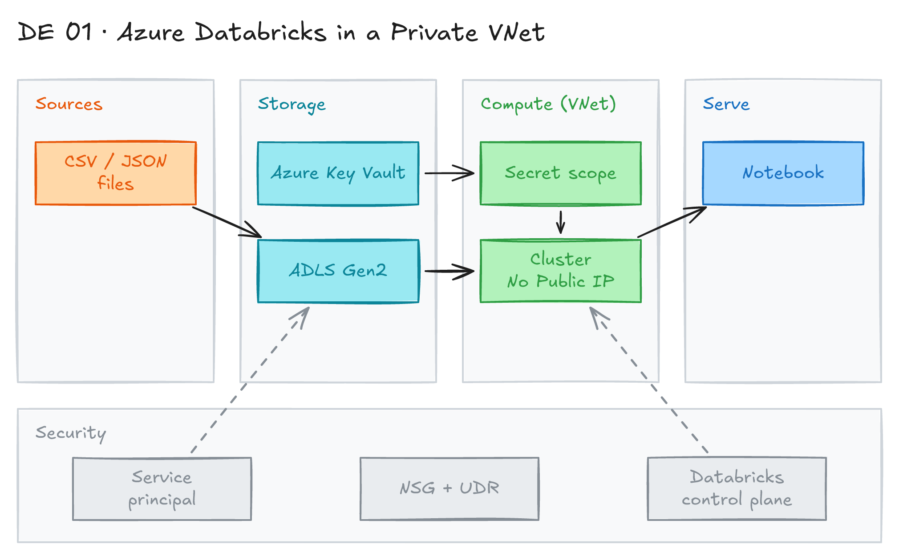

# Azure Databricks in a Private VNet (No Public IP)

## Project card

| Level | Roles | Duration | Cost | Status |
|---|---|---|---|---|
| Advanced | Data Engineer, DataOps Engineer | 3 assignments, ~3-5 h each | Free trial | Draft |

## Goal

Companies often block their data platform from the public internet. You deploy an Azure Databricks workspace inside your own VNet with secure cluster connectivity (No Public IP). Then you connect it to Azure Storage and Azure Key Vault and read CSV files from a notebook.

## What you will learn

- Deploy Azure Databricks with VNet injection and secure cluster connectivity (No Public IP).
- Understand the Databricks control plane and compute plane.
- Use a service principal to access Azure Storage.
- Store secrets in Azure Key Vault and read them with a Databricks secret scope.
- Configure subnets, network security groups and routes so the workspace can reach storage.

## Who it is for

- **Data Engineer**: you set up a secure Databricks workspace like many companies do in production.
- **DataOps Engineer**: you practice cloud networking, identities and secrets for a data platform.

## Tools and services

| Tool | Used for | Free option |
|---|---|---|
| Azure Databricks | Spark workspace and notebooks | trial (14-day Premium trial; you pay for Azure VMs) |
| Azure Virtual Network (VNet) | Private network for the Databricks clusters | yes |
| Azure Data Lake Storage Gen2 | Store CSV, TXT or JSON files | trial (Azure free credit) |
| Azure Key Vault | Store the service principal secret | trial (Azure free credit) |
| Microsoft Entra ID (formerly Azure AD) | Service principal (app registration) | yes |

### Key terms

| Term | Meaning |
|---|---|
| Control plane | Management layer run by Databricks: workspaces, users, permissions, notebooks. |
| Compute plane (classic) | Clusters that run in your Azure subscription. Older docs call it "data plane". |
| Workspace | Web app and unit of organization for Databricks assets. |
| Databricks Runtime | Spark plus Databricks improvements that run on clusters. |
| Secret scope | Named set of secrets in Databricks. It can point to Azure Key Vault. |
| VNet | Private, isolated network in Azure with your IP ranges and subnets. |
| Public / private subnet | Databricks needs two subnets: "host" (public) and "container" (private). |
| UDR | User-defined route. It overrides default Azure routing for a subnet. |
| Network security group (NSG) | Rules that allow or deny traffic by IP, port and protocol. |
| Secure cluster connectivity (SCC) / No Public IP (NPIP) | Cluster nodes have no public IP. The VNet has no open inbound ports. |
| Data exfiltration | Unauthorized transfer of data out of your network. |
| Service principal | Identity for apps and automated tools. It gets access through role assignments. |

## Architecture

The diagram is at the top of this page. Source file: [`images/architecture.excalidraw`](images/architecture.excalidraw). Open it at [excalidraw.com](https://excalidraw.com) to copy or edit it.

Data flow:

1. You upload CSV, TXT or JSON files to an Azure Data Lake Storage Gen2 account.
2. The service principal secret is stored in Azure Key Vault.
3. A Databricks secret scope reads the secret from Key Vault.
4. A cluster in your VNet (no public IP) uses the service principal to read the files from storage.
5. A notebook queries the data with Spark. You open the workspace through the Databricks control plane.

## Dataset

- **Source:** any small CSV, TXT or JSON file. For example, a public CSV from [Kaggle](https://www.kaggle.com/datasets).
- **Tables / entities:** one or two files are enough.
- **Size:** a few MB.

## Prerequisites

- Azure subscription. Start with the [Azure free account](https://azure.microsoft.com/en-us/free/).
- Basic knowledge of cloud computing and Azure. Courses:
  - [Introduction to Microsoft Azure Cloud Services](https://www.coursera.org/learn/microsoft-azure-cloud-services)
  - [Microsoft Azure Management Tools and Security Solutions](https://learn.microsoft.com/en-us/training/courses/az-900t00)
  - [Microsoft Azure Services and Lifecycles](https://learn.microsoft.com/en-us/training/courses/az-900t00)
- New to Git, CLI or Docker? Start with [Surfalytics Module 0](https://www.youtube.com/watch?v=LJIiCLu2gr8&list=PLNCDg7zJiXhP5Z_-TXUdorz2n7sjYHHKE&index=1).

## Assignments

Work at your own pace. Each assignment shows the expected time.

### Assignment 1: Deploy the workspace in a VNet with No Public IP (~3 h)

**Goal:** Create an Azure Databricks workspace with VNet injection and secure cluster connectivity.

**Steps:**

1. Log in to the Azure Portal. Create a resource group for this project.
2. Create a VNet with two subnets for Databricks (host and container). See [VNet injection](https://learn.microsoft.com/en-us/azure/databricks/security/network/classic/vnet-inject).
3. Create an Azure Databricks workspace (Premium tier):
   - Choose "Deploy in your own VNet" and select the VNet and subnets.
   - Turn on "No Public IP" (secure cluster connectivity).
4. Do not spend much time on network rules yet. Just get the workspace created.
5. Open the workspace and start a small cluster. Check that it starts.

**Deliverable:** screenshots of the workspace network settings and a running cluster.

**Done when:**

- [ ] The workspace uses your own VNet.
- [ ] "No Public IP" is enabled.
- [ ] A cluster starts without errors.

**Hints:** [Secure cluster connectivity](https://learn.microsoft.com/en-us/azure/databricks/security/network/classic/secure-cluster-connectivity).

### Assignment 2: Storage, service principal and Key Vault (~3 h)

**Goal:** Create the storage account, the service principal and a Key Vault secret.

**Steps:**

1. Create a storage account with hierarchical namespace on (ADLS Gen2). Upload a CSV, TXT or JSON file. See [Connect to Azure storage](https://learn.microsoft.com/en-us/azure/databricks/connect/storage/azure-storage).
2. Create a service principal (app registration in Microsoft Entra ID). Create a client secret.
3. Give the service principal the `Storage Blob Data Contributor` role on the storage account.
4. Create an Azure Key Vault. Store the client secret in it. See [Key Vault quickstart](https://learn.microsoft.com/en-us/azure/key-vault/general/quick-create-portal).
5. Create a Key Vault-backed Databricks secret scope. See [Secret scopes](https://learn.microsoft.com/en-us/azure/databricks/security/secrets/secret-scopes).

**Deliverable:** list of created resources and a screenshot of the secret scope (no secret values).

**Done when:**

- [ ] The file is in the storage account.
- [ ] The service principal has a role on the storage account.
- [ ] The secret is in Key Vault and the secret scope exists.

### Assignment 3: Connect everything and read the data (~5 h)

**Goal:** Make the private workspace reach storage and Key Vault, and read the file from a notebook.

**Steps:**

1. Right now the resources exist but may not work together. The workspace is in a private subnet.
2. Check the network settings: NSG rules, routes (UDR), and storage and Key Vault firewalls. Allow access from the Databricks subnets (service endpoints or private endpoints).
3. Create a notebook. Read the secret with `dbutils.secrets.get(scope="<scope>", key="<key>")`.
4. Configure Spark to use the service principal (OAuth) for the storage account.
5. Read the CSV file into a DataFrame and run a simple query.

**Deliverable:** notebook export (`.ipynb` or `.py`) in your repo and a short README of the network setup.

**Done when:**

- [ ] The notebook reads the secret from the scope.
- [ ] The notebook reads the file from storage.
- [ ] No secrets are hardcoded in the notebook.

**Hints:** New workspaces often use Unity Catalog. Then you can use a storage credential and external location instead of Spark config. Both ways are fine for this project.

## Final result

- A private Azure Databricks workspace that reads data from storage with secrets in Key Vault.
- Put the notebook and a network diagram on GitHub.
- Interview pitch: "I deployed Azure Databricks in my own VNet with No Public IP. I used a service principal and a Key Vault-backed secret scope to read data from ADLS Gen2. I configured the network so the workspace is not open to the internet."

## Clean up

Delete cloud resources so you do not pay for them.

- Terminate and delete clusters.
- Delete the resource group: `az group delete --name <your-rg> --yes`. This removes the workspace, VNet, storage account and Key Vault.
- Also delete the managed resource group that Databricks created, if it is still there.
- Delete the app registration (service principal) in Microsoft Entra ID.

## Resources

- [Network access](https://learn.microsoft.com/en-us/azure/databricks/security/network/): overview of Databricks network security.
- [Deploy Azure Databricks in your VNet (VNet injection)](https://learn.microsoft.com/en-us/azure/databricks/security/network/classic/vnet-inject): main setup guide.
- [Secure cluster connectivity (No Public IP)](https://learn.microsoft.com/en-us/azure/databricks/security/network/classic/secure-cluster-connectivity): how NPIP works.
- [Secret scopes](https://learn.microsoft.com/en-us/azure/databricks/security/secrets/secret-scopes): Key Vault-backed scopes.

Discussions are in the Discord channel **data-engineering-projects**.

## Community solutions

Share your repo in Discord. We add the best ones here.
