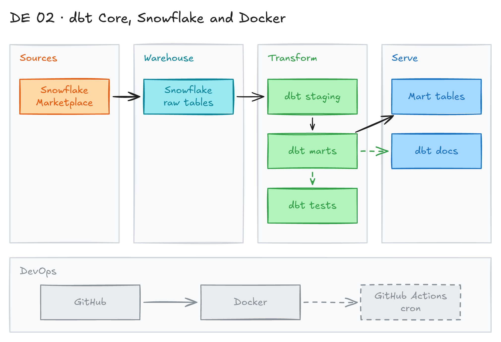

# dbt Core, Snowflake and Docker Pipelines



## Project card

| Level | Roles | Duration | Cost | Status |
|---|---|---|---|---|
| Intermediate | Analytics Engineer, Data Engineer | 3 assignments, ~3-5 h each | Free trial | Draft |

## Goal

You set up a dbt Core project from scratch and connect it to Snowflake. You build transformation models on a free Snowflake Marketplace dataset. Then you pack the project into a Docker container and run it on a schedule.

We follow the [Snowflake dbt Core quickstart](https://quickstarts.snowflake.com/guide/data_teams_with_dbt_core/index.html#0) as a pattern, but you build your own models.

## What you will learn

- Set up a Python virtual environment and install dbt Core with the Snowflake adapter.
- Configure `profiles.yml` and connect dbt to Snowflake.
- Build staging and mart models, with tests and docs.
- Use data from the Snowflake Marketplace.
- Run dbt inside a Docker container.
- Run the pipeline on a schedule.

## Who it is for

- **Analytics Engineer**: you build a full dbt project and learn how it runs in production.
- **Data Engineer**: you package and schedule a transformation pipeline.

## Tools and services

| Tool | Used for | Free option |
|---|---|---|
| dbt Core (`dbt-snowflake`) | SQL transformations, tests and docs | yes |
| Snowflake | Data warehouse | trial (30 days) |
| Snowflake Marketplace | Free source dataset | yes |
| Docker | Run dbt in a container | yes |
| GitHub + GitHub Actions | Code and scheduled runs | yes |
| VS Code | IDE | yes |

### Key terms

| Term | Meaning |
|---|---|
| dbt | Command-line tool. You write modular SQL models. dbt runs them in the right order, tests them and builds docs. |
| Snowflake | Cloud data warehouse. Storage and compute are separate, so you scale them on their own. |
| Docker | Packs an app and its dependencies into a container that runs the same way everywhere. |
| GitHub | Hosting for Git repos, code review and CI/CD (GitHub Actions). |

## Architecture

The diagram is at the top of this page. Source file: [`images/architecture.excalidraw`](images/architecture.excalidraw). Open it at [excalidraw.com](https://excalidraw.com) to copy or edit it.

Data flow:

1. You get a free financial dataset from the Snowflake Marketplace into your Snowflake account.
2. dbt staging models clean the raw tables.
3. dbt mart models build tables for analysis. dbt tests check the data.
4. A Docker container runs `dbt build`.
5. A scheduler (GitHub Actions cron) runs the container on a schedule.

## Dataset

- **Source:** Financial & Economic Essentials from the [Snowflake Marketplace](https://app.snowflake.com/marketplace/listing/GZTSZAS2KF7/cybersyn-inc-financial-economic-essentials) (free). This is the dataset from the quickstart.
- **Tables / entities:** stock prices, economic indicators, company data.
- **Size:** large shared tables. You read them in place. You do not copy all data.

## Prerequisites

- [Snowflake trial account](https://signup.snowflake.com/) (30 days).
- The Financial & Economic Essentials dataset installed in your Snowflake account.
- GitHub account.
- VS Code and Python 3.11 (or another version that your dbt version supports).
- Basic dbt knowledge: [dbt Fundamentals](https://learn.getdbt.com/courses/dbt-fundamentals).
- Docker basics: [Docker tutorial video](https://www.youtube.com/watch?v=pg19Z8LL06w&t=1282).
- New to Git, CLI or Docker? Start with [Surfalytics Module 0](https://www.youtube.com/watch?v=LJIiCLu2gr8&list=PLNCDg7zJiXhP5Z_-TXUdorz2n7sjYHHKE&index=1).

## Assignments

Work at your own pace. Each assignment shows the expected time.

### Assignment 1: Set up dbt Core and connect to Snowflake (~3 h)

**Goal:** Create a repo and a virtual environment, install dbt, and connect it to Snowflake.

**Steps:**

1. Create a GitHub repo with a README. Clone it.
2. Create a virtual environment and install dbt:

   ```bash
   python -m venv venv
   source venv/bin/activate  # On Windows: venv\Scripts\activate
   pip install dbt-core dbt-snowflake
   pip freeze > requirements.txt
   ```

3. In Snowflake, create a warehouse, a database, a role and a user for dbt.
4. Start the dbt project:

   ```bash
   dbt init my_dbt_project
   ```

5. Fill in `~/.dbt/profiles.yml`. Read the password from an environment variable, for example `{{ env_var('SNOWFLAKE_PASSWORD') }}`.
6. Check the connection:

   ```bash
   dbt debug
   ```

**Deliverable:** repo with the dbt project, `requirements.txt`, and a `.gitignore` that excludes `venv/`, `target/` and `logs/`.

**Done when:**

- [ ] `dbt debug` shows "All checks passed".
- [ ] No passwords are in the repo.

### Assignment 2: Build models on the Marketplace data (~5 h)

**Goal:** Build staging and mart models with tests, following the quickstart.

**Steps:**

1. Install the Financial & Economic Essentials dataset from the Marketplace.
2. Declare the dataset tables as dbt `sources`.
3. Build staging models (rename columns, cast types).
4. Build mart models that answer a business question. Use the quickstart as a pattern.
5. Add tests (`unique`, `not_null`, `relationships`) and model descriptions.
6. Run and check performance:

   ```bash
   dbt build
   dbt docs generate
   dbt docs serve
   ```

7. Look at the query profile in Snowflake. Note slow models and the warehouse size you used.

**Deliverable:** models, tests and docs in the repo. A short note on run time.

**Done when:**

- [ ] `dbt build` passes with no errors.
- [ ] Every model has a description and at least one test.
- [ ] Run time and warehouse size are documented.

**Hints:** [dbt best practices](https://docs.getdbt.com/best-practices), [Jinja, macros and packages course](https://learn.getdbt.com/courses/jinja-macros-and-packages).

### Assignment 3: Docker and scheduled runs (Planned) (~4 h)

**Goal:** Run the dbt project in a Docker container on a schedule.

**Steps:**

1. Write a `Dockerfile`: Python base image, install `requirements.txt`, copy the dbt project, run `dbt build`.
2. Pass Snowflake credentials as environment variables. Do not bake them into the image.
3. Build and run the container locally.
4. Add a GitHub Actions workflow with a `schedule` (cron) trigger. Store credentials in GitHub Secrets.
5. Check the run logs in GitHub Actions.

**Deliverable:** `Dockerfile`, workflow YAML, and README section on how to run it.

**Done when:**

- [ ] The container runs `dbt build` successfully.
- [ ] The workflow runs on schedule.
- [ ] Secrets are stored in GitHub Secrets only.

## Final result

- A dbt Core project on Snowflake that runs in Docker on a schedule.
- Put the repo on GitHub. Share the dbt docs screenshot on LinkedIn.
- Interview pitch: "I built a dbt Core project on Snowflake from scratch. I added tests and docs. I packed it in Docker and scheduled it with GitHub Actions."

## Clean up

- Suspend or drop the warehouse you created: `DROP WAREHOUSE <your_wh>;`.
- Drop the dbt database: `DROP DATABASE <your_db>;`.
- Disable the GitHub Actions schedule.
- Remove local Docker images: `docker rmi <image>`.

## Resources

- [Snowflake dbt Core quickstart](https://quickstarts.snowflake.com/guide/data_teams_with_dbt_core/index.html#0): the pattern for this project.
- [dbt Snowflake setup](https://docs.getdbt.com/docs/core/connect-data-platform/snowflake-setup): `profiles.yml` options.
- [dbt best practices](https://docs.getdbt.com/best-practices): project structure.
- [Jinja, macros and packages](https://learn.getdbt.com/courses/jinja-macros-and-packages): free dbt course.
- [Docker course on Udemy](https://www.udemy.com/course/docker-ru/): recommended course (in Russian).

Discussions are in the Discord channel **data-engineering-projects**.

## Community solutions

Share your repo in Discord. We add the best ones here.
