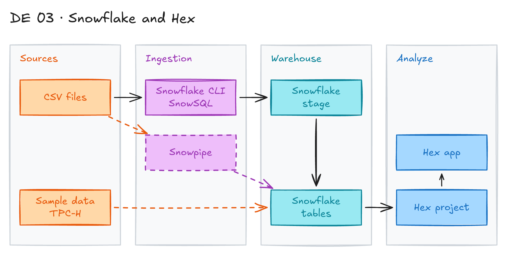

# Snowflake Data Warehouse and Hex Notebooks



## Project card

| Level | Roles | Duration | Cost | Status |
|---|---|---|---|---|
| Base | Data Engineer, Data Analyst, Analytics Engineer | 3 assignments, ~3-4 h each | Free trial | Draft |

## Goal

You learn two tools of the modern data stack: Snowflake and Hex. You load and query data in Snowflake with its main tools and features. Then you connect Hex to Snowflake and build an analysis with SQL, Python and charts.

## What you will learn

- Explain the Snowflake architecture: separate storage and compute, virtual warehouses.
- Use Snowflake CLI and SnowSQL from the terminal.
- Load files with stages, `COPY INTO` and Snowpipe.
- Use Time Travel to query and restore old data.
- Connect Hex to Snowflake and build a notebook with SQL, Python and charts.
- Share the result as a Hex app.

## Who it is for

- **Data Engineer**: you learn how to load and manage data in Snowflake.
- **Data Analyst**: you query a warehouse and build visuals in a notebook.
- **Analytics Engineer**: you learn the warehouse features that your models depend on.

## Tools and services

| Tool | Used for | Free option |
|---|---|---|
| Snowflake | Cloud data warehouse | trial (30 days) |
| Snowflake CLI (`snow`) | Manage Snowflake from the command line | yes |
| SnowSQL | Legacy SQL command-line client | yes |
| Snowpipe | Automatic file loading | trial (uses Snowflake credits) |
| Hex | Notebooks with SQL, Python and charts | trial |

### Key terms

| Term | Meaning |
|---|---|
| Snowflake architecture | Multi-cluster, shared data. Storage and compute are separate, so many workloads run at the same time. |
| Virtual warehouse | Compute cluster that runs your queries. You pay while it runs. |
| Snowflake CLI | Newer command-line tool (`snow`) for Snowflake. It was called SnowCLI before. |
| SnowSQL | Older SQL client for the terminal. Snowflake now recommends Snowflake CLI. |
| Snowpipe | Loads files into a table automatically when they arrive in a stage. |
| Time Travel | Query or restore data as it was at an earlier time (1 day by default). |
| Hex | Data workspace with notebooks, SQL, Python, charts and shareable apps. |

## Architecture

The diagram is at the top of this page. Source file: [`images/architecture.excalidraw`](images/architecture.excalidraw). Open it at [excalidraw.com](https://excalidraw.com) to copy or edit it.

Data flow:

1. You take CSV files or the built-in `SNOWFLAKE_SAMPLE_DATA` database.
2. You upload files to a Snowflake stage with Snowflake CLI or SnowSQL.
3. `COPY INTO` or Snowpipe loads the files into Snowflake tables.
4. Hex connects to Snowflake and runs SQL and Python on the tables.
5. Hex shows charts and publishes a shareable app.

## Dataset

- **Source:** `SNOWFLAKE_SAMPLE_DATA` (TPC-H), included in every Snowflake account. Or any public CSV, for example from [Kaggle](https://www.kaggle.com/datasets).
- **Tables / entities:** `CUSTOMER`, `ORDERS`, `LINEITEM`, `NATION` in `TPCH_SF1`.
- **Size:** `TPCH_SF1` has about 6 million rows in `LINEITEM`.

## Prerequisites

- [Snowflake trial account](https://signup.snowflake.com/).
- [Hex trial account](https://app.hex.tech/signup).
- Basic SQL.
- New to Git, CLI or Docker? Start with [Surfalytics Module 0](https://www.youtube.com/watch?v=LJIiCLu2gr8&list=PLNCDg7zJiXhP5Z_-TXUdorz2n7sjYHHKE&index=1).

## Assignments

Work at your own pace. Each assignment shows the expected time.

### Assignment 1: Snowflake basics and architecture (~3 h)

**Goal:** Understand the main Snowflake features and its architecture.

**Steps:**

1. Create the Snowflake trial account. Open Snowsight (the web UI).
2. Read about the [Snowflake architecture](https://docs.snowflake.com/en/user-guide/intro-key-concepts). Write 5 bullets on how it works.
3. Create a warehouse, a database and a schema:

   ```sql
   CREATE WAREHOUSE IF NOT EXISTS learn_wh WAREHOUSE_SIZE = 'XSMALL' AUTO_SUSPEND = 60;
   CREATE DATABASE IF NOT EXISTS learn_db;
   CREATE SCHEMA IF NOT EXISTS learn_db.raw;
   ```

4. Query `SNOWFLAKE_SAMPLE_DATA.TPCH_SF1`. Change the warehouse size and compare query time.

**Deliverable:** SQL file and a short note on architecture and warehouse sizes.

**Done when:**

- [ ] The warehouse, database and schema exist.
- [ ] You ran queries on the sample data with two warehouse sizes.

### Assignment 2: Snowflake tools: CLI, SnowSQL, Snowpipe and Time Travel (~4 h)

**Goal:** Use the Snowflake command-line tools, load files and try Time Travel.

**Steps:**

1. Install [Snowflake CLI](https://docs.snowflake.com/en/developer-guide/snowflake-cli/index) and set up a connection. Run a query with `snow sql -q "SELECT CURRENT_VERSION()"`.
2. Optional: install [SnowSQL](https://docs.snowflake.com/en/user-guide/snowsql) and run the same query.
3. Upload a CSV file to an internal stage with `PUT` and load it with `COPY INTO`.
4. Try [Snowpipe](https://docs.snowflake.com/en/user-guide/data-load-snowpipe-intro). Auto-ingest needs an external stage (for example, S3).
5. Try Time Travel:

   ```sql
   -- Delete rows, then read the table as it was 5 minutes ago
   DELETE FROM learn_db.raw.my_table;
   SELECT COUNT(*) FROM learn_db.raw.my_table AT(OFFSET => -60*5);

   -- Drop the table, then bring it back
   DROP TABLE learn_db.raw.my_table;
   UNDROP TABLE learn_db.raw.my_table;
   ```

**Deliverable:** commands and SQL in your repo, with a short README.

**Done when:**

- [ ] Snowflake CLI runs queries.
- [ ] A CSV file is loaded into a table.
- [ ] You restored data with Time Travel.

### Assignment 3: Hex project on Snowflake data (~4 h)

**Goal:** Build an analysis in Hex on your Snowflake data and share it.

**Steps:**

1. Learn the Hex basics with the [Hex tutorials](https://learn.hex.tech/tutorials).
2. Add a Snowflake data connection in Hex. Use a role with read access only.
3. Create a project with SQL cells, a Python cell and at least 3 charts.
4. Answer business questions, for example: revenue by nation, top customers, orders by month.
5. Publish the project as an app. Invite a teammate to comment (collaboration).

**Deliverable:** link to the Hex app or screenshots, and the SQL in your repo.

**Done when:**

- [ ] Hex reads data from Snowflake.
- [ ] The project has at least 3 charts.
- [ ] The app is published.

## Final result

- A Snowflake account with loaded data and a Hex app on top of it.
- Put the SQL, screenshots and the app link on GitHub and LinkedIn.
- Interview pitch: "I loaded data into Snowflake with Snowflake CLI and COPY INTO. I used Time Travel to restore data. I built and shared a Hex app with SQL, Python and charts on top of Snowflake."

## Clean up

- Drop the Snowflake objects: `DROP DATABASE learn_db;` and `DROP WAREHOUSE learn_wh;`.
- Drop any pipes and external stages you created.
- Delete the Hex project if you do not need it.

## Resources

- [Snowflake documentation](https://docs.snowflake.com/): official guides.
- [Hex tutorials](https://learn.hex.tech/tutorials): Hex basics.
- [Full Snowflake YouTube tutorial](https://youtube.com/playlist?list=PLba2xJ7yxHB7SWc4Sm-Sp3uGN74ulI4pS&si=fkLQ9meJ36IwE0gA): video course.
- [Snowflake vs Databricks](https://youtu.be/VLtq0eeHc14?si=JIFmDrN8OQg6Xvm1): comparison video.

Discussions are in the Discord channel **data-engineering-projects**.

## Community solutions

Share your repo in Discord. We add the best ones here.
