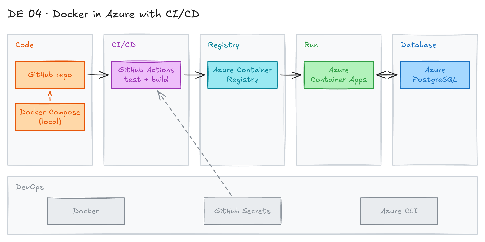

# Docker in Azure with CI/CD



## Project card

| Level | Roles | Duration | Cost | Status |
|---|---|---|---|---|
| Middle | Data Engineer, DataOps Engineer | 4 assignments, ~3-5 h each | Free trial | Draft |

## Goal

You run a Python app and a PostgreSQL database together with Docker Compose. Then you push the app image to Azure Container Registry and deploy it to Azure. GitHub Actions builds, tests and deploys the app on every push.

## What you will learn

- Run a multi-container app (app + PostgreSQL) with Docker Compose.
- Store images in Azure Container Registry (ACR).
- Deploy a container to Azure.
- Build a CI/CD pipeline with GitHub Actions.
- Test the deployment end to end.

## Who it is for

- **Data Engineer**: you learn how to ship a data app or pipeline as a container.
- **DataOps Engineer**: you build CI/CD for containers in the cloud.

## Tools and services

| Tool | Used for | Free option |
|---|---|---|
| Docker | Build and run containers | yes |
| Docker Compose | Run the app and PostgreSQL together | yes |
| PostgreSQL | Relational database | yes (local container) |
| Azure Container Registry | Store container images | trial (Azure free credit) |
| Azure Container Apps | Run the container in Azure | trial (has a monthly free grant) |
| Azure Database for PostgreSQL (Flexible Server) | Managed database in Azure | trial (Azure free credit) |
| GitHub Actions | CI/CD | yes |

### Key terms

| Term | Meaning |
|---|---|
| Docker container | Small package with everything needed to run an app. |
| Docker Compose | Tool to define and run apps with several containers in one YAML file. |
| PostgreSQL | Open-source relational database. |
| CI/CD | Continuous integration and deployment. Code is tested and deployed automatically. |
| Azure Container Registry | Private Azure registry for container images. |

## Architecture

The diagram is at the top of this page. Source file: [`images/architecture.excalidraw`](images/architecture.excalidraw). Open it at [excalidraw.com](https://excalidraw.com) to copy or edit it.

Data flow:

1. You push code to GitHub.
2. GitHub Actions runs tests and builds the Docker image.
3. GitHub Actions pushes the image to Azure Container Registry.
4. Azure Container Apps pulls the image and runs the app.
5. The app reads and writes data in PostgreSQL.

## Dataset

- **Source:** any small dataset your app loads into PostgreSQL. For example, a public CSV from [Kaggle](https://www.kaggle.com/datasets).
- **Tables / entities:** one or two tables.
- **Size:** a few MB.

## Prerequisites

- [Azure free account](https://azure.microsoft.com/en-us/free/).
- [Docker Desktop](https://docs.docker.com/get-docker/).
- [Azure CLI](https://learn.microsoft.com/en-us/cli/azure/install-azure-cli).
- GitHub account.
- A simple containerized Python app. You can reuse the container from an earlier Surfalytics project.
- New to Git, CLI or Docker? Start with [Surfalytics Module 0](https://www.youtube.com/watch?v=LJIiCLu2gr8&list=PLNCDg7zJiXhP5Z_-TXUdorz2n7sjYHHKE&index=1).

## Assignments

Work at your own pace. Each assignment shows the expected time.

### Assignment 1: App and PostgreSQL with Docker Compose (~4 h)

**Goal:** Run your app and PostgreSQL together on your laptop.

**Steps:**

1. Review your existing container (`Dockerfile`, dependencies, start command).
2. Create a GitHub repo for the app code and Docker files.
3. Write `docker-compose.yml` with two services: `app` and `db` (image `postgres`).
4. Put the database password in `.env`. Add `.env` to `.gitignore`. Commit `.env.example`.
5. Start the stack and check that the app writes to the database:

   ```bash
   docker compose up -d --build
   docker compose logs app
   docker compose exec db psql -U postgres -c "\dt"
   ```

**Deliverable:** `Dockerfile`, `docker-compose.yml`, `.env.example` and a README on how to run it.

**Done when:**

- [ ] `docker compose up` starts both containers.
- [ ] The app writes data to PostgreSQL.
- [ ] No passwords are in the repo.

### Assignment 2: Azure Container Registry (~3 h)

**Goal:** Create a registry in Azure and push your image to it.

**Steps:**

1. Create a resource group and a registry:

   ```bash
   az login
   az group create --name <your-rg> --location <region>
   az acr create --resource-group <your-rg> --name <yourregistry> --sku Basic
   ```

2. Log in to the registry, tag and push the image:

   ```bash
   az acr login --name <yourregistry>
   docker tag <your-app> <yourregistry>.azurecr.io/<your-app>:v1
   docker push <yourregistry>.azurecr.io/<your-app>:v1
   ```

3. Check that the image is in the registry in the Azure Portal.

**Deliverable:** commands in the README and a screenshot of the image in ACR.

**Done when:**

- [ ] The image is in Azure Container Registry.

**Hints:** [ACR quickstart](https://learn.microsoft.com/en-us/azure/container-registry/container-registry-get-started-azure-cli). On Apple Silicon, build for `linux/amd64`: `docker build --platform linux/amd64 ...`.

### Assignment 3: Deploy on Azure (~4 h)

**Goal:** Run the app in Azure with a PostgreSQL database.

**Steps:**

1. Create a PostgreSQL database in Azure (Azure Database for PostgreSQL Flexible Server, smallest tier).
2. Deploy the app image from ACR to [Azure Container Apps](https://learn.microsoft.com/en-us/azure/container-apps/).
3. Pass the database connection string as a secret, not as plain text.
4. Check the app logs. Check that data is in the Azure database.

**Deliverable:** deploy commands and screenshots of the running app and its logs.

**Done when:**

- [ ] The app runs in Azure.
- [ ] The app writes to the Azure PostgreSQL database.

**Hints:** Simpler option: run `docker compose` on a small Azure VM. The old `docker compose` integration with Azure Container Instances is retired, so do not use it.

### Assignment 4: CI/CD with GitHub Actions (~5 h)

**Goal:** Build, test and deploy the app automatically on every push.

**Steps:**

1. Create a service principal (or use OpenID Connect) for GitHub Actions. Store credentials in GitHub Secrets.
2. Add a workflow `.github/workflows/deploy.yml`:
   - Run tests (for example, `pytest`).
   - Build the Docker image.
   - Push it to ACR with the commit SHA as the tag.
   - Update the Container App to the new image.
3. Push a change. Watch the workflow run.
4. Run an end-to-end test: call the app and check the new data in the database.

**Deliverable:** workflow YAML and a screenshot of a green workflow run.

**Done when:**

- [ ] A push to `main` deploys a new version.
- [ ] Tests run before the deploy.
- [ ] The end-to-end test passes.

**Hints:** [GitHub Actions docs](https://docs.github.com/en/actions), [Deploy to Azure Container Apps with GitHub Actions](https://learn.microsoft.com/en-us/azure/container-apps/github-actions).

## Final result

- An app and database that run locally with Docker Compose and in Azure.
- A CI/CD pipeline that deploys on every push.
- Put the repo and a screenshot of the pipeline on GitHub and LinkedIn.
- Interview pitch: "I packed an app with Docker and ran it with PostgreSQL using Docker Compose. I pushed the image to Azure Container Registry and deployed it to Azure Container Apps. GitHub Actions tests, builds and deploys every change."

## Clean up

Delete cloud resources so you do not pay for them.

- Delete the resource group: `az group delete --name <your-rg> --yes`. This removes ACR, Container Apps and the PostgreSQL server.
- Delete the service principal you created for GitHub Actions.
- Locally: `docker compose down -v` and remove images with `docker rmi <image>`.

## Resources

- [Docker docs](https://docs.docker.com/): Docker and Compose reference.
- [Azure Container Registry docs](https://learn.microsoft.com/en-us/azure/container-registry/): registry setup.
- [Azure Container Apps docs](https://learn.microsoft.com/en-us/azure/container-apps/): run containers in Azure.
- [GitHub Actions docs](https://docs.github.com/en/actions): CI/CD workflows.
- [PostgreSQL docs](https://www.postgresql.org/docs/): database reference.
- "Docker for Beginners" courses on Coursera or Udemy.

## Community solutions

Share your repo in Discord. We add the best ones here.
