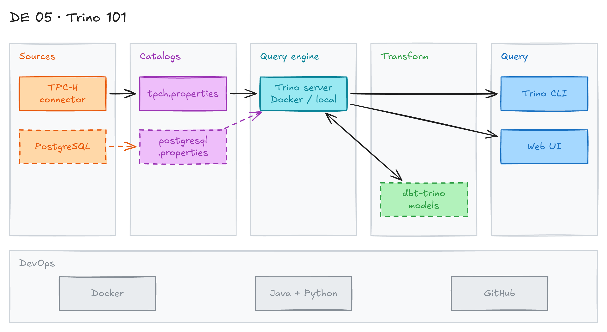

# Trino 101: Distributed SQL Query Engine



## Project card

| Level | Roles | Duration | Cost | Status |
|---|---|---|---|---|
| Base | Data Engineer, Analytics Engineer | 4 assignments, ~2-4 h each | Free | In progress |

## Goal

You try Trino, an open-source distributed SQL query engine. You run it in Docker and as a standalone install from the archive file. Then you add data sources (catalogs), query them with SQL, and run dbt models on Trino with the `dbt-trino` adapter.

## What you will learn

- Run Trino in Docker and from the archive file.
- Configure a Trino server: `config.properties`, `node.properties`, `jvm.config`.
- Add data sources as catalogs (connectors).
- Query data with the Trino CLI.
- Use dbt with Trino through the `dbt-trino` adapter.

## Who it is for

- **Data Engineer**: you learn a query engine that reads many data sources with one SQL.
- **Analytics Engineer**: you run dbt on top of a query engine, not only a warehouse.

## Tools and services

| Tool | Used for | Free option |
|---|---|---|
| Trino | Distributed SQL query engine | yes (open source) |
| Docker | Run Trino and PostgreSQL in containers | yes |
| Java (OpenJDK) | Runtime for the standalone Trino server | yes |
| Python | Trino launcher script and dbt | yes |
| PostgreSQL | Second data source | yes |
| dbt-trino | dbt adapter for Trino | yes |

### Key terms

| Term | Meaning |
|---|---|
| Trino | Open-source distributed SQL query engine. It queries data from GB to PB in many sources. |
| Coordinator | Trino node that parses and plans queries. In this project it is also the worker. |
| Catalog | A configured data source. It uses a connector set with `connector.name`. |
| Connector | Plugin that lets Trino read a data source (TPC-H, PostgreSQL, Hive and others). |
| `tpch` | Built-in connector with generated TPC-H test data. Good for first queries. |

## Architecture

The diagram is at the top of this page. Source file: [`images/architecture.excalidraw`](images/architecture.excalidraw). Open it at [excalidraw.com](https://excalidraw.com) to copy or edit it.

Data flow:

1. Data sources are the built-in `tpch` connector and a PostgreSQL database.
2. Each source is a catalog file in `etc/catalog/`.
3. The Trino server (Docker or standalone) runs the SQL across catalogs.
4. You query Trino with the Trino CLI.
5. dbt (`dbt-trino`) runs models on Trino and writes the results to a catalog.

## Dataset

- **Source:** the built-in Trino [TPC-H connector](https://trino.io/docs/current/connector/tpch.html). No download needed.
- **Tables / entities:** `nation`, `region`, `customer`, `orders`, `lineitem` and others.
- **Size:** schema `sf1` is about 1 GB. Schema `tiny` is very small.

## Prerequisites

- Docker Desktop.
- Java and Python for the standalone install. Check them:

  ```bash
  java --version
  python --version
  ```

- New to Git, CLI or Docker? Start with [Surfalytics Module 0](https://www.youtube.com/watch?v=LJIiCLu2gr8&list=PLNCDg7zJiXhP5Z_-TXUdorz2n7sjYHHKE&index=1).

## Assignments

Work at your own pace. Each assignment shows the expected time.

### Assignment 1: Trino on Docker (~2 h)

**Goal:** Run Trino in a Docker container and run your first query.

**Steps:**

1. Download the Trino image:

   ```bash
   docker pull trinodb/trino
   ```

2. Run Trino:

   ```bash
   docker run -d -p 8080:8080 --name trino-trial trinodb/trino
   ```

3. Open the Trino CLI inside the container:

   ```bash
   docker exec -it trino-trial trino
   ```

   The Trino web UI is at http://localhost:8080.

4. Query the data:

   ```sql
   SELECT count(*) FROM tpch.sf1.nation;
   ```

   Expected output:

   ```text
    _col0
   -------
       25
   (1 row)

   Query 20231213_012611_00000_cp5e6, FINISHED, 1 node
   Splits: 21 total, 21 done (100.00%)
   1.31 [25 rows, 0B] [19 rows/s, 0B/s]
   ```

5. Use your own configuration. Mount a local `etc` folder to `/etc/trino`. Trino then uses it instead of the default config in the image:

   ```bash
   docker run -d -p 8080:8080 --volume $PWD/etc:/etc/trino trinodb/trino
   ```

6. Manage the container:

   ```bash
   # Stop the container
   docker stop trino-trial

   # Start it again
   docker start trino-trial

   # Delete the container and the image
   docker rm trino-trial
   docker rmi trinodb/trino
   ```

**Deliverable:** README with the commands and a screenshot of the query result and the web UI.

**Done when:**

- [ ] Trino runs in Docker.
- [ ] The query returns 25 nations.
- [ ] You can see the query in the web UI.

### Assignment 2: Trino from the archive file (~3 h)

**Goal:** Install and configure a standalone Trino server on your laptop.

**Steps:**

1. Check that Java and Python are installed and on the `PATH`. Install Java on Mac with Homebrew:

   ```bash
   brew install openjdk
   sudo ln -sfn /opt/homebrew/opt/openjdk/libexec/openjdk.jdk \
        /Library/Java/JavaVirtualMachines/openjdk.jdk
   java -version
   ```

   Each Trino version needs a specific Java version. Check the [Trino requirements](https://trino.io/docs/current/installation/deployment.html) for your version.

2. Download Trino from [Maven Central](https://repo.maven.apache.org/maven2/io/trino/trino-server/). Pick the latest version:

   ```bash
   TRINO_VERSION=<latest-version>
   wget https://repo.maven.apache.org/maven2/io/trino/trino-server/${TRINO_VERSION}/trino-server-${TRINO_VERSION}.tar.gz
   tar xvzf trino-server-*.tar.gz
   ```

3. Create an `etc` folder inside the Trino folder with these files.

   `etc/config.properties`:

   ```properties
   coordinator=true
   node-scheduler.include-coordinator=true
   http-server.http.port=8080
   discovery.uri=http://localhost:8080
   ```

   `etc/node.properties`:

   ```properties
   node.environment=demo
   node.id=trino-local-1
   node.data-dir=/tmp/trino/data
   ```

   `etc/jvm.config` (use the recommended file from the [deployment docs](https://trino.io/docs/current/installation/deployment.html) for your version):

   ```text
   -server
   -Xmx4G
   -XX:InitialRAMPercentage=80
   -XX:MaxRAMPercentage=80
   -XX:G1HeapRegionSize=32M
   -XX:+ExplicitGCInvokesConcurrent
   -XX:+ExitOnOutOfMemoryError
   -XX:+HeapDumpOnOutOfMemoryError
   -XX:-OmitStackTraceInFastThrow
   -XX:ReservedCodeCacheSize=512M
   -XX:PerMethodRecompilationCutoff=10000
   -XX:PerBytecodeRecompilationCutoff=10000
   -Djdk.attach.allowAttachSelf=true
   -Djdk.nio.maxCachedBufferSize=2000000
   -XX:+UnlockDiagnosticVMOptions
   -XX:+UseAESCTRIntrinsics
   ```

4. Add a data source. Catalogs define the data sources. Each catalog uses a connector set by `connector.name`. Create `etc/catalog/tpch.properties`:

   ```properties
   connector.name=tpch
   ```

5. Start Trino:

   ```bash
   bin/launcher run
   ```

6. Download the [Trino CLI](https://trino.io/docs/current/client/cli.html) and run the query from Assignment 1.

**Deliverable:** your `etc` folder in the repo and a README with the steps.

**Done when:**

- [ ] `bin/launcher run` starts the server without errors.
- [ ] The CLI runs a query on `tpch`.

**Hints:** If the launcher fails with a Python error, change the shebang in `bin/launcher.py` to `#!/usr/bin/env python3`.

### Assignment 3: Add PostgreSQL as a catalog (Planned) (~3 h)

**Goal:** Query a PostgreSQL table and join it with `tpch` data in one SQL.

**Steps:**

1. Write a `docker-compose.yml` with two services: `trino` and `postgres`.
2. Load a small table into PostgreSQL.
3. Add `etc/catalog/postgresql.properties` with `connector.name=postgresql`, `connection-url`, `connection-user` and `connection-password`.
4. Run `SHOW SCHEMAS FROM postgresql;` and query the table.
5. Join the PostgreSQL table with `tpch.tiny.nation`.

**Deliverable:** `docker-compose.yml`, catalog file (password as a placeholder) and the SQL.

**Done when:**

- [ ] Trino reads the PostgreSQL table.
- [ ] One query joins data from two catalogs.

**Hints:** [PostgreSQL connector](https://trino.io/docs/current/connector/postgresql.html).

### Assignment 4: dbt on Trino (Planned) (~4 h)

**Goal:** Run dbt models on Trino with the `dbt-trino` adapter.

**Steps:**

1. Install the adapter: `pip install dbt-trino`.
2. Run `dbt init` and set up `profiles.yml` with `type: trino`, host `localhost`, port `8080`, a catalog (`database`) and a schema.
3. Use a catalog you can write to (PostgreSQL from Assignment 3, or the `memory` connector).
4. Build staging and mart models on `tpch` data. Add tests.
5. Run `dbt build`.

**Deliverable:** dbt project in the repo.

**Done when:**

- [ ] `dbt debug` passes.
- [ ] `dbt build` creates tables in the target catalog.

**Hints:** [dbt-trino setup](https://docs.getdbt.com/docs/core/connect-data-platform/trino-setup).

## Final result

- A Trino server running in Docker and from the archive, with several catalogs.
- A dbt project that runs on Trino.
- Put the config files, SQL and dbt project on GitHub.
- Interview pitch: "I set up Trino in Docker and as a standalone server. I configured catalogs for TPC-H and PostgreSQL and joined them in one query. I ran dbt models on Trino with the dbt-trino adapter."

## Clean up

Nothing to clean up in the cloud. Everything runs locally.

- Stop and remove containers: `docker rm -f trino-trial` and `docker compose down -v`.
- Remove images: `docker rmi trinodb/trino`.
- Stop the standalone server with `Ctrl+C` or `bin/launcher stop`.

## Resources

- [Trino documentation](https://trino.io/docs/current/): official docs.
- [Trino: The Definitive Guide (O'Reilly, free PDF)](https://www.starburst.io/wp-content/uploads/2021/04/Trino-Oreilly-Guide.pdf): the main book on Trino.
- [Book repo](https://github.com/trinodb/trino-the-definitive-guide): code examples from the book.
- [Trino repo](https://github.com/trinodb/trino): source code.

## Community solutions

Share your repo in Discord. We add the best ones here.
