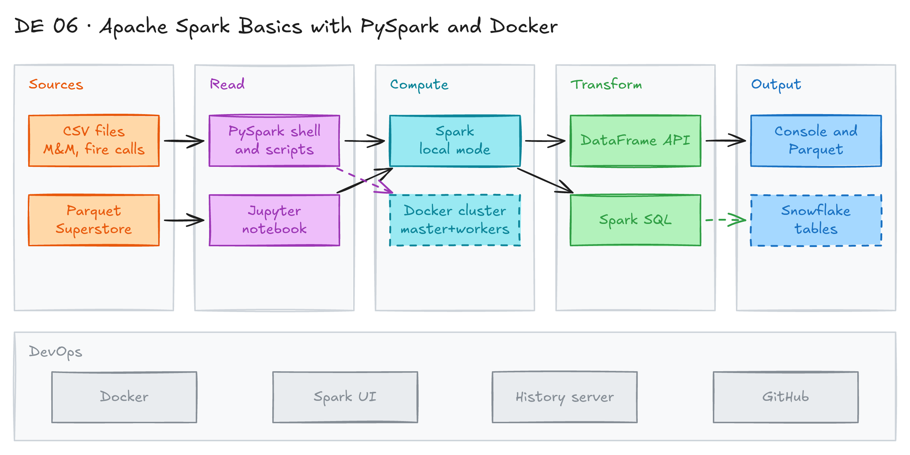

# Apache Spark Basics with PySpark and Docker



## Project card

| Level | Roles | Duration | Cost | Status |
|---|---|---|---|---|
| Beginner | Data Engineer | 6 assignments, ~2-4 h each | Free | In progress |

## Goal

You install Apache Spark on your laptop and learn the PySpark DataFrame API. You analyze San Francisco fire calls with PySpark and Spark SQL. At the end you run a small Spark cluster (master, workers, history server) in Docker.

## What you will learn

- Install PySpark locally, on Windows WSL, or in Docker.
- Read CSV and Parquet files into a DataFrame.
- Define a schema with `StructType` or a DDL string.
- Filter, group, rename columns and convert dates with the DataFrame API.
- Write the same logic in Spark SQL.
- Read from and write to Snowflake with the Spark connector.
- Run a Spark cluster with Docker Compose and use the Spark UI and history server.

## Who it is for

- **Data Engineer**: Spark is the main engine for big data jobs. This project gives you a safe local start.

## Tools and services

| Tool | Used for | Free option |
|---|---|---|
| Apache Spark / PySpark | Process data with DataFrames and SQL | yes |
| Python 3.11 | Run PySpark code | yes |
| Java 17 | Spark runs on the JVM | yes |
| Docker Desktop | Run Spark in a container or as a cluster | yes |
| VS Code + Jupyter extension | Run notebook cells | yes |
| Snowflake | Optional target for read and write (Assignment 5) | trial |

## Architecture

The diagram is at the top of this page. Source file: [`images/architecture.excalidraw`](images/architecture.excalidraw). Open it at [excalidraw.com](https://excalidraw.com) to copy or edit it.

Data flow:

1. CSV and Parquet files sit in the local `data/` folders.
2. A PySpark script, the `pyspark` shell, or a Jupyter notebook reads them into DataFrames.
3. Spark runs the transformations: local mode first, then a Docker cluster with a master and workers.
4. Results print to the console, or go to Parquet files and Snowflake tables.
5. You watch jobs in the Spark UI and the Spark history server.

## Dataset

- **Source:** sample files from the book *Learning Spark, 2nd Edition* plus Superstore orders. All files are in this repo.
- **Tables / entities:**

| File | Rows | Used in |
|---|---|---|
| [`mnm_dataset.csv`](docker_v1/01_spark_localhost/data/mnm_dataset.csv) | ~100,000 (State, Color, Count) | Assignment 2 |
| [`test_agg.csv`](docker_v1/01_spark_localhost/data/test_agg.csv) | 6 (small test file) | Assignment 2 |
| [`sf-fire-calls.csv`](docker_v1/02_spark_dataframe_api/data/sf-fire-calls.csv) | ~175,000 (28 columns) | Assignments 3-4 |
| [`sf-fire-incidents.csv`](docker_v1/02_spark_dataframe_api/data/sf-fire-incidents.csv) | ~31,000 (extra practice) | Assignment 4 |
| [`supestore_orders.parquet`](docker_v1/02_spark_dataframe_api/data/supestore_orders.parquet) | Superstore orders | Assignment 5 |

- **Size:** about 57 MB in total.

## Prerequisites

- Python 3.11 and Java 17 (or Docker Desktop).
- VS Code with the Jupyter extension.
- Snowflake trial account (only for Assignment 5).
- Windows users: install [Ubuntu on WSL](https://ubuntu.com/wsl).
- New to Git, CLI or Docker? Start with [Surfalytics Module 0](https://www.youtube.com/watch?v=LJIiCLu2gr8&list=PLNCDg7zJiXhP5Z_-TXUdorz2n7sjYHHKE&index=1).

### Project files

| Path | What it is |
|---|---|
| [`docker_v1/README.md`](docker_v1/README.md) | Install options: archive, pip, WSL, Docker |
| [`docker_v1/Dockerfile`](docker_v1/Dockerfile) | Image with Python 3.11, Java 11 and PySpark |
| [`docker_v1/01_spark_localhost/`](docker_v1/01_spark_localhost/README.md) | First Spark program: M&M count |
| [`docker_v1/02_spark_dataframe_api/`](docker_v1/02_spark_dataframe_api/README.md) | DataFrame API, schemas, SF fire calls |
| [`docker_v1/02_spark_dataframe_api/sf_fire.ipynb`](docker_v1/02_spark_dataframe_api/sf_fire.ipynb) | Notebook with answers in PySpark and SQL |
| [`docker_v2/`](docker_v2/README.md) | Spark cluster with Docker Compose |

## Assignments

Work at your own pace. Each assignment shows the expected time.

### Assignment 1: Install Spark locally (~2 h)

**Goal:** Run the `pyspark` shell on your laptop.

**Steps:**

1. Pick one option. Details are in [`docker_v1/README.md`](docker_v1/README.md).
   - Download the [Spark archive](https://spark.apache.org/downloads.html).
   - Install the [PySpark library](https://pypi.org/project/pyspark/) with pip.
   - Use the Docker image.
   - Use [Databricks Free Edition](https://www.databricks.com/learn/free-edition) in the browser.
2. macOS or Linux: check Java and Python, then install PySpark.

   ```bash
   java -version      # Java 17 is a safe choice for Spark 3.5 and 4.x
   python3 --version  # Python 3.11
   pip install pyspark
   ```

3. Windows: use WSL.

   ```bash
   sudo apt update
   sudo apt upgrade

   # install python and pip
   sudo apt install python3 python3-pip

   # install java
   sudo apt install default-jdk

   # install pyspark
   pip install pyspark
   ```

4. Docker option:

   ```bash
   cd de-projects/06_spark_projects/docker_v1

   # build the image
   docker build -t spark-local .

   # run pyspark and mount the project folders
   docker run -it -p 4050:4040 \
     -v ./01_spark_localhost:/opt/spark_projects/01_spark_localhost \
     -v ./02_spark_dataframe_api:/opt/spark_projects/02_spark_dataframe_api \
     spark-local pyspark
   ```

   Port 4040 in the container maps to 4050 on your laptop.
5. Run `pyspark`. Read a file to test it:

   ```python
   fire_df = spark.read.csv("/opt/spark_projects/02_spark_dataframe_api/data/sf-fire-calls.csv", header=True)
   fire_df.show()
   ```

6. Open the Spark UI: [http://localhost:4040](http://localhost:4040) (local) or [http://localhost:4050/jobs/](http://localhost:4050/jobs/) (Docker).

**Deliverable:** Screenshot of the `pyspark` shell banner and the Spark UI.

**Done when:**

- [ ] `pyspark` starts and shows `SparkSession available as 'spark'`.
- [ ] `fire_df.show()` prints rows.
- [ ] The Spark UI opens in the browser.

**Hints:**

- `pip install pyspark` now installs Spark 4.x. Spark 4 needs Java 17 or newer.
- The Dockerfiles find the right `JAVA_HOME` for your CPU (`arm64` or `amd64`). You do not need to change it.
- The old guide says `spark_docker`. The real folder is `docker_v1`.

### Assignment 2: First Spark program: M&M count (~2 h)

**Goal:** Read a CSV file, aggregate it, and run the same logic as a script.

**Steps:**

1. Follow [`docker_v1/01_spark_localhost/README.md`](docker_v1/01_spark_localhost/README.md).
2. In the `pyspark` shell, load the file:

   ```python
   mnm_file = "docker_v1/01_spark_localhost/data/mnm_dataset.csv"
   mnm_df = (spark.read.format("csv")
             .option("header", "true")
             .option("inferSchema", "true")
             .load(mnm_file))
   mnm_df.printSchema()
   mnm_df.show(n=5, truncate=False)
   ```

3. Sum `Count` by `State` and `Color`. Sort by the sum, descending. Expect 60 rows.
4. Filter only `CA` and repeat the aggregation.
5. Run the full script [`mnmcount.py`](docker_v1/01_spark_localhost/mnmcount.py):

   ```bash
   cd docker_v1/01_spark_localhost
   python3 mnmcount.py data/mnm_dataset.csv
   # or, with the Spark archive:
   spark-submit mnmcount.py data/mnm_dataset.csv
   ```

**Deliverable:** Script output in your repo README.

**Done when:**

- [ ] The aggregation shows 60 rows. Top row: `CA, Yellow, 100956`.
- [ ] The CA filter shows 6 colors.
- [ ] `mnmcount.py` runs from the command line.

**Hints:** Use the small [`test_agg.csv`](docker_v1/01_spark_localhost/data/test_agg.csv) to test your logic fast.

### Assignment 3: DataFrame API and schemas (~3 h)

**Goal:** Define schemas and use the core DataFrame operations.

**Steps:**

1. Follow [`docker_v1/02_spark_dataframe_api/README.md`](docker_v1/02_spark_dataframe_api/README.md).
2. Run [`define_schema_example.py`](docker_v1/02_spark_dataframe_api/define_schema_example.py). It builds a DataFrame with a DDL schema string, including an `ARRAY<STRING>` column.

   ```bash
   cd docker_v1/02_spark_dataframe_api
   python3 define_schema_example.py
   # or
   spark-submit define_schema_example.py
   ```

3. Create a `Row` object:

   ```python
   from pyspark.sql import Row
   blog_row = Row(1, "Dmitry", "Vancouver")
   blog_row[1]
   ```

4. Read `sf-fire-calls.csv` with the `StructType` schema from [`sf_fire.py`](docker_v1/02_spark_dataframe_api/sf_fire.py). Check `fire_df.columns` and `fire_df.printSchema()`.
5. Practice projection and filters with `select()` and `where()`:

   ```python
   import pyspark.sql.functions as F

   few_fire_df = (fire_df
                  .select("IncidentNumber", "AvailableDtTm", "CallType")
                  .where(F.col("CallType") != "Medical Incident"))
   few_fire_df.show(5, truncate=False)
   ```

6. Rename `Delay` to `ResponseDelayedinMins`. Convert `CallDate`, `WatchDate` and `AvailableDtTm` to timestamps:

   ```python
   new_fire_df = fire_df.withColumnRenamed("Delay", "ResponseDelayedinMins")

   fire_ts_df = (new_fire_df
     .withColumn("IncidentDate", F.to_timestamp(F.col("CallDate"), "MM/dd/yyyy"))
     .drop("CallDate")
     .withColumn("OnWatchDate", F.to_timestamp(F.col("WatchDate"), "MM/dd/yyyy"))
     .drop("WatchDate")
     .withColumn("AvailableDtTS", F.to_timestamp(F.col("AvailableDtTm"), "MM/dd/yyyy hh:mm:ss a"))
     .drop("AvailableDtTm"))
   ```

**Deliverable:** A script or notebook with all steps and their output.

**Done when:**

- [ ] The schema shows correct types (for example, `Delay: float`).
- [ ] The renamed column and the 3 timestamp columns exist.
- [ ] You can explain why DataFrames are immutable.

**Hints:** Windows users: VS Code + Jupyter extension + WSL is the easiest setup. Install the "Jupyter" extension from the Extensions panel.

### Assignment 4: Analyze SF fire calls (~4 h)

**Goal:** Answer business questions with the DataFrame API and with Spark SQL.

**Steps:**

1. Open [`sf_fire.ipynb`](docker_v1/02_spark_dataframe_api/sf_fire.ipynb). Try each question yourself first. Then compare with the notebook.
2. Register a view so you can use SQL: `fire_df.createOrReplaceTempView("fire_calls")`.
3. Answer each question in PySpark and in SQL:
   - Q1. How many distinct call types are there? Do not count nulls.
   - Q2. What are the distinct call types?
   - Q3. Which calls had a response delay of more than 5 minutes?
   - Q4a. Which zip codes have the most calls, and of which type?
   - Q4b. Which neighborhoods are in zip codes 94102 and 94103?
   - Q5. What are the total alarms and the min, max and average response delay?
   - Q6. Which week of 2018 had the most calls?
   - Q7. Which neighborhoods had the worst response time in 2018?
4. Example for Q7:

   ```sql
   SELECT neighborhood, AVG(delay) AS avg_delay
   FROM fire_calls
   WHERE YEAR(calldate) = 2018 AND city = 'San Francisco'
   GROUP BY neighborhood
   ORDER BY avg_delay DESC
   LIMIT 3;
   ```

5. Extra practice: load [`sf-fire-incidents.csv`](docker_v1/02_spark_dataframe_api/data/sf-fire-incidents.csv) and join it to fire calls on the incident number.

**Deliverable:** Notebook with all answers, in PySpark and SQL.

**Done when:**

- [ ] Q1-Q7 have answers in both PySpark and SQL.
- [ ] Both versions return the same result.
- [ ] Dates are converted before you use `YEAR()` or `weekofyear()`.

### Assignment 5: Parquet and Snowflake (~3 h)

**Goal:** Store data as Parquet and read and write Snowflake tables from Spark.

**Steps:**

1. Read [`supestore_orders.parquet`](docker_v1/02_spark_dataframe_api/data/supestore_orders.parquet). You do not need a schema. Parquet stores it.

   ```python
   df = spark.read.parquet("./data/supestore_orders.parquet")
   df.show()
   ```

2. Write `fire_df` to Parquet and read it back.
3. Start Spark with the Snowflake connector packages. The versions must match your Spark version. Find them on [Maven Central](https://central.sonatype.com/artifact/net.snowflake/spark-snowflake_2.12).

   ```bash
   # example from the notebook (Spark 3.4)
   pyspark --packages net.snowflake:snowflake-jdbc:3.14.5,net.snowflake:spark-snowflake_2.12:2.12.0-spark_3.4
   ```

4. Set Snowflake credentials as environment variables: `SF_URL`, `SF_ACCOUNT`, `SF_USER`, `SF_PASSWORD`. Never write them in the notebook.
5. Read a table:

   ```python
   options = {
       "sfURL": os.getenv("SF_URL"),
       "sfAccount": os.getenv("SF_ACCOUNT"),
       "sfUser": os.getenv("SF_USER"),
       "sfPassword": os.getenv("SF_PASSWORD"),
       "sfDatabase": "RAW",
       "sfSchema": "SUPERSTORE",
       "sfWarehouse": "WH_SUPERSTORE",
   }
   df = (spark.read.format("net.snowflake.spark.snowflake")
         .options(**options)
         .option("query", "SELECT * FROM returned_orders")
         .load())
   ```

6. Add a `return_date` column with `F.current_date()`. Write it to the table `returned_orders_with_date` with `mode("overwrite")`.

**Deliverable:** Notebook cells and a screenshot of the new table in Snowflake.

**Done when:**

- [ ] Parquet write and read work.
- [ ] Spark reads `returned_orders` from Snowflake.
- [ ] `returned_orders_with_date` exists in Snowflake.

**Hints:**

- The Spark connector for 3.4 does not work with Spark 4.x. Easiest fix: `pip install "pyspark==3.5.*"` and use a `-spark_3.5` connector.
- Snowflake is blocking password-only sign-in. If it fails, use key-pair auth (`pem_private_key` option).
- You need the `returned_orders` table in Snowflake first. You can load it from [`07_soda_core_snowflake/src`](../07_soda_core_snowflake/src).

### Assignment 6: Spark cluster in Docker (~3 h)

**Goal:** Run a Spark master, several workers and a history server with Docker Compose.

**Steps:**

1. Watch [How to Run a Spark Cluster with Multiple Workers Locally Using Docker](https://youtu.be/FteThJ-YvXk?feature=shared).
2. Read the files in [`docker_v2/`](docker_v2/):
   - [`Dockerfile`](docker_v2/Dockerfile): downloads Spark 3.4.4 and installs [`requirements.txt`](docker_v2/requirements.txt).
   - [`entrypoint.sh`](docker_v2/entrypoint.sh): starts `master`, `worker` or `history`.
   - [`docker-compose.yml`](docker_v2/docker-compose.yml): 3 services and a shared `spark-logs` volume.
   - [`spark-defaults.conf`](docker_v2/spark-defaults.conf): turns on event logs for the history server.
   - [`Makefile`](docker_v2/Makefile): short commands for build and run.
3. The compose file mounts two folders: `book_data/` (data) and `spark_apps/` (scripts). They are empty. Copy `mnm_dataset.csv` to `book_data/` and `mnmcount.py` to `spark_apps/`.
4. Build and start the cluster with 3 workers:

   ```bash
   cd docker_v2
   docker compose build
   docker compose up --scale spark-worker=3
   ```

5. Open the master UI at [http://localhost:9090](http://localhost:9090). Check that 3 workers are alive.
6. Submit a job:

   ```bash
   docker exec da-spark-master spark-submit --master spark://spark-master:7077 \
     /opt/spark/apps/mnmcount.py /opt/spark/data/mnm_dataset.csv
   ```

7. Open the history server at [http://localhost:18080](http://localhost:18080) and find your finished job.

**Deliverable:** Screenshots of the master UI with 3 workers and the history server with your job.

**Done when:**

- [ ] The master UI shows 3 workers.
- [ ] The job finishes on the cluster.
- [ ] The job appears in the history server.

**Hints:**

- You can also use the `Makefile`: `make build`, then `make run-scaled`.
- Docker Compose v1 (`docker-compose`) is retired. Use `docker compose`. The `version:` line in the compose file is ignored.
- The Dockerfile downloads Spark from `archive.apache.org`. It is slow but keeps old releases.
- The Dockerfile works on both `arm64` (Apple Silicon) and `amd64` (Intel or AMD) machines.

## Final result

- A repo with local PySpark scripts, a notebook with 8 analysis questions in PySpark and SQL, and a Docker Spark cluster.
- Post screenshots of the cluster UI and your answers on LinkedIn.
- Interview pitch: "I learned the PySpark DataFrame API on real fire department data. I wrote each answer in PySpark and Spark SQL. I ran a Spark cluster with workers and a history server in Docker, and connected Spark to Snowflake."

## Clean up

- Stop the cluster and remove its volume: `docker compose down --volumes` in `docker_v2`.
- Remove images: `docker rmi spark-local da-spark-image`.
- Snowflake: `DROP TABLE returned_orders_with_date;` and suspend your warehouse.

## Resources

- [Apache Spark downloads](https://spark.apache.org/downloads.html): Spark archive.
- [PySpark documentation](https://spark.apache.org/docs/latest/api/python/): API reference.
- [Learning Spark, 2nd Edition (code and data)](https://github.com/databricks/LearningSparkV2): source of the sample datasets.
- [Snowflake Connector for Spark](https://docs.snowflake.com/en/user-guide/spark-connector): setup and options.
- [Databricks Free Edition](https://www.databricks.com/learn/free-edition): run Spark in the browser.
- [Spark cluster in Docker (video)](https://youtu.be/FteThJ-YvXk?feature=shared): source of `docker_v2`.

## Community solutions

Share your repo in Discord. We add the best ones here.

- <Name>: <link>
