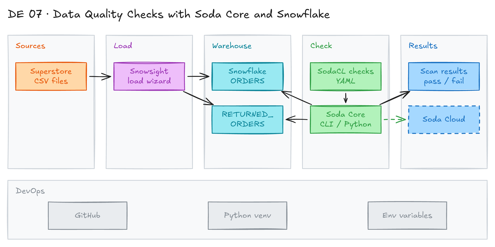

# Data Quality Checks with Soda Core and Snowflake



## Project card

| Level | Roles | Duration | Cost | Status |
|---|---|---|---|---|
| Beginner | Data Engineer, Analytics Engineer, DataOps Engineer | 3 assignments, ~2-3 h each | Free trial | Ready |

## Goal

Bad data breaks reports and models. You load the Superstore dataset into Snowflake and write data quality checks with Soda Core. You run the checks from the CLI and from Python, so a pipeline can stop when data is bad.

## What you will learn

- Connect Soda Core to Snowflake with a `configuration.yml` file.
- Write checks in SodaCL (YAML): row count, missing values, duplicates, schema.
- Write a custom SQL metric and a referential integrity check.
- Run a scan from the CLI and from Python.
- Read scan results and failed row samples in code.

## Who it is for

- **Data Engineer**: add quality gates to your pipelines.
- **Analytics Engineer**: test source tables before you model them.
- **DataOps Engineer**: automate data monitoring and alerts.

## Tools and services

| Tool | Used for | Free option |
|---|---|---|
| [Soda Core](https://github.com/sodadata/soda-core) | Open source data quality CLI and Python library | yes |
| SodaCL | YAML language for checks | yes |
| Python 3 + venv | Run Soda | yes |
| Snowflake | Data warehouse with the tables to check | trial |
| Soda Cloud | UI, alerts and history (optional) | trial |

Key concepts:

- **Check**: a test Soda runs on a dataset. It describes the passing state.
- **Scan**: runs the checks. Each check gets `pass`, `fail`, `warn` or `error` (invalid syntax).
- **Metric**: a property of the data, for example `row_count`. Built-in (25+) or custom SQL.
- **Threshold**: the value the metric is compared to, for example `> 10000`.

## Architecture

The diagram is at the top of this page. Source file: [`images/architecture.excalidraw`](images/architecture.excalidraw). Open it at [excalidraw.com](https://excalidraw.com) to copy or edit it.

Data flow:

1. Superstore CSV files load into Snowflake tables `ORDERS` and `RETURNED_ORDERS`.
2. Soda reads connection details from [`soda/configuration.yml`](soda/configuration.yml).
3. Soda runs the SodaCL checks from [`soda/checks/`](soda/checks/) as SQL queries in Snowflake.
4. The scan returns pass, warn or fail for each check, in the CLI or in Python.
5. Optional: a custom sampler prints failed rows, and Soda Cloud stores results.

## Dataset

- **Source:** Superstore sample data, in [`src/`](src/).
- **Tables / entities:**
  - [`supestore_orders.csv`](src/supestore_orders.csv): orders (row id, order id, dates, customer, product, sales, profit). Pipe `|` delimited.
  - [`supestore_returns.csv`](src/supestore_returns.csv): returned orders (`Returned`, `Order ID`). Pipe `|` delimited.
- **Size:** 9,993 orders and 800 returns.

## Prerequisites

- Python 3 with `pip` and `venv`.
- Snowflake trial account.
- New to Git, CLI or Docker? Start with [Surfalytics Module 0](https://www.youtube.com/watch?v=LJIiCLu2gr8&list=PLNCDg7zJiXhP5Z_-TXUdorz2n7sjYHHKE&index=1).

## Assignments

Work at your own pace. Each assignment shows the expected time.

### Assignment 1: Load data and connect Soda to Snowflake (~2 h)

**Goal:** Load the Superstore data into Snowflake and test the Soda connection.

**Steps:**

1. In Snowflake, create the warehouse `WH_SUPERSTORE`, database `SUPERSTORE` and schema `RAW`.
2. Load [`supestore_orders.csv`](src/supestore_orders.csv) into `ORDERS` and [`supestore_returns.csv`](src/supestore_returns.csv) into `RETURNED_ORDERS`. Use the Snowsight "Load data" wizard. Set the field delimiter to `|`. Use snake_case column names (`ORDER_ID`, `ORDER_DATE`, `SHIP_DATE`, ...).
3. Create a virtual environment and install Soda Core:

   ```bash
   python -m venv soda_venv

   # macOS / Linux
   source soda_venv/bin/activate
   # Windows
   .\soda_venv\Scripts\activate

   python -m pip install --upgrade pip
   pip install soda-core-snowflake
   ```

4. Set environment variables `SNOWFLAKE_USER`, `SNOWFLAKE_PASSWORD` and `SNOWFLAKE_ACCOUNT`.
5. Check [`soda/configuration.yml`](soda/configuration.yml). It reads the variables, so no secrets are in the file:

   ```yaml
   data_source snowflake:
     type: snowflake
     username: ${SNOWFLAKE_USER}
     password: ${SNOWFLAKE_PASSWORD}
     account: ${SNOWFLAKE_ACCOUNT}
     database: SUPERSTORE
     schema: RAW
     warehouse: WH_SUPERSTORE
     connection_timeout: 240
     session_params:
       QUERY_TAG: soda-queries
       QUOTED_IDENTIFIERS_IGNORE_CASE: false
   ```

6. Test the connection:

   ```bash
   soda test-connection -d snowflake -c ./soda/configuration.yml -V
   ```

**Deliverable:** Snowflake tables with data and a successful connection test.

**Done when:**

- [ ] `ORDERS` has 9,993 rows. `RETURNED_ORDERS` has 800 rows.
- [ ] The output says `Connection 'snowflake' is valid`.
- [ ] No passwords are in any committed file.

**Hints:** [Soda: connect to Snowflake](https://docs.soda.io/soda/connect-snowflake.html). Snowflake is blocking password-only sign-in. If it fails, use key-pair auth (`private_key_path` in the config).

### Assignment 2: Write checks and run a scan with the CLI (~3 h)

**Goal:** Write SodaCL checks for both tables and run them.

**Steps:**

1. Read [`soda/checks/orders.yml`](soda/checks/orders.yml). It has:

   ```yaml
   checks for ORDERS:
   # Built-in metrics
     - row_count > 10000
     - missing_count(row_id) = 0
     - duplicate_count(row_id) = 0
     - missing_count(order_id) = 0
     - missing_count(order_date) = 0

   # Custom metric
     - count_order_date_after_ship_date = 0:
         count_order_date_after_ship_date query: |
           SELECT COUNT(*)
           FROM ORDERS
           WHERE order_date > ship_date

   # Schema validation
     - schema:
         fail:
           when required column missing:
             - ORDER_ID
             - YEAR
           when wrong column type:
             ORDER_ID: TEXT
   ```

2. Read [`soda/checks/returned_orders.yml`](soda/checks/returned_orders.yml):

   ```yaml
   checks for RETURNED_ORDERS:
     - row_count > 0
   # Referential integrity
     - values in (order_id) must exist in orders (order_id)
   ```

3. Run the scan:

   ```bash
   soda scan -d snowflake -c ./soda/configuration.yml ./soda/checks/
   ```

4. Read the output. Some checks fail on purpose. Explain each failure:
   - `row_count > 10000`: the table has 9,993 rows.
   - The custom metric: row 1 has `order_date` after `ship_date`.
   - The schema check: there is no `YEAR` column.
5. Change thresholds or add a `warn` level. Add 2 checks of your own, for example `invalid_count` or `freshness`.

**Deliverable:** Your checks YAML files and the scan output.

**Done when:**

- [ ] The scan runs and shows a summary.
- [ ] You can explain every failed check.
- [ ] You added at least 2 new checks.

**Hints:** Checks describe the passing state, not the failed state. See the [SodaCL tutorial](https://docs.soda.io/soda/quick-start-sodacl.html) and [SodaCL metrics and checks](https://docs.soda.io/soda-cl/metrics-and-checks.html).

### Assignment 3: Run scans from Python (~2 h)

**Goal:** Run the same checks from a Python script so a pipeline can use the result.

**Steps:**

1. Read [`python/soda_scans.py`](python/soda_scans.py). The main part:

   ```python
   from soda.scan import Scan

   scan = Scan()
   scan.set_data_source_name("snowflake")
   scan.add_configuration_yaml_file(file_path="./soda/configuration.yml")
   scan.add_variables({"date": "2024-01-24"})
   scan.add_sodacl_yaml_file("./soda/checks/orders.yml")
   scan.add_sodacl_yaml_file("./soda/checks/returned_orders.yml")

   exit_code = scan.execute()
   print(exit_code)
   scan.set_verbose(True)
   print(scan.get_logs_text())
   ```

2. Run it from the project folder:

   ```bash
   python ./python/soda_scans.py
   ```

3. Try the inspection methods in the script comments:
   - `scan.get_scan_results()`: results as JSON.
   - `scan.assert_no_error_logs()` and `scan.assert_no_checks_fail()`: stop a pipeline on failure.
   - `scan.has_check_fails()`, `scan.get_checks_fail_text()`, `scan.get_checks_warn_or_fail()`.
4. Run [`python/soda_sampler.py`](python/soda_sampler.py). It uses a custom `Sampler` class to print the query, schema and rows of failed checks.
5. Make your script exit with a non-zero code when a check fails.

**Deliverable:** A Python script that runs the scan and fails on bad data.

**Done when:**

- [ ] `soda_scans.py` prints the same results as the CLI.
- [ ] `soda_sampler.py` prints failed rows.
- [ ] Your script exits with code 1 when a check fails.

**Hints:** Optional: connect to [Soda Cloud](https://www.soda.io/) with the commented `soda_cloud` block in `configuration.yml` to see results in a UI.

## Final result

- A repo with Snowflake checks in SodaCL, run from the CLI and from Python.
- Post the scan output and your custom checks on LinkedIn.
- Interview pitch: "I added data quality checks to Snowflake tables with Soda Core. I used built-in metrics, custom SQL, schema and referential integrity checks. I ran them from Python so the pipeline stops when data is bad."

## Clean up

- Snowflake: `DROP DATABASE SUPERSTORE;` and `DROP WAREHOUSE WH_SUPERSTORE;`.
- Delete the virtual environment folder `soda_venv`.

## Resources

- [Soda website](https://www.soda.io/): product overview.
- [Soda Core on GitHub](https://github.com/sodadata/soda-core): source and install guide.
- [Soda docs](https://docs.soda.io/): SodaCL reference.
- [SodaCL metrics and checks](https://docs.soda.io/soda-cl/metrics-and-checks.html): all built-in metrics.
- [Soda: connect to Snowflake](https://docs.soda.io/soda/connect-snowflake.html): connection options.

## Community solutions

Share your repo in Discord. We add the best ones here.

- <Name>: <link>
