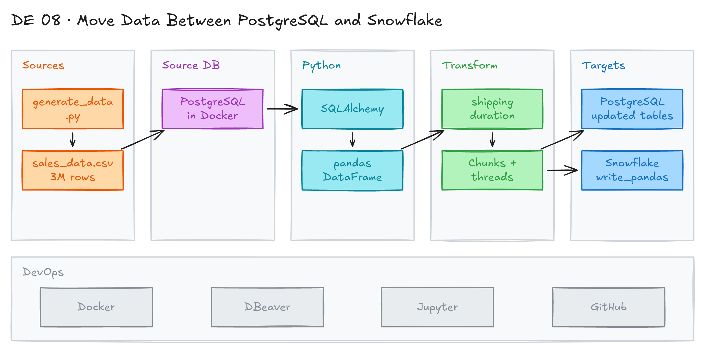

# Move Data Between PostgreSQL and Snowflake with Python and pandas



## Project card

| Level | Roles | Duration | Cost | Status |
|---|---|---|---|---|
| Beginner | Data Engineer, Data Analyst | 5 assignments, ~1-2 h each | Free trial | Ready |

## Goal

You read data from database tables into pandas and write it back. You generate 3 million sales rows, load them into PostgreSQL in Docker, change them in pandas, and move them to Snowflake.

Use cases:

- A common test assignment in DA and DE job interviews.
- Transformations that are hard to do in SQL.
- Data migration between databases.

## What you will learn

- Generate a large test CSV file with Python.
- Run PostgreSQL in Docker and load a CSV on start.
- Read a table into pandas with SQLAlchemy.
- Write a DataFrame back to a database, and make it faster with chunks and threads.
- Read from and write to Snowflake with `snowflake-connector-python` and `write_pandas`.

## Who it is for

- **Data Engineer**: learn the basic pattern of every migration script.
- **Data Analyst**: move data between tools with Python when SQL is not enough.

## Tools and services

| Tool | Used for | Free option |
|---|---|---|
| Python, pandas | Read, change and write data | yes |
| SQLAlchemy + `psycopg2-binary` | Connect pandas to PostgreSQL | yes |
| `snowflake-connector-python[pandas]` | Connect pandas to Snowflake | yes |
| Docker Desktop | Run PostgreSQL | yes |
| PostgreSQL | Source database | yes |
| DBeaver | SQL client to check data | yes |
| VS Code (Python, Jupyter, Rainbow CSV extensions) | Edit and run the notebook | yes |
| Snowflake | Target data warehouse | trial |

## Architecture

The diagram is at the top of this page. Source file: [`images/architecture.excalidraw`](images/architecture.excalidraw). Open it at [excalidraw.com](https://excalidraw.com) to copy or edit it.

Data flow:

1. [`generate_data.py`](generate_data.py) writes 3 million rows to `docker/source-data/sales_data.csv`.
2. The Docker image runs [`init.sql`](docker/init-scripts/init.sql). It creates `migration.sales_data` and loads the CSV with `COPY`.
3. [`migration.ipynb`](migration.ipynb) reads the table into a pandas DataFrame with SQLAlchemy.
4. pandas adds a `shipping_duration` column and writes the result back to PostgreSQL.
5. `write_pandas` loads the DataFrame into a Snowflake table.

## Dataset

- **Source:** generated by [`generate_data.py`](generate_data.py). Same columns as the Superstore dataset.
- **Tables / entities:** `migration.sales_data` (row id, order id, order and ship dates, customer, region, product, sales, quantity, discount, profit).
- **Size:** 3,000,000 rows, dates in 2024-2025.

## Prerequisites

- Git, Python 3, Docker Desktop, DBeaver.
- VS Code with the Python, Jupyter and Rainbow CSV extensions.
- Snowflake trial account (Assignments 4-5).
- New to Git, CLI or Docker? Start with [Surfalytics Module 0](https://www.youtube.com/watch?v=LJIiCLu2gr8&list=PLNCDg7zJiXhP5Z_-TXUdorz2n7sjYHHKE&index=1).

## Assignments

Work at your own pace. Each assignment shows the expected time.

### Assignment 1: Generate data and load it into PostgreSQL (~2 h)

**Goal:** Run PostgreSQL in Docker with 3 million generated rows.

**Steps:**

1. Clone the repo and open it in VS Code:

   ```bash
   git clone https://github.com/surfalytics/data-projects.git
   cd data-projects/de-projects/08_db_to_db_python
   ```

2. Create the `docker/source-data` folder. Run the generator from the project folder:

   ```bash
   mkdir -p docker/source-data
   python generate_data.py
   ```

3. Open `docker/source-data/sales_data.csv` in VS Code. Look at the Rainbow CSV colors.
4. Start Docker Desktop. Build and run the image (see [`docker/Dockerfile`](docker/Dockerfile) and [`docker/README.md`](docker/README.md)):

   ```bash
   cd docker
   docker build -t postgres-image .
   docker image list
   docker run --name postgres-cont -d -p 5433:5432 postgres-image
   docker ps
   ```

5. In DBeaver, create a PostgreSQL connection:

   ```text
   Host: localhost
   Port: 5433
   Database: sales
   Username: postgres
   Password: 1
   ```

   Click `Test Connection`, then `Finish`.
6. Check the data:

   ```sql
   SELECT COUNT(*) FROM migration.sales_data;   -- 3,000,000
   SELECT * FROM migration.sales_data LIMIT 100;
   ```

**Deliverable:** Screenshot of the row count in DBeaver.

**Done when:**

- [ ] `sales_data.csv` exists with 3,000,001 lines (with header).
- [ ] DBeaver shows the `sales` database, `migration` schema and `sales_data` table.
- [ ] The row count is 3,000,000.

**Hints:** The password `1` is a local test password from the Dockerfile. Never use it outside your laptop. The first start takes a few minutes while `COPY` loads the file.

### Assignment 2: Read PostgreSQL into pandas (~1 h)

**Goal:** Load the table into a pandas DataFrame.

**Steps:**

1. Create and activate a virtual environment:

   ```bash
   python -m venv project_venv

   # macOS / Linux
   source project_venv/bin/activate
   # Windows
   .\project_venv\Scripts\activate
   ```

2. Install packages:

   ```bash
   pip install pandas sqlalchemy psycopg2-binary "snowflake-connector-python[pandas]"
   ```

3. Open [`migration.ipynb`](migration.ipynb). Set the kernel to `project_venv`.
4. Run cell 1. It builds the connection string and reads the table:

   ```python
   database_uri = f"postgresql+psycopg2://{user}:{password}@{host}:{port}/{dbname}"
   engine = create_engine(database_uri)
   sales_data_df = pd.read_sql("SELECT * FROM migration.sales_data", engine)
   ```

**Deliverable:** Notebook output with the DataFrame.

**Done when:**

- [ ] The DataFrame prints with 3,000,000 rows.
- [ ] You wrote down the read time (about 1 minute).

### Assignment 3: Change data and write it back to PostgreSQL (~2 h)

**Goal:** Add a calculated column, write the result back, then make the write faster.

**Steps:**

1. Run cell 2. It converts `order_date` and `ship_date` to datetime and adds `shipping_duration` in days.
2. Uncomment the last line of cell 2 and run it again. It writes to `migration.updated_sales_data`:

   ```python
   updated_sales_data_df.to_sql("updated_sales_data", con=engine, schema="migration",
                                if_exists="replace", index=False)
   ```

3. Write down the time (about 9 minutes). In DBeaver, refresh and check the new table and the `shipping_duration` column.
4. Now make it faster. In DBeaver, create the target table:

   ```sql
   CREATE TABLE migration.fast_updated_sales_data (
      row_id INT PRIMARY KEY,
      order_id VARCHAR(255),
      order_date DATE,
      ship_date DATE,
      ship_mode VARCHAR(50),
      customer_id VARCHAR(50),
      customer_name VARCHAR(255),
      segment VARCHAR(50),
      country VARCHAR(50),
      city VARCHAR(50),
      state VARCHAR(50),
      postal_code VARCHAR(20),
      region VARCHAR(50),
      product_id VARCHAR(255),
      category VARCHAR(50),
      sub_category VARCHAR(50),
      product_name VARCHAR(255),
      sales NUMERIC(10, 2),
      quantity INT,
      discount NUMERIC(5, 2),
      profit NUMERIC(10, 2),
      shipping_duration INT
   );
   ```

5. Run cell 3. It splits the DataFrame into chunks of 10,000 rows and writes them in parallel with `ThreadPoolExecutor`.
6. Compare the time with step 3 (about 4.5 minutes).

**Deliverable:** A table in your README: method, rows, time.

**Done when:**

- [ ] `updated_sales_data` has the `shipping_duration` column.
- [ ] `fast_updated_sales_data` has 3,000,000 rows.
- [ ] The parallel write is clearly faster.

**Hints:**

- Cell 3 writes to `fast_updated_sales_data` in `append` mode. Create the table first (step 4). `row_id` is the primary key, so a second run fails. Run `TRUNCATE migration.fast_updated_sales_data;` first.
- Try other speed-ups: `method="multi"` in `to_sql`, or PostgreSQL `COPY` with `psycopg2`.

### Assignment 4: Read Snowflake into pandas (~1 h)

**Goal:** Query a Snowflake table into a DataFrame.

**Steps:**

1. Log in to Snowflake. You need a table to read, for example `ORDERS` from [project 07](../07_soda_core_snowflake/README.md).
2. Set credentials as environment variables. Do not type them in the notebook.
3. Open cell 4. Update the connection to read the variables, and set the warehouse, database and schema that hold your table:

   ```python
   conn = snowflake.connector.connect(
       user=os.getenv("SNOWFLAKE_USER"),
       password=os.getenv("SNOWFLAKE_PASSWORD"),
       account=os.getenv("SNOWFLAKE_ACCOUNT"),
       warehouse="WH_SUPERSTORE",
       database="SUPERSTORE",
       schema="RAW")
   cur = conn.cursor()
   cur.execute("select * from orders limit 100")
   df = cur.fetch_pandas_all()
   ```

4. Run cell 4.

**Deliverable:** Notebook output with the Snowflake data.

**Done when:**

- [ ] The DataFrame shows 100 rows from Snowflake.
- [ ] No credentials are in the notebook.

**Hints:** Snowflake is blocking password-only sign-in. If it fails, use key-pair auth (`private_key_file`) or `authenticator="externalbrowser"`.

### Assignment 5: Move data from PostgreSQL to Snowflake (~2 h)

**Goal:** Copy the 3 million rows from PostgreSQL to Snowflake with pandas in the middle.

**Steps:**

1. In Snowflake, create your database and schema:

   ```sql
   CREATE DATABASE IF NOT EXISTS <your_name>_MIGRATION;
   CREATE SCHEMA IF NOT EXISTS <your_name>_MIGRATION.RAW;
   ```

2. Open cell 5. Update the Snowflake connection:

   ```python
   snowflake_conn = snowflake.connector.connect(
       user=os.getenv("SNOWFLAKE_USER"),
       password=os.getenv("SNOWFLAKE_PASSWORD"),
       account=os.getenv("SNOWFLAKE_ACCOUNT"),
       warehouse="<your_warehouse>",
       database="<your_name>_MIGRATION",
       schema="RAW")
   ```

3. Run cell 5. It reads `migration.sales_data` and calls `write_pandas(..., auto_create_table=True)`.
4. In Snowflake, check the new table and its row count.

**Deliverable:** Screenshot of the table and row count in Snowflake.

**Done when:**

- [ ] The table exists in `<your_name>_MIGRATION.RAW`.
- [ ] It has 3,000,000 rows.
- [ ] `write_pandas` prints `success = True`.

**Hints:** The notebook names the target table `SALES_DATA4`. Rename it to `SALES_DATA`.

## Final result

- A repo with a data generator, a PostgreSQL Docker image, and a notebook that moves data PostgreSQL → pandas → PostgreSQL and Snowflake.
- A table that compares write methods by time.
- Interview pitch: "I moved 3 million rows from PostgreSQL to Snowflake with pandas. I measured each step and cut the PostgreSQL write time by half with chunks and parallel threads. I know when pandas is enough and when to use a bulk loader."

## Clean up

- Docker: `docker rm -f postgres-cont` and `docker rmi postgres-image`.
- Delete `docker/source-data/sales_data.csv` (several hundred MB). Do not commit it.
- Snowflake: `DROP DATABASE <your_name>_MIGRATION;`.

## Resources

- [Bridging databases with Python (article with screenshots)](https://python.plainenglish.io/bridging-databases-with-python-from-database-tables-to-pandas-and-back-again-1ae5ad4e2e1f): step-by-step guide for this project.
- [pandas `read_sql`](https://pandas.pydata.org/docs/reference/api/pandas.read_sql.html) and [`to_sql`](https://pandas.pydata.org/docs/reference/api/pandas.DataFrame.to_sql.html): API reference.
- [Snowflake Connector for Python: pandas](https://docs.snowflake.com/en/developer-guide/python-connector/python-connector-pandas): `fetch_pandas_all` and `write_pandas`.
- [PostgreSQL Docker image](https://hub.docker.com/_/postgres): init scripts and environment variables.

## Community solutions

Share your repo in Discord. We add the best ones here.

- <Name>: <link>
