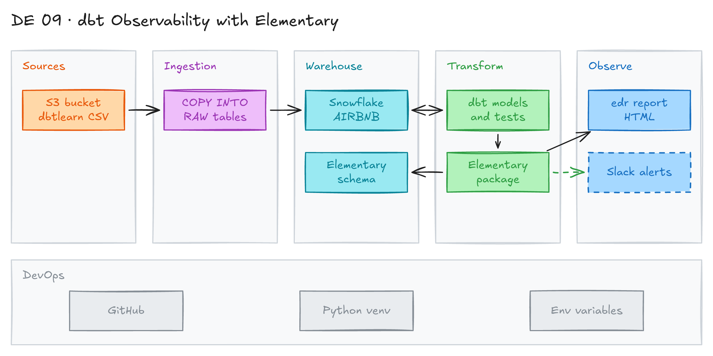

# dbt Observability with Elementary



## Project card

| Level | Roles | Duration | Cost | Status |
|---|---|---|---|---|
| Middle | Analytics Engineer, Data Engineer, DataOps Engineer | 5 assignments, ~1-2 h each | Free trial | In progress |

## Goal

A dbt project needs monitoring: which models ran, which tests failed, and how long it took. You add the open source tool Elementary to an Airbnb dbt project on Snowflake. You build the Elementary models and generate an observability report.

## What you will learn

- Set up Snowflake roles, a warehouse and a database for dbt.
- Load raw data from S3 into Snowflake with `COPY INTO`.
- Configure `profiles.yml` with environment variables.
- Install the Elementary dbt package and store run and test results in Snowflake.
- Use the Elementary CLI (`edr`) to build an HTML observability report.

## Who it is for

- **Analytics Engineer**: see test results and model run history in one place.
- **Data Engineer**: monitor dbt jobs in production.
- **DataOps Engineer**: add observability and alerts to the data stack.

## Tools and services

| Tool | Used for | Free option |
|---|---|---|
| dbt Core + `dbt-snowflake` | Build models and run tests | yes |
| [Elementary dbt package](https://hub.getdbt.com/elementary-data/elementary/latest/) | Store run and test results in tables | yes |
| [Elementary CLI (`edr`)](https://docs.elementary-data.com/) | Build the report and send alerts | yes |
| Snowflake | Data warehouse | trial |
| Python, VS Code, Git | Run dbt and edit the project | yes |

## Architecture

The diagram is at the top of this page. Source file: [`images/architecture.excalidraw`](images/architecture.excalidraw). Open it at [excalidraw.com](https://excalidraw.com) to copy or edit it.

Data flow:

1. Airbnb CSV files in the public S3 bucket `s3://dbtlearn/` load into Snowflake `RAW` tables.
2. dbt builds models and runs tests on the raw tables.
3. The Elementary package saves run results and test results into the `<schema>_elementary` schema.
4. The `edr` CLI reads these tables and builds an HTML report.
5. Planned: `edr monitor` sends alerts to Slack.

## Dataset

- **Source:** Airbnb data from the [Complete dbt Bootcamp](https://github.com/nordquant/complete-dbt-bootcamp-zero-to-hero), in the public bucket `s3://dbtlearn/`.
- **Tables / entities:** `raw_listings`, `raw_reviews`, `raw_hosts`.
- **Size:** small (thousands to hundreds of thousands of rows). Loads in seconds.

## Prerequisites

- Git, Python 3, VS Code.
- Snowflake trial account.
- Basic dbt knowledge. New to dbt? Do [02_dbt_core_snowflake](../02_dbt_core_snowflake/README.md) first.
- New to Git, CLI or Docker? Start with [Surfalytics Module 0](https://www.youtube.com/watch?v=LJIiCLu2gr8&list=PLNCDg7zJiXhP5Z_-TXUdorz2n7sjYHHKE&index=1).

## Assignments

Work at your own pace. Each assignment shows the expected time. In all code, replace `<your_name>` with your name.

### Assignment 1: Set up Snowflake and load data (~1.5 h)

**Goal:** Create the Snowflake objects for dbt and load the Airbnb raw tables.

**Steps:**

1. Clone the dbt project and open it in VS Code:

   ```bash
   git clone https://github.com/nordquant/complete-dbt-bootcamp-zero-to-hero.git
   ```

2. Start a [Snowflake trial](https://signup.snowflake.com/). Choose Standard edition, AWS, US East (Ohio).
3. Create the role, warehouse, user and database:

   ```sql
   -- Use an admin role
   USE ROLE ACCOUNTADMIN;

   -- Create the `transform` role
   CREATE ROLE IF NOT EXISTS transform;
   GRANT ROLE TRANSFORM TO ROLE ACCOUNTADMIN;

   -- Create the default warehouse if necessary
   CREATE WAREHOUSE IF NOT EXISTS <your_name>_COMPUTE_WH;
   GRANT OPERATE ON WAREHOUSE <your_name>_COMPUTE_WH TO ROLE TRANSFORM;

   -- Create the `dbt` user and assign to role
   CREATE USER IF NOT EXISTS dbt
     PASSWORD='<your_password>'
     LOGIN_NAME='<your_login>'
     MUST_CHANGE_PASSWORD=FALSE
     DEFAULT_WAREHOUSE='<your_name>_COMPUTE_WH'
     DEFAULT_ROLE='transform'
     DEFAULT_NAMESPACE='<your_name>_AIRBNB.RAW'
     COMMENT='DBT user used for data transformation';
   GRANT ROLE transform to USER dbt;

   -- Create our database and schemas
   CREATE DATABASE IF NOT EXISTS <your_name>_AIRBNB;
   CREATE SCHEMA IF NOT EXISTS <your_name>_AIRBNB.RAW;

   -- Set up permissions to role `transform`
   GRANT ALL ON WAREHOUSE <your_name>_COMPUTE_WH TO ROLE transform;
   GRANT ALL ON DATABASE <your_name>_AIRBNB to ROLE transform;
   GRANT ALL ON ALL SCHEMAS IN DATABASE <your_name>_AIRBNB to ROLE transform;
   GRANT ALL ON FUTURE SCHEMAS IN DATABASE <your_name>_AIRBNB to ROLE transform;
   GRANT ALL ON ALL TABLES IN SCHEMA <your_name>_AIRBNB.RAW to ROLE transform;
   GRANT ALL ON FUTURE TABLES IN SCHEMA <your_name>_AIRBNB.RAW to ROLE transform;
   ```

4. Load the raw data:

   ```sql
   -- Set up the defaults
   USE WAREHOUSE <your_name>_COMPUTE_WH;
   USE DATABASE <your_name>_airbnb;
   USE SCHEMA RAW;

   -- Create our three tables and import the data from S3
   CREATE OR REPLACE TABLE raw_listings
       (id integer,
        listing_url string,
        name string,
        room_type string,
        minimum_nights integer,
        host_id integer,
        price string,
        created_at datetime,
        updated_at datetime);

   COPY INTO raw_listings (id, listing_url, name, room_type, minimum_nights,
                           host_id, price, created_at, updated_at)
       FROM 's3://dbtlearn/listings.csv'
       FILE_FORMAT = (type = 'CSV' skip_header = 1
                      FIELD_OPTIONALLY_ENCLOSED_BY = '"');

   CREATE OR REPLACE TABLE raw_reviews
       (listing_id integer,
        date datetime,
        reviewer_name string,
        comments string,
        sentiment string);

   COPY INTO raw_reviews (listing_id, date, reviewer_name, comments, sentiment)
       FROM 's3://dbtlearn/reviews.csv'
       FILE_FORMAT = (type = 'CSV' skip_header = 1
                      FIELD_OPTIONALLY_ENCLOSED_BY = '"');

   CREATE OR REPLACE TABLE raw_hosts
       (id integer,
        name string,
        is_superhost string,
        created_at datetime,
        updated_at datetime);

   COPY INTO raw_hosts (id, name, is_superhost, created_at, updated_at)
       FROM 's3://dbtlearn/hosts.csv'
       FILE_FORMAT = (type = 'CSV' skip_header = 1
                      FIELD_OPTIONALLY_ENCLOSED_BY = '"');
   ```

**Deliverable:** Screenshot of the 3 raw tables with row counts.

**Done when:**

- [ ] Role `transform`, user `dbt`, warehouse and database exist.
- [ ] `raw_listings`, `raw_reviews` and `raw_hosts` have data.

**Hints:** Snowflake is blocking password-only sign-in. For the `dbt` user, use `TYPE = SERVICE` with key-pair auth if the password does not work. See [Snowflake key-pair auth](https://docs.snowflake.com/en/user-guide/key-pair-auth).

### Assignment 2: Configure and run the dbt project (~1.5 h)

**Goal:** Point the dbt project to your database and check the connection.

**Steps:**

1. In the dbt project, change the database name from `airbnb` to `<your_name>_airbnb` in:
   - `sources.yml`,
   - all models in the `src` folder,
   - the `snapshots` folder.
2. Edit `profiles.yml`:

   ```yaml
   dbtlearn:
     outputs:
       dev:
         account: "{{ env_var('SNOWFLAKE_ACCOUNT') }}"
         database: <your_name>_AIRBNB
         password: "{{ env_var('SNOWFLAKE_PASSWORD') }}"
         role: transform
         schema: DEV
         threads: 1
         type: snowflake
         user: "{{ env_var('SNOWFLAKE_USER') }}"
         warehouse: <your_name>_COMPUTE_WH
     target: dev
   ```

3. Create and activate a virtual environment:

   ```bash
   # macOS / Linux
   python3 -m venv edenv
   source edenv/bin/activate

   # Windows
   python -m venv edenv
   edenv\Scripts\activate
   ```

4. Set environment variables for the session:

   ```bash
   # macOS / Linux
   export SNOWFLAKE_ACCOUNT=<your_account>
   export SNOWFLAKE_USER=<your_login>
   export SNOWFLAKE_PASSWORD=<your_password>
   ```

   ```bat
   :: Windows cmd
   set SNOWFLAKE_ACCOUNT=<your_account>
   set SNOWFLAKE_USER=<your_login>
   set SNOWFLAKE_PASSWORD=<your_password>
   ```

   ```powershell
   # Windows PowerShell
   $env:SNOWFLAKE_ACCOUNT="<your_account>"
   $env:SNOWFLAKE_USER="<your_login>"
   $env:SNOWFLAKE_PASSWORD="<your_password>"
   ```

5. Optional, macOS: add the 3 `export` lines to the end of `edenv/bin/activate`. Then run `deactivate` and `source edenv/bin/activate`. The variables load every time. On Windows, use system environment variables.
6. Install dbt and test the connection from the dbt project folder:

   ```bash
   pip install dbt-core dbt-snowflake
   dbt debug
   ```

**Deliverable:** `dbt debug` output.

**Done when:**

- [ ] `dbt debug` shows `All checks passed!`.
- [ ] No passwords are in `profiles.yml`.

### Assignment 3: Install Elementary and build its models (~1.5 h)

**Goal:** Add the Elementary package so dbt saves run and test results.

**Steps:**

1. Add Elementary to `packages.yml`. Check [dbt Hub](https://hub.getdbt.com/elementary-data/elementary/latest/) for the latest version:

   ```yaml
   packages:
     - package: elementary-data/elementary
       version: 0.14.1  # replace with the latest version from dbt Hub
   ```

2. Add the Elementary config to `dbt_project.yml`:

   ```yaml
   models:
     elementary:
       # elementary models go to the schema '<your_schema>_elementary'
       +schema: "elementary"
       # To disable elementary in dev, uncomment this:
       # +enabled: "{{ target.name in ['prod', 'analytics'] }}"
   ```

3. Install and run:

   ```bash
   dbt deps   # install packages
   dbt seed   # load seed data to Snowflake
   dbt run    # run models
   ```

4. If `dbt run` fails on a `GRANT ... TO ROLE REPORTER` post-hook, change `REPORTER` to `TRANSFORM` in `dbt_project.yml` and run again:

   ```yaml
   models:
     dbtlearn:
       +materialized: view
       +post-hook:
         - "GRANT SELECT ON {{ this }} TO ROLE TRANSFORM"
   ```

5. Run the tests:

   ```bash
   dbt test
   ```

6. In Snowflake, open the `DEV_ELEMENTARY` schema. Query `elementary_test_results`.

**Deliverable:** Screenshot of `elementary_test_results` with rows.

**Done when:**

- [ ] The `DEV_ELEMENTARY` schema has Elementary tables.
- [ ] `elementary_test_results` has one row per test.

**Hints:** On dbt 1.8 or newer, Elementary may ask for extra `flags` in `dbt_project.yml`. Follow the [Elementary quickstart](https://docs.elementary-data.com/oss/quickstart/quickstart-cli-package).

### Assignment 4: Install the Elementary CLI and build the report (~1 h)

**Goal:** Generate the Elementary observability report.

**Steps:**

1. Generate the CLI profile in the dbt project folder:

   ```bash
   dbt run-operation elementary.generate_elementary_cli_profile
   ```

2. Copy the output into `profiles.yml`. Fill in the missing fields:

   ```yaml
   elementary:
     outputs:
       dev:
         type: snowflake
         account: "{{ env_var('SNOWFLAKE_ACCOUNT') }}"
         user: "{{ env_var('SNOWFLAKE_USER') }}"
         password: "{{ env_var('SNOWFLAKE_PASSWORD') }}"
         role: transform
         warehouse: <your_name>_COMPUTE_WH
         database: <your_name>_AIRBNB
         schema: dev_elementary
         threads: 1
   ```

3. Install the CLI:

   ```bash
   pip install 'elementary-data[snowflake]'
   ```

   Other warehouses use another extra: `bigquery`, `redshift`, `databricks`, `athena`. Postgres needs no extra.
4. Check the install:

   ```bash
   edr --help
   ```

   You see the list of `edr` commands. If you get `command not found: edr`, see the [troubleshooting guide](https://docs.elementary-data.com/oss/general/troubleshooting).
5. Build the report:

   ```bash
   edr report
   ```

6. Open the HTML report. Look at test results, model runs and lineage.

**Deliverable:** Screenshots of the report pages.

**Done when:**

- [ ] `edr report` finishes without errors.
- [ ] The report shows your dbt tests and model runs.

### Assignment 5: Send alerts to Slack (Planned) (~1 h)

**Goal:** Get a Slack message when a dbt test fails.

**Steps:**

1. Create a Slack webhook or Slack app token.
2. Break one test on purpose, then run `dbt test`.
3. Run `edr monitor --slack-webhook <your_webhook>`.
4. Check the alert in Slack.

**Deliverable:** Screenshot of the Slack alert.

**Done when:**

- [ ] A failed test sends a Slack message.

**Hints:** [Elementary alerts docs](https://docs.elementary-data.com/).

## Final result

- A dbt project on Snowflake with Elementary tables and an HTML observability report.
- Post report screenshots on LinkedIn.
- Interview pitch: "I added Elementary to a dbt project on Snowflake. dbt saves every run and test result into tables, and the Elementary CLI turns them into a report. This shows failed tests and slow models fast."

## Clean up

- Snowflake:

  ```sql
  DROP DATABASE <your_name>_AIRBNB;
  DROP WAREHOUSE <your_name>_COMPUTE_WH;
  DROP USER dbt;
  DROP ROLE transform;
  ```

- Delete the virtual environment folder `edenv`.

## Resources

- [Elementary quickstart (CLI + package)](https://docs.elementary-data.com/oss/quickstart/quickstart-cli-package): official step-by-step guide.
- [Elementary troubleshooting](https://docs.elementary-data.com/oss/general/troubleshooting): common install errors.
- [Video: data observability](https://youtu.be/jfg9wBJBtKk?si=4UVZ93u-MdwnJvaF): why observability matters.
- [Complete dbt Bootcamp repo](https://github.com/nordquant/complete-dbt-bootcamp-zero-to-hero): the dbt project used here.
- [dbt Snowflake setup](https://docs.getdbt.com/docs/core/connect-data-platform/snowflake-setup): profile options.

## Community solutions

Share your repo in Discord. We add the best ones here.

- <Name>: <link>
