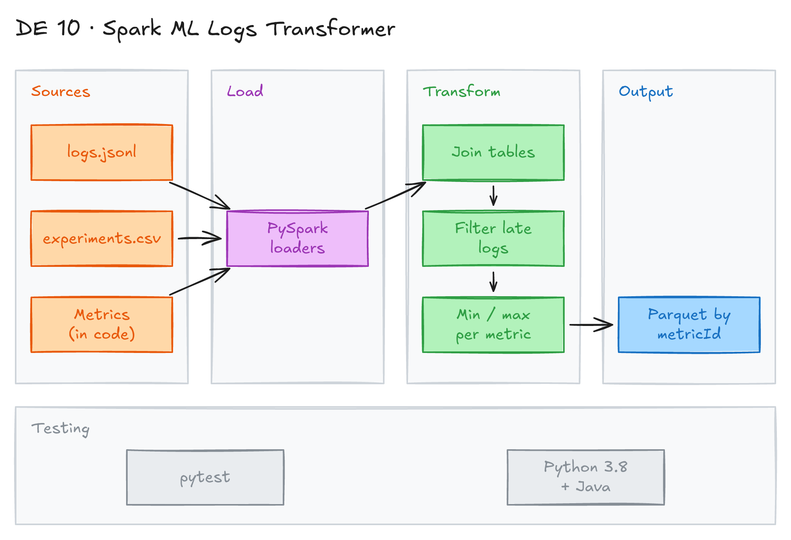

# Spark ML Logs Transformer with Unit Tests



## Project card

| Level | Roles | Duration | Cost | Status |
|---|---|---|---|---|
| Beginner | Data Engineer | 5 assignments, ~1-2 h each | Free | Ready |

## Goal

You are a new data engineer. Data scientists write logs from their machine learning experiments to a stream. You build a small PySpark ETL job: load the logs, join reference data, drop late logs, calculate statistics, and save the result as Parquet. Unit tests check every step.

## What you will learn

- Read JSONL and CSV files into Spark DataFrames with a fixed schema.
- Join several DataFrames on foreign keys.
- Filter rows with timestamp math.
- Aggregate with `groupBy`, `min` and `max`.
- Write partitioned Parquet files.
- Work in test-driven style: run tests, fix code, run tests again.

## Who it is for

- **Data Engineer**: a typical take-home task. It shows you can write clean PySpark code that passes tests.

## Tools and services

| Tool | Used for | Free option |
|---|---|---|
| Python 3.8 | Run the code | yes |
| PySpark 3.0.0 | ETL logic | yes |
| Java 8 or 11 | Runtime for Spark | yes |
| pytest | Run unit tests | yes |
| Parquet | Output format | yes |

## Architecture

The diagram is at the top of this page. Source file: [`images/architecture.excalidraw`](images/architecture.excalidraw). Open it at [excalidraw.com](https://excalidraw.com) to copy or edit it.

Data flow:

1. Spark reads logs from [`app/logs.jsonl`](app/logs.jsonl) and experiments from [`app/experiments.csv`](app/experiments.csv). Metrics are created in code.
2. Spark joins the three DataFrames on `expId` and `metricId`.
3. Spark drops logs that arrived too late (`ingestedAt` minus `createdAt` is more than N hours).
4. Spark calculates `min` and `max` value per experiment and metric.
5. Spark writes the result as Parquet, partitioned by `metricId`.
6. Unit tests in [`test/`](test/) check every step.

## Dataset

- **Source:** files in this folder: [`app/logs.jsonl`](app/logs.jsonl) and [`app/experiments.csv`](app/experiments.csv).
- **Tables / entities:**
  - **Logs** (one JSON object per line):
    - `logId`: string, unique ID.
    - `expId`: int, ID of the experiment.
    - `metricId`: int, ID of the metric.
    - `valid`: boolean, deprecated, not used.
    - `createdAt`: date when the log was produced.
    - `ingestedAt`: date when the log was written to the stream.
    - `step`: order of the log inside the experiment.
    - `value`: value of the metric.
  - **Experiments**: `expId`, `expName`.
  - **Metrics**: not in a file. `0` means `Loss`, `1` means `Accuracy`.
- **Size:** 64 logs, 4 experiments.

Sample log:

```json
{"logId":"5f2d8f1490d884c89bbe5487","expId":0,"metricId":1,"valid":true,"createdAt":"2020-07-27T09:28:13","ingestedAt":"2020-07-27T23:18:24","step":0,"value":0.5}
```

## Prerequisites

- Python 3.8 and Java 8 or 11. PySpark 3.0.0 is old and does not work well with newer versions.
- Basic Python and SQL.
- New to Git, CLI or Docker? Start with [Surfalytics Module 0](https://www.youtube.com/watch?v=LJIiCLu2gr8&list=PLNCDg7zJiXhP5Z_-TXUdorz2n7sjYHHKE&index=1).

Project files:

| File | What it is |
|---|---|
| [`app/etl.py`](app/etl.py) | Starter code. You write your solution here. |
| [`test/test_etl.py`](test/test_etl.py) | Unit tests for each function. |
| [`test/test_structure.py`](test/test_structure.py) | Tests for function names and signatures. |
| [`setup.py`](setup.py), [`setup.cfg`](setup.cfg) | Package and pytest config. |
| [`solution.py`](solution.py) | Reference solution. It has a known bug. Try on your own first. |

## Assignments

Work at your own pace. Each assignment shows the expected time.

### Assignment 1: Set up and load data (~2 h)

**Goal:** Install the project and load the three data sources into Spark DataFrames.

**Steps:**

1. Create a virtual environment and install the project with test packages:

   ```bash
   python3.8 -m venv venv
   source venv/bin/activate
   pip install -q -e . "pytest>=5,<7" pytest-timeout
   ```

2. Run the tests. Most of them fail. This is expected.

   ```bash
   pytest
   ```

3. In [`app/etl.py`](app/etl.py), implement:
   - `load_logs`: takes a path to a JSONL file, returns a DataFrame with the logs.
   - `load_experiments`: takes a path to a CSV file, returns a DataFrame with `expId` and `expName`.
   - `load_metrics`: returns a DataFrame with 2 rows and 2 columns (`metricId`, `metricName`).

**Deliverable:** the three loader functions in `app/etl.py`.

**Done when:**

- [ ] `test_logs_*`, `test_experiments_*` and `test_metrics_*` tests pass.
- [ ] Column types match the schema in the starter code.

**Hints:** Use `spark.read.json` with a schema and `spark.read.csv` with `header=True`.

### Assignment 2: Merge data sources (~1 h)

**Goal:** Join the three DataFrames into one.

**Steps:**

1. Implement `join_tables` in [`app/etl.py`](app/etl.py).
2. Join logs with experiments on `expId`.
3. Join the result with metrics on `metricId`.

**Deliverable:** `join_tables` function.

**Done when:**

- [ ] `test_joined_tables_*` tests pass.
- [ ] The output has `expName` and `metricName` columns.

### Assignment 3: Filter late logs (~1.5 h)

**Goal:** Drop logs that were written to the stream too late.

**Steps:**

1. Implement `filter_late_logs(data, hours)`.
2. Convert `createdAt` and `ingestedAt` to timestamps.
3. Keep only logs where `ingestedAt` is at most `hours` hours after `createdAt`.

**Deliverable:** `filter_late_logs` function.

**Done when:**

- [ ] With `hours=4` you get 7 rows.
- [ ] With `hours=8` you get 11 rows.
- [ ] `test_filtered_late_logs_*` tests pass.

**Hints:** Use `unix_timestamp` and divide the difference by 3600. The reference [`solution.py`](solution.py) keeps the late logs instead of dropping them. Check the direction of your filter.

### Assignment 4: Calculate experiment statistics (~1 h)

**Goal:** Calculate the final score for each metric in each experiment.

**Steps:**

1. Implement `calculate_experiment_final_scores`.
2. Group by experiment and metric.
3. Return at least these columns:
   - `expName`: name of the experiment.
   - `metricName`: name of the metric.
   - `maxValue`: max `value` of the metric in the experiment.
   - `minValue`: min `value` of the metric in the experiment.
4. Keep `expId` and `metricId` too. Tests and the next step need them.

**Deliverable:** `calculate_experiment_final_scores` function.

**Done when:**

- [ ] `test_calculated_experiment_final_scores_*` tests pass.
- [ ] Min `Loss` for `expId = 0` is `0.1`.

### Assignment 5: Save as partitioned Parquet (~1 h)

**Goal:** Save the statistics in Parquet format, partitioned by `metricId`.

**Steps:**

1. Implement `save(data, output_path)`.
2. Write Parquet with `partitionBy("metricId")`.
3. Run the full test suite.

   ```bash
   pytest
   ```

**Deliverable:** complete `app/etl.py` with all tests green.

**Done when:**

- [ ] `test_saved_data_is_in_partitioned_parquet_format` passes.
- [ ] The output folder has 2 sub-folders: `metricId=0` and `metricId=1`.
- [ ] All tests in `test/` pass.

**Hints:** Read the [PySpark style guide](https://github.com/palantir/pyspark-style-guide).

## Final result

- A PySpark ETL job with 7 functions and green unit tests.
- Put the repo on GitHub with a short README and a screenshot of passing tests.
- Interview pitch: "I built a PySpark ETL job for ML experiment logs. It joins three sources, drops late events with timestamp math, aggregates metrics and writes partitioned Parquet. I used unit tests to check each step."

## Clean up

Nothing to clean up. Delete the virtual environment if you do not need it.

## Resources

- [PySpark documentation](https://spark.apache.org/docs/latest/api/python/): API reference.
- [PySpark style guide by Palantir](https://github.com/palantir/pyspark-style-guide): how to write clean PySpark code.
- [pytest documentation](https://docs.pytest.org/): how to run and write tests.

## Community solutions

Share your repo in Discord. We add the best ones here.
