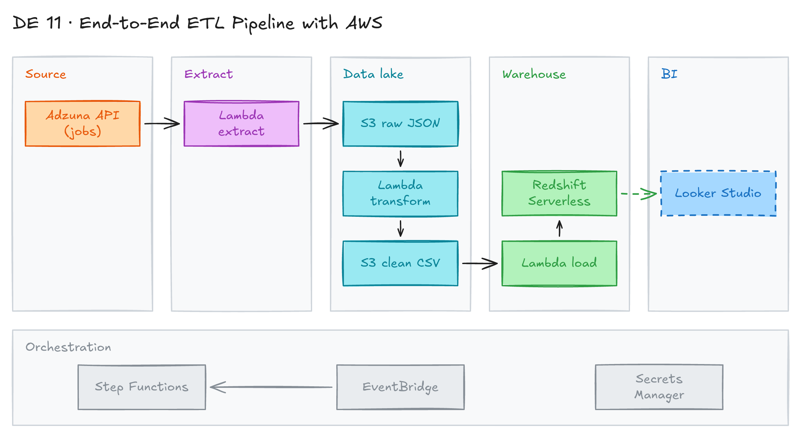

# End-to-End ETL Pipeline with AWS



## Project card

| Level | Roles | Duration | Cost | Status |
|---|---|---|---|---|
| Intermediate | Data Engineer | 6 assignments, ~2-4 h each | Free trial | Draft |

## Goal

You build a full ETL pipeline on AWS. It gets "data engineer" job postings in Canada from the Adzuna API, stores raw and clean files in S3, and loads them into Redshift Serverless. Step Functions runs the three Lambda functions in order. At the end you show the data on a dashboard.

## What you will learn

- Call a REST API with pagination from Python.
- Write AWS Lambda functions for extract, transform and load.
- Organize an S3 bucket by processing stage.
- Load CSV from S3 into Redshift with `COPY` and the Redshift Data API.
- Orchestrate Lambdas with a Step Functions state machine.
- Build a dashboard on top of the warehouse.

## Who it is for

- **Data Engineer**: you build a real serverless ETL pipeline from API to dashboard.

## Tools and services

| Tool | Used for | Free option |
|---|---|---|
| Python (`requests`, `pandas`, `boto3`) | Extract and transform code | yes |
| Adzuna API | Source of job postings | yes |
| AWS Lambda | Run extract, transform and load | yes (free tier) |
| AWS S3 | Store raw JSON and clean CSV files | yes (free tier) |
| AWS Step Functions | Run the 3 Lambdas in order | yes (free tier) |
| Amazon Redshift Serverless | Data warehouse | trial (credit for new users) |
| AWS Secrets Manager | Store Redshift credentials | no (small cost) |
| Looker Studio | Dashboard | yes |

## Architecture

The diagram is at the top of this page. Source file: [`images/architecture.excalidraw`](images/architecture.excalidraw). Open it at [excalidraw.com](https://excalidraw.com) to copy or edit it.

Data flow:

1. The extract Lambda calls the Adzuna API and saves raw JSON to `s3://<bucket>/raw_data/to_process/`.
2. The transform Lambda reads the JSON, keeps the needed fields, and writes CSV to `transformed_data/to_migrate/`. It moves the raw file to `raw_data/processed/`.
3. The load Lambda runs `COPY` into a Redshift staging table, then inserts only new jobs into the `dw.jobs` table. It moves the CSV to `transformed_data/migrated/`.
4. A Step Functions state machine runs the three Lambdas in order and stops on any error.
5. Looker Studio reads the `dw.jobs` table and shows a dashboard.

## Dataset

- **Source:** [Adzuna API](https://developer.adzuna.com/). Endpoint: `https://api.adzuna.com/v1/api/jobs/ca/search/<page>`.
- **Tables / entities:** job postings. The pipeline keeps `job_id`, `job_title`, `job_location`, `job_company`, `job_category`, `job_description`, `job_url`, `job_created`.
- **Size:** a few hundred jobs per run. The query uses `what_phrase = "data engineer"`, `max_days_old = 2`, 50 results per page.

## Prerequisites

- Python and VS Code.
- [Adzuna API account](https://developer.adzuna.com/). Save your `app_id` and `app_key`.
- AWS account.
- Google account (for Looker Studio).
- New to Git, CLI or Docker? Start with [Surfalytics Module 0](https://www.youtube.com/watch?v=LJIiCLu2gr8&list=PLNCDg7zJiXhP5Z_-TXUdorz2n7sjYHHKE&index=1).

> This project follows the article [From API to Dashboard: building an end-to-end ETL pipeline with AWS](https://medium.com/@kazarmax/from-api-to-dashboard-building-an-end-to-end-etl-pipeline-with-aws-3c1f4048676d). Read it before you start. Write down questions and issues for the Discord discussion.

## Assignments

Work at your own pace. Each assignment shows the expected time.

### Assignment 1: Explore the Adzuna API locally (~2 h)

**Goal:** Get all job postings from the API with a local Python script.

**Steps:**

1. Install the packages:

   ```bash
   pip install requests pandas loguru
   ```

2. Set your API keys as environment variables:

   ```bash
   export ADZUNA_APP_ID=<your_app_id>
   export ADZUNA_APP_KEY=<your_app_key>
   ```

3. Run [`adzuna_research.py`](adzuna_research.py). It:
   - makes the first request to get the total count of results;
   - calculates the number of pages;
   - loops through all pages;
   - keeps 8 fields and builds a pandas DataFrame.
4. Look at the DataFrame. Check types and nulls.

**Deliverable:** working script and a short note on the API response structure.

**Done when:**

- [ ] The script gets all pages without errors.
- [ ] The DataFrame has the 8 columns listed in **Dataset**.

### Assignment 2: Extract Lambda (~3 h)

**Goal:** Run the extract step in AWS Lambda and save raw JSON to S3.

**Steps:**

1. Create an S3 bucket. Bucket names are global, so change `adzuna-etl-project` in the code to your bucket name.
2. Create a Lambda function `lambda_adzuna_extract_data` from [`aws_lambda_extract.py`](aws_lambda_extract.py).
3. Add environment variables `ADZUNA_APP_ID` and `ADZUNA_APP_KEY`.
4. Add the `requests` package with a Lambda layer.
5. Give the Lambda role S3 write access.
6. Test the function. It returns the S3 key of the raw file.

**Deliverable:** Lambda code and a screenshot of the file in `raw_data/to_process/`.

**Done when:**

- [ ] The Lambda runs without errors.
- [ ] A JSON file appears in `raw_data/to_process/`.

### Assignment 3: Transform Lambda (~3 h)

**Goal:** Turn raw JSON into a clean CSV file.

**Steps:**

1. Create a Lambda function `lambda_adzuna_transform_data` from [`aws_lambda_transform.py`](aws_lambda_transform.py).
2. Add `pandas` with a Lambda layer (for example, the AWS SDK for pandas layer).
3. Give the Lambda role S3 read, write and delete access.
4. Test it with input `{"s3ObjectKey": "raw_data/to_process/<file>.json"}`.

**Deliverable:** Lambda code and a screenshot of the S3 folders.

**Done when:**

- [ ] A CSV file appears in `transformed_data/to_migrate/`.
- [ ] The raw file moved to `raw_data/processed/`.

### Assignment 4: Redshift and the load Lambda (~4 h)

**Goal:** Load the CSV into Redshift Serverless and keep only new jobs.

**Steps:**

1. Create a Redshift Serverless workgroup `adzuna-etl-project-redshift-wg` and a database `adzuna`.
2. Create schemas `stg` and `dw`, and the tables `stg.staging_jobs` and `dw.jobs`. Use the 8 columns from **Dataset**. Example:

   ```sql
   CREATE SCHEMA IF NOT EXISTS stg;
   CREATE SCHEMA IF NOT EXISTS dw;

   CREATE TABLE stg.staging_jobs (
       job_id          VARCHAR(64),
       job_title       VARCHAR(512),
       job_location    VARCHAR(512),
       job_company     VARCHAR(512),
       job_category    VARCHAR(256),
       job_description VARCHAR(65535),
       job_url         VARCHAR(2048),
       job_created     TIMESTAMP
   );

   CREATE TABLE dw.jobs (LIKE stg.staging_jobs);
   ```

3. Store Redshift credentials in Secrets Manager. Create an IAM role that lets Redshift read from S3.
4. Create a Lambda function `lambda_adzuna_load_data` from [`aws_lambda_load.py`](aws_lambda_load.py). Set `REDSHIFT_SECRET_ARN` and `REDSHIFT_IAM_ROLE` environment variables.
5. Test it with input `{"s3ObjectKeyTransformed": "transformed_data/to_migrate/<file>.csv"}`.

**Deliverable:** DDL, Lambda code and a query result from `dw.jobs`.

**Done when:**

- [ ] `dw.jobs` has rows.
- [ ] A second run with the same file adds no duplicates.
- [ ] The CSV moved to `transformed_data/migrated/`.

**Hints:** The load SQL truncates staging, runs `COPY`, then inserts rows with a `LEFT JOIN ... WHERE dwj.job_id IS NULL`.

### Assignment 5: Orchestrate with Step Functions (~2 h)

**Goal:** Run extract, transform and load as one pipeline.

**Steps:**

1. Create a state machine from [`adzuna_state_machine.json`](adzuna_state_machine.json).
2. Replace the account ID `123456789123` and region in the Lambda ARNs with your own.
3. Give the state machine role permission to invoke the three Lambdas.
4. Start an execution and watch each step.
5. Add a daily schedule with Amazon EventBridge.

**Deliverable:** state machine JSON and a screenshot of a successful run.

**Done when:**

- [ ] All three steps are green.
- [ ] Any error goes to `FailureState`.
- [ ] The pipeline runs on a schedule.

### Assignment 6: Dashboard in Looker Studio (Planned) (~2 h)

**Goal:** Show the job postings on a dashboard.

**Steps:**

1. Connect Looker Studio to Redshift (or export `dw.jobs` to Google Sheets).
2. Add a chart: jobs per day.
3. Add a chart: top companies and top locations.
4. Add a table with job titles and links.

**Deliverable:** link to the dashboard.

**Done when:**

- [ ] The dashboard shows fresh data after a pipeline run.

## Final result

- A serverless ETL pipeline: Adzuna API → Lambda → S3 → Redshift, run by Step Functions.
- A dashboard with data engineer jobs in Canada.
- Interview pitch: "I built a serverless ETL pipeline on AWS. Three Lambda functions extract, transform and load job postings into Redshift. Step Functions orchestrates them, and the load is idempotent, so reruns do not add duplicates."

## Clean up

Delete cloud resources so you do not pay for them.

- **AWS:**
  - Delete the Redshift Serverless workgroup and namespace.
  - Delete the Step Functions state machine and the EventBridge schedule.
  - Delete the three Lambda functions and their layers.
  - Empty and delete the S3 bucket: `aws s3 rb s3://<your-bucket> --force`.
  - Delete the Secrets Manager secret and the IAM roles.

## Resources

- [From API to Dashboard (Medium)](https://medium.com/@kazarmax/from-api-to-dashboard-building-an-end-to-end-etl-pipeline-with-aws-3c1f4048676d): the full walkthrough this project is based on.
- [Adzuna API docs](https://developer.adzuna.com/): endpoints and parameters.
- [AWS Lambda Developer Guide](https://docs.aws.amazon.com/lambda/): functions, layers, environment variables.
- [Redshift Data API](https://docs.aws.amazon.com/redshift/latest/mgmt/data-api.html): run SQL from Lambda.
- [AWS Step Functions](https://docs.aws.amazon.com/step-functions/): state machines.

## Community solutions

Share your repo in Discord. We add the best ones here.
