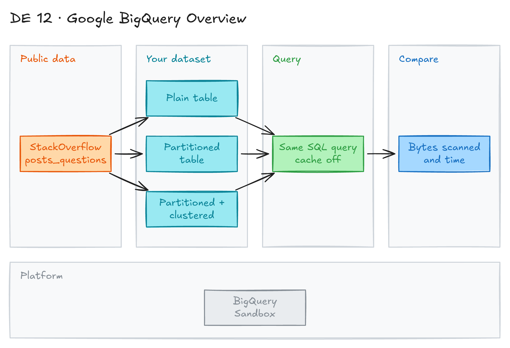

# Google BigQuery Overview: Partitioning and Clustering



## Project card

| Level | Roles | Duration | Cost | Status |
|---|---|---|---|---|
| Beginner | Data Engineer, Analytics Engineer, Data Analyst | 4 assignments, ~1-2 h each | Free | Ready |

## Goal

You learn how Google BigQuery works and how it compares to Snowflake. You start BigQuery for free with the Sandbox. Then you use partitioning and clustering on a public StackOverflow dataset and measure how much less data your queries scan.

## What you will learn

- The difference between databases, data warehouses and data lakes.
- BigQuery architecture: Dremel, Colossus, Jupiter and Borg.
- How BigQuery differs from Snowflake.
- How to start BigQuery for free with the Sandbox.
- How to create partitioned and clustered tables.
- How to compare bytes scanned and query time.

## Who it is for

- **Data Engineer**: you design tables that are fast and cheap to query.
- **Analytics Engineer**: you choose partition and cluster keys for your models.
- **Data Analyst**: you learn why some queries cost more than others.

## Tools and services

| Tool | Used for | Free option |
|---|---|---|
| Google BigQuery | Data warehouse | yes (Sandbox, no credit card) |
| BigQuery public datasets | Sample data | yes |
| Google Cloud free trial | Full BigQuery features | trial ($300 credit) |

## Architecture

The diagram is at the top of this page. Source file: [`images/architecture.excalidraw`](images/architecture.excalidraw). Open it at [excalidraw.com](https://excalidraw.com) to copy or edit it.

Data flow:

1. You open the BigQuery console in the Sandbox.
2. You read the public table `bigquery-public-data.stackoverflow.posts_questions`.
3. You copy 6 months of 2018 data into 3 tables in your `stackoverflow` dataset: plain, partitioned, and partitioned + clustered.
4. You run the same query on each table and compare bytes scanned and time.

## Dataset

- **Source:** [BigQuery public datasets](https://console.cloud.google.com/marketplace/browse?filter=solution-type:dataset), StackOverflow (`bigquery-public-data.stackoverflow`).
- **Tables / entities:** `posts_questions` (questions with title, body, tags, dates, counts). `stackoverflow_posts` for the first query.
- **Size:** about 3.2 GB for January to June 2018 questions.

## Prerequisites

- Google account.
- Basic SQL.
- New to Git, CLI or Docker? Start with [Surfalytics Module 0](https://www.youtube.com/watch?v=LJIiCLu2gr8&list=PLNCDg7zJiXhP5Z_-TXUdorz2n7sjYHHKE&index=1).

## Assignments

Work at your own pace. Each assignment shows the expected time.

### Assignment 1: Learn the concepts (~1.5 h)

**Goal:** Understand where BigQuery fits and how it works inside.

**Steps:**

1. Learn the difference between databases, data warehouses and data lakes.

   

   | Type | Examples | Architecture | Pros | Cons |
   |---|---|---|---|---|
   | Database | MySQL, PostgreSQL, MongoDB | Row-based, OLTP | Fast transactions, data integrity | Limited scale, weak for analytics |
   | Data warehouse | BigQuery, Redshift, Snowflake | Columnar, OLAP | Fast queries, central data, history | Higher cost, rigid ETL, weak for unstructured data |
   | Data lake | Google Cloud Storage, Amazon S3, Azure Data Lake | Distributed, schema-on-read | High scale, any format, good for ML | Can become a "data swamp", slower, data quality risks |

2. Learn what [BigQuery](https://cloud.google.com/bigquery) is. Google released it in 2011.

   

   - Enterprise data warehouse for large-scale analytics.
   - Serverless. Google manages all infrastructure.
   - Storage and compute are separate and scale on their own.
   - Handles petabytes of data.
   - You pay only for the storage and compute you use.

3. Learn the architecture. Storage and compute are decoupled. This is different from node-based cloud warehouses and on-premise MPP systems. Read [BigQuery under the hood](https://cloud.google.com/blog/products/bigquery/bigquery-under-the-hood).

   

   

   | Component | Role |
   |---|---|
   | [Dremel](https://research.google.com/pubs/pub36632.html) (compute) | Multi-tenant cluster that runs SQL. It turns a query into an execution tree. Leaves are **slots**: they read data and compute. Branches are **mixers**: they aggregate. Slots are given to queries as needed. One user can get thousands of slots. |
   | [Colossus](https://cloud.google.com/blog/products/storage-data-transfer/a-peek-behind-colossus-googles-file-system) (storage) | Google's global storage. Data is stored in a [columnar format](https://cloud.google.com/blog/products/gcp/inside-capacitor-bigquerys-next-generation-columnar-storage-format) with compression. It handles replication and recovery. |
   | [Jupiter](https://cloudplatform.googleblog.com/2015/06/A-Look-Inside-Googles-Data-Center-Networks.html) (network) | Petabit network between storage and compute. The **shuffle** step uses it to move data fast. |
   | [Borg](https://research.google.com/pubs/pub43438.html) (orchestration) | Allocates hardware for mixers and slots. It is the predecessor of [Kubernetes](https://kubernetes.io/). |

4. Compare BigQuery and Snowflake.

   

   - Both separate storage and compute and scale on demand.
   - Snowflake has a [three-layer architecture](https://docs.snowflake.com/en/user-guide/intro-key-concepts.html#snowflake-architecture):
     - Storage layer: cloud storage on AWS, Azure or GCP.
     - Compute layer: many MPP compute clusters (virtual warehouses).
     - Cloud services layer: query management, optimization, transactions, security, metadata, sharing.
   - Snowflake mixes the simple data management of shared-disk with the scale of shared-nothing.

   

   

   Scalability:

   

   Performance:

   

   

   Pricing:

   

**Deliverable:** a short note (5-10 bullets) in your repo: when to use a database, a warehouse and a lake, and BigQuery vs Snowflake.

**Done when:**

- [ ] You can explain slots, mixers and shuffle.
- [ ] You can name 2 differences between BigQuery and Snowflake.

### Assignment 2: Start with the BigQuery Sandbox (~1 h)

**Goal:** Open BigQuery for free and run your first query on public data.

**Steps:**

1. Choose how to start:
   - **BigQuery Sandbox**: no credit card. Some limits, for example tables expire after 60 days.
   - **Google Cloud free trial**: $300 credit for all Google Cloud products.
   - Both: 10 GB storage and 1 TB of query processing free per month.
2. Log in with your Google account and open [console.cloud.google.com/bigquery](https://console.cloud.google.com/bigquery).
3. Run this query:

   ```sql
   SELECT
     EXTRACT(YEAR FROM creation_date) AS year,
     EXTRACT(MONTH FROM creation_date) AS month,
     COUNT(creation_date) AS number_posts
   FROM
     `bigquery-public-data.stackoverflow.stackoverflow_posts`
   WHERE
     answer_count > 0
   GROUP BY year, month
   ORDER BY year ASC, month ASC;
   ```

4. Learn the resource model: **project → dataset → table**.

   

5. Learn the storage basics:
   - Columnar storage: each column is in a separate block. Good for OLAP. MySQL stores rows, which is good for OLTP.
   - BigQuery supports streaming and unlimited DML (`INSERT`, `UPDATE`, `MERGE`, `DELETE`).
   - The internal format is [Capacitor](https://cloud.google.com/blog/products/gcp/inside-capacitor-bigquerys-next-generation-columnar-storage-format).
   - Batch loads are [free](https://cloud.google.com/bigquery/pricing#free). You pay for [storage](https://cloud.google.com/bigquery/pricing#storage). The first 10 GB per month is free.
   - A table or partition changed in the last 90 days is **active storage**. Older data is **long-term storage** and costs less.

   

   

6. Create a dataset named `stackoverflow` in your project. You need it in the next assignments.

**Deliverable:** screenshot of the query result.

**Done when:**

- [ ] The query returns posts per month.
- [ ] The `stackoverflow` dataset exists in your project.

### Assignment 3: Partitioning (~1.5 h)

**Goal:** Create a partitioned table and compare it with a plain table.

**Steps:**

1. Learn the partition types. A partitioned table is split into segments (partitions). This makes it easier to manage and query.

   

   | Type | How it works |
   |---|---|
   | Ingestion time | Partitions by load date. Adds `_PARTITIONTIME` and `_PARTITIONDATE` columns. |
   | `DATE` / `TIMESTAMP` column | Partitions by a date column. Supports hourly granularity. Special partitions for `NULL` and out-of-range values. |
   | `INTEGER` range | Partitions by integer ranges. Special partitions for `NULL` and out-of-range values. |

2. [Disable cached results](https://cloud.google.com/bigquery/docs/cached-results#console) in query settings. This makes the comparison fair.
3. Create a plain (non-partitioned) table with questions from the first half of 2018. See [creating a table from an existing table](https://cloud.google.com/bigquery/docs/reference/standard-sql/data-definition-language#creating_a_new_table_from_an_existing_table).

   ```sql
   CREATE OR REPLACE TABLE `stackoverflow.questions_2018` AS
   SELECT *
   FROM `bigquery-public-data.stackoverflow.posts_questions`
   WHERE creation_date BETWEEN '2018-01-01' AND '2018-07-01';
   ```

4. Query Android questions from January 2018:

   ```sql
   SELECT
     id,
     title,
     body,
     accepted_answer_id,
     creation_date,
     answer_count,
     comment_count,
     favorite_count,
     view_count
   FROM
     `stackoverflow.questions_2018`
   WHERE
     creation_date BETWEEN '2018-01-01' AND '2018-02-01'
     AND tags = 'android';
   ```

5. Create a table partitioned by `creation_date` with [BigQuery DDL](https://cloud.google.com/bigquery/docs/reference/standard-sql/data-definition-language). Other ways are in the [docs](https://cloud.google.com/bigquery/docs/creating-partitioned-tables).

   ```sql
   CREATE OR REPLACE TABLE `stackoverflow.questions_2018_partitioned`
   PARTITION BY DATE(creation_date) AS
   SELECT *
   FROM `bigquery-public-data.stackoverflow.posts_questions`
   WHERE creation_date BETWEEN '2018-01-01' AND '2018-07-01';
   ```

6. Run the same query on `stackoverflow.questions_2018_partitioned`.
7. Compare bytes processed and time.

**Deliverable:** a table with bytes processed and time for both queries.

**Done when:**

- [ ] The plain table query scans about 3.2 GB.
- [ ] The partitioned table query scans about 290 MB in less than 2 seconds.

### Assignment 4: Clustering (~1 h)

**Goal:** Add clustering to the partitioned table and measure the gain.

**Steps:**

1. Learn how clustering works:
   - Data is sorted by the cluster columns into storage blocks.
   - Best for high-cardinality, non-date columns.
   - BigQuery re-clusters new data automatically, at no extra cost.
   - It helps filter and aggregation queries skip data.
   - Works on partitioned and non-partitioned tables. Up to 4 cluster columns.

   

2. Create a table partitioned by `creation_date` and clustered by `tags`. See [creating clustered tables](https://cloud.google.com/bigquery/docs/creating-clustered-tables) and [DDL for clustered tables](https://cloud.google.com/bigquery/docs/reference/standard-sql/data-definition-language#creating_a_clustered_table).

   ```sql
   CREATE OR REPLACE TABLE `stackoverflow.questions_2018_clustered`
   PARTITION BY DATE(creation_date)
   CLUSTER BY tags AS
   SELECT *
   FROM `bigquery-public-data.stackoverflow.posts_questions`
   WHERE creation_date BETWEEN '2018-01-01' AND '2018-07-01';
   ```

3. Run the same Android query on `stackoverflow.questions_2018_clustered`, with cache disabled.
4. Compare the estimate before the run with the actual bytes processed.
5. Do the [Partitioning and Clustering codelab](https://codelabs.developers.google.com/codelabs/gcp-bq-partitioning-and-clustering/#0).

**Deliverable:** the comparison table from Assignment 3 with a third row for the clustered table.

**Done when:**

- [ ] The clustered query scans about 275 MB in less than 1 second.
- [ ] You can explain why the estimate (~286 MB) differs from the actual bytes.

**Hints:**

- Clustering gives no strict cost guarantee before the query runs. The estimate is an upper bound.
- Use clustering only when you need more detail than partitioning alone gives.

## Final result

- A comparison table: plain vs partitioned vs partitioned + clustered, with bytes and time.
- Post the table and a short summary on LinkedIn.
- Interview pitch: "I tested BigQuery partitioning and clustering on StackOverflow data. Partitioning by date cut the scan from 3.2 GB to 290 MB. Adding clustering by tag cut it to 275 MB and the query ran in under 1 second."

## Clean up

- Delete the `stackoverflow` dataset in your project: in the console, open the dataset and click **Delete**. Or run `DROP SCHEMA stackoverflow CASCADE;`.
- In the Sandbox nothing is billed. Tables also expire after 60 days.
- On the free trial, delete the project if you do not need it.

## Resources

- [BigQuery documentation](https://cloud.google.com/bigquery/docs): official docs.
- [BigQuery pricing](https://cloud.google.com/bigquery/pricing): free tier and storage prices.
- [Partitioned tables](https://cloud.google.com/bigquery/docs/partitioned-tables) and [clustered tables](https://cloud.google.com/bigquery/docs/clustered-tables): details and limits.
- [BigQuery learning course](https://www.cloudskillsboost.google/course_templates/14): official Google course.
- [Partitioning and Clustering codelab](https://codelabs.developers.google.com/codelabs/gcp-bq-partitioning-and-clustering/#0): guided hands-on.

## Community solutions

Share your repo in Discord. We add the best ones here.
