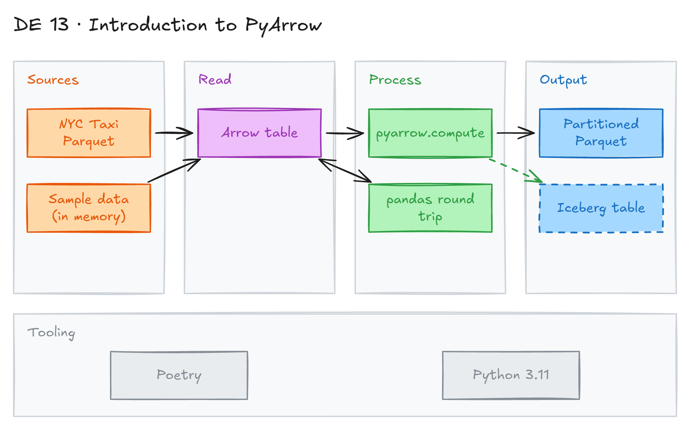

# Introduction to PyArrow



## Project card

| Level | Roles | Duration | Cost | Status |
|---|---|---|---|---|
| Base | Data Engineer | 4 assignments, ~1-2 h each | Free | In progress |

## Goal

You learn PyArrow, the Python library for Apache Arrow. You build Arrow arrays and tables, convert to and from pandas, and read real Parquet data (NYC Taxi). You also see where PyArrow helps in ETL pipelines and when you do not need it.

### Key concepts

- The Arrow columnar format is a language-independent, in-memory data structure. It also defines metadata and a protocol to move data between systems. It is fast for analytics. Changing data (mutation) is more expensive. See the [Arrow columnar format docs](https://arrow.apache.org/docs/format/Columnar.html).
- The main data structure is the **Arrow table**. It is two-dimensional. Each column is a **chunked array**.
- PyArrow is the Python interface to Arrow.

### When to use PyArrow

Benefits:

- Speed: much faster than plain Python for data operations.
- Memory: uses less RAM.
- Compatibility: works with many data tools.
- Handles complex data types.

| Use PyArrow when | Examples |
|---|---|
| Large datasets | Files over 1 GB, memory or speed matters |
| Parquet files | Read and write Parquet, data warehouses, efficient storage |
| Exact data types | Timestamps, decimals, type consistency |
| Big data tools | Apache Spark, data lakes |
| Pipelines | ETL, warehousing, real-time processing, data exchange between platforms |

You do **not** need PyArrow for small datasets (under 100 MB), simple analysis, simple CSV files, or when speed does not matter.

## What you will learn

- What the Arrow columnar format is and why it is fast.
- Create Arrow arrays, tables, schemas and nested types.
- Convert between pandas and Arrow.
- Read Parquet files and use `pyarrow.compute` for analysis.
- Write partitioned datasets with `pyarrow.dataset`.
- Know when PyArrow is useful and when it is not.

## Who it is for

- **Data Engineer**: Arrow is under pandas, Polars, DuckDB, Spark and Iceberg. You need to know how it works.

## Tools and services

| Tool | Used for | Free option |
|---|---|---|
| Python 3.9-3.11 | Run the examples | yes |
| Poetry | Manage dependencies | yes |
| PyArrow | Arrow tables, Parquet, compute | yes |
| pandas, NumPy | Compare with Arrow | yes |
| DuckDB, fastparquet | Optional integrations | yes |
| PyIceberg | Optional Iceberg integration | yes |
| Jupyter | Optional notebooks | yes |

## Architecture

The diagram is at the top of this page. Source file: [`images/architecture.excalidraw`](images/architecture.excalidraw). Open it at [excalidraw.com](https://excalidraw.com) to copy or edit it.

Data flow:

1. A Python script downloads a NYC Taxi Parquet file or creates sample data in memory.
2. PyArrow reads the data into an Arrow table.
3. `pyarrow.compute` cleans, filters and aggregates the data.
4. The script converts results to pandas or writes Parquet (partitioned) to local disk.

## Dataset

- **Source:** [NYC TLC Trip Record Data](https://www.nyc.gov/site/tlc/about/tlc-trip-record-data.page), Yellow Taxi January 2023: `https://d37ci6vzurychx.cloudfront.net/trip-data/yellow_tripdata_2023-01.parquet`.
- **Tables / entities:** taxi trips (pickup and dropoff time, passenger count, distance, fare, tip, total).
- **Size:** about 3 million rows, about 50 MB.
- Other scripts generate sample data in memory.

## Prerequisites

- Python 3.9, 3.10 or 3.11.
- [pipx](https://pipx.pypa.io/) to install Poetry.
- Basic Python and pandas.
- New to Git, CLI or Docker? Start with [Surfalytics Module 0](https://www.youtube.com/watch?v=LJIiCLu2gr8&list=PLNCDg7zJiXhP5Z_-TXUdorz2n7sjYHHKE&index=1).

## Assignments

Work at your own pace. Each assignment shows the expected time.

### Assignment 1: Set up and learn the basics (~1.5 h)

**Goal:** Install the project and create your first Arrow arrays and tables.

**Steps:**

1. Install Poetry and the project dependencies from [`pyproject.toml`](pyproject.toml):

   ```bash
   pipx install poetry
   export PATH="$HOME/.local/bin:$PATH"

   cd de-projects/13_pyarrow_intro

   # Install dependencies
   poetry install
   ```

2. Run [`examples.py`](examples.py):

   ```bash
   poetry run python examples.py
   ```

   It shows: a simple array, a table from a dict, different data types, pandas to Arrow and back, a custom schema with nested data, and chunked arrays.
3. Run [`pyarrow_pandas.py`](pyarrow_pandas.py). It converts a pandas DataFrame to Arrow and back.

**Deliverable:** your own script with 3 examples: an array, a table with a custom schema, and a pandas round trip.

**Done when:**

- [ ] `poetry install` works.
- [ ] Both scripts run without errors.
- [ ] You can explain what a chunked array is.

**Hints:** Poetry 2.0 removed `poetry shell`. Use `poetry run <command>`, or activate the env with `eval $(poetry env activate)`.

### Assignment 2: Analyze NYC Taxi data (~1.5 h)

**Goal:** Read a real Parquet file and analyze it with `pyarrow.compute`.

**Steps:**

1. Run [`ny_tax_parquet.py`](ny_tax_parquet.py):

   ```bash
   poetry run python ny_tax_parquet.py
   ```

2. Read the code. It:
   - downloads the January 2023 Yellow Taxi file;
   - reads only the needed columns with `pq.read_table`;
   - calculates basic statistics;
   - calculates trip duration in minutes;
   - finds long trips (more than 10 miles) and high tips (more than 20% of fare);
   - prints memory usage.
3. Add one more question of your own, for example average fare per passenger count.

**Deliverable:** your updated script and its output.

**Done when:**

- [ ] The script prints the row count and statistics.
- [ ] Your extra question works with `pyarrow.compute`, not pandas.

**Hints:** [`ex.py`](ex.py) is a short version of the same code. Run it with `poetry run python ex.py`.

### Assignment 3: PyArrow for data engineering (~2 h)

**Goal:** See where PyArrow helps in real pipelines.

**Steps:**

1. Run [`use_cases.py`](use_cases.py). It shows:
   - memory use: pandas vs PyArrow on 1 million rows;
   - Parquet read and write;
   - data type preservation;
   - integration with big data tools.
2. Run [`data_engineering_example.py`](data_engineering_example.py). It shows:
   - an ETL pipeline with data validation (null checks, cleaning);
   - a partitioned dataset with `pyarrow.dataset`;
   - performance tips for large data;
   - format conversion.
3. Write down the results: memory, time, file sizes.

**Deliverable:** a short table in your README with the results of each case.

**Done when:**

- [ ] Both scripts run without errors.
- [ ] You can explain when to use PyArrow and when pandas is enough.

### Assignment 4: PyArrow and Apache Iceberg (Planned) (~2 h)

**Goal:** Write an Arrow table to an Iceberg table with PyIceberg.

**Steps:**

1. Read [`pyarrow_iceberg.py`](pyarrow_iceberg.py). The Iceberg part is pseudo-code now.
2. Set up a local catalog (for example, a SQLite catalog) with PyIceberg.
3. Create an Iceberg table from the Arrow schema.
4. Append the Arrow table to it.
5. Read it back and check the row count.

**Deliverable:** working `pyarrow_iceberg.py`.

**Done when:**

- [ ] The Iceberg table has 1,000 rows after the write.

**Hints:** See [PyIceberg docs](https://py.iceberg.apache.org/). Project [15_apache_iceberg_intro](../15_apache_iceberg_intro/) goes deeper.

## Final result

- A repo with PyArrow examples and a NYC Taxi analysis.
- A table that compares pandas and PyArrow on memory and speed.
- Interview pitch: "I used PyArrow to read and analyze 3 million NYC Taxi trips from Parquet. I used Arrow compute functions and partitioned datasets, and measured memory against pandas. I know Arrow is the in-memory format under pandas, Polars, DuckDB and Spark."

## Clean up

Nothing to clean up. Delete downloaded Parquet files and local output folders if you do not need them.

## Resources

- [Arrow Columnar Format documentation](https://arrow.apache.org/docs/format/Columnar.html): the format spec.
- [PyArrow documentation](https://arrow.apache.org/docs/python/): Python API.
- [An analysis of the strengths and weaknesses of Apache Arrow](https://dbmsmusings.blogspot.com/2018/03/an-analysis-of-strengths-and-weaknesses.html): design trade-offs.
- [Apache Arrow: Overview](https://vutr.substack.com/p/i-spent-6-hours-learning-apache-arrow): a beginner-friendly deep dive.

## Community solutions

Share your repo in Discord. We add the best ones here.
