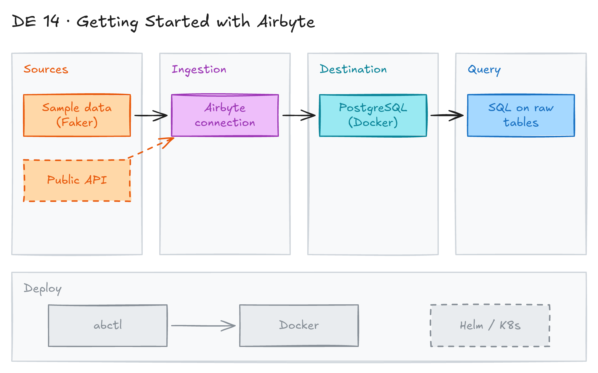

# Getting Started with Airbyte and Data Ingestion



## Project card

| Level | Roles | Duration | Cost | Status |
|---|---|---|---|---|
| Beginner | Data Engineer, Analytics Engineer | 3 assignments, ~2-3 h each | Free | Draft |

## Goal

You deploy Airbyte on your laptop and learn how it moves data into a data warehouse. You create a first connection from a source to a destination. You also learn how Airbyte runs on Kubernetes with Helm.

## What you will learn

- What Airbyte is and where it fits in ELT.
- Install Airbyte locally with `abctl`.
- Create a source, a destination and a connection.
- Run and monitor a sync.
- How Airbyte is deployed on Kubernetes with Helm.

## Who it is for

- **Data Engineer**: you learn an open-source ingestion tool instead of writing custom code.
- **Analytics Engineer**: you learn how raw data lands in the warehouse before you model it.

## Tools and services

| Tool | Used for | Free option |
|---|---|---|
| Airbyte (open source) | Extract and load data | yes |
| `abctl` | Install and run Airbyte locally | yes |
| Docker Desktop | Runtime for the local Airbyte cluster | yes |
| PostgreSQL | Example destination | yes |
| Helm, Kubernetes | Production-style deployment | yes |

**Airbyte** is an open-source data integration platform. It extracts data from many sources and loads it into destinations: databases, data warehouses or cloud storage.

## Architecture

The diagram is at the top of this page. Source file: [`images/architecture.excalidraw`](images/architecture.excalidraw). Open it at [excalidraw.com](https://excalidraw.com) to copy or edit it.

Data flow:

1. `abctl` starts Airbyte in a local Kubernetes cluster inside Docker.
2. You add a source in the Airbyte UI.
3. You add a destination, for example PostgreSQL in Docker.
4. A connection syncs data from the source to the destination.
5. You query the raw tables in the destination.

## Dataset

- **Source:** any Airbyte source. For a first test use a sample data source (for example, Faker), or a public API.
- **Tables / entities:** depends on the source.
- **Size:** small (thousands of rows).

## Prerequisites

- Docker Desktop. Give it at least 4 CPUs and 8 GB RAM.
- Basic Docker knowledge.
- Understanding of ETL vs ELT.
- New to Git, CLI or Docker? Start with [Surfalytics Module 0](https://www.youtube.com/watch?v=LJIiCLu2gr8&list=PLNCDg7zJiXhP5Z_-TXUdorz2n7sjYHHKE&index=1).

> Airbyte 1.0 deprecated the Docker Compose install. Use `abctl` instead. See [this discussion](https://docs.airbyte.com/platform/using-airbyte/getting-started/oss-quickstart).

## Assignments

Work at your own pace. Each assignment shows the expected time.

### Assignment 1: Install Airbyte locally (Planned) (~2 h)

**Goal:** Run Airbyte on your laptop with `abctl`.

**Steps:**

1. Follow the [Quickstart](https://docs.airbyte.com/using-airbyte/getting-started/oss-quickstart).
2. Install `abctl`:

   ```bash
   curl -LsfS https://get.airbyte.com | bash -
   ```

3. Start Airbyte:

   ```bash
   abctl local install
   ```

4. Get the login credentials:

   ```bash
   abctl local credentials
   ```

5. Open [http://localhost:8000](http://localhost:8000) and log in.

**Deliverable:** screenshot of the Airbyte UI.

**Done when:**

- [ ] The Airbyte UI opens at `localhost:8000`.

### Assignment 2: First sync (Planned) (~2 h)

**Goal:** Move data from a source to PostgreSQL.

**Steps:**

1. Start PostgreSQL in Docker:

   ```bash
   docker run -d --name airbyte-pg -e POSTGRES_PASSWORD=<your_password> -p 5432:5432 postgres:16
   ```

2. In Airbyte, add a sample data source.
3. Add a PostgreSQL destination. Use `host.docker.internal` as the host.
4. Create a connection and run a sync.
5. Query the new tables in PostgreSQL.

**Deliverable:** screenshot of a successful sync and a query result.

**Done when:**

- [ ] The sync finishes with status "Succeeded".
- [ ] The tables have rows in PostgreSQL.

### Assignment 3: Airbyte on Kubernetes with Helm (Planned) (~3 h)

**Goal:** Understand how to deploy Airbyte in production with Helm.

**Steps:**

1. Read the [Airbyte Helm chart](https://artifacthub.io/packages/helm/airbyte/airbyte) and its values.
2. List the main components: server, webapp, worker, database, storage.
3. Write a `values.yaml` for a small deployment (external database, external storage).
4. Optional: install it on a local Kubernetes cluster (kind or minikube).

**Deliverable:** `values.yaml` and a short note on each component.

**Done when:**

- [ ] You can explain how `abctl` and Helm deployments differ.

## Final result

- A local Airbyte setup with a working connection.
- Post a screenshot of the sync and what you learned on LinkedIn.
- Interview pitch: "I deployed open-source Airbyte with abctl and set up a sync into PostgreSQL. I know how Airbyte runs on Kubernetes with Helm, and when to use a ready connector instead of custom code."

## Clean up

- Stop and remove Airbyte: `abctl local uninstall`. Add `--persisted` to also delete saved data.
- Remove the PostgreSQL container: `docker rm -f airbyte-pg`.

## Resources

- [Airbyte OSS Quickstart](https://docs.airbyte.com/using-airbyte/getting-started/oss-quickstart): official install guide.
- [Airbyte Helm chart](https://artifacthub.io/packages/helm/airbyte/airbyte): chart and values.
- [Getting Started with Airbyte: An Introductory Tutorial for Beginners](https://medium.com/data-engineer-things/getting-started-with-airbyte-an-introductory-tutorial-for-beginners-58887bc3b4dd): step-by-step tutorial.
- [Deprecation of Docker Compose in Airbyte 1.0](https://docs.airbyte.com/platform/using-airbyte/getting-started/oss-quickstart): why `abctl` replaced Docker Compose.

## Community solutions

Share your repo in Discord. We add the best ones here. Discussions and weekly meetings are in the Discord channel **data-engineering-projects**.
