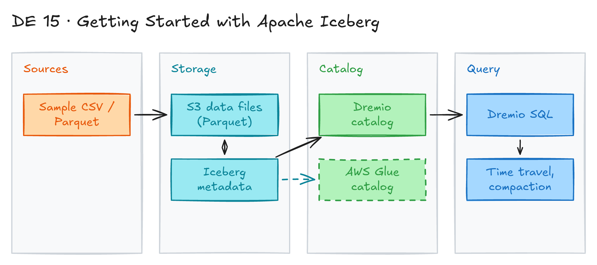

# Getting Started with Apache Iceberg

## Project card

| Level | Roles | Duration | Cost | Status |
|---|---|---|---|---|
| Middle | Data Engineer | 3 assignments, ~3-5 h each | Free trial | Draft |

## Goal

You learn what the Apache Iceberg table format is. You learn its key benefits and its use cases for a lakehouse. You use the book "Apache Iceberg: The Definitive Guide" for the hands-on parts.

## What you will learn

- What a table format is and why a data lake needs one.
- How Iceberg metadata works: metadata file, manifest list, manifest files, data files.
- How snapshots give you time travel and ACID transactions.
- How schema evolution and hidden partitioning work.
- What a catalog does and which catalogs exist.
- How compaction keeps queries fast.

## Who it is for

- **Data Engineer**: Iceberg is the most common open table format for lakehouses. You will see it in many job posts.

## Tools and services

| Tool | Used for | Free option |
|---|---|---|
| Apache Iceberg | Open table format on top of Parquet files | yes |
| Dremio Cloud | Query engine and catalog for Iceberg tables | trial |
| AWS S3 | Storage for data and metadata files | yes (free tier) |
| AWS Glue Data Catalog | Iceberg catalog (optional) | yes (free tier) |

## Architecture

The diagram is at the top of this page. Source file: [`images/architecture.excalidraw`](images/architecture.excalidraw). Open it at [excalidraw.com](https://excalidraw.com) to copy or edit it.

Data flow:

1. You load sample data (CSV or Parquet) into an S3 bucket.
2. Dremio creates an Iceberg table. It writes Parquet data files and metadata files to S3.
3. A catalog (Dremio catalog or AWS Glue) stores the pointer to the current metadata file.
4. You query the table with SQL in Dremio. You try time travel, schema changes and compaction.

## Dataset

- **Source:** the sample datasets from "Apache Iceberg: The Definitive Guide", or any public CSV/Parquet file (for example [NYC TLC trip data](https://www.nyc.gov/site/tlc/about/tlc-trip-record-data.page)).
- **Tables / entities:** one or two tables are enough.
- **Size:** small. A few MB is fine.

## Prerequisites

- [Apache Iceberg: The Definitive Guide](https://hello.dremio.com/wp-apache-iceberg-the-definitive-guide-reg.html) (free ebook).
- Dremio Cloud trial: <https://www.dremio.com/cloud/>
- AWS account: <https://aws.amazon.com/free/>
- Basic SQL.
- New to Git, CLI or Docker? Start with [Surfalytics Module 0](https://www.youtube.com/watch?v=LJIiCLu2gr8&list=PLNCDg7zJiXhP5Z_-TXUdorz2n7sjYHHKE&index=1).

## Assignments

Work at your own pace. Each assignment shows the expected time.

### Assignment 1: Learn the Iceberg concepts (~4 h)

**Goal:** Understand the key Iceberg terms and the benefits of the format.

**Steps:**

1. Read the first chapters of "Apache Iceberg: The Definitive Guide".
2. Learn the key terms in the table below. Write one example for each term in your own words.

   | Term | What it is | Why it matters |
   |---|---|---|
   | Table format | A spec that says how data files are structured and stored in a data lake. | Many engines (Spark, Flink, Trino, Dremio) read and write the same table. |
   | Data files | Files with the table data, in Parquet, Avro or ORC. | Hold the actual rows. Iceberg manages them. |
   | Manifest files | Metadata files that list data files, with paths, row counts and column stats. | Engines skip files they do not need. |
   | Manifest list | A file that lists all manifest files for one snapshot. | One entry point to the table state. |
   | Table metadata file | Stores schema, partition spec and pointers to snapshots. | Keeps versions, so you can recover old table states. |
   | Snapshot | A consistent view of the table at one point in time. | Gives time travel. Readers and writers do not block each other. |
   | ACID transactions | Atomicity, Consistency, Isolation, Durability. | Reads and writes stay correct with many users at once. |
   | Schema evolution | Add, drop or rename columns without breaking queries. | Easy to follow changes in source data. |
   | Partitioning | Split data by key columns. | Faster queries. |
   | Hidden partitioning | Iceberg handles partitions itself. | Users do not need to filter on partition columns in queries. |
   | Time travel | Query an old snapshot. | Debugging, audits, reproducible analysis. |
   | Compaction | Merge many small files into bigger ones. | Fewer files, faster queries. |
   | Row-level deletes and updates | Change single rows without a full partition rewrite. | Fine control over data changes. |
   | Catalog | A service that tracks Iceberg tables and their current metadata. | Lets engines find tables. Examples: Hive Metastore, AWS Glue, REST catalogs such as Apache Polaris or Nessie. |

3. Learn the main benefits:
   - **Engine agnostic:** works with Spark, Flink, Trino, Dremio, Snowflake and more.
   - **Efficient queries:** column stats and hidden partitioning skip files.
   - **Versioned data:** time travel and snapshot isolation.
   - **Scalable:** built for large data lakes.
   - **ACID:** data stays consistent during complex operations.

**Deliverable:** a short note (Markdown in your repo) with the terms in your own words and a drawing of the Iceberg metadata tree.

**Done when:**

- [ ] You can explain metadata file → manifest list → manifest files → data files.
- [ ] You can explain how a snapshot gives time travel.
- [ ] You can name 3 catalogs and 3 engines that support Iceberg.

### Assignment 2: Create your first Iceberg table (Planned) (~4 h)

**Goal:** Create and query an Iceberg table on S3 with Dremio.

**Steps:**

1. Create an S3 bucket and connect it to Dremio Cloud.
2. Upload a sample CSV or Parquet file.
3. Create an Iceberg table with `CREATE TABLE ... AS SELECT`.
4. Look at the files in S3. Find the data files and the `metadata/` folder.
5. Run `INSERT`, `UPDATE` and `DELETE`. Check how new snapshots appear.

**Deliverable:** SQL scripts in your repo and screenshots of the S3 folder.

**Done when:**

- [ ] The table exists and you can query it.
- [ ] You can point to the metadata files for each snapshot.

### Assignment 3: Time travel, schema evolution and compaction (Planned) (~4 h)

**Goal:** Use the main Iceberg features on your table.

**Steps:**

1. Query an old snapshot (time travel).
2. Add and rename a column. Check that old queries still work.
3. Change the partition spec (for example, partition by day of a date column).
4. Run compaction (`OPTIMIZE TABLE`) and compare the file count before and after.
5. Expire old snapshots (`VACUUM TABLE ... EXPIRE SNAPSHOTS`).

**Deliverable:** SQL scripts and a short note with your results.

**Done when:**

- [ ] You ran a time travel query.
- [ ] You changed the schema without errors.
- [ ] The file count went down after compaction.

**Hints:** the SQL syntax depends on the engine. Check the [Dremio Iceberg docs](https://docs.dremio.com/).

## Final result

- Notes on Iceberg concepts and SQL scripts in a GitHub repo.
- LinkedIn post: what you learned about open table formats.
- Interview answer: "Iceberg is an open table format. It adds a metadata layer on top of Parquet files. This gives ACID transactions, time travel, schema evolution and hidden partitioning, and many engines can use the same table."

## Clean up

- Delete the S3 bucket and its objects.
- Delete the Dremio Cloud project if you do not need it.
- Delete Glue databases and tables if you created them.

## Resources

- [Apache Iceberg: The Definitive Guide](https://hello.dremio.com/wp-apache-iceberg-the-definitive-guide-reg.html): the main book for this project.
- [Apache Iceberg docs](https://iceberg.apache.org/docs/latest/): official spec and engine guides.
- [Dremio Cloud](https://www.dremio.com/cloud/): query engine used in the hands-on parts.

Discussions and weekly meetings are in the Discord channel **data-engineering-projects**.

## Community solutions

Share your repo in Discord. We add the best ones here.
