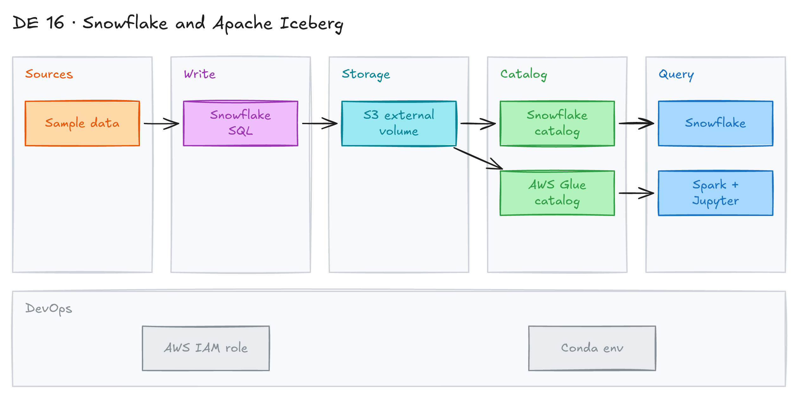

# Getting Started with Snowflake and Apache Iceberg



## Project card

| Level | Roles | Duration | Cost | Status |
|---|---|---|---|---|
| Intermediate | Data Engineer, Analytics Engineer | 3 assignments, ~3-4 h each | Free trial | Draft |

## Goal

You explore how Apache Iceberg and Snowflake work together. You create Iceberg tables in Snowflake on your own S3 storage. You read the same tables from Spark and from AWS Glue. At the end you know when to use Iceberg tables instead of normal Snowflake tables.

## What you will learn

- What Snowflake Iceberg tables are and when to use them.
- How to set up an external volume on S3 for Snowflake.
- The difference between a Snowflake-managed catalog and an external catalog (AWS Glue).
- How to read Snowflake-managed Iceberg tables from Spark.
- How to query an Iceberg data lake on S3 with Snowflake and AWS Glue.

## Who it is for

- **Data Engineer**: you build an open lakehouse where many engines share the same tables.
- **Analytics Engineer**: you learn where your Snowflake data lives and how other tools can read it.

## Tools and services

| Tool | Used for | Free option |
|---|---|---|
| Snowflake | Create and query Iceberg tables | trial |
| Apache Iceberg | Open table format (Parquet files + metadata) | yes |
| AWS S3 | Storage for Iceberg data and metadata | yes (free tier) |
| AWS Glue Data Catalog | External Iceberg catalog | yes (free tier) |
| Apache Spark (PySpark) + Jupyter | Read Iceberg tables outside Snowflake | yes |
| Conda | Local Python environment from [`environment.yml`](environment.yml) | yes |

## Architecture

The diagram is at the top of this page. Source file: [`images/architecture.excalidraw`](images/architecture.excalidraw). Open it at [excalidraw.com](https://excalidraw.com) to copy or edit it.

Data flow:

1. You load sample data into Snowflake.
2. Snowflake writes Iceberg tables (Parquet + metadata) to your S3 bucket through an external volume.
3. A catalog tracks the tables: Snowflake (managed) or AWS Glue (external).
4. Snowflake queries the tables with SQL.
5. Spark (local Jupyter) reads the same tables from S3 through the Snowflake catalog.

## Dataset

- **Source:** sample data from the Snowflake quickstarts (TPC-H sample data and the quickstart files).
- **Tables / entities:** customer and order tables from the tutorials.
- **Size:** small. Fits the free trial.

## Prerequisites

- Snowflake trial: <https://signup.snowflake.com/>
- AWS account: <https://aws.amazon.com/free/>
- [Conda](https://docs.conda.io/) or Miniconda for the Spark environment.
- Do [15 Apache Iceberg intro](../15_apache_iceberg_intro/README.md) first if Iceberg is new to you.
- New to Git, CLI or Docker? Start with [Surfalytics Module 0](https://www.youtube.com/watch?v=LJIiCLu2gr8&list=PLNCDg7zJiXhP5Z_-TXUdorz2n7sjYHHKE&index=1).

Key facts about Snowflake Iceberg tables:

- They combine Snowflake performance and SQL with external cloud storage that you manage.
- They fit data lakes that you cannot or do not want to store inside Snowflake.
- They support ACID transactions, schema evolution, hidden partitioning and table snapshots.
- Snowflake supports Iceberg tables with the Apache Parquet file format.

## Assignments

Work at your own pace. Each assignment shows the expected time.

### Assignment 1: Create your first Iceberg table (~3 h)

**Goal:** Create a Snowflake-managed Iceberg table on your own S3 bucket.

**Steps:**

1. Create an S3 bucket and an IAM role for Snowflake.
2. Follow [Tutorial: Create your first Apache Iceberg table](https://docs.snowflake.com/en/user-guide/tutorials/create-your-first-iceberg-table).
3. Create an external volume that points to your bucket.
4. Create an Iceberg table with `CATALOG = 'SNOWFLAKE'` and load data.
5. Open the S3 bucket. Find the `data/` and `metadata/` files.

**Deliverable:** SQL script in your repo and a screenshot of the S3 folder.

**Done when:**

- [ ] The external volume works (`SYSTEM$VERIFY_EXTERNAL_VOLUME` succeeds).
- [ ] You can query the Iceberg table in Snowflake.
- [ ] You can see the Parquet and metadata files in S3.

### Assignment 2: Read Snowflake Iceberg tables from Spark (~4 h)

**Goal:** Read the same Iceberg table with Spark outside Snowflake.

**Steps:**

1. Follow the quickstart [Getting Started with Iceberg Tables](https://quickstarts.snowflake.com/guide/getting_started_iceberg_tables/index.html#0).
2. Create the local Spark environment from [`environment.yml`](environment.yml) (PySpark 3.5, Jupyter, OpenJDK 11):

   ```bash
   conda env create -f environment.yml
   conda activate iceberg-lab
   jupyter notebook
   ```

3. Configure Spark to use the Snowflake catalog for Iceberg.
4. Read the table from Spark. Compare the row count with Snowflake.
5. Try time travel and schema evolution in Snowflake. Check what Spark sees.

**Deliverable:** notebook in your repo with the Spark read.

**Done when:**

- [ ] Spark reads the table and the row count matches Snowflake.
- [ ] You can explain who owns the catalog and who can write to the table.

### Assignment 3: Data lake with Snowflake and AWS Glue (~4 h)

**Goal:** Use AWS Glue as an external Iceberg catalog and query the tables from Snowflake.

**Steps:**

1. Follow the quickstart [Build Data Lakes using Apache Iceberg with Snowflake and AWS Glue](https://quickstarts.snowflake.com/guide/data_lake_using_apache_iceberg_with_snowflake_and_aws_glue/index.html#0).
2. Create Iceberg tables in AWS Glue.
3. Create a catalog integration in Snowflake for Glue.
4. Query the Glue tables from Snowflake.
5. Write a short comparison: Snowflake-managed catalog vs Glue catalog.

**Deliverable:** SQL scripts and the comparison note in your repo.

**Done when:**

- [ ] Snowflake queries Iceberg tables from the Glue catalog.
- [ ] Your note lists 2-3 pros and cons of each catalog option.

**Hints:** Snowflake also offers Snowflake Open Catalog (managed Apache Polaris). Read about it if you want a REST catalog for many engines.

## Final result

- A GitHub repo with SQL scripts, a Spark notebook and a comparison note.
- LinkedIn post: how you shared one Iceberg table between Snowflake and Spark.
- Interview answer: "I created Iceberg tables in Snowflake on my own S3 bucket. I read them from Spark and used AWS Glue as an external catalog. Iceberg lets many engines share the same data without copies."

## Clean up

- Drop the Iceberg tables, external volumes and catalog integrations in Snowflake.
- Suspend or drop the Snowflake warehouse.
- Delete the S3 bucket, IAM roles and Glue databases.
- Remove the local environment: `conda env remove -n iceberg-lab`.

## Resources

- [Apache Iceberg: The Definitive Guide](https://hello.dremio.com/wp-apache-iceberg-the-definitive-guide-reg.html): the main Iceberg book.
- [Best Practices for Data Ingestion with Snowflake: Part 1](https://www.snowflake.com/en/blog/best-practices-for-data-ingestion/)
- [Best Practices for Data Ingestion with Snowflake: Part 2](https://www.snowflake.com/en/blog/best-practices-for-data-ingestion-part-2/)
- [Best Practices for Data Ingestion with Snowflake: Part 3](https://www.snowflake.com/en/blog/data-ingestion-best-practices-part-three/)
- [How To Integrate Databricks With Snowflake-Managed Iceberg Tables](https://youtu.be/lIavIiBBvV8?si=5ZkhgIBRq2qrRLJU): video.
- [What's New: Apache Iceberg With Snowflake | Summit 2023](https://youtu.be/1-APptl8URs?si=FXtxIu85xHLicFQy): video.
- [Big-data dust-up: Why two AI giants are at war over who's more open](https://siliconangle.com/2024/10/18/big-data-dust-two-ai-giants-war-open/): Snowflake vs Databricks on open formats.
- [Query external Iceberg tables created and managed by Databricks with Snowflake](https://medium.com/dbsql-sme-engineering/query-external-iceberg-tables-created-and-managed-by-databricks-with-snowflake-e4d537d09e31)
- [Snowflake catalog supports cross-engine access to Iceberg data](https://siliconangle.com/2024/06/03/snowflake-catalog-supports-cross-engine-access-iceberg-data/)

Discussions and weekly meetings are in the Discord channel **data-engineering-projects**.

## Community solutions

Share your repo in Discord. We add the best ones here.
