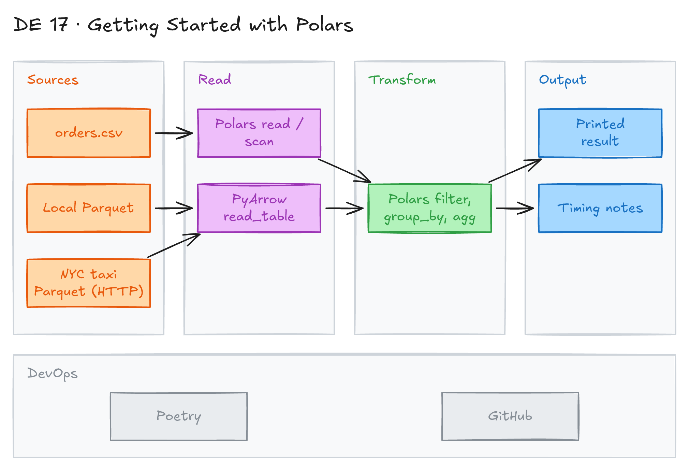

# Getting Started with Polars



## Project card

| Level | Roles | Duration | Cost | Status |
|---|---|---|---|---|
| Base | Data Engineer, Data Analyst, Analytics Engineer | 3 assignments, ~2-3 h each | Free | In progress |

## Goal

You learn Polars, a fast DataFrame library for Python. You process a CSV and Parquet files on your laptop. You compare Polars with Pandas, PyArrow and PySpark, so you know when to use each one.

## What you will learn

- What Polars is and why it is fast (Rust, Apache Arrow, all CPU cores).
- Filter, group and aggregate data with Polars expressions.
- The difference between eager (`read_*`) and lazy (`scan_*`) execution.
- How Polars and PyArrow work together.
- When to choose Polars, Pandas or PySpark.

## Who it is for

- **Data Engineer**: Polars is a fast tool for single-machine pipelines, for example in AWS Lambda or Docker jobs.
- **Data Analyst**: a faster replacement for Pandas in notebooks.
- **Analytics Engineer**: quick data checks and Python models on local files.

## Tools and services

| Tool | Used for | Free option |
|---|---|---|
| Python 3.9-3.11 | Run the code | yes |
| Polars | DataFrame processing | yes |
| PyArrow | Read and write Arrow/Parquet data | yes |
| Poetry | Manage dependencies ([`pyproject.toml`](pyproject.toml), [`poetry.lock`](poetry.lock)) | yes |
| Jupyter / IPython | Run code step by step (optional) | yes |

## Architecture

The diagram is at the top of this page. Source file: [`images/architecture.excalidraw`](images/architecture.excalidraw). Open it at [excalidraw.com](https://excalidraw.com) to copy or edit it.

Data flow:

1. A Python script reads local files ([`orders.csv`](orders.csv), [`analyticsfile.parquet`](analyticsfile.parquet)) or downloads a Parquet file over HTTP.
2. PyArrow or Polars loads the data into memory (eager) or builds a lazy query plan.
3. Polars filters, groups and aggregates the data.
4. The script prints the result or writes it to a new file.

## Dataset

- **Source 1:** [`orders.csv`](orders.csv) in this folder. Superstore-style orders: order date, ship mode, customer segment, region, product category, sales, profit and more. About 8,400 rows.
- **Source 2:** [`analyticsfile.parquet`](analyticsfile.parquet) in this folder. Small test file.
- **Source 3:** [NYC TLC Yellow Taxi trips, January 2023](https://www.nyc.gov/site/tlc/about/tlc-trip-record-data.page). Parquet, about 3 million rows (~50 MB).

## Prerequisites

- Python 3.9, 3.10 or 3.11 (the [`pyproject.toml`](pyproject.toml) needs `<3.12`).
- [Poetry](https://python-poetry.org/), or plain `pip` and a virtual environment.
- Basic Python. Pandas experience helps.
- New to Git, CLI or Docker? Start with [Surfalytics Module 0](https://www.youtube.com/watch?v=LJIiCLu2gr8&list=PLNCDg7zJiXhP5Z_-TXUdorz2n7sjYHHKE&index=1).

Polars in short:

- A modern DataFrame library written in Rust.
- Uses Apache Arrow for memory and speed.
- Faster and uses less memory than Pandas. Users report 5-10x speedups.
- Uses all CPU cores.
- Supports lazy execution, query optimization and method chaining.
- Names are close to PySpark. The API is close to dplyr in R.
- Few dependencies. Easy to install.
- Can process data larger than memory in lazy (streaming) mode.

## Assignments

Work at your own pace. Each assignment shows the expected time.

### Assignment 1: Set up and process a CSV (~2 h)

**Goal:** Install Polars and run your first transformation on `orders.csv`.

**Steps:**

1. Install the dependencies from this folder:

   ```bash
   poetry install
   poetry shell   # Poetry 2.x: use "poetry env activate" instead
   ```

   Or use pip:

   ```bash
   python -m venv .venv
   source .venv/bin/activate
   pip install polars pyarrow requests
   ```

2. Read the CSV and aggregate sales by product category:

   ```python
   import polars as pl

   # Read a CSV
   df = pl.read_csv('orders.csv')

   # Transform data
   result = (df
       .filter(pl.col('Sales') > 10)
       .group_by('Product Category')
       .agg(pl.col('Sales').sum())
   )
   print(result)
   ```

3. Add more questions: profit by region, top 10 customers by sales, orders by ship mode.
4. Do the same with Pandas. Compare the code and the run time.

**Deliverable:** a script or notebook in your repo with the Polars and Pandas versions.

**Done when:**

- [ ] The script runs without errors.
- [ ] You answer at least 3 business questions with Polars.
- [ ] You wrote down the run time of Polars vs Pandas.

**Hints:** the [`poetry.lock`](poetry.lock) is older than [`pyproject.toml`](pyproject.toml). If `poetry install` says the lock file is out of date, run `poetry lock` first. On an old CPU, use `polars-lts-cpu` instead of `polars` (not both).

### Assignment 2: Polars and PyArrow (~2 h)

**Goal:** Read Parquet with PyArrow and process it with Polars.

**Steps:**

1. Learn the roles of the two libraries:

   | | PyArrow | Polars |
   |---|---|---|
   | Main job | File formats and memory format (Arrow) | Data processing |
   | Strong at | Read/write columnar files, serialization | Filter, join, group, aggregate |
   | Full DataFrame API | no | yes |

2. Read the local Parquet file with PyArrow and convert it to Polars:

   ```python
   import pyarrow.parquet as pq
   import polars as pl

   # Read parquet with PyArrow
   arrow_table = pq.read_table('analyticsfile.parquet')

   # Convert to Polars for processing
   polars_df = pl.from_arrow(arrow_table)

   # Do data processing in Polars
   result = polars_df.filter(pl.col('column0') == 'Alan')
   print(result)
   ```

3. Run the full example with NYC taxi data. It downloads a file, reads it with PyArrow and processes it with Polars:

   ```python
   import pyarrow.parquet as pq
   import polars as pl
   import requests

   # URL of the Parquet file
   PARQUET_URL = "https://d37ci6vzurychx.cloudfront.net/trip-data/yellow_tripdata_2023-01.parquet"

   # Download the Parquet file
   def download_parquet_file(url, filename='yellow_tripdata_2023-01.parquet'):
       response = requests.get(url)
       with open(filename, 'wb') as f:
           f.write(response.content)
       return filename

   # Read Parquet file with PyArrow
   def read_with_pyarrow(filename):
       # Read the entire Parquet file into a PyArrow Table
       arrow_table = pq.read_table(filename)
       return arrow_table

   # Process with Polars
   def process_with_polars(arrow_table):
       # Convert PyArrow Table to Polars DataFrame
       polars_df = pl.from_arrow(arrow_table)

       # Example processing: Filter trips longer than 10 miles
       long_trips = polars_df.filter(
           (pl.col('trip_distance') > 10) &
           (pl.col('total_amount') > 50)
       )

       # Calculate some statistics
       stats = long_trips.group_by('PULocationID').agg([
           pl.col('trip_distance').mean().alias('avg_distance'),
           pl.col('total_amount').mean().alias('avg_total_amount'),
           pl.len().alias('trip_count')
       ])

       return stats

   def main():
       filename = download_parquet_file(PARQUET_URL)
       arrow_table = read_with_pyarrow(filename)
       result = process_with_polars(arrow_table)
       print(result)

   if __name__ == "__main__":
       main()
   ```

   Key steps:
   - `pq.read_table()` reads the Parquet file.
   - `pl.from_arrow()` converts the PyArrow Table to a Polars DataFrame.

**Deliverable:** the script in your repo and the printed result.

**Done when:**

- [ ] Both examples run.
- [ ] You can explain when to use PyArrow and when to use Polars.

**Hints:** a common pattern is: read/write with PyArrow → process with Polars → convert back to Arrow if another tool needs it.

### Assignment 3: Polars only, eager vs lazy (~3 h)

**Goal:** Read Parquet directly with Polars and compare eager and lazy mode.

**Steps:**

1. Run the Polars-only version:

   ```python
   import polars as pl
   import requests

   PARQUET_URL = "https://d37ci6vzurychx.cloudfront.net/trip-data/yellow_tripdata_2023-01.parquet"

   def download_parquet_file(url, filename='yellow_tripdata_2023-01.parquet'):
       response = requests.get(url)
       with open(filename, 'wb') as f:
           f.write(response.content)
       return filename

   def read_and_process_parquet():
       filename = download_parquet_file(PARQUET_URL)

       # Option 1: Read entire file into memory
       df = pl.read_parquet(filename)

       # Option 2: Lazy reading (for larger files)
       # df = pl.scan_parquet(filename)

       # Example processing: Filter and aggregate
       long_trips = df.filter(
           (pl.col('trip_distance') > 10) &
           (pl.col('total_amount') > 50)
       )

       # Calculate statistics by pickup location
       location_stats = long_trips.group_by('PULocationID').agg([
           pl.col('trip_distance').mean().alias('avg_distance'),
           pl.col('total_amount').mean().alias('avg_total_amount'),
           pl.len().alias('trip_count')
       ])

       # Sort by number of trips in descending order
       result = location_stats.sort('trip_count', descending=True)

       return result

   print(read_and_process_parquet())
   ```

2. Switch to lazy mode: use `pl.scan_parquet()` and add `.collect()` at the end.
3. Print the query plan with `.explain()`. Find the filter pushdown.
4. Measure run time and memory for eager and lazy mode.
5. Write down when to choose each library:

   | Library | Use it when |
   |---|---|
   | Polars | One machine, data fits in memory or streams, fast pipelines, data wrangling |
   | Pandas | Rich ecosystem, financial or scientific modeling, complex cross-frame logic |
   | PyArrow | File formats, memory format, data exchange between tools |
   | PySpark | Distributed processing, data larger than one machine (TB/PB) |

**Deliverable:** script and a short note with your timing results and the comparison table.

**Done when:**

- [ ] Eager and lazy versions give the same result.
- [ ] You saved the output of `.explain()`.
- [ ] Your note says which mode was faster and why.

**Hints:**

- `pl.read_parquet()` reads the whole file into memory.
- `pl.scan_parquet()` is lazy. Polars reads only the columns and rows it needs.
- Advantages of Polars-only code: simpler code, native optimizations, [lazy execution](https://stackoverflow.com/questions/76612163/what-are-the-advantages-of-a-polars-lazyframe-over-a-dataframe), fewer dependencies.
- Limits of Polars: fewer features than Pandas. Not ideal for very complex modeling.

## Final result

- A GitHub repo with three scripts and a note that compares Polars, Pandas, PyArrow and PySpark.
- LinkedIn post: your Polars vs Pandas timing results.
- Interview answer: "Polars is a Rust DataFrame library on Apache Arrow. It uses all CPU cores and has a lazy mode with query optimization. I use it for single-machine pipelines, and Spark when data does not fit one machine."

## Clean up

Nothing to clean up. Delete the downloaded `yellow_tripdata_2023-01.parquet` file if you need disk space.

## Resources

- [Polars user guide](https://docs.pola.rs/): official docs.
- [Polars lazy API](https://docs.pola.rs/user-guide/lazy/): how lazy mode and query optimization work.
- [Apache Arrow](https://arrow.apache.org/docs/python/): PyArrow docs.
- [NYC TLC trip record data](https://www.nyc.gov/site/tlc/about/tlc-trip-record-data.page): source of the taxi Parquet files.

## Community solutions

Share your repo in Discord. We add the best ones here.
