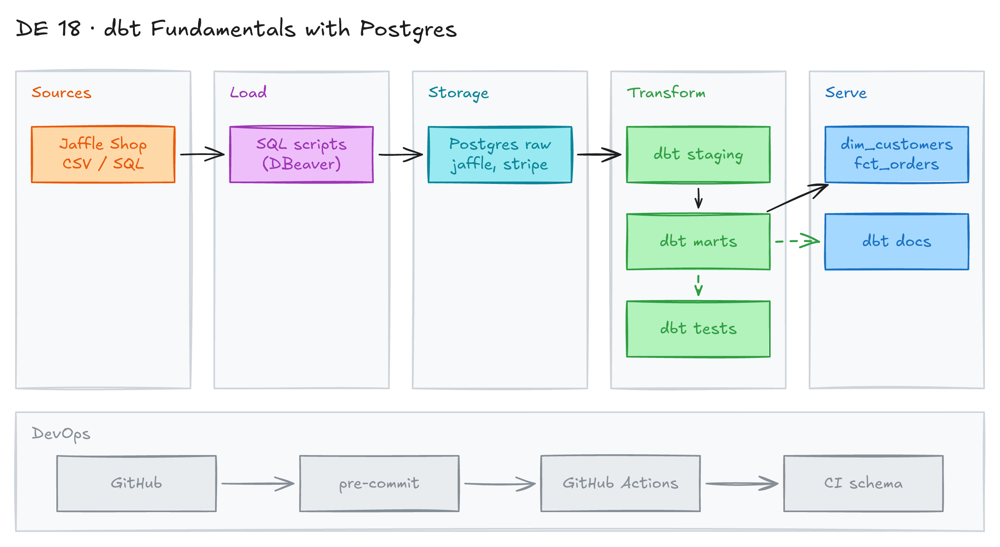

# dbt Fundamentals with Postgres and GitHub Actions



## Project card

| Level | Roles | Duration | Cost | Status |
|---|---|---|---|---|
| Base | Analytics Engineer, Data Engineer | 6 assignments, ~2-4 h each | Free | Ready |

## Goal

You build a small dbt project on top of a cloud Postgres database. You model Jaffle Shop orders and Stripe payments into staging models and marts. Then you add tests, docs, pre-commit hooks and a CI pipeline in GitHub Actions.

## What you will learn

- Set up dbt Core with Postgres and a `profiles.yml`.
- Build staging models from sources, and marts from staging models.
- Add generic tests, singular tests, source freshness and docs.
- Use dbt packages (`dbt_utils`) and macros.
- Check code quality with pre-commit, `sqlfmt` and `dbt-checkpoint`.
- Run dbt in GitHub Actions with secrets and separate targets (`dev`, `ci`).

## Who it is for

- **Analytics Engineer**: you learn the standard dbt workflow, from sources to marts with tests.
- **Data Engineer**: you learn how to add dbt to a Git repo with CI checks.

## Tools and services

| Tool | Used for | Free option |
|---|---|---|
| dbt Core + `dbt-postgres` | Transform data with SQL models | yes |
| PostgreSQL (for example [Neon](https://neon.tech)) | Cloud database for raw data and models | yes (free tier) |
| DBeaver | SQL client to create tables and load data | yes |
| Python + venv | Run dbt locally | yes |
| GitHub + GitHub Actions | Store code, run CI checks | yes |
| pre-commit, `sqlfmt`, `dbt-checkpoint` | Check code quality before commit and in CI | yes |

## Architecture

The diagram is at the top of this page. Source file: [`images/architecture.excalidraw`](images/architecture.excalidraw). Open it at [excalidraw.com](https://excalidraw.com) to copy or edit it.

Data flow:

1. SQL scripts create the raw schemas `jaffle_shop` and `stripe` in Postgres and load sample data.
2. dbt staging models (views) read the raw tables with `source()`.
3. dbt marts (`dim_customers`, `fct_orders`) read the staging models with `ref()`.
4. dbt tests check keys, accepted values, relationships and freshness. dbt docs show the lineage.
5. pre-commit and GitHub Actions check every commit and pull request. CI compiles and builds dbt in a separate `ci` schema.

## Dataset

- **Source:** Jaffle Shop sample data from dbt Labs. Files are in this folder:
  - SQL: [`src/sql/01_create_schemas_tables.sql`](src/sql/01_create_schemas_tables.sql), [`src/sql/02_insert_data.sql`](src/sql/02_insert_data.sql).
  - CSV: [`data/jaffle_shop_customers.csv`](data/jaffle_shop_customers.csv), [`data/jaffle_shop_orders.csv`](data/jaffle_shop_orders.csv), [`data/stripe_payments.csv`](data/stripe_payments.csv).
- **Tables / entities:**
  - `jaffle_shop.customers` (id, first_name, last_name)
  - `jaffle_shop.orders` (id, user_id, order_date, status)
  - `jaffle_shop.payments` (id, order_id, payment_method, status, amount, created). Extra table, the dbt models in this project do not use it.
  - `stripe.payment` (id, orderid, paymentmethod, status, amount in cents, created)
- **Size:** about 100 customers, 99 orders, 120 payments.

## Prerequisites

- GitHub account. You can work locally or in a GitHub Codespace.
- A cloud Postgres database. [Neon](https://neon.tech) has a free tier. Any Postgres you can reach from your laptop and from GitHub Actions works.
- Python 3.11, VS Code, Git, a SQL client (DBeaver). Docker Desktop is optional.
- On Windows, [install Git](https://git-scm.com/downloads/win). It adds Git Bash, which works well for this project. On macOS, Git is already installed.
- New to Git, CLI or Docker? Start with [Surfalytics Module 0](https://www.youtube.com/watch?v=LJIiCLu2gr8&list=PLNCDg7zJiXhP5Z_-TXUdorz2n7sjYHHKE&index=1).

## Assignments

Work at your own pace. Each assignment shows the expected time.

### Assignment 1: Set up the database and the dbt project (~3 h)

**Goal:** Load the raw data into cloud Postgres and create a working dbt project.

**Steps:**

1. Create a GitHub repo `dbt_workshop` with an empty `README.md`.
2. Create a folder `github`, open it in the CLI, clone the repo and open it in VS Code:

   ```bash
   git clone https://github.com/<your-username>/dbt_workshop.git
   cd dbt_workshop
   code .
   ```

3. Create a Postgres database in the cloud. Allow access from your IP if your provider needs it. Connect with DBeaver.
4. Run [`src/sql/01_create_schemas_tables.sql`](src/sql/01_create_schemas_tables.sql) to create the schemas `jaffle_shop`, `stripe`, `dev` and the tables.
5. Run [`src/sql/02_insert_data.sql`](src/sql/02_insert_data.sql) to load the data.
6. Create a virtual environment.

   macOS / Linux:

   ```bash
   python3 -m venv venv
   source venv/bin/activate
   ```

   Windows (Git Bash):

   ```bash
   python -m venv venv
   source venv/Scripts/activate
   ```

   Windows (PowerShell):

   ```powershell
   python -m venv venv
   venv\Scripts\Activate.ps1
   ```

7. Install dbt for Postgres, save the requirements and check the version:

   ```bash
   python -m pip install dbt-core dbt-postgres
   pip freeze -l > requirements.txt
   dbt --version
   ```

8. Create the dbt project with `dbt init`. Answer the questions with your own connection details:

   ```text
   dbt init
   Enter a name for your project (letters, digits, underscore): dbtworkshop
   Which database would you like to use?
   [1] postgres
   Enter a number: 1
   host (hostname for the instance): <your_host>
   port [5432]:
   user (dev username): <your_user>
   pass (dev password):
   dbname (default database that dbt will build objects in): <your_database>
   schema (default schema that dbt will build objects in): dev
   threads (1 or more) [1]: 1
   ```

9. dbt writes the profile to `~/.dbt/profiles.yml`:

   ```yaml
   dbtworkshop:
     outputs:
       dev:
         dbname: <your_database>
         host: <your_host>
         pass: <your_password>
         port: 5432
         schema: dev
         threads: 1
         type: postgres
         user: <your_user>
     target: dev
   ```

   You can use environment variables instead of a plain password. See Assignment 6.

10. Move all content from the `dbtworkshop` folder to the repo root:

    ```bash
    mv dbtworkshop/* dbtworkshop/.gitignore . && rmdir dbtworkshop
    ```

11. Check the connection with `dbt debug`.
12. Look at the sample models, then run them with `dbt run`. Look at the `logs` folder.
    - `models/example/my_first_dbt_model.sql`: a simple base model.
    - `models/example/my_second_dbt_model.sql`: depends on the first model.
    - `models/example/schema.yml`: model docs and tests.

**Deliverable:** GitHub repo with a dbt project that connects to your database.

**Done when:**

- [ ] The tables `jaffle_shop.customers`, `jaffle_shop.orders` and `stripe.payment` have data.
- [ ] `dbt debug` shows "All checks passed!".
- [ ] `dbt run` builds the sample models in the `dev` schema.
- [ ] No password is in the repo.

**Hints:**

- You can also load the CSV files from the `data` folder with DBeaver import.

### Assignment 2: Build staging models (~3 h)

**Goal:** Write your first model, then split it into sources and staging models in dbt style.

**Steps:**

1. Delete `models/example`. Create a folder `models/jaffle_shop` with the model `customer_sales.sql`:

   ```sql
   with customers as (

       select
           id as customer_id,
           first_name,
           last_name

       from jaffle_shop.customers

   ),

   orders as (

       select
           id as order_id,
           user_id as customer_id,
           order_date,
           status

       from jaffle_shop.orders

   ),

   customer_orders as (

       select
           customer_id,

           min(order_date) as first_order_date,
           max(order_date) as most_recent_order_date,
           count(order_id) as number_of_orders

       from orders

       group by 1

   ),

   final as (

       select
           customers.customer_id,
           customers.first_name,
           customers.last_name,
           customer_orders.first_order_date,
           customer_orders.most_recent_order_date,
           coalesce(customer_orders.number_of_orders, 0) as number_of_orders

       from customers

       left join customer_orders using (customer_id)

   )

   select * from final
   ```

2. Set the materialization in `dbt_project.yml`:

   ```yaml
   models:
     dbtworkshop:
       jaffle_shop:
         +materialized: view
   ```

   Or set it inside the model:

   ```sql
   {{
     config(
       materialized='view'
     )
   }}
   ```

3. Run `dbt run`. Check the view in the database. Then delete the `jaffle_shop` folder and the model. Hard-coded table names are not dbt style.
4. Create `models/staging` with subfolders `jaffle_shop` and `stripe`.
5. Add `models/staging/jaffle_shop/_jaffle_shop_sources.yml`. The `database` key is optional. dbt uses the database from your profile.

   ```yaml
   version: 2

   sources:
     - name: jaffle_shop
       description: Jaffle Shop
       loader: Manual
       schema: jaffle_shop
       tables:
         - name: customers
         - name: orders
   ```

6. Add `models/staging/jaffle_shop/stg_jaffle_shop__customers.sql`:

   ```sql
   select
       id as customer_id,
       first_name,
       last_name

   from {{ source('jaffle_shop', 'customers') }}
   ```

7. Add `models/staging/jaffle_shop/stg_jaffle_shop__orders.sql`:

   ```sql
   select
       id as order_id,
       user_id as customer_id,
       order_date,
       status

   from {{ source('jaffle_shop', 'orders') }}
   ```

8. Add `models/staging/stripe/_stripe_sources.yml`:

   ```yaml
   version: 2

   sources:
     - name: stripe
       schema: stripe
       tables:
         - name: payment
   ```

9. Add `models/staging/stripe/stg_stripe__payments.sql`:

   ```sql
   select
       id as payment_id,
       orderid as order_id,
       paymentmethod as payment_method,
       status,
       -- amount is stored in cents, convert it to dollars
       amount / 100.0 as amount,
       created as created_at
   from {{ source('stripe', 'payment') }}
   ```

10. Update `dbt_project.yml`:

    ```yaml
    models:
      dbtworkshop:
        staging:
          +materialized: view
          +tags: staging
    ```

11. Run the staging models:

    ```bash
    dbt run --select tag:staging
    ```

**Deliverable:** 3 staging models and 2 source files in your repo.

**Done when:**

- [ ] `dbt run --select tag:staging` builds 3 views in the `dev` schema.
- [ ] Models use `source()`, not hard-coded table names.

**Hints:** Read the [dbt project structure guide](https://docs.getdbt.com/best-practices/how-we-structure/1-guide-overview).

### Assignment 3: Tests, freshness and docs (~2 h)

**Goal:** Add generic tests, a singular test, a freshness check and generate docs.

**Steps:**

1. Learn the generic test syntax:

   ```yaml
   data_tests:
     - unique
     - not_null

   data_tests:
     - accepted_values:
         values:
           - completed
           - shipped
           - returned
           - return_pending
           - placed
   ```

2. Add `models/staging/jaffle_shop/stg_jaffle_shop__customers.yml`:

   ```yaml
   version: 2

   models:
     - name: stg_jaffle_shop__customers
       description: This model cleans up customer data
       columns:
         - name: customer_id
           description: Primary key
           data_tests:
             - unique
             - not_null
   ```

3. Add `models/staging/jaffle_shop/stg_jaffle_shop__orders.yml`:

   ```yaml
   version: 2

   models:
     - name: stg_jaffle_shop__orders
       description: This model cleans up order data
       columns:
         - name: order_id
           description: Primary key
           data_tests:
             - unique
             - not_null
         - name: status
           data_tests:
             - accepted_values:
                 values: ['placed', 'shipped', 'completed', 'return_pending', 'returned']
         - name: customer_id
           data_tests:
             - not_null
             - relationships:
                 to: ref('stg_jaffle_shop__customers')
                 field: customer_id
   ```

4. Add `models/staging/stripe/stg_stripe__payments.yml`:

   ```yaml
   version: 2

   models:
     - name: stg_stripe__payments
       description: Stripe payments
       columns:
         - name: payment_id
           description: Primary key
           data_tests:
             - unique
             - not_null
   ```

5. Add a singular test `tests/assert_positive_total_for_payments.sql`:

   ```sql
   -- Refunds have a negative amount, so the total amount should always be >= 0.
   -- Return records where this isn't true to make the test fail.
   select
       order_id,
       sum(amount) as total_amount
   from {{ ref('stg_stripe__payments') }}
   group by 1
   having sum(amount) < 0
   ```

6. Run the tests:

   ```bash
   dbt test --select tag:staging
   ```

7. Add a freshness check. Freshness works on sources, not models. Add it to the `orders` table in `_jaffle_shop_sources.yml`:

   ```yaml
   version: 2

   sources:
     - name: jaffle_shop
       description: Jaffle Shop
       loader: Manual
       schema: jaffle_shop
       tables:
         - name: customers
         - name: orders
           loaded_at_field: order_date
           freshness:
             warn_after: {count: 12, period: hour}
             error_after: {count: 24, period: hour}
   ```

8. Run `dbt source freshness`. The sample data is from 2018, so you get an error. This is expected.
9. Generate and open the docs:

   ```bash
   dbt docs generate
   dbt docs serve --host localhost --port 8091
   ```

   Open `http://localhost:8091/#!/overview` in the browser. Look at the lineage graph.

**Deliverable:** YAML files with descriptions and tests, one singular test.

**Done when:**

- [ ] `dbt test --select tag:staging` passes.
- [ ] `dbt source freshness` runs and shows the status for `orders`.
- [ ] dbt docs show the lineage from sources to staging models.

**Hints:** In real projects, `loaded_at_field` is a load timestamp column, for example `_etl_loaded_at`. See [dbt data tests](https://docs.getdbt.com/docs/build/data-tests) and [source freshness](https://docs.getdbt.com/docs/deploy/source-freshness).

### Assignment 4: Marts, packages and macros (~3 h)

**Goal:** Build a dimension and a fact table, use a dbt package and write a macro.

**Steps:**

1. Add `models/mart/dim_customers.sql`:

   ```sql
   with
       customers as (select * from {{ ref('stg_jaffle_shop__customers') }}),

       orders as (select * from {{ ref('stg_jaffle_shop__orders') }}),

       customer_orders as (

           select
               customer_id,

               min(order_date) as first_order_date,
               max(order_date) as most_recent_order_date,
               count(order_id) as number_of_orders

           from orders

           group by 1

       ),

       final as (

           select
               customers.customer_id,
               customers.first_name,
               customers.last_name,
               customer_orders.first_order_date,
               customer_orders.most_recent_order_date,
               coalesce(customer_orders.number_of_orders, 0) as number_of_orders

           from customers

           left join customer_orders using (customer_id)

       )

   select *
   from final
   ```

2. Add `models/mart/fct_orders.sql`:

   ```sql
   with
       orders as (select * from {{ ref('stg_jaffle_shop__orders') }}),

       payments as (select * from {{ ref('stg_stripe__payments') }}),

       order_payments as (
           select order_id, sum(case when status = 'success' then amount end) as amount

           from payments
           group by 1
       ),

       final as (

           select
               orders.order_id,
               orders.customer_id,
               orders.order_date,
               coalesce(order_payments.amount, 0) as amount

           from orders
           left join order_payments using (order_id)
       )

   select *
   from final
   ```

3. Add `models/mart/dim_customers.yml`:

   ```yaml
   version: 2

   models:
     - name: dim_customers
       description: "Aggregates customer information with their order statistics."

       columns:
         - name: customer_id
           description: "Unique identifier for each customer."
           data_tests:
             - unique
             - not_null

         - name: first_name
           description: "Customer's first name."

         - name: last_name
           description: "Customer's last name."

         - name: first_order_date
           description: "The date of the customer's first order."

         - name: most_recent_order_date
           description: "The date of the customer's most recent order."

         - name: number_of_orders
           description: "The total number of orders placed by the customer."
   ```

4. Add `models/mart/fct_orders.yml`. It uses a test from the `dbt_utils` package:

   ```yaml
   version: 2

   models:
     - name: fct_orders
       description: "Combines order and payment information, summarizing successful payment amounts for each order."
       columns:
         - name: order_id
           description: "Unique identifier for each order."
           data_tests:
             - not_null
         - name: customer_id
           description: "Unique identifier for the customer who placed the order."
           data_tests:
             - not_null
         - name: order_date
           description: "The date when the order was placed."
           data_tests:
             - not_null
         - name: amount
           description: "The total amount of successful payments for the order. Defaults to 0 if no successful payments exist."
       data_tests:
         - dbt_utils.unique_combination_of_columns:
             combination_of_columns:
               - order_id
               - customer_id
               - order_date
   ```

5. Add `packages.yml` and install the package:

   ```yaml
   packages:
     - package: dbt-labs/dbt_utils
       version: 1.3.0
   ```

   ```bash
   dbt deps
   ```

6. Update `dbt_project.yml`:

   ```yaml
   models:
     dbtworkshop:
       staging:
         +materialized: view
         +tags: staging
       mart:
         +materialized: view
         +tags: mart
   ```

7. Build the marts (run and test):

   ```bash
   dbt build --select tag:mart
   ```

8. Try targets and profile paths. You can set them on every command:

   ```bash
   dbt build --select fct_orders --target dev --profiles-dir ~/.dbt/
   ```

9. Add the macro `macros/add_etl_timestamp.sql`:

   ```sql
   
       CURRENT_TIMESTAMP as etl_timestamp_utc
   
   ```

10. Document the macro in `macros/add_etl_timestamp.yml`:

    ```yaml
    version: 2

    macros:
      - name: add_etl_timestamp
        description: |
          This macro generates a UTC timestamp representing the current date and time when executed.
          It is useful for tracking ETL processes by adding a standardized `etl_timestamp_utc` column
          in transformation queries.
        arguments: []
    ```

11. Use the macro in a model, for example `stg_jaffle_shop__customers.sql`:

    ```sql
    select id as customer_id, first_name, last_name, {{ add_etl_timestamp() }}
    from {{ source('jaffle_shop', 'customers') }}
    ```

**Deliverable:** 2 mart models with docs and tests, `packages.yml`, one macro.

**Done when:**

- [ ] `dbt build --select tag:mart` passes.
- [ ] `stg_jaffle_shop__customers` has the column `etl_timestamp_utc`.
- [ ] dbt docs show the full lineage from sources to marts.

**Hints:** Find more packages on [dbt Package Hub](https://hub.getdbt.com/), for example `dbt_expectations` and `dbt_date`.

### Assignment 5: Pre-commit, pull request template and CI (~3 h)

**Goal:** Check code quality on every commit, locally and in GitHub Actions.

**Steps:**

1. Add `venv/` to `.gitignore`.
2. Create a branch for your work. In real projects you do this first.

   ```bash
   git checkout -b feature/new-dbt-model
   ```

3. Install pre-commit:

   ```bash
   pip install pre-commit
   pip freeze -l > requirements.txt
   ```

4. Create `.pre-commit-config.yaml`:

   ```yaml
   # Pre-commit that runs locally
   fail_fast: false

   repos:
     - repo: https://github.com/pre-commit/pre-commit-hooks
       rev: v4.6.0
       hooks:
         - id: trailing-whitespace
         - id: check-yaml

     - repo: https://github.com/pre-commit/mirrors-prettier
       rev: v3.1.0
       hooks:
         - id: prettier
           files: '\.(yaml|yml)$'

     - repo: https://github.com/psf/black
       rev: 24.8.0
       hooks:
         - id: black
           language_version: python3.11

     - repo: https://github.com/pycqa/flake8
       rev: 7.1.1
       hooks:
         - id: flake8

     - repo: https://github.com/tconbeer/sqlfmt
       rev: v0.21.0
       hooks:
         - id: sqlfmt
           files: ^(models|analyses|tests)/.*.sql$
   ```

5. Turn on the hooks and commit. The hooks check and fix files on commit. If they change files, add them and commit again.

   ```bash
   pre-commit install
   git add .
   git commit -m "Adding initial models"
   ```

6. Add a pull request template `.github/pull_request_template.md`. GitHub uses it only after it is merged to `main`. Until then, copy it into the PR by hand.

   ```markdown
   # Description of change

   > Eg: The new model_name_here is responsible for a_thing that relates to business_requirements.  It is doing some complex_thing (which is commented) that is required because of data_quality_issue or business_rule that is outlined in the requirements document.

   # Links
     > Ticket, Slack conversations, Doc


   # Testing

     > Adding dbt run, test, SQL queries


   # Before Merge

     > Anything to do before merge?

   ---

   # Diligence

   - [ ] I have checked affected models for appropriate tests and metadata
   - [ ] Project has been built locally
   - [ ] Project has been tested locally
   - [ ] Each model has YAML file with model description, tests
   - [ ] dbt CI pass
   ```

7. Add the GitHub Action `.github/workflows/pre-commit.yml`. It runs the same hooks on files changed against `main`:

   ```yaml
   name: Run Pre-commit Hooks

   on:
     pull_request:
       branches:
         - main
     push:
       branches:
         - main

   jobs:
     pre-commit:
       runs-on: ubuntu-latest

       steps:
         # Checkout the code and fetch all branches
         - name: Checkout code
           uses: actions/checkout@v4
           with:
             fetch-depth: 0 # Ensure the full history is fetched, not just the last commit

         # Set up Python environment
         - name: Set up Python
           uses: actions/setup-python@v5
           with:
             python-version: 3.11

         # Install dependencies
         - name: Install dependencies
           run: |
             python -m venv venv
             . venv/bin/activate
             pip install --upgrade pip
             pip install -r requirements.txt
             pre-commit install --install-hooks

         # Fetch the main branch to ensure it's available for comparison
         - name: Fetch main branch
           run: git fetch origin main

         # Run pre-commit on all files changed between the current branch and main
         - name: Run pre-commit on all changed files
           run: |
             . venv/bin/activate
             # Get the list of files changed between the current branch and main
             files=$(git diff --name-only origin/main)
             if [ -n "$files" ]; then
               pre-commit run --files $files
             else
               echo "No modified files to check."
             fi
   ```

8. Push the branch and open a pull request.

**Deliverable:** A pull request with the pre-commit config, the PR template and the workflow.

**Done when:**

- [ ] `git commit` runs the hooks locally.
- [ ] The GitHub Action runs on the pull request and passes.

**Hints:** [pre-commit docs](https://pre-commit.com/), [sqlfmt docs](https://sqlfmt.com/).

### Assignment 6: dbt checks in CI and a CI schema (~4 h)

**Goal:** Check dbt rules (descriptions, tests) in CI and build models in a separate `ci` schema.

**Steps:**

1. Add `dbt-checkpoint` to `.pre-commit-config.yaml`, under `repos:`:

   ```yaml
     - repo: https://github.com/dbt-checkpoint/dbt-checkpoint
       rev: v2.0.4
       hooks:
         - id: check-model-has-description
         - id: check-model-has-tests-by-group
           args: ["--tests", "not_null", "--test-cnt", "1", "--"]
         - id: check-model-has-tests-by-group
           args:
             [
               "--tests",
               "unique",
               "unique_combination_of_columns",
               "--test-cnt",
               "1",
               "--",
             ]

         - id: check-macro-has-description
           files: ^(macros/).*$
   ```

2. Install the hooks again and commit. The hook asks for a `not_null` test in `models/mart/fct_orders.yml` if a model has none. Fix it and commit again.

   ```bash
   pre-commit install
   git add .
   git commit -m "Adding files"
   ```

3. `dbt-checkpoint` reads dbt artifacts (`manifest.json`). So CI must compile dbt, and it needs a database connection. Create the schema for CI in Postgres:

   ```sql
   create schema if not exists ci;
   ```

4. Add `profiles.yml` to the repo root. It reads all secrets from environment variables:

   ```yaml
   dbtworkshop:
     outputs:
       dev:
         type: postgres
         host: '{{ env_var("DBT_HOST") }}'
         user: '{{ env_var("DBT_USER") }}'
         password: '{{ env_var("DBT_PASSWORD") }}'
         port: 5432
         dbname: '{{ env_var("DBT_DATABASE") }}'
         schema: dev
         threads: 1
       ci:
         type: postgres
         host: '{{ env_var("DBT_HOST") }}'
         user: '{{ env_var("DBT_USER") }}'
         password: '{{ env_var("DBT_PASSWORD") }}'
         port: 5432
         dbname: '{{ env_var("DBT_DATABASE") }}'
         schema: ci
         threads: 1

     target: dev
   ```

5. In GitHub, open **Repository → Settings → Secrets and variables → Actions**. Add the secrets `DBT_HOST`, `DBT_USER`, `DBT_PASSWORD`, `DBT_DATABASE`.
6. Update `.github/workflows/pre-commit.yml`. It compiles dbt, runs pre-commit, then builds the models in the `ci` schema:

   ```yaml
   name: Run Pre-commit Hooks with Postgres

   on:
     pull_request:
       branches:
         - main
     push:
       branches:
         - main

   jobs:
     pre-commit:
       runs-on: ubuntu-latest

       env:
         DBT_USER: ${{ secrets.DBT_USER }}
         DBT_PASSWORD: ${{ secrets.DBT_PASSWORD }}
         DBT_HOST: ${{ secrets.DBT_HOST }}
         DBT_DATABASE: ${{ secrets.DBT_DATABASE }}

       steps:
         # Checkout the code
         - name: Checkout code
           uses: actions/checkout@v4
           with:
             fetch-depth: 0

         # Set up Python environment
         - name: Set up Python
           uses: actions/setup-python@v5
           with:
             python-version: 3.11

         # Install dependencies
         - name: Install dependencies
           run: |
             python -m venv venv
             . venv/bin/activate
             pip install --upgrade pip
             pip install -r requirements.txt

         # Install dbt package dependencies
         - name: Install dbt package dependencies
           run: |
             . venv/bin/activate
             dbt deps

         # Copy the profiles.yml file to the correct location
         - name: Copy profiles.yml to /home/runner/.dbt
           run: |
             mkdir -p /home/runner/.dbt
             cp ./profiles.yml /home/runner/.dbt/profiles.yml

         # Compile the dbt project
         - name: Compile dbt project
           run: |
             . venv/bin/activate
             dbt compile

         # Run pre-commit hooks
         - name: Run pre-commit on all changed files
           run: |
             . venv/bin/activate
             git fetch origin main
             files=$(git diff --name-only origin/main)
             if [ -n "$files" ]; then
               pre-commit run --files $files
             else
               echo "No modified files to check."
             fi

         # Build models in the CI schema
         - name: Build dbt models in CI schema
           run: |
             . venv/bin/activate
             dbt build --target ci
   ```

7. Push and check that the workflow passes.

**Deliverable:** A workflow that compiles dbt, runs `dbt-checkpoint` and builds models in the `ci` schema.

**Done when:**

- [ ] Secrets are in GitHub, not in the repo.
- [ ] The workflow passes on a pull request.
- [ ] Models and tests run in the `ci` schema.

**Hints:** Your cloud Postgres must accept connections from GitHub Actions runners. Neon accepts connections from any IP by default. See the [dbt-checkpoint hooks list](https://github.com/dbt-checkpoint/dbt-checkpoint).

## Final result

- A dbt project with sources, staging models, marts, tests, a macro and docs.
- Pre-commit hooks and a GitHub Actions pipeline that compiles, checks and builds dbt.
- Post the repo link and a screenshot of the dbt lineage graph on LinkedIn.
- Interview pitch: "I built a dbt project on Postgres with staging models and marts. Every model has docs and tests. A GitHub Actions pipeline checks code style and dbt rules, and builds the models in a separate CI schema before merge."

## Clean up

- Delete the Postgres database or the Neon project if you do not need it.
- Delete the GitHub secrets if you delete the database.
- Local: run `deactivate` and delete the `venv` folder.

## Resources

- [dbt documentation](https://docs.getdbt.com/docs/introduction): concepts and commands.
- [dbt best practices](https://docs.getdbt.com/best-practices): project structure and style.
- [dbt Fundamentals course](https://learn.getdbt.com/courses/dbt-fundamentals): free course from dbt Labs. This project uses its Jaffle Shop data.
- [dbt-postgres setup](https://docs.getdbt.com/docs/core/connect-data-platform/postgres-setup): profile options.
- [dbt-checkpoint](https://github.com/dbt-checkpoint/dbt-checkpoint): pre-commit hooks for dbt.
- [GitHub Actions documentation](https://docs.github.com/en/actions): workflows and secrets.

## Community solutions

Share your repo in Discord. We add the best ones here.

- <Name>: <link>
