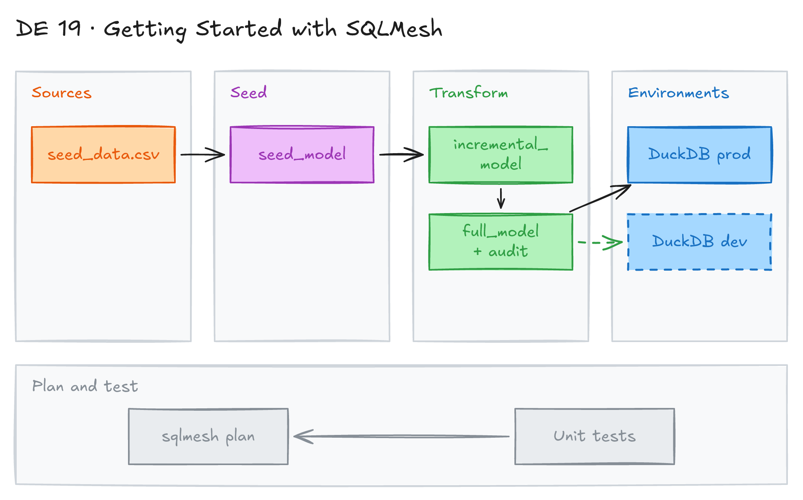

# Getting Started with SQLMesh



## Project card

| Level | Roles | Duration | Cost | Status |
|---|---|---|---|---|
| Base | Analytics Engineer, Data Engineer | 3 assignments, ~2-3 h each | Free | In progress |

## Goal

You learn SQLMesh, a data transformation framework similar to dbt. You build the SQLMesh example project on a local DuckDB database. You learn plans, environments, incremental models, tests and audits.

## What you will learn

- Create a SQLMesh project with the scaffold generator.
- Configure a DuckDB gateway in `config.yaml`.
- Build seed, full and incremental models.
- Use plans and environments (`prod` and dev) to apply changes safely.
- See how SQLMesh classifies changes as breaking or non-breaking.
- Write unit tests and audits.

## Who it is for

- **Analytics Engineer**: SQLMesh is an alternative to dbt. You learn a second way to manage SQL models.
- **Data Engineer**: you learn virtual environments and incremental backfills for SQL pipelines.

## Tools and services

| Tool | Used for | Free option |
|---|---|---|
| SQLMesh | Transformation framework (models, plans, tests, audits) | yes (open source) |
| DuckDB | Local embedded SQL engine | yes |
| Python 3 + venv | Install and run SQLMesh | yes |

## Architecture

The diagram is at the top of this page. Source file: [`images/architecture.excalidraw`](images/architecture.excalidraw). Open it at [excalidraw.com](https://excalidraw.com) to copy or edit it.

Data flow:

1. [`seeds/seed_data.csv`](seeds/seed_data.csv) holds the raw sales data.
2. [`seed_model`](models/seed_model.sql) loads the CSV into DuckDB.
3. [`incremental_model`](models/incremental_model.sql) reads the seed by date range (`@start_date` to `@end_date`).
4. [`full_model`](models/full_model.sql) counts orders per item. It runs the [`assert_positive_order_ids`](audits/assert_positive_order_ids.sql) audit.
5. `sqlmesh plan` runs the [unit test](tests/test_full_model.yaml), then backfills the models into the `prod` or a dev environment in `db.db`.

## Dataset

- **Source:** [`seeds/seed_data.csv`](seeds/seed_data.csv), created by the SQLMesh scaffold.
- **Tables / entities:** sales of 3 items over 7 days in January 2020. Columns: `id` (row ID), `item_id` (sold item), `event_date` (sale date).
- **Size:** 7 rows.

| id | item_id | event_date |
|---|---|---|
| 1 | 2 | 2020-01-01 |
| 2 | 1 | 2020-01-01 |
| 3 | 3 | 2020-01-03 |
| 4 | 1 | 2020-01-04 |
| 5 | 1 | 2020-01-05 |
| 6 | 1 | 2020-01-06 |
| 7 | 1 | 2020-01-07 |

## Prerequisites

- Python 3.9 or newer.
- Basic SQL. dbt experience helps but is not required.
- New to Git, CLI or Docker? Start with [Surfalytics Module 0](https://www.youtube.com/watch?v=LJIiCLu2gr8&list=PLNCDg7zJiXhP5Z_-TXUdorz2n7sjYHHKE&index=1).

## Assignments

Work at your own pace. Each assignment shows the expected time.

### Assignment 1: Set up SQLMesh and create the project (~2 h)

**Goal:** Install SQLMesh and create a project on DuckDB.

**Steps:**

1. Create and activate a virtual environment:

   ```bash
   python3 -m venv .env
   source .env/bin/activate
   ```

2. Install SQLMesh:

   ```bash
   pip install sqlmesh
   ```

3. Create the project with the DuckDB dialect:

   ```bash
   sqlmesh init duckdb
   ```

4. Check the files the scaffold created:

   | Path | What it holds |
   |---|---|
   | [`config.yaml`](config.yaml) | Project configuration |
   | [`models/`](models/) | SQL and Python models: [`seed_model.sql`](models/seed_model.sql), [`incremental_model.sql`](models/incremental_model.sql), [`full_model.sql`](models/full_model.sql) |
   | [`seeds/`](seeds/) | Seed files: [`seed_data.csv`](seeds/seed_data.csv) |
   | [`audits/`](audits/) | Shared audits: [`assert_positive_order_ids.sql`](audits/assert_positive_order_ids.sql) |
   | [`tests/`](tests/) | Unit tests: [`test_full_model.yaml`](tests/test_full_model.yaml) |
   | [`macros/`](macros/) | Macro files |

5. Read [`config.yaml`](config.yaml). The project uses embedded DuckDB. The `local` gateway is the default. The `model_defaults.dialect` key holds the dialect you passed to `sqlmesh init`:

   ```yaml
   gateways:
     local:
       connection:
         type: duckdb
         database: db.db

   default_gateway: local

   model_defaults:
     dialect: duckdb
     start: 2025-01-23
   ```

**Deliverable:** the project folder in your GitHub repo.

**Done when:**

- [ ] `sqlmesh --version` works.
- [ ] The project has `config.yaml`, `models/`, `seeds/`, `audits/`, `tests/` and `macros/`.
- [ ] You can explain what each folder is for.

**Hints:** in newer SQLMesh versions, `sqlmesh init` without arguments starts an interactive wizard. Pass `duckdb` to skip it.

### Assignment 2: Create the prod environment (~2 h)

**Goal:** Run your first plan and fill the `prod` environment.

**Steps:**

1. Learn two key ideas:
   - **Environment:** an isolated namespace with models and their data. `prod` is the main one. Other environments let you test changes before they go live.
   - **Plan:** a comparison of one environment with another, plus the changes needed to align them. SQLMesh classifies each change as breaking or non-breaking.
2. Run the first plan. It runs every model to fill `prod`:

   ```bash
   sqlmesh plan
   ```

   Expected output:

   ```text
   ======================================================================
   Successfully Ran 1 tests against duckdb
   ----------------------------------------------------------------------
   `prod` environment will be initialized

   Models:
   └── Added:
       ├── sqlmesh_example.full_model
       ├── sqlmesh_example.incremental_model
       └── sqlmesh_example.seed_model
   Models needing backfill [missing dates]:
   ├── sqlmesh_example.full_model: [full refresh]
   ├── sqlmesh_example.incremental_model: [2020-01-01 - 2025-01-23]
   └── sqlmesh_example.seed_model: [full refresh]
   Apply - Backfill Tables [y/n]:
   ```

3. Type `y` to apply the plan and backfill the tables.
4. Query the result:

   ```bash
   sqlmesh fetchdf "select * from sqlmesh_example.full_model"
   ```

**Deliverable:** screenshot of the plan output and the query result.

**Done when:**

- [ ] The unit test passed.
- [ ] All 3 models are backfilled in `prod`.
- [ ] `full_model` shows the number of orders per `item_id`.

### Assignment 3: Change a model in a dev environment (Planned) (~3 h)

**Goal:** Change a model in a dev environment and promote it to `prod`.

**Steps:**

1. Add a column to [`incremental_model.sql`](models/incremental_model.sql), for example `'z' as new_column`.
2. Run `sqlmesh plan dev`. Check if SQLMesh calls the change breaking or non-breaking.
3. Query the dev table and compare it with `prod` (`sqlmesh table_diff prod:dev sqlmesh_example.incremental_model`).
4. Break the audit on purpose (for example, a negative `item_id` in the seed) and see the plan fail.
5. Run `sqlmesh plan` to promote the change to `prod`.

**Deliverable:** commit with the model change and a short note on what the plan showed.

**Done when:**

- [ ] The dev environment has the new column and `prod` does not, before promotion.
- [ ] You saw a failed audit and fixed it.
- [ ] `prod` has the change after the final plan.

**Hints:** the models in this folder already contain sample changes (`new_column` in `incremental_model`, `one` in `full_model`). Compare them with a fresh scaffold.

## Final result

- A GitHub repo with a working SQLMesh project, tests and audits.
- LinkedIn post: SQLMesh vs dbt, from your own test.
- Interview answer: "I built a SQLMesh project on DuckDB with seed, full and incremental models. I used plans and dev environments to test changes before prod, plus unit tests and audits for data quality."

## Clean up

Nothing to clean up. Delete `db.db`, `logs/` and `.cache/` to reset the project.

## Resources

- [SQLMesh docs](https://sqlmesh.readthedocs.io/en/stable/): official docs.
- [SQLMesh quickstart (CLI)](https://sqlmesh.readthedocs.io/en/stable/quickstart/cli/): the example this project is based on.
- [SQLMesh concepts: plans](https://sqlmesh.readthedocs.io/en/stable/concepts/plans/) and [environments](https://sqlmesh.readthedocs.io/en/stable/concepts/environments/).
- [SQLMesh GitHub](https://github.com/TobikoData/sqlmesh): source code.

## Community solutions

Share your repo in Discord. We add the best ones here.
