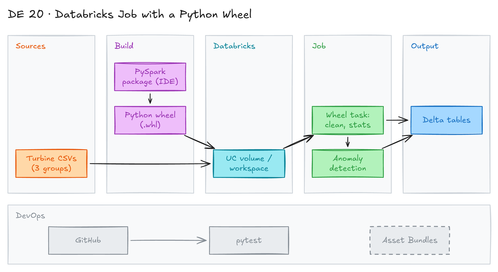

# Databricks Job with a Python Wheel Task



## Project card

| Level | Roles | Duration | Cost | Status |
|---|---|---|---|---|
| Intermediate | Data Engineer | 3 assignments, ~3-6 h each | Free trial | In progress |

## Goal

You build a PySpark ETL pipeline for wind turbine data in your IDE. You package it as a Python wheel. You run the wheel as a task in a Databricks job.

> This task was part of a home assignment for a data engineering interview in the EU.

## What you will learn

- Set up a Databricks workspace and link it to a GitHub repo.
- Write a PySpark pipeline as a Python package, not as notebooks.
- Clean data: missing values and outliers.
- Calculate summary statistics and find anomalies with standard deviation.
- Build a Python wheel with an entry point.
- Run the wheel as a Python wheel task in a Databricks job.

## Who it is for

- **Data Engineer**: production Spark code lives in packages with tests, not only in notebooks. This is a common interview task.

## Tools and services

| Tool | Used for | Free option |
|---|---|---|
| Databricks | Workspace, cluster and jobs | trial |
| PySpark | ETL logic | yes |
| Python + IDE (VS Code, PyCharm) | Local development and tests | yes |
| `build` / `setuptools` | Build the wheel file | yes |
| GitHub | Source code and Databricks Git folder | yes |

## Architecture

The diagram is at the top of this page. Source file: [`images/architecture.excalidraw`](images/architecture.excalidraw). Open it at [excalidraw.com](https://excalidraw.com) to copy or edit it.

Data flow:

1. Turbine CSV files ([`data/`](data/)) are uploaded to the Databricks workspace.
2. You write the PySpark package locally and build a `.whl` file.
3. You upload the wheel to Databricks and attach it to a job task.
4. The job runs the wheel entry point: clean data, calculate stats, find anomalies.
5. The job writes cleaned data, summary stats and anomalies to Delta tables.

## Dataset

- **Source:** [`data/data_group_1.csv`](data/data_group_1.csv), [`data/data_group_2.csv`](data/data_group_2.csv), [`data/data_group_3.csv`](data/data_group_3.csv) in this folder.
- **Tables / entities:** turbine readings. Columns: `timestamp`, `turbine_id`, `wind_speed`, `wind_direction`, `power_output` (MW).
- **Size:** one month (March 2022) of hourly data for 15 turbines. About 3,720 rows per file, 11,160 rows total.

Business context:

- You are a data engineer at a renewable energy company. It runs a farm of wind turbines.
- Turbines make power based on wind speed and direction. Output is in megawatts (MW).
- Each CSV holds data for a group of 5 turbines. One turbine is always in the same file (turbine 1 is in `data_group_1.csv`).
- The CSVs are appended daily with data for the last 24 hours.
- Sensors sometimes fail, so some entries are missing.
- You can add or remove data in the files to test your logic.

## Prerequisites

- GitHub account and repo.
- Databricks trial account: <https://www.databricks.com/try-databricks>
- Local Python environment and an IDE.
- Basic PySpark.
- How to build a wheel: [Create a wheel file for Python](https://www.mssqltips.com/sqlservertip/6802/create-wheel-file-python-package-distribute-custom-code/).
- New to Git, CLI or Docker? Start with [Surfalytics Module 0](https://www.youtube.com/watch?v=LJIiCLu2gr8&list=PLNCDg7zJiXhP5Z_-TXUdorz2n7sjYHHKE&index=1).

## Assignments

Work at your own pace. Each assignment shows the expected time.

### Assignment 1: Set up Databricks and GitHub (~3 h)

**Goal:** Prepare the workspace, the repo and the data.

**Steps:**

1. Create a Databricks workspace (free trial).
2. Create a GitHub repo. Link it to Databricks as a Git folder.
3. Upload the three CSV files from [`data/`](data/) to the workspace (for example, to a Unity Catalog volume).
4. Create a small cluster (single node is enough).
5. Read one CSV in a notebook to check access.

**Deliverable:** linked repo and a screenshot of the data in Databricks.

**Done when:**

- [ ] Databricks can read all three CSV files.
- [ ] The repo is visible as a Git folder in Databricks.

### Assignment 2: Build the PySpark pipeline locally (~6 h)

**Goal:** Write a tested PySpark package that processes the turbine data.

**Steps:**

1. Create a Python package in your IDE, for example `src/wind_turbines/` with modules for read, clean, stats, anomalies and write.
2. **Clean the data:** remove or impute missing values and outliers.
3. **Summary statistics:** for each turbine, calculate min, max and average power output over a time period (for example, 24 hours).
4. **Anomalies:** find turbines whose output is outside 2 standard deviations from the mean for the same period.
5. **Store the results:** write cleaned data and summary stats (and anomalies) to tables for later analysis.
6. Add unit tests with `pytest` and a local Spark session.
7. Write a short design note with your assumptions.

**Deliverable:** package code, tests and a design note in your repo.

**Done when:**

- [ ] Tests pass locally.
- [ ] The pipeline handles missing rows and outliers.
- [ ] Stats and anomalies are correct for a small test dataset.
- [ ] The README explains the design and assumptions.

**Hints:** the focus is clean, testable and scalable code. The overall app design is less important.

### Assignment 3: Build the wheel and run a Databricks job (~4 h)

**Goal:** Package the pipeline as a wheel and run it with a Databricks job.

**Steps:**

1. Add an entry point to your package (for example, `main()` in `wind_turbines/main.py`) in `pyproject.toml` or `setup.py`.
2. Build the wheel:

   ```bash
   pip install build
   python -m build --wheel
   ```

3. Upload the `.whl` file from `dist/` to Databricks (workspace files or a Unity Catalog volume).
4. Create a job with a **Python wheel** task. Set the package name and entry point. Attach the wheel as a library.
5. Run the job. Check the output tables.

**Deliverable:** the wheel build in your repo (or CI), job config (JSON or YAML) and a screenshot of a successful run.

**Done when:**

- [ ] The wheel builds without errors.
- [ ] The job run succeeds.
- [ ] Output tables have cleaned data, stats and anomalies.

**Hints:** Databricks Asset Bundles can build the wheel and deploy the job in one command (`databricks bundle deploy`). Try it after the manual way.

## Final result

- A GitHub repo with a PySpark package, tests, a wheel build and a Databricks job config.
- LinkedIn post: how you moved from notebooks to a packaged Spark job.
- Interview answer: "I wrote a PySpark pipeline as a Python package with unit tests. I built a wheel and ran it as a Databricks job task. It cleans turbine data, calculates daily stats and flags anomalies outside 2 standard deviations."

## Clean up

- Delete the Databricks job and terminate the cluster.
- Delete uploaded files and output tables.
- Cancel the trial or delete the workspace if you do not need it.

## Resources

- [Use a Python wheel file in a Databricks job](https://docs.databricks.com/aws/en/jobs/how-to/use-python-wheels-in-workflows): official guide.
- [Databricks Asset Bundles](https://docs.databricks.com/aws/en/dev-tools/bundles/): deploy code and jobs as code.
- [Create a wheel file for Python](https://www.mssqltips.com/sqlservertip/6802/create-wheel-file-python-package-distribute-custom-code/): wheel basics.

## Community solutions

Share your repo in Discord. We add the best ones here.

- Initial solution: <https://github.com/dfoshin/wind-turbines-project>
