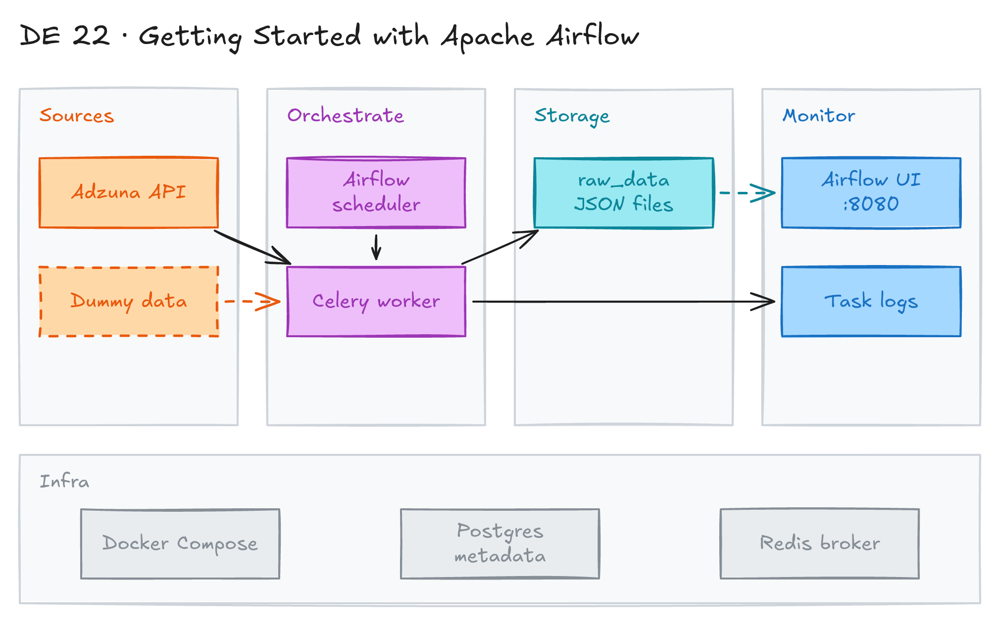

# Getting Started with Apache Airflow



## Project card

| Level | Roles | Duration | Cost | Status |
|---|---|---|---|---|
| Beginner | Data Engineer | 4 assignments, ~2-4 h each | Free | Draft |

## Goal

You run Apache Airflow locally in Docker. You write simple ETL DAGs in two styles. Then you build a DAG that extracts job postings from the Adzuna API and saves them as JSON files.

## What you will learn

- Run Airflow with Docker Compose (webserver, scheduler, worker, Postgres, Redis).
- Write DAGs with classic operators and with the TaskFlow API (`@dag`, `@task`).
- Pass data between tasks with XCom.
- Create many DAGs from one function (dynamic DAGs).
- Use Airflow Variables for API keys.
- Read logs and debug tasks.

## Who it is for

- **Data Engineer**: Airflow is the most common orchestrator. You learn how to schedule and monitor pipelines.

## Tools and services

| Tool | Used for | Free option |
|---|---|---|
| Apache Airflow 2.10 | Orchestrate and schedule tasks | yes |
| Docker Desktop + Docker Compose | Run Airflow and its services locally | yes |
| PostgreSQL, Redis | Airflow metadata database and Celery broker | yes |
| Python (`requests`) | Task code | yes |
| [Adzuna API](https://developer.adzuna.com/) | Job postings data source | yes (free key) |

## Architecture

The diagram is at the top of this page. Source file: [`images/architecture.excalidraw`](images/architecture.excalidraw). Open it at [excalidraw.com](https://excalidraw.com) to copy or edit it.

Data flow:

1. Docker Compose starts Airflow (webserver, scheduler, Celery worker) with Postgres and Redis.
2. The scheduler reads DAG files from the `dags` folder.
3. The Adzuna DAG calls the Adzuna API for "data engineer" jobs in Canada, page by page.
4. The task writes one JSON file per run to `raw_data` (mounted at `/opt/airflow/shared-data/raw_data/to_process/`).
5. You monitor runs and logs in the Airflow UI.

## Dataset

- **Source:** [Adzuna Jobs API](https://developer.adzuna.com/), endpoint `https://api.adzuna.com/v1/api/jobs/ca/search/`.
- **Tables / entities:** job postings for the phrase "data engineer", posted in the last 2 days, 50 per page.
- **Size:** a few hundred postings per run. Files are named `adzuna_raw_data_<timestamp>.json`.

## Prerequisites

- Python, VS Code, Docker Desktop.
- A free Adzuna developer account (for Assignment 3).
- New to Git, CLI or Docker? Start with [Surfalytics Module 0](https://www.youtube.com/watch?v=LJIiCLu2gr8&list=PLNCDg7zJiXhP5Z_-TXUdorz2n7sjYHHKE&index=1).

## Assignments

Work at your own pace. Each assignment shows the expected time.

### Assignment 1: Run Airflow in Docker (~2 h)

**Goal:** Start Airflow locally and learn the UI and the main commands.

**Steps:**

1. Clone this repo and open it in VS Code.
2. Go to the project folder:

   ```bash
   cd data-projects/de-projects/22_airflow_intro/
   ```

3. Look at [`docker-compose.yaml`](docker-compose.yaml). It uses the image `apache/airflow:2.10.4` with `CeleryExecutor`. It mounts `dags`, `logs`, `config`, `plugins` and `raw_data` into the containers.
4. On Linux, set your user ID so files are not owned by root:

   ```bash
   echo -e "AIRFLOW_UID=$(id -u)" > .env
   ```

5. Start the services and check them:

   ```bash
   docker compose up -d
   docker compose ps -a
   ```

6. Open the Airflow UI at http://localhost:8080/. The default login is `airflow` / `airflow`.
7. Try the useful commands:

   ```bash
   # Logs for all services
   docker compose logs

   # Logs for one service
   docker compose logs airflow-webserver

   # Live logs for one service
   docker compose logs airflow-webserver -f

   # Open a shell in the webserver container
   docker compose exec -it airflow-webserver bash
   ```

**Deliverable:** A screenshot of the Airflow UI with the DAG list.

**Done when:**

- [ ] All containers are `healthy` in `docker compose ps -a`.
- [ ] You can log in to the UI and see the DAGs from the `dags` folder.

**Hints:** Read the [Airflow Docker Compose guide](https://airflow.apache.org/docs/apache-airflow/2.10.4/howto/docker-compose/index.html). DAGs are paused when created. Turn them on in the UI.

### Assignment 2: Simple ETL DAGs (~2 h)

**Goal:** Understand three ways to write the same extract, transform, load DAG.

**Steps:**

1. Read [`dags/simple_etl_dag_v1.py`](dags/simple_etl_dag_v1.py). It uses `PythonOperator` and `BashOperator`. Tasks pass data with `ti.xcom_pull()`.
2. Read [`dags/simple_etl_dag_v2.py`](dags/simple_etl_dag_v2.py). It does the same with the TaskFlow API (`@dag`, `@task`, `@task.bash`). Return values pass between tasks as XCom.
3. Read [`dags/simple_etl_dags_v3.py`](dags/simple_etl_dags_v3.py). One function creates a DAG for each table in `TABLES = ['accounts', 'contacts', 'sales']`.
4. Turn on and run all DAGs in the UI.
5. Open each task's logs. Find the "Transforming data" message. Open the XCom tab and see the values.
6. Compare: `simple_etl_dag_v1` has no `catchup=False`. See how many runs it creates since `2025-01-01`.

**Deliverable:** Screenshots of the graph view and task logs for each DAG.

**Done when:**

- [ ] All 5 DAGs run with success (`simple_etl_dag_v1`, `simple_etl_dag_v2`, and 3 `simple_etl_dag_<table>` DAGs).
- [ ] You can explain the difference between classic operators and TaskFlow.
- [ ] You can explain what `catchup` does.

**Hints:** [TaskFlow tutorial](https://airflow.apache.org/docs/apache-airflow/2.10.4/tutorial/taskflow.html), [XComs](https://airflow.apache.org/docs/apache-airflow/2.10.4/core-concepts/xcoms.html).

### Assignment 3: Extract job postings from the Adzuna API (~3 h)

**Goal:** Run a real extract DAG that saves API data to files.

**Steps:**

1. Register at [developer.adzuna.com](https://developer.adzuna.com/) and get an `app_id` and an `app_key`.
2. In the Airflow UI, open **Admin → Variables**. Add `ADZUNA_APP_ID` and `ADZUNA_APP_KEY`. The DAG reads them with `Variable.get()`. Without them, the DAG fails to import.
3. Read [`dags/adzuna_etl/adzuna_etl_dag.py`](dags/adzuna_etl/adzuna_etl_dag.py) and [`dags/adzuna_etl/src/utils.py`](dags/adzuna_etl/src/utils.py):
   - The first request gets the total count and the number of pages.
   - The loop requests the other pages.
   - The task writes all results to one JSON file with a timestamp in the name.
4. Trigger the DAG `adzuna_ingest_raw_data` by hand. It has `schedule=None`.
5. Check the new file in the local `raw_data` folder.
6. Change the schedule to `timedelta(hours=1)` or `timedelta(days=1)` and watch the next runs.

**Deliverable:** A JSON file with job postings and a screenshot of a successful DAG run.

**Done when:**

- [ ] The DAG imports without errors.
- [ ] A run creates `raw_data/adzuna_raw_data_<timestamp>.json`.
- [ ] The API keys are in Airflow Variables, not in code.

**Hints:** Read the article ["ETL with Airflow and the Adzuna API"](https://medium.com/@kazarmax/extracting-and-processing-job-market-data-etl-with-apache-airflow-and-adzuna-api-d7feae752bf9).

### Assignment 4: Move the heavy work out of Airflow (Planned) (~4 h)

**Goal:** Run the extract code in its own Docker container. Airflow only starts it.

**Steps:**

1. Split the Adzuna code into small modules (extract, transform, save) and import them in the DAG.
2. Create a new repo with the ingestion code and a `Dockerfile`.
3. Build the image and push it to a registry (for example Docker Hub or GitHub Container Registry).
4. In the DAG, use `DockerOperator` to pull the image and run the task in the container.
5. Add a transform task that reads the raw JSON and writes a clean file or table.

**Deliverable:** A DAG that runs the extract in a Docker container.

**Done when:**

- [ ] The DAG runs the container and the file appears in `raw_data`.

## Final result

- A local Airflow setup in Docker with 6 working DAGs.
- A DAG that extracts real job postings from an API on a schedule.
- Post the repo and a screenshot of the DAG graph on LinkedIn.
- Interview pitch: "I ran Airflow in Docker with the Celery executor. I wrote DAGs with classic operators and with TaskFlow, and generated DAGs dynamically. I built a DAG that extracts job postings from the Adzuna API and stores them as JSON files, with API keys in Airflow Variables."

## Clean up

Stop the containers and delete the volumes:

```bash
docker compose down --volumes --remove-orphans
```

Nothing else to clean up. The project runs locally.

## Resources

- ["Getting Started with Apache Airflow" article](https://medium.com/@kazarmax/getting-started-with-apache-airflow-b2fba7dbd45a): step-by-step intro for this project.
- ["ETL with Airflow" project article](https://medium.com/@kazarmax/extracting-and-processing-job-market-data-etl-with-apache-airflow-and-adzuna-api-d7feae752bf9): the Adzuna pipeline in detail.
- [Airflow 2.10 documentation](https://airflow.apache.org/docs/apache-airflow/2.10.4/index.html): concepts and operators.
- [Adzuna API docs](https://developer.adzuna.com/overview): endpoints and parameters.

## Community solutions

Share your repo in Discord. We add the best ones here.

- <Name>: <link>
