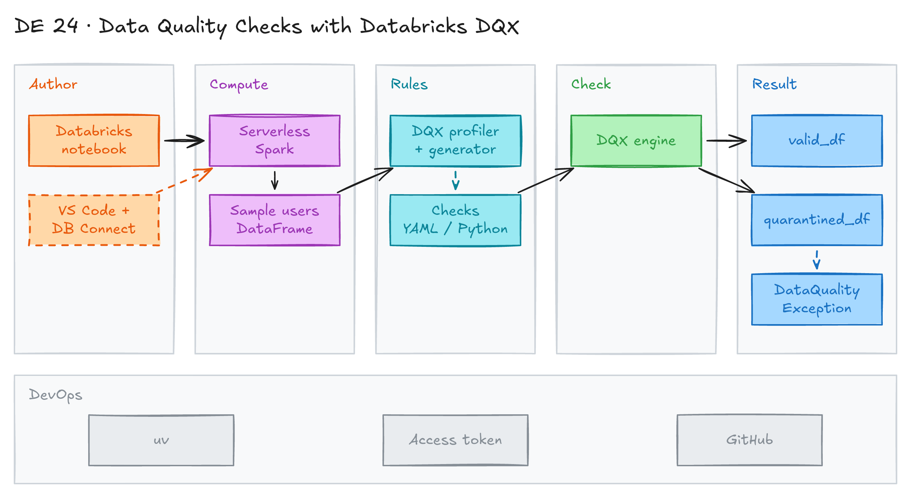

# Data Quality Checks with Databricks DQX



## Project card

| Level | Roles | Duration | Cost | Status |
|---|---|---|---|---|
| Middle | Data Engineer, Analytics Engineer | 4 assignments, ~1-3 h each | Free | Ready |

## Goal

Bad rows in a table break reports and models. You use **DQX** (a Databricks Labs library) to check PySpark DataFrames. You profile the data, generate rules, split good rows from bad rows, and stop a pipeline when checks fail.

## What you will learn

- Profile a DataFrame and generate data quality rule candidates.
- Define checks in YAML and in Python.
- Split a DataFrame into valid and quarantined rows.
- Flag bad rows with `_errors` and `_warnings` columns.
- Stop a pipeline with a custom exception and a clear log message.
- Run notebooks in Databricks or locally in VS Code with Databricks Connect.

## Who it is for

- **Data Engineer**: you add quality gates to Spark pipelines before data reaches curated layers.
- **Analytics Engineer**: you compare DQX with dbt tests, Soda and Great Expectations.

## Tools and services

| Tool | Used for | Free option |
|---|---|---|
| Databricks Free Edition | Serverless Spark compute and workspace | yes |
| [DQX](https://databrickslabs.github.io/dqx/) (`databricks-labs-dqx`) | Data quality profiling and checks | yes |
| Databricks Connect 16.4 | Run Spark code from VS Code on remote serverless compute | yes |
| uv | Python package manager for the local setup | yes |
| VS Code + Jupyter | Local notebook editor | yes |

**About DQX:**

- Checks are code (Python) or config (YAML).
- Works with Spark batch and streaming, including Lakeflow Declarative Pipelines (formerly Delta Live Tables).
- Custom checks can use SQL expressions, for example `ended_at > started_at`.
- Comes with a simple Databricks dashboard to track issues.
- Limits: checks run on one DataFrame. Join DataFrames first for cross-table checks. No built-in referential integrity check. The dashboard is basic.
- Use cases: checks before loading into curated layers, and checks on data that is already loaded.
- Alternatives: dbt tests, Soda, Great Expectations.

## Architecture

The diagram is at the top of this page. Source file: [`images/architecture.excalidraw`](images/architecture.excalidraw). Open it at [excalidraw.com](https://excalidraw.com) to copy or edit it.

Data flow:

1. You run a notebook in Databricks or in VS Code (through Databricks Connect).
2. The notebook creates a sample `users` DataFrame on serverless compute.
3. The DQX profiler reads the DataFrame and generates rule candidates.
4. The DQX engine applies YAML or Python checks.
5. Valid rows go to `valid_df`. Bad rows go to `quarantined_df` with an `_errors` column.
6. A `validate_df()` function logs a summary and raises `DataQualityException` if checks fail.

## Dataset

- **Source:** a small DataFrame created in the notebook. No download needed.
- **Tables / entities:** `users` with `id`, `name`, `email`, `age`, `signup_date`, `gender`.
- **Size:** 6 rows with known issues:
  - `id` is null (Frank).
  - `age` is null or out of range (Charlie, Eve = 200).
  - `signup_date` is not a valid date (`2022-14-01`, `2022-02-30`).
  - `gender` is not in the list (`Femail`, `F`).
  - `email` is null (Eve).

## Prerequisites

- [Databricks Free Edition](https://www.databricks.com/learn/free-edition) account.
- For the local option: VS Code, Python 3.12, [uv](https://docs.astral.sh/uv/).
- Basic PySpark: DataFrames, `select`, `groupBy`.
- New to Git, CLI or Docker? Start with [Surfalytics Module 0](https://www.youtube.com/watch?v=LJIiCLu2gr8&list=PLNCDg7zJiXhP5Z_-TXUdorz2n7sjYHHKE&index=1).

## Assignments

Work at your own pace. Each assignment shows the expected time.

| Notebook | Where it runs |
|---|---|
| [`dqx_demo_notebook.ipynb`](dqx_demo_notebook.ipynb) | Databricks workspace. Uses `display()`. |
| [`dqx_demo_vscode.ipynb`](dqx_demo_vscode.ipynb) | VS Code with Databricks Connect. Uses `.show()`. |

### Assignment 1: Set up the environment (~1 h)

**Goal:** Run Spark code on Databricks serverless compute, in the workspace or from VS Code.

**Steps:**

1. **Option A: Databricks workspace.**
   1. Import [`dqx_demo_notebook.ipynb`](dqx_demo_notebook.ipynb) into your workspace.
   2. Attach it to serverless compute.
   3. Uncomment and run the first code cell to install DQX:

      ```python
      %pip install databricks-labs-dqx
      dbutils.library.restartPython()
      ```

2. **Option B: VS Code with Databricks Connect.**
   1. Install uv:

      ```bash
      curl -LsSf https://astral.sh/uv/install.sh | sh
      ```

   2. Install the dependencies from [`pyproject.toml`](pyproject.toml) (`databricks-connect==16.4.1`, `databricks-labs-dqx>=0.6.0`, `ipykernel`):

      ```bash
      cd de-projects/24_databricks_dqx_demo
      uv sync
      ```

   3. Create an access token in Databricks: **Profile > Settings > User > Developer > Access tokens > Manage > Generate new token**.
   4. Create `~/.databrickscfg` in your home directory:

      ```ini
      [DEFAULT]
      host = https://<your-workspace>.cloud.databricks.com
      token = <your-token>
      serverless_compute_id = auto
      ```

   5. Open [`dqx_demo_vscode.ipynb`](dqx_demo_vscode.ipynb). Select the `.venv` kernel.
   6. Run the first cell. It connects to serverless compute:

      ```python
      from databricks.connect import DatabricksSession

      spark = DatabricksSession.builder.getOrCreate()
      spark.sql("select current_date").show()
      ```

**Deliverable:** a screenshot of the `current_date` result.

**Done when:**

- [ ] The notebook connects to serverless compute.
- [ ] `from databricks.labs.dqx.engine import DQEngine` runs without errors.
- [ ] Your token is not in Git.

**Hints:** Never commit `~/.databrickscfg`. It holds your token.

### Assignment 2: Profile data and generate rules (~1 h)

**Goal:** Let DQX look at the data and suggest rules.

**Steps:**

1. Run the cell that creates the sample `df` with 6 rows and the schema.
2. Profile the data with `DQProfiler`. Set `sample_fraction` to `1.0` so all rows are used (default is 30%):

   ```python
   ws = WorkspaceClient()
   profiler = DQProfiler(ws)
   summary_stats, profiles = profiler.profile(df, options={"sample_fraction": 1.0})
   print(yaml.safe_dump(summary_stats))
   ```

3. Generate rule candidates with `DQGenerator`:

   ```python
   generator = DQGenerator(ws)
   generated_checks = generator.generate_dq_rules(profiles)
   print(yaml.safe_dump(generated_checks))
   ```

4. Read the generated rules. Mark which ones you keep, change or drop.

**Deliverable:** the generated YAML with your notes on each rule.

**Done when:**

- [ ] You can explain each profile (null count, min, max, distinct values).
- [ ] You know which generated rules are useful and which are not.

### Assignment 3: Define checks and split the data (~2 h)

**Goal:** Write checks in YAML and in Python. Split good rows from bad rows.

**Steps:**

1. Define checks in YAML and apply them with `apply_checks_by_metadata_and_split`:

   ```yaml
   - check:
       function: is_not_null
       arguments:
         column: id
     criticality: error
     name: id_is_null
   - check:
       function: is_in_range
       arguments:
         column: age
         min_limit: 10
         max_limit: 100
     criticality: error
     name: age_isnt_in_range
   - check:
       function: is_valid_date
       arguments:
         column: signup_date
     criticality: error
     name: wrong_date_format
   - check:
       function: is_in_list
       arguments:
         column: gender
         allowed: [Female, Male]
     criticality: error
     name: gender_is_not_in_the_list
   ```

2. Define the same checks in Python with `DQRowRule` and `check_funcs`. Apply them with `apply_checks_and_split`.
3. Use `apply_checks` instead. It keeps all rows and adds `_errors` and `_warnings` columns. Use `dq_engine.get_valid()` and `dq_engine.get_invalid()` to filter.
4. Add one check of your own, for example `email` is not null with `criticality: warn`.

**Deliverable:** the quarantined rows from both methods.

**Done when:**

- [ ] YAML and Python checks give the same quarantined rows.
- [ ] You can explain the difference between `error` and `warn`.
- [ ] You can explain the difference between `apply_checks_and_split` and `apply_checks`.

**Hints:** The last Python rule in the notebook has no `name`. DQX builds a default name. Add a name so logs are easier to read.

### Assignment 4: Stop the pipeline on bad data (~2 h)

**Goal:** Turn checks into a quality gate for a pipeline.

**Steps:**

1. Write `_get_validation_summary_log()`. It explodes `_errors`, groups by check name and counts rows. Output example: `Found 2 records with failed check "wrong_date_format"`.
2. Configure Python `logging` with a timestamp format.
3. Create a custom `DataQualityException`.
4. Write `validate_df(df)`:
   - Apply the checks with `apply_checks_and_split`.
   - If the error DataFrame has rows, raise `DataQualityException` with the summary.
   - Otherwise log "Dataframe validated successfully".
5. Call `validate_df(df)` in `try` / `except` and print the message.

**Deliverable:** the notebook with the gate and the printed failure summary.

**Done when:**

- [ ] The sample data fails with a clear summary per check.
- [ ] A clean DataFrame passes with no exception.

**Hints:** In a real job, do not catch the exception. Let the task fail so the orchestrator (Airflow, Databricks Jobs) marks the run red.

## Final result

- Two notebooks: one for the Databricks workspace and one for VS Code.
- A reusable `validate_df()` quality gate.
- Post on LinkedIn: a short comparison of DQX vs dbt tests vs Great Expectations.
- Interview pitch: "I used Databricks DQX to profile data, generate rules and split bad rows into quarantine. I added a quality gate that fails the pipeline with a clear summary. Checks live as YAML or Python code."

## Clean up

- Databricks Free Edition has no cost. Serverless compute stops by itself.
- Revoke the access token if you do not need it: **Settings > Developer > Access tokens**.

## Resources

- [DQX documentation](https://databrickslabs.github.io/dqx/): checks, profiler, engine API.
- [DQX GitHub repo](https://github.com/databrickslabs/dqx): source code and examples.
- [Review of DQX (waitingforcode.com)](https://www.waitingforcode.com/databricks/data-quality-databricks-dqx/read): a deep review with pros and cons.
- [Databricks Connect](https://docs.databricks.com/en/dev-tools/databricks-connect/index.html): run Spark code from your IDE.
- [Databricks Free Edition](https://www.databricks.com/learn/free-edition): free workspace.

## Community solutions

Share your repo in Discord. We add the best ones here.

- <Name>: <link>
