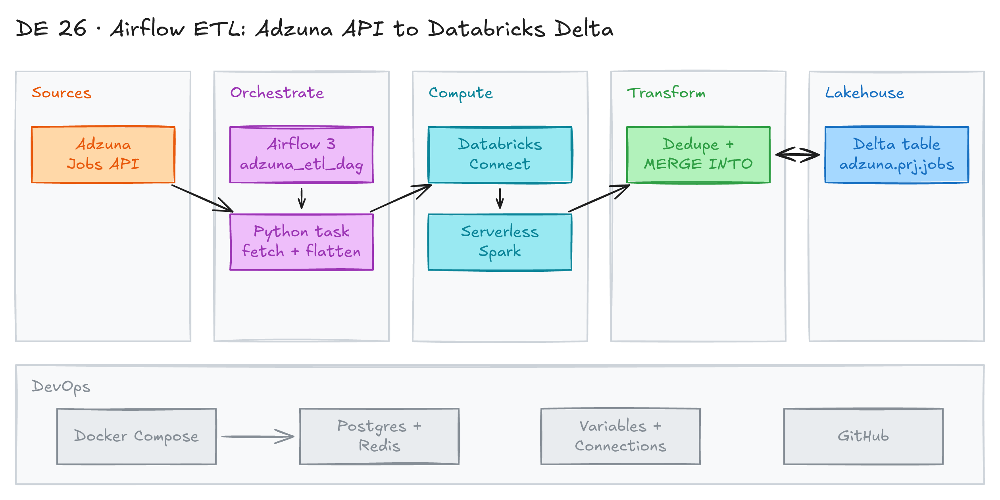

# Airflow ETL: Adzuna API to Databricks Delta



## Project card

| Level | Roles | Duration | Cost | Status |
|---|---|---|---|---|
| Intermediate | Data Engineer | 4 assignments, ~1-3 h each | Free | Ready |

## Goal

You build an ETL pipeline for "data engineer" job postings in Canada. Apache Airflow pulls jobs from the Adzuna API every hour. It loads them into a Databricks Delta table with `MERGE`. Everything runs in Docker.

## What you will learn

- Run Airflow 3 with Docker Compose (CeleryExecutor, Postgres, Redis).
- Build a custom Airflow image with your own Python package.
- Store secrets in Airflow Variables and Connections.
- Call a paginated REST API from an Airflow task.
- Use Databricks Connect with serverless compute from Airflow.
- Upsert data into a Delta table with `MERGE INTO`.

## Who it is for

- **Data Engineer**: you build a full API-to-lakehouse pipeline with a real orchestrator.

## Tools and services

| Tool | Used for | Free option |
|---|---|---|
| Apache Airflow 3.0.3 | Orchestration, scheduling, secrets | yes |
| Docker + Docker Compose | Run all Airflow services locally | yes |
| [Adzuna API](https://developer.adzuna.com/) | Job postings source | yes (free key) |
| Databricks Free Edition | Unity Catalog, Delta table, serverless compute | yes |
| Databricks Connect 16.3 | Run Spark code from Airflow on Databricks | yes |
| uv + hatchling | Build the `scripts` package as a wheel | yes |

## Architecture

The diagram is at the top of this page. Source file: [`images/architecture.excalidraw`](images/architecture.excalidraw). Open it at [excalidraw.com](https://excalidraw.com) to copy or edit it.

Data flow:

1. Airflow runs the `adzuna_etl_dag` DAG every hour in Docker.
2. The task calls the Adzuna search API page by page (50 results per page, jobs from the last 3 days).
3. The task flattens the JSON and builds a Spark DataFrame on Databricks serverless compute through Databricks Connect.
4. The task removes duplicate `id`s and runs `MERGE INTO adzuna.prj.jobs`.
5. You query the Delta table in Databricks.

## Dataset

- **Source:** [Adzuna Jobs API](https://developer.adzuna.com/docs/search). Endpoint: `https://api.adzuna.com/v1/api/jobs/ca/search/<page>`.
- **Search:** `what_phrase = "data engineer"`, country `ca`, sorted by date.
- **Table:** `adzuna.prj.jobs` with `id`, `title`, `location`, `company`, `category`, `description`, `url`, `created`, `etl_at`.
- **Size:** a few hundred jobs per run.

## Prerequisites

- [Adzuna developer account](https://developer.adzuna.com/) with an **Application ID** and **Application Key**.
- [Databricks Free Edition](https://www.databricks.com/learn/free-edition) account.
- Docker Desktop with at least 4 GB RAM and 2 CPUs. VS Code.
- Basic Airflow and PySpark.
- New to Git, CLI or Docker? Start with [Surfalytics Module 0](https://www.youtube.com/watch?v=LJIiCLu2gr8&list=PLNCDg7zJiXhP5Z_-TXUdorz2n7sjYHHKE&index=1).

## Assignments

Work at your own pace. Each assignment shows the expected time.

Project files:

| File | What it does |
|---|---|
| [`docker-compose.yaml`](docker-compose.yaml) | Airflow 3 services: api-server, scheduler, dag-processor, worker, triggerer, Postgres, Redis |
| [`Dockerfile`](Dockerfile) | Custom image: installs the `scripts` wheel, `databricks-connect`, `munch`, Databricks provider |
| [`pyproject.toml`](pyproject.toml) | Packages the `scripts` folder as `adzuna-etl` |
| [`airflow/dags/etl.py`](airflow/dags/etl.py) | The `adzuna_etl_dag` DAG |
| [`airflow/config/etl_config.py`](airflow/config/etl_config.py) | Schedule, start date, target catalog / schema / table |
| [`airflow/config/airflow_vars_to_import.json`](airflow/config/airflow_vars_to_import.json) | Template for Airflow Variables |
| [`scripts/src.py`](scripts/src.py) | Spark session, Adzuna fetch, `MERGE`, row count |
| [`scripts/databricks_ddl.py`](scripts/databricks_ddl.py) | Creates the catalog, schema and table |

### Assignment 1: Run Airflow in Docker (~1 h)

**Goal:** Start Airflow 3 locally and open the UI.

**Steps:**

1. Clone this repo and go to the project folder:

   ```bash
   git clone https://github.com/surfalytics/data-projects.git
   cd data-projects/de-projects/26_airflow_docker_databricks_etl
   ```

2. Open the folder in VS Code. Read [`Dockerfile`](Dockerfile) and [`docker-compose.yaml`](docker-compose.yaml).
3. On Linux, set your user ID so files are not owned by root:

   ```bash
   echo "AIRFLOW_UID=$(id -u)" > .env
   ```

4. Generate your own Fernet key. Airflow uses it to encrypt passwords in Connections. Add it to `.env`:

   ```bash
   pip install cryptography
   echo "AIRFLOW_FERNET_KEY=$(python -c "from cryptography.fernet import Fernet; print(Fernet.generate_key().decode())")" >> .env
   ```

   You can also set `AIRFLOW_API_SECRET_KEY` and `AIRFLOW_JWT_SECRET` in `.env`. Without them, Docker Compose uses local test values. Never commit `.env`.

5. Build the image and start all services:

   ```bash
   docker compose up -d --build
   ```

6. Open the Airflow UI at `http://localhost:8080/`. Login: `airflow` / `airflow`.

**Deliverable:** a screenshot of the Airflow UI.

**Done when:**

- [ ] `docker compose ps` shows all services as `healthy`.
- [ ] You can log in to the UI.

**Hints:** The DAG shows an import error until you add the Variables in Assignment 2. [`etl_config.py`](airflow/config/etl_config.py) reads them when the DAG is parsed.

### Assignment 2: Configure secrets and the Databricks connection (~1 h)

**Goal:** Give Airflow the Adzuna keys and the Databricks token.

**Steps:**

1. In Airflow UI, go to **Admin > Variables**. Add `ADZUNA_APP_ID` and `ADZUNA_APP_KEY` with values from your Adzuna account. You can also fill in [`airflow_vars_to_import.json`](airflow/config/airflow_vars_to_import.json) and import it. Do not commit the filled file.
2. In Databricks, create a Personal Access Token (PAT):
   - Go to **Settings > Developer > Access tokens**.
   - Click **Generate new token**.
   - Copy it and save it in a safe place.
3. In Airflow UI, go to **Admin > Connections** and add a connection:
   - Connection ID: `databricks_default`
   - Connection Type: `Databricks`
   - Host: your workspace URL, for example `https://<your-workspace>.cloud.databricks.com`
   - Password: your Databricks token

**Deliverable:** Variables and the connection exist in Airflow (screenshot with values hidden).

**Done when:**

- [ ] The DAG `adzuna_etl_dag` shows with no import errors.
- [ ] No keys or tokens are in Git.

### Assignment 3: Create the Delta table and run the DAG (~2 h)

**Goal:** Create the target table and load data with the DAG.

**Steps:**

1. Create the catalog, schema and table in Unity Catalog. Run [`databricks_ddl.py`](scripts/databricks_ddl.py) inside the scheduler container:

   ```bash
   docker compose exec -T airflow-scheduler python /opt/python/scripts/databricks_ddl.py
   ```

   It runs:

   ```sql
   CREATE CATALOG adzuna;
   CREATE SCHEMA adzuna.prj;
   CREATE TABLE adzuna.prj.jobs (
       id BIGINT, title STRING, location STRING, company STRING,
       category STRING, description STRING, url STRING,
       created TIMESTAMP, etl_at TIMESTAMP
   ) USING DELTA;
   ```

2. Read the DAG in [`etl.py`](airflow/dags/etl.py) and the functions in [`src.py`](scripts/src.py):
   - `get_spark()` reads the `databricks_default` connection and opens a serverless session.
   - `fetch_adzuna_to_spark_df()` reads all pages and builds a DataFrame.
   - `merge_to_delta_table()` runs `MERGE INTO` on `id`.
3. In Airflow UI, unpause and trigger `adzuna_etl_dag`.
4. Check the task logs: fetched records, records after merge.
5. In Databricks, check the table:

   ```sql
   SELECT COUNT(*) FROM adzuna.prj.jobs;
   SELECT * FROM adzuna.prj.jobs ORDER BY created DESC LIMIT 10;
   ```

**Deliverable:** a screenshot of a green DAG run and the query result.

**Done when:**

- [ ] The table `adzuna.prj.jobs` exists and has rows.
- [ ] A second run does not create duplicate `id`s.

**Hints:** `databricks_ddl.py` logs errors and does not fail. If the table is missing, check the output for errors (for example, the catalog already exists).

### Assignment 4: Review and improve the pipeline (~3 h)

**Goal:** Find weak spots in the code and fix them.

**Steps:**

1. Check the `WHEN MATCHED` condition in `merge_to_delta_table()`. `<=>` is null-safe **equal**. Does the update run when a value changed, or when it stayed the same? Fix it with `NOT (t.title <=> s.title) OR ...`.
2. `fetch_adzuna_to_spark_df()` returns `None` when there are no jobs. The DAG then calls `df.count()`. Make the task skip the merge when there is no data.
3. Make the search phrase and country configurable in [`etl_config.py`](airflow/config/etl_config.py).
4. Add a data quality check before the merge (for example, `id` is not null).
5. Rebuild and run again:

   ```bash
   docker compose up -d --build
   ```

**Deliverable:** a pull request in your fork with the fixes.

**Done when:**

- [ ] Only changed rows get a new `etl_at`.
- [ ] A run with no new jobs ends green.

## Final result

- An hourly Airflow pipeline from a REST API to a Delta table in Docker.
- Post the repo and a screenshot of the DAG on LinkedIn.
- Interview pitch: "I built an Airflow 3 pipeline in Docker. It pulls job postings from the Adzuna API and upserts them into a Databricks Delta table with MERGE. Airflow uses Databricks Connect with serverless compute, so no cluster is needed."

## Clean up

- Stop and remove containers and volumes:

  ```bash
  docker compose down --volumes --rmi local
  ```

- In Databricks, drop the catalog: `DROP CATALOG adzuna CASCADE;`.
- Revoke the Databricks token: **Settings > Developer > Access tokens**.

## Resources

- [Medium article by the author](https://medium.com/@kazarmax/hands-on-project-building-a-simple-api-to-delta-pipeline-with-airflow-and-databricks-connect-028881ba3585): full walkthrough of this project.
- [Original repo](https://github.com/kazarmax/airflow_databricks_etl): the author's version of the code.
- [Airflow in Docker](https://airflow.apache.org/docs/apache-airflow/stable/howto/docker-compose/index.html): official Docker Compose setup.
- [Databricks provider for Airflow](https://airflow.apache.org/docs/apache-airflow-providers-databricks/stable/index.html): connection and hooks.
- [Databricks Connect](https://docs.databricks.com/en/dev-tools/databricks-connect/index.html): run Spark code remotely.
- [Delta MERGE INTO](https://docs.databricks.com/en/sql/language-manual/delta-merge-into.html): upsert syntax.
- [Adzuna API docs](https://developer.adzuna.com/docs/search): search parameters.

## Community solutions

Share your repo in Discord. We add the best ones here.

- <Name>: <link>
