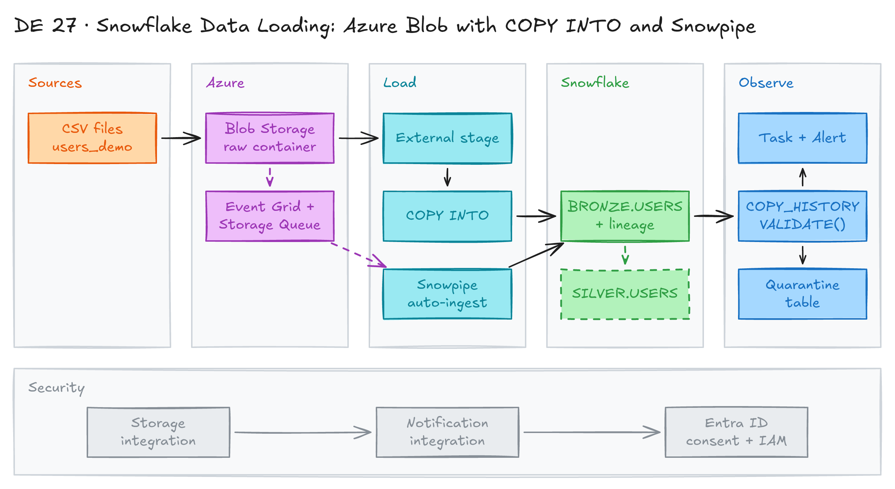

# Snowflake Data Loading: Azure Blob with COPY INTO and Snowpipe



## Project card

| Level | Roles | Duration | Cost | Status |
|---|---|---|---|---|
| Middle | Data Engineer, Analytics Engineer | 6 assignments, ~1-3 h each | Free trial | In progress |

## Goal

You load CSV files from Azure Blob Storage into Snowflake. You use two methods: bulk `COPY INTO` and Snowpipe auto-ingest with Azure Event Grid. You add lineage columns, handle bad rows, and monitor loads. Data follows a medallion layout: RAW → BRONZE → SILVER.

## What you will learn

- Connect Snowflake to Azure with a storage integration and an external stage.
- Load files with `COPY INTO`: validation mode, `ON_ERROR`, `FORCE`, load deduplication.
- Set up Snowpipe auto-ingest with Event Grid and a Storage Queue.
- Add lineage columns with `METADATA$FILENAME` and other metadata fields.
- Find rejected rows with `VALIDATE()` and audit loads with `COPY_HISTORY`.
- Automate monitoring with Snowflake Tasks and Alerts.

## Who it is for

- **Data Engineer**: you build batch and event-driven ingestion into Snowflake.
- **Analytics Engineer**: you learn how raw data lands in the warehouse and how to trace each row to its file.

## Tools and services

| Tool | Used for | Free option |
|---|---|---|
| Snowflake | Warehouse, stages, `COPY INTO`, Snowpipe, Tasks, Alerts | trial (30 days) |
| Azure Blob Storage | Landing zone for CSV files (`raw` container) | trial / free account credit |
| Azure Event Grid | Sends `BlobCreated` events | trial / free account credit |
| Azure Storage Queue | Holds events for Snowpipe | trial / free account credit |
| Azure CLI or Azure Portal | Upload files, set up IAM | yes |

## Architecture

The diagram is at the top of this page. Source file: [`images/architecture.excalidraw`](images/architecture.excalidraw). Open it at [excalidraw.com](https://excalidraw.com) to copy or edit it.

Data flow:

1. You upload CSV files to the `raw` container in Azure Blob Storage.
2. **Bulk path:** you run `COPY INTO` from the external stage `ANALYTICS_DEV.RAW.AZUREDATA_STAGE` into a BRONZE table.
3. **Auto-ingest path:** Event Grid sends a `BlobCreated` event to `snowpipe-queue`. Snowpipe reads the queue and loads the file. Typical delay: 30 seconds to 2 minutes.
4. The production pipe adds lineage columns (file name, row number, load time, load ID) to `BRONZE.USERS`.
5. `COPY_HISTORY`, `VALIDATE()`, a Task and an Alert track failed loads. Bad rows go to a quarantine table.
6. BRONZE data is cleaned and upserted into `SILVER.USERS`.

## Dataset

- **Source:** two CSV files in [`demo-files/`](demo-files/).
- **Tables / entities:** users with `UserId`, `FirstName`, `LastName`, `Email`, `Phone`, `Country`, `IsActive`, `CreatedAt`, `UpdatedAt`.
- **Size:**
  - [`users_demo.csv`](demo-files/users_demo.csv): 20 clean rows.
  - [`users_demo_bad.csv`](demo-files/users_demo_bad.csv): 15 rows with 3 errors:

    | Row | UserId | Error |
    |---|---|---|
    | 4 | U-1003 | `IsActive = 'MAYBE'`: invalid BOOLEAN |
    | 7 | U-1006 | `CreatedAt = '15/04/2023'`: wrong timestamp format |
    | 13 | U-1012 | `CreatedAt = 'NOT-A-DATE'`: invalid timestamp |

## Prerequisites

- [Snowflake trial account](https://signup.snowflake.com/) with the `ACCOUNTADMIN` role.
- [Azure account](https://azure.microsoft.com/free/) with a subscription.
- Azure CLI (optional, to upload files from the terminal).
- Basic SQL.
- New to Git, CLI or Docker? Start with [Surfalytics Module 0](https://www.youtube.com/watch?v=LJIiCLu2gr8&list=PLNCDg7zJiXhP5Z_-TXUdorz2n7sjYHHKE&index=1).

## Assignments

Work at your own pace. Each assignment shows the expected time.

Project files:

| File | What it does |
|---|---|
| [`config/01_create_db_and_schemas.sql`](config/01_create_db_and_schemas.sql) | `ANALYTICS_DEV` database with `RAW`, `BRONZE`, `SILVER` schemas |
| [`config/02_create_warehouse.sql`](config/02_create_warehouse.sql) | `COMPUTE_DEV` warehouse (XSmall, auto-suspend 60 s) |
| [`config/03_create_file_format.sql`](config/03_create_file_format.sql) | `FF_USERS_CSV` file format (skip header, NULL handling) |
| [`config/04_create_tables.sql`](config/04_create_tables.sql) | `BRONZE.USERS` (with lineage columns) and `SILVER.USERS` |
| [`config/05_azure_storage_integration.sql`](config/05_azure_storage_integration.sql) | Storage integration and external stage |
| [`config/06_azure_notification_integration.sql`](config/06_azure_notification_integration.sql) | Notification integration, Storage Queue, Event Grid steps |
| [`scripts/00_copy_command_demo.sql`](scripts/00_copy_command_demo.sql) | Bulk `COPY INTO` walkthrough |
| [`scripts/00_snowpipe_demo.sql`](scripts/00_snowpipe_demo.sql) | Snowpipe auto-ingest walkthrough |
| [`scripts/03_raw_to_bronze_pipe.sql`](scripts/03_raw_to_bronze_pipe.sql) | Production pipe with lineage columns |
| [`scripts/99_bulk_load_data_ingestion_observability.sql`](scripts/99_bulk_load_data_ingestion_observability.sql) | `COPY_HISTORY`, `VALIDATE()`, Task, Alert, quarantine |

The scripts use placeholders. Replace them with your own values:

| Placeholder | Replace with |
|---|---|
| `<storage_account>` | your storage account name |
| `<tenant_id>` | your Microsoft Entra ID tenant ID |
| `<resource_group>` | your Azure resource group |
| `<your_email>` | your verified email for alerts |

### Assignment 1: Set up Snowflake and Azure storage (~2 h)

**Goal:** Create Snowflake objects and connect Snowflake to an Azure container.

**Steps:**

1. In Azure, create a Storage Account and a container named `raw`.
2. In Snowflake, run the config scripts in order as `ACCOUNTADMIN`:

   | Step | Script | Result |
   |---|---|---|
   | 1 | [`01_create_db_and_schemas.sql`](config/01_create_db_and_schemas.sql) | `ANALYTICS_DEV` with `RAW`, `BRONZE`, `SILVER` |
   | 2 | [`02_create_warehouse.sql`](config/02_create_warehouse.sql) | `COMPUTE_DEV` warehouse |
   | 3 | [`03_create_file_format.sql`](config/03_create_file_format.sql) | `FF_USERS_CSV` |
   | 4 | [`04_create_tables.sql`](config/04_create_tables.sql) | `BRONZE.USERS`, `SILVER.USERS` |
   | 5 | [`05_azure_storage_integration.sql`](config/05_azure_storage_integration.sql) | Integration and stage |

3. In script 5, create the storage integration:

   ```sql
   CREATE OR REPLACE STORAGE INTEGRATION sv_azure_data_integration
     TYPE = EXTERNAL_STAGE
     STORAGE_PROVIDER = 'AZURE'
     AZURE_TENANT_ID = '<tenant_id>'
     ENABLED = TRUE
     STORAGE_ALLOWED_LOCATIONS = ('azure://<storage_account>.blob.core.windows.net/raw/');
   ```

4. Run `DESCRIBE INTEGRATION sv_azure_data_integration;`. Copy `AZURE_CONSENT_URL` and `AZURE_MULTI_TENANT_APP_NAME`.
5. Open the consent URL and accept. In Azure Portal, give the Snowflake app the **Storage Blob Data Reader** role on the storage account (**Storage Blob Data Contributor** if you want to unload or purge). See [Configure an Azure container](https://docs.snowflake.com/en/user-guide/data-load-azure-config).
6. Create the stage:

   ```sql
   CREATE OR REPLACE STAGE analytics_dev.raw.azuredata_stage
     STORAGE_INTEGRATION = sv_azure_data_integration
     URL = 'azure://<storage_account>.blob.core.windows.net/raw/';
   ```

**Deliverable:** your edited config scripts in a Git repo (no tenant IDs or keys).

**Done when:**

- [ ] `SHOW STAGES IN SCHEMA ANALYTICS_DEV.RAW;` shows `AZUREDATA_STAGE`.
- [ ] `LIST @analytics_dev.raw.azuredata_stage;` runs without an access error.

**Hints:** The role assignment can take a few minutes to work.

### Assignment 2: Bulk load with COPY INTO (~2 h)

**Goal:** Learn every `COPY INTO` option on clean and bad files.

**Steps:**

1. Upload both files to `raw/users_demo/`:

   ```bash
   az login
   az storage blob upload --account-name <storage_account> --container-name raw \
     --name users_demo/users_demo.csv --file demo-files/users_demo.csv --auth-mode login
   az storage blob upload --account-name <storage_account> --container-name raw \
     --name users_demo/users_demo_bad.csv --file demo-files/users_demo_bad.csv --auth-mode login
   ```

2. Follow [`00_copy_command_demo.sql`](scripts/00_copy_command_demo.sql) step by step:

   | Step | What you do | Expected result |
   |---|---|---|
   | Create `BRONZE.USERS_DEMO` | Target table | Empty table |
   | `LIST @.../users_demo/` | Check Snowflake sees the files | 2 files |
   | `VALIDATION_MODE = RETURN_ERRORS` | Dry run, no rows loaded | Empty result for the clean file |
   | `VALIDATION_MODE = RETURN_5_ROWS` | Preview parsed rows | 5 rows |
   | `ON_ERROR = 'ABORT_STATEMENT'` | Load the clean file | `LOADED`, 20 rows |
   | Run the same `COPY` again | Load deduplication | `LOAD_SKIPPED`, still 20 rows |
   | `FORCE = TRUE` | Reload on purpose | 40 rows (duplicates), then `TRUNCATE` |
   | Bad file with `ABORT_STATEMENT` | Whole file fails | `LOAD_FAILED`, 0 rows |
   | Bad file with `ON_ERROR = 'CONTINUE'` | Skip bad rows | `PARTIALLY_LOADED`, 12 rows |
   | `VALIDATE(..., JOB_ID => '_last')` | See rejected rows | 3 rows with line, column, error |

3. Check the audit trail in three places:

   | View | Retention | Delay |
   |---|---|---|
   | `INFORMATION_SCHEMA.COPY_HISTORY()` | 14 days | near real time |
   | `INFORMATION_SCHEMA.LOAD_HISTORY` | 14 days | near real time, bulk load only |
   | `SNOWFLAKE.ACCOUNT_USAGE.COPY_HISTORY` | 365 days | up to ~2 h |

**Deliverable:** a short table of each step with the status you got.

**Done when:**

- [ ] You can explain why the second `COPY` is skipped (load metadata kept for 64 days).
- [ ] You can explain when to use `ABORT_STATEMENT` vs `CONTINUE`.
- [ ] You found the 3 bad rows with `VALIDATE()`.

### Assignment 3: Auto-ingest with Snowpipe (~3 h)

**Goal:** Load files automatically when they land in Azure.

**Steps:**

1. Follow the Azure Portal steps in [`06_azure_notification_integration.sql`](config/06_azure_notification_integration.sql):
   1. **Register Event Grid:** Subscriptions > your subscription > **Resource providers** > `Microsoft.EventGrid` > **Register**.
   2. **Create a queue:** Storage account > **Data storage > Queues** > **+ Queue** > name `snowpipe-queue`. Copy the URL `https://<storage_account>.queue.core.windows.net/snowpipe-queue`.
   3. **Create an event subscription:** Storage account > **Events** > **+ Event Subscription**:
      - Name: `snowpipe-sub`. Event Schema: **Event Grid Schema** (not CloudEvents).
      - Event type: only **Blob Created**.
      - Endpoint type: **Storage Queue** > `snowpipe-queue`.
      - Filters tab, advanced filter: key `data.api`, operator **String is in**, values `CopyBlob`, `PutBlob`, `PutBlockList`, `FlushWithClose`, `SftpCommit`.
2. Create the notification integration in Snowflake:

   ```sql
   CREATE NOTIFICATION INTEGRATION sv_azure_notification_integration
     ENABLED = TRUE
     TYPE = QUEUE
     NOTIFICATION_PROVIDER = AZURE_STORAGE_QUEUE
     AZURE_STORAGE_QUEUE_PRIMARY_URI = 'https://<storage_account>.queue.core.windows.net/snowpipe-queue'
     AZURE_TENANT_ID = '<tenant_id>';

   DESC NOTIFICATION INTEGRATION sv_azure_notification_integration;
   ```

3. Open `AZURE_CONSENT_URL` and accept. The app can take up to 1 hour to appear.
4. On `snowpipe-queue`, open **Access Control (IAM)** > **Add role assignment** > **Storage Queue Data Contributor**. Select the app by the part of `AZURE_MULTI_TENANT_APP_NAME` before the underscore. Check that the app is listed in **Microsoft Entra ID > Enterprise applications**.
5. Follow [`00_snowpipe_demo.sql`](scripts/00_snowpipe_demo.sql):
   - Create `BRONZE.pipe_users_demo` with `AUTO_INGEST = TRUE` on `@.../users_demo_snowpipe/`.
   - Check `SYSTEM$PIPE_STATUS`. `executionState` must be `RUNNING`.
   - Upload `users_demo.csv` to `raw/users_demo_snowpipe/` (same `az storage blob upload` command, new path).
   - Watch `pendingFileCount` go to 0. Expect 20 rows.
   - Upload `users_demo_bad.csv`. The pipe uses `ON_ERROR = 'CONTINUE'`. Expect 32 rows.
   - Check cost in `SNOWFLAKE.ACCOUNT_USAGE.PIPE_USAGE_HISTORY`.
   - Pause and resume: `ALTER PIPE ... SUSPEND;` and `ALTER PIPE ... RESUME;`. Files that arrive while paused load after resume.

**Deliverable:** screenshots of `SYSTEM$PIPE_STATUS` before and after upload.

**Done when:**

- [ ] A new file in `users_demo_snowpipe/` loads with no manual `COPY`.
- [ ] `COPY_HISTORY` shows `LOADED` and `PARTIALLY_LOADED` for the two files.

**Hints:** The integration name in `CREATE PIPE ... INTEGRATION = '...'` must be in UPPERCASE. `SHOW PIPES` shows `notification_channel`. It must match the queue in your Event Grid subscription.

### Assignment 4: Production pipe with lineage (~1 h)

**Goal:** Load `BRONZE.USERS` with columns that trace each row to its file.

**Steps:**

1. Run [`03_raw_to_bronze_pipe.sql`](scripts/03_raw_to_bronze_pipe.sql). It creates `ANALYTICS_DEV.BRONZE.SV_USERS_PIPE` on `@.../users/` and adds:

   | Column | Source |
   |---|---|
   | `SourceFilePath` | `METADATA$FILENAME` |
   | `SourceFileRowNumber` | `METADATA$FILE_ROW_NUMBER` |
   | `SourceFileLastModified` | `METADATA$FILE_LAST_MODIFIED` |
   | `LoadTs` | `METADATA$START_SCAN_TIME` |
   | `LoadId` | `'LOAD_' \|\| TO_VARCHAR(CURRENT_TIMESTAMP(), 'YYYYMMDD_HH24MISSFF3')` |

2. Load files that were in the stage before the pipe existed:

   ```sql
   ALTER PIPE ANALYTICS_DEV.BRONZE.SV_USERS_PIPE REFRESH;
   SELECT SYSTEM$PIPE_STATUS('ANALYTICS_DEV.BRONZE.SV_USERS_PIPE');
   ```

3. Upload a file to `raw/users/` and query the lineage columns.

**Deliverable:** a query result that shows rows with their file name and row number.

**Done when:**

- [ ] `executionState` is `RUNNING`. If `FAILING`, recheck consent and IAM roles.
- [ ] Every row in `BRONZE.USERS` has `SourceFilePath` and `LoadId`.

### Assignment 5: Observability and quarantine (~2 h)

**Goal:** Detect failed loads without checking by hand.

**Steps:**

1. Follow [`99_bulk_load_data_ingestion_observability.sql`](scripts/99_bulk_load_data_ingestion_observability.sql):

   | Technique | Purpose |
   |---|---|
   | `COPY_HISTORY` | Find `PARTIALLY_LOADED` and `LOAD_FAILED` loads |
   | `VALIDATE()` | See the exact rejected rows |
   | Snowflake **Task** | Hourly cron that writes failed loads to `load_alerts` |
   | Snowflake **Alert** | Sends an email when `ERROR_COUNT > 0` |
   | Quarantine | Load with `ON_ERROR = 'CONTINUE'`, save rejects to `USERS_DEMO_REJECTED` |

2. The script creates the `load_alerts` table for the Task. It also creates an email notification integration named `load_alerts` for the Alert. Replace `<your_email>` with your own verified email in both places.
3. Load the bad file again with `ON_ERROR = 'CONTINUE'` and `FORCE = TRUE`. Save rejects to `USERS_DEMO_REJECTED`.
4. Suspend the Task and the Alert when you finish. They use warehouse credits.

**Deliverable:** a row in `load_alerts`, an alert email, and the quarantine table.

**Done when:**

- [ ] `load_alerts` has a row for `users_demo_bad.csv`.
- [ ] You got an alert email.
- [ ] `USERS_DEMO_REJECTED` has 3 rows.

### Assignment 6: BRONZE to SILVER (Planned) (~2 h)

**Goal:** Clean and upsert `BRONZE.USERS` into `SILVER.USERS`.

**Steps:**

1. Cast `UserId` from `U-1001` to a number.
2. Remove duplicate rows (for example, from `FORCE = TRUE` loads) with `QUALIFY ROW_NUMBER()` by `UserId`, latest `UpdatedAt`.
3. `MERGE` into `SILVER.USERS`. Map `LoadTs` to `BronzeLoadTs` and `LoadId` to `BronzeLoadId`.
4. Schedule the `MERGE` with a Task or a Stream + Task.

**Deliverable:** a SQL script `scripts/04_bronze_to_silver.sql`.

**Done when:**

- [ ] `SILVER.USERS` has one row per user.

## Final result

- A Snowflake project with batch and event-driven loading from Azure.
- Lineage columns, error handling and automated monitoring.
- Post the repo and a short summary of `COPY INTO` vs Snowpipe on LinkedIn.
- Interview pitch: "I loaded CSV files from Azure Blob into Snowflake with COPY INTO and with Snowpipe auto-ingest through Event Grid. Each row keeps its source file and load ID. Failed loads are caught by a Task and an Alert, and bad rows go to a quarantine table."

## Clean up

- **Snowflake:**

  ```sql
  ALTER TASK  ANALYTICS_DEV.BRONZE.monitor_users_demo_load SUSPEND;
  ALTER ALERT ANALYTICS_DEV.BRONZE.alert_users_demo_errors SUSPEND;
  DROP PIPE IF EXISTS ANALYTICS_DEV.BRONZE.pipe_users_demo;
  DROP PIPE IF EXISTS ANALYTICS_DEV.BRONZE.SV_USERS_PIPE;
  DROP DATABASE IF EXISTS ANALYTICS_DEV;
  DROP WAREHOUSE IF EXISTS COMPUTE_DEV;
  DROP INTEGRATION IF EXISTS sv_azure_notification_integration;
  DROP INTEGRATION IF EXISTS sv_azure_data_integration;
  DROP INTEGRATION IF EXISTS load_alerts;
  ```

  The Task and Alert are created in the schema that is active when you run script 99. Change the schema in the commands if needed.

- **Azure:** delete the Event Grid subscription and system topic, the queue, and the storage account. The easiest way is to delete the resource group:

  ```bash
  az group delete --name <resource_group>
  ```

## Resources

- [Bulk loading from Azure](https://docs.snowflake.com/en/user-guide/data-load-azure): full Snowflake guide.
- [Configure an Azure container](https://docs.snowflake.com/en/user-guide/data-load-azure-config): storage integration and consent.
- [Snowpipe auto-ingest for Azure](https://docs.snowflake.com/en/user-guide/data-load-snowpipe-auto-azure): Event Grid setup.
- [COPY INTO table](https://docs.snowflake.com/en/sql-reference/sql/copy-into-table): all options.
- [VALIDATE](https://docs.snowflake.com/en/sql-reference/functions/validate): rejected rows.
- [COPY_HISTORY](https://docs.snowflake.com/en/sql-reference/functions/copy_history): load audit.
- [Snowflake Alerts](https://docs.snowflake.com/en/user-guide/alerts): alert setup.
- [Snowflake Free Trial](https://signup.snowflake.com/): 30-day trial.

## Community solutions

Share your repo in Discord. We add the best ones here.

- <Name>: <link>
