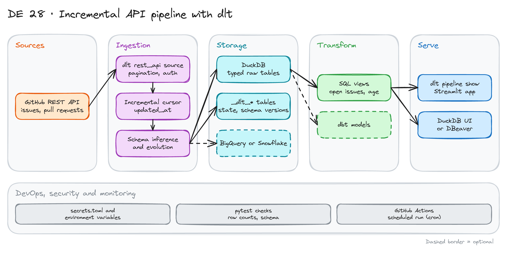

# Incremental API Pipeline with dlt

> **Draft.** The outline and the plan are ready. We have not run every command yet. Check the dlt docs for the current syntax.

## Project card

| Level | Roles | Duration | Cost | Status |
|---|---|---|---|---|
| Base | Data Engineer, Analytics Engineer | 4 assignments, ~2-3 h each | Free | Draft |

## Goal

You load issues and pull requests from the GitHub API into DuckDB with `dlt`. The first run loads all history. Next runs load only new and changed items. You handle API pagination, schema changes and a scheduled run.

## What you will learn

- Read a paginated REST API with the `dlt` `rest_api` source.
- Load only new data with an incremental cursor.
- Use `merge` with a primary key, so updated rows do not duplicate.
- See how `dlt` stores state and schema versions.
- Control schema changes with schema contracts.
- Run a pipeline on a schedule in GitHub Actions.

## Who it is for

- **Data Engineer**: you learn the standard pattern for incremental API ingestion.
- **Analytics Engineer**: you learn how raw data lands before dbt starts.

## Tools and services

| Tool | Used for | Free option |
|---|---|---|
| Python 3.10+ | Run the pipeline | Yes |
| `dlt` | Extract, normalize, load | Yes |
| DuckDB | Destination | Yes |
| GitHub REST API + a personal access token | Source | Yes |
| `pytest` | Pipeline checks | Yes |
| GitHub Actions | Scheduled run | Yes |
| BigQuery, Snowflake or MotherDuck | Optional destination | Free trial |

## Architecture

The diagram is at the top of this page. Source file: [`images/architecture.excalidraw`](images/architecture.excalidraw). Open it at [excalidraw.com](https://excalidraw.com) to copy or edit it.

Data flow:

1. `dlt` calls the GitHub `issues` endpoint and follows the pages.
2. The cursor on `updated_at` remembers the last value. Next run asks only for newer items.
3. `dlt` infers the schema. Nested lists become child tables.
4. Data lands in DuckDB. `dlt` also writes state and schema versions in `_dlt_*` tables.
5. SQL views answer questions. `dlt pipeline show` gives a quick look.

## Dataset

- **Source:** the GitHub REST API, `GET /repos/{owner}/{repo}/issues`. Use a public repo, for example `dlt-hub/dlt`.
- **Entities:** issues and pull requests (the endpoint returns both), labels, users, milestones.
- **Size:** a few thousand rows for a mid-size repo. Small enough to run in minutes.
- **Limit:** without a token you get about 60 requests per hour. With a token you get about 5,000. Create a token with read-only access to public data.

## Prerequisites

- Python, Git and a terminal.
- A GitHub account and a personal access token.
- New to Git, CLI or Docker? Start with [Surfalytics Module 0](https://www.youtube.com/watch?v=LJIiCLu2gr8&list=PLNCDg7zJiXhP5Z_-TXUdorz2n7sjYHHKE&index=1).

## Assignments

Work at your own pace. Each assignment shows the expected time.

### Assignment 1: First pipeline (~2 h)

**Goal:** Load all issues of one repo into DuckDB.

**Steps:**

1. Create a virtual environment. Install `dlt[duckdb]`.
2. Define a `rest_api` source for the `issues` endpoint. Set `state=all` and `per_page=100`.
3. Put the token in `.dlt/secrets.toml`. Add the file to `.gitignore`.
4. Run the pipeline. Open the DuckDB file and look at the tables.

**Deliverable:** `pipeline.py` and a list of the tables that `dlt` created.

**Done when:**

- [ ] The `issues` table has rows.
- [ ] Child tables exist for labels (for example `issues__labels`).
- [ ] The token is not in Git.

### Assignment 2: Make it incremental (~3 h)

**Goal:** The second run loads only new and changed issues.

**Steps:**

1. Add an incremental cursor on `updated_at`. Send it as the `since` parameter.
2. Set `write_disposition="merge"` and the primary key `id`.
3. Run twice. Compare row counts and the log.
4. Look at the state in the `_dlt_pipeline_state` table.

**Deliverable:** A short note: how many rows did run 1 and run 2 load?

**Done when:**

- [ ] Run 2 loads far fewer rows than run 1.
- [ ] No duplicate `id` in the `issues` table.
- [ ] An issue you edit in GitHub shows the new value after the next run.

### Assignment 3: Schema changes (~2 h)

**Goal:** Know what happens when the source changes.

**Steps:**

1. Add a new field to the data in a test (for example with `add_map`). Run the pipeline. See the new column.
2. Set a schema contract that freezes columns. Run again. See it fail.
3. Write when you would use `evolve` and when you would use `freeze`.

**Deliverable:** A short note with your choice and the reason.

**Done when:**

- [ ] You saw a new column appear on its own.
- [ ] You saw the run fail with the freeze contract.
- [ ] You can explain the trade-off in two sentences.

### Assignment 4: Test, schedule, publish (~3 h)

**Goal:** Run the pipeline every day without your laptop.

**Steps:**

1. Write two `pytest` checks: no duplicate ids, and row count is more than 0.
2. Add a GitHub Actions workflow with a `cron` schedule. Use a repo secret for the token.
3. Add one SQL view: open issues by age.
4. Optional: change the destination to BigQuery, Snowflake or MotherDuck.

**Deliverable:** A green scheduled run and the SQL view.

**Done when:**

- [ ] The workflow runs on schedule and on manual trigger.
- [ ] The tests fail if you break the primary key on purpose.
- [ ] The README explains how to run the pipeline locally.

**Hints:** A GitHub Actions runner has no disk between runs. For a real incremental load, keep the DuckDB file in a cache or use a cloud destination.

## Final result

- A `dlt` pipeline with incremental loads, a schema contract, tests and a schedule.
- Put the repo on GitHub. Add the diagram and a table of run 1 versus run 2.
- Interview answer: "I built an incremental pipeline with `dlt`. It uses a cursor and `merge`, so reruns are safe and only changed rows load."

## Clean up

Nothing to clean up for DuckDB. If you used a cloud destination, drop the dataset. Delete the GitHub token when you finish.

## Resources

- [dlt documentation](https://dlthub.com/docs): sources, incremental loading, schema contracts.
- [GitHub REST API: issues](https://docs.github.com/en/rest/issues/issues): fields and parameters.
- [Data Engineering Zoomcamp](https://github.com/DataTalksClub/data-engineering-zoomcamp): has a workshop on `dlt`.

## Community solutions

Share your repo in Discord. We add the best ones here.

- <Name>: <link>
