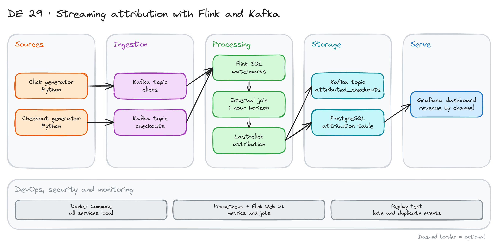

# Streaming Attribution with Flink and Kafka

> **Draft.** The outline and the plan are ready. We have not run every command yet. Flink needs the Kafka and JDBC connector jars. Check the versions in the Flink docs.

## Project card

| Level | Roles | Duration | Cost | Status |
|---|---|---|---|---|
| Middle | Data Engineer | 5 assignments, ~3-4 h each | Free | Draft |

## Goal

An online shop wants to know which ad click led to each purchase. You join checkout events to click events in real time with Flink SQL. A checkout gets the last click of the same user in the 1 hour before it. You write the result to Postgres and show it in Grafana. You also test late and duplicate events.

## What you will learn

- Run Kafka and Flink in Docker Compose.
- Use event time and watermarks in Flink SQL.
- Write an interval join and understand its state.
- Pick the last click with a Top-N (deduplication) query.
- Write results to Kafka and Postgres with upsert sinks.
- Monitor a Flink job with Prometheus and Grafana.

## Who it is for

- **Data Engineer**: you practice stateful stream processing. This is a common interview topic.

## Tools and services

| Tool | Used for | Free option |
|---|---|---|
| Apache Kafka (KRaft mode) | Event transport | Yes |
| Apache Flink + SQL client | Stream processing | Yes |
| PostgreSQL | Result table | Yes |
| Prometheus + Grafana | Metrics and dashboard | Yes |
| Python (`confluent-kafka` or `kafka-python`) | Event generators | Yes |
| Docker Compose | Run everything locally | Yes |

## Architecture

The diagram is at the top of this page. Source file: [`images/architecture.excalidraw`](images/architecture.excalidraw). Open it at [excalidraw.com](https://excalidraw.com) to copy or edit it.

Data flow:

1. Two Python scripts write `clicks` and `checkouts` events to Kafka.
2. Flink reads both topics with event time and a watermark.
3. An interval join matches each checkout to clicks of the same user in the last hour.
4. A Top-N query keeps the last click per order.
5. The result goes to a Kafka topic and a Postgres table.
6. Grafana shows revenue by channel. Prometheus shows job health.

## Dataset

You generate the data. No download needed.

- **`clicks`:** `click_id`, `user_id`, `campaign`, `channel`, `event_time`.
- **`checkouts`:** `order_id`, `user_id`, `amount`, `event_time`.
- **Volume:** 10 to 100 events per second is enough.
- **Mess on purpose:** about 5% late events, about 1% duplicates, some checkouts with no click.

## Prerequisites

- Docker with 6 GB of memory or more.
- Python and SQL.
- Do first: [Data Streaming Mastery](../../async-projects/07-data-streaming-mastery/) (Kafka basics).
- New to Git, CLI or Docker? Start with [Surfalytics Module 0](https://www.youtube.com/watch?v=LJIiCLu2gr8&list=PLNCDg7zJiXhP5Z_-TXUdorz2n7sjYHHKE&index=1).

## Assignments

Work at your own pace. Each assignment shows the expected time.

### Assignment 1: Run the stack (~3 h)

**Goal:** All services start and talk to each other.

**Steps:**

1. Write a `docker-compose.yml` with Kafka, a Flink JobManager and TaskManager, Postgres, Prometheus and Grafana.
2. Add the Flink Kafka and JDBC connector jars to the Flink image.
3. Create the topics `clicks`, `checkouts` and `attributed_checkouts`.
4. Open the Flink Web UI and the Grafana login page.

**Deliverable:** `docker-compose.yml` and a README with start steps.

**Done when:**

- [ ] `docker compose up` starts all services.
- [ ] The Flink SQL client opens.
- [ ] You can write to and read from a Kafka topic.

### Assignment 2: Event generators (~2 h)

**Goal:** Produce realistic events, including bad ones.

**Steps:**

1. Write a click generator and a checkout generator.
2. Make 70% of checkouts follow a click of the same user within an hour.
3. Add late events and duplicates with settings you can change.

**Deliverable:** Two Python scripts with settings.

**Done when:**

- [ ] Both topics fill with JSON events.
- [ ] You can change the late and duplicate rate.
- [ ] The scripts can replay a fixed seed.

### Assignment 3: Flink SQL tables and watermarks (~3 h)

**Goal:** Read both topics with event time.

**Steps:**

1. Create Kafka source tables in Flink SQL. Add `WATERMARK FOR event_time AS event_time - INTERVAL '10' SECOND`.
2. Run a simple `select` and a 1-minute tumbling window count.
3. Change the watermark delay. See which late events drop out of the window.

**Deliverable:** A `.sql` file and a note on what the watermark delay changes.

**Done when:**

- [ ] Window counts appear on the console.
- [ ] You can explain what a watermark is in two sentences.
- [ ] You saw late events being dropped.

### Assignment 4: Interval join and last click (~4 h)

**Goal:** Attribute each checkout to one click.

**Steps:**

1. Write an interval join: click time between `checkout_time - 1 hour` and `checkout_time`.
2. Use `ROW_NUMBER()` over each order, ordered by click time descending. Keep row 1.
3. Write the result to `attributed_checkouts` (upsert Kafka) and to Postgres (JDBC upsert).
4. Check duplicates: the same order must appear once.

**Deliverable:** The job SQL and a sample result.

**Done when:**

- [ ] Each `order_id` appears once in Postgres.
- [ ] Checkouts with no click appear as `unattributed` or are counted separately.
- [ ] You can explain why the join state stays small.

**Hints:** The interval join drops old state when the watermark moves on. A regular join would keep state forever.

### Assignment 5: Dashboard, monitoring and failure test (~4 h)

**Goal:** See the pipeline and break it on purpose.

**Steps:**

1. Build a Grafana dashboard: revenue by channel, attributed share, orders per minute.
2. Turn on the Flink Prometheus metrics. Add panels for records in and out, checkpoint time and watermark lag.
3. Turn on checkpoints. Kill the TaskManager. Restart it. Check there are no lost or double results.

**Deliverable:** A dashboard screenshot and a note on the failure test.

**Done when:**

- [ ] The dashboard updates in near real time.
- [ ] After the restart, the job resumes from the last checkpoint.
- [ ] Postgres still has one row per order.

## Final result

- A streaming job with event time, a stateful join, upsert sinks and monitoring.
- Put the repo on GitHub. Add the diagram and the Grafana screenshot to the README.
- Interview answer: "I joined clicks and checkouts with a Flink interval join. I used watermarks for late data and upsert sinks so a restart does not create duplicates."

## Clean up

Run `docker compose down -v`. This removes containers and volumes.

## Resources

- [Flink SQL: joins](https://nightlies.apache.org/flink/flink-docs-stable/docs/dev/table/sql/queries/joins/): interval join.
- [Flink SQL: deduplication](https://nightlies.apache.org/flink/flink-docs-stable/docs/dev/table/sql/queries/deduplication/): the `ROW_NUMBER` pattern.
- [Flink training](https://github.com/apache/flink-training): official labs on windows, state and timers.

## Community solutions

Share your repo in Discord. We add the best ones here.

- <Name>: <link>
