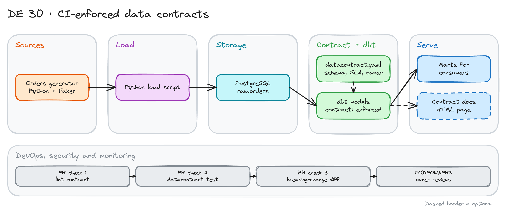

# CI-Enforced Data Contracts

> **Draft.** The outline and the plan are ready. We have not run every command yet. The contract format changes between versions. Check the `datacontract-cli` docs first.

## Project card

| Level | Roles | Duration | Cost | Status |
|---|---|---|---|---|
| Middle | Data Engineer, Analytics Engineer | 5 assignments, ~2-3 h each | Free | Draft |

## Goal

A producer team changes a column name. The dashboards of the consumers break. You stop this. You write a data contract in YAML: schema, quality rules, SLA and owner. You test the live data against it. CI fails when a pull request makes a breaking change.

## What you will learn

- Write a data contract: schema, quality, SLA, owner.
- Test a contract against a Postgres table.
- Tell breaking from non-breaking changes.
- Fail a pull request on a breaking change.
- Connect the contract to dbt model contracts.
- Use `CODEOWNERS` so the owner reviews every change.

## Who it is for

- **Data Engineer**: you learn how producers and consumers agree on data.
- **Analytics Engineer**: you learn how to protect marts from upstream changes.

## Tools and services

| Tool | Used for | Free option |
|---|---|---|
| `datacontract-cli` | Lint, test, diff contracts | Yes |
| PostgreSQL in Docker | The data under contract | Yes |
| dbt Core | Models with `contract: enforced` | Yes |
| Python + Faker | Generate orders | Yes |
| GitHub Actions | PR checks | Yes |
| `CODEOWNERS` | Owner review | Yes |

## Architecture

The diagram is at the top of this page. Source file: [`images/architecture.excalidraw`](images/architecture.excalidraw). Open it at [excalidraw.com](https://excalidraw.com) to copy or edit it.

Data flow:

1. A Python script generates orders and loads them into `raw.orders` in Postgres.
2. `datacontract.yaml` describes the table: fields, types, rules, SLA, owner.
3. dbt builds marts from `raw.orders`. Marts have enforced model contracts.
4. A pull request starts three checks: lint, test against live data, breaking-change diff.
5. `CODEOWNERS` asks the data owner to review.

## Dataset

You generate the data. No download needed.

- **Table:** `orders` with `order_id`, `customer_id`, `status`, `amount`, `currency`, `created_at`.
- **Rules to write:** `order_id` is unique and required. `status` is one of `new`, `paid`, `shipped`, `cancelled`. `amount` is more than 0. `created_at` is not older than 24 hours (freshness).
- **Size:** 10,000 rows is enough.

## Prerequisites

- Docker, Python, Git and SQL.
- A GitHub account.
- Do first: [Getting Started with Git and CI/CD](../../dataops-projects/01_git_and_ci_cd/) and [dbt Fundamentals](../18_dbt_intro/).
- New to Git, CLI or Docker? Start with [Surfalytics Module 0](https://www.youtube.com/watch?v=LJIiCLu2gr8&list=PLNCDg7zJiXhP5Z_-TXUdorz2n7sjYHHKE&index=1).

## Assignments

Work at your own pace. Each assignment shows the expected time.

### Assignment 1: Write the contract (~2 h)

**Goal:** A valid contract for `orders`.

**Steps:**

1. Start Postgres with Docker. Generate and load 10,000 orders.
2. Write `datacontract.yaml`: info, owner, server, model, fields, quality, service levels.
3. Run the lint command.

**Deliverable:** `datacontract.yaml` and the load script.

**Done when:**

- [ ] The contract passes lint.
- [ ] It has an owner and a version.
- [ ] Every field has a type and a description.

### Assignment 2: Test the contract against live data (~2 h)

**Goal:** The data meets the contract.

**Steps:**

1. Connect the contract to the Postgres server (credentials in environment variables).
2. Run the contract test.
3. Add two quality rules in SQL: no future `created_at`, `amount` above 0.

**Deliverable:** A passing test run.

**Done when:**

- [ ] The test passes on clean data.
- [ ] Each rule in the contract is checked.
- [ ] No password is in Git.

### Assignment 3: Break the data on purpose (~2 h)

**Goal:** See the test catch bad data.

**Steps:**

1. Insert a duplicate `order_id`, a `null`, a wrong `status` and a negative `amount`.
2. Run the test. Read the report.
3. Fix the data. Run again.

**Deliverable:** A table: bad row, rule that caught it.

**Done when:**

- [ ] Each bad row fails at least one rule.
- [ ] The test passes after the fix.
- [ ] You know which rule type caught each issue.

### Assignment 4: Breaking and non-breaking changes (~3 h)

**Goal:** Know which change is safe.

**Steps:**

1. Make a copy of the contract as version 2.
2. Try these changes: add an optional field, rename a field, remove a field, change a type, add a new enum value.
3. Run the breaking-change command for each. Record the result.
4. Add `contract: enforced` to your dbt mart and match it to the contract.

**Deliverable:** A table: change, breaking or not, why.

**Done when:**

- [ ] Rename, remove and type change are marked breaking.
- [ ] Adding an optional field is not breaking.
- [ ] The dbt model fails to build if a contracted column is missing.

### Assignment 5: Put it in CI (~3 h)

**Goal:** A pull request cannot merge with a breaking change.

**Steps:**

1. Write a GitHub Actions workflow with 3 jobs: lint, test (Postgres as a service container), breaking-change diff against `main`.
2. Add `CODEOWNERS` with the data owner for the `contracts/` folder.
3. Open two pull requests: one safe, one breaking.

**Deliverable:** Two pull requests. One is green. One is red.

**Done when:**

- [ ] The breaking pull request fails the diff check.
- [ ] The safe pull request passes all checks.
- [ ] The owner is asked to review any change to `contracts/`.

## Final result

- A contract, tests on live data and a CI gate for breaking changes.
- Put the repo on GitHub. Add the diagram and a screenshot of the red pull request.
- Interview answer: "I wrote data contracts in YAML. CI tests the live data and fails any pull request with a breaking change. The owner reviews every contract change."

## Clean up

Run `docker compose down -v`. Nothing else to clean up.

## Resources

- [Data Contract CLI](https://github.com/datacontract/datacontract-cli): commands and server types.
- [Open Data Contract Standard](https://github.com/bitol-io/open-data-contract-standard): an alternative spec.
- [dbt model contracts](https://docs.getdbt.com/docs/mesh/govern/model-contracts): enforce column names and types.

## Community solutions

Share your repo in Discord. We add the best ones here.

- <Name>: <link>
