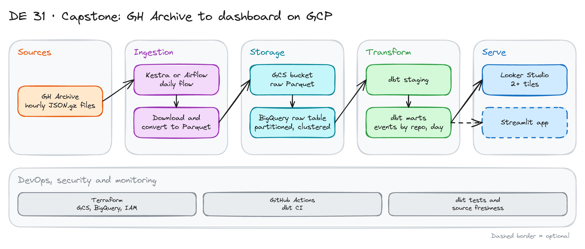

# Capstone: GH Archive to Dashboard on GCP

> **Draft.** The outline, the plan and the grading table are ready. We have not run every step yet. Check file sizes before you backfill.

## Project card

| Level | Roles | Duration | Cost | Status |
|---|---|---|---|---|
| Middle | Data Engineer, Analytics Engineer | 6 assignments, ~3-5 h each | Free trial | Draft |

## Goal

You build one full batch pipeline on Google Cloud. You take public GitHub event data, land it in a lake, load it to a warehouse, model it with dbt and show it in a dashboard. You create the cloud resources with Terraform. This is a portfolio project. You can also use it as the capstone for the [Data Engineering Zoomcamp](https://github.com/DataTalksClub/data-engineering-zoomcamp).

## What you will learn

- Create cloud resources with Terraform.
- Orchestrate a daily ingestion flow and a backfill.
- Store raw data as Parquet in GCS.
- Build a BigQuery table that is partitioned and clustered.
- Model the data with dbt and test it.
- Build a dashboard and explain the pipeline.

## Who it is for

- **Data Engineer**: you practice the full path from source to dashboard.
- **Analytics Engineer**: you practice dbt on a large, nested dataset.

## Tools and services

| Tool | Used for | Free option |
|---|---|---|
| Google Cloud (GCS, BigQuery) | Lake and warehouse | Free trial and free tier |
| Terraform | Create buckets, datasets, IAM | Yes |
| Kestra or Airflow | Orchestration | Yes (open source, in Docker) |
| Python (`requests`, `pyarrow`) | Download and convert | Yes |
| dbt Core + `dbt-bigquery` | Staging and marts | Yes |
| Looker Studio | Dashboard | Yes |
| GitHub Actions | dbt CI | Yes |

## Architecture

The diagram is at the top of this page. Source file: [`images/architecture.excalidraw`](images/architecture.excalidraw). Open it at [excalidraw.com](https://excalidraw.com) to copy or edit it.

Data flow:

1. A daily flow downloads the 24 hourly files of one day from GH Archive.
2. A Python step converts them to Parquet and uploads them to GCS.
3. BigQuery loads the Parquet files into a raw table. The table is partitioned by day and clustered by event type and repo.
4. dbt builds staging and marts: events by day, by type and by repo.
5. Looker Studio reads the marts.

## Dataset

- **Source:** [GH Archive](https://www.gharchive.org). One gzipped JSON file per hour. All public GitHub events.
- **Fields:** `id`, `type`, `actor`, `repo`, `payload` (different for each event type), `created_at`.
- **Size:** one day is hundreds of MB compressed. Check the size of one file first. Start with 3 to 7 days, not a full year.
- **Other data:** you can pick another dataset. See the [Zoomcamp dataset list](https://github.com/DataTalksClub/data-engineering-zoomcamp/blob/main/projects/datasets.md). Do not use NYC taxi data for the Zoomcamp capstone.

## Prerequisites

- A Google Cloud account with a free trial and a billing budget alert.
- Docker, Python, Git, Terraform.
- Do first: [Terraform 101](../../dataops-projects/02_terraform_101/), [BigQuery Overview](../12_bigquery-overview/) and [dbt Fundamentals](../18_dbt_intro/).
- New to Git, CLI or Docker? Start with [Surfalytics Module 0](https://www.youtube.com/watch?v=LJIiCLu2gr8&list=PLNCDg7zJiXhP5Z_-TXUdorz2n7sjYHHKE&index=1).

## Grading table

Use this table to check your own work. Or use it for peer review.

| Area | 0 points | 2 points | 4 points |
|---|---|---|---|
| Problem description | None | Short | Clear question and users |
| Cloud and IaC | Manual clicks | Some Terraform | All resources in Terraform |
| Ingestion | Manual run | One flow, one day | Daily flow and backfill |
| Warehouse | Plain table | Partitioned or clustered | Both, with a written reason |
| Transformations | None | SQL scripts | dbt with tests and docs |
| Dashboard | None | 1 tile | 2 or more tiles, titles, axes |
| Reproducibility | No steps | Partial steps | Another person can run it |

## Assignments

Work at your own pace. Each assignment shows the expected time.

### Assignment 1: Problem and cloud setup (~3 h)

**Goal:** One page of scope. A cloud project ready for Terraform.

**Steps:**

1. Write the problem: which questions will the dashboard answer? Examples: Which event types grow? Which repos get the most activity?
2. Create a GCP project and a budget alert. Create a service account with the roles you need.
3. Write Terraform for a GCS bucket and two BigQuery datasets (`raw`, `analytics`).
4. Run `terraform apply`.

**Deliverable:** A `README` with the problem and a `terraform/` folder.

**Done when:**

- [ ] `terraform plan` shows no changes after apply.
- [ ] The service account key is not in Git.
- [ ] The budget alert exists.

### Assignment 2: Ingestion flow (~5 h)

**Goal:** One day of data lands in GCS as Parquet.

**Steps:**

1. Run Kestra or Airflow in Docker.
2. Write a flow with a date input. It downloads the 24 hourly files.
3. Convert to Parquet. Upload to `gs://<bucket>/raw/date=YYYY-MM-DD/`.
4. Make the flow safe to rerun (same input, same result).

**Deliverable:** The flow file and a screenshot of a green run.

**Done when:**

- [ ] The bucket has Parquet files for the chosen day.
- [ ] A rerun does not create duplicates.
- [ ] A failed hour is retried and logged.

### Assignment 3: Backfill and BigQuery table (~4 h)

**Goal:** Several days in a partitioned, clustered table.

**Steps:**

1. Run the flow for 3 to 7 days (backfill).
2. Create the raw table in BigQuery: partitioned by `created_at` day, clustered by `type` and `repo`.
3. Set `require_partition_filter` so no one scans the full table by mistake.
4. Compare bytes scanned for a query with and without a partition filter.

**Deliverable:** A table with bytes scanned for both queries.

**Done when:**

- [ ] The raw table has all days you loaded.
- [ ] A query with a filter scans much less data.
- [ ] You wrote why you chose these partition and cluster columns.

### Assignment 4: dbt models (~5 h)

**Goal:** Clean marts with tests.

**Steps:**

1. Set up `dbt-bigquery`. Declare the raw table as a source.
2. Write `stg_events`. Pick fields from the nested `actor` and `repo`.
3. Write marts: `fct_events_daily` (by day and type) and `fct_repo_activity` (by repo and day).
4. Add `not_null`, `unique` and `accepted_values` tests and a freshness check.
5. Add a GitHub Actions workflow that runs `dbt build` on pull requests.

**Deliverable:** A dbt project with docs and a green CI run.

**Done when:**

- [ ] `dbt build` passes.
- [ ] Marts are partitioned the same way as the raw table.
- [ ] CI is green on a pull request.

### Assignment 5: Dashboard (~3 h)

**Goal:** A dashboard that answers your questions.

**Steps:**

1. Connect Looker Studio to the marts.
2. Build at least 2 tiles: events by type (categorical) and events per day (time).
3. Add titles, axis labels and one filter.
4. Share a view-only link.

**Deliverable:** A link and a screenshot.

**Done when:**

- [ ] Both tiles show data.
- [ ] A person with the link can open it.
- [ ] Each tile answers a question from Assignment 1.

### Assignment 6: Document and review (~3 h)

**Goal:** Someone else can run your project.

**Steps:**

1. Write the README: problem, diagram, steps to reproduce, costs.
2. Score yourself with the grading table.
3. Ask a friend to follow the README on a clean machine. Fix what breaks.

**Deliverable:** A final README and your score.

**Done when:**

- [ ] Steps are in the right order and complete.
- [ ] The diagram matches what you built.
- [ ] You list the total cost of the project.

## Final result

- A full pipeline: Terraform, orchestration, lake, warehouse, dbt, dashboard.
- Put the repo and the dashboard link on GitHub and LinkedIn.
- Interview answer: "I built a daily batch pipeline on GCP. Terraform creates the resources. Kestra loads data to GCS and BigQuery. dbt builds the marts. I partitioned the table and tested the effect on cost."

## Clean up

- Run `terraform destroy`. This deletes the bucket and the datasets.
- Stop the orchestrator containers: `docker compose down -v`.
- Delete the service account key.
- Check the billing page after one day.

## Resources

- [GH Archive](https://www.gharchive.org): the data source.
- [Data Engineering Zoomcamp](https://github.com/DataTalksClub/data-engineering-zoomcamp): course and capstone rules.
- [BigQuery partitioned tables](https://cloud.google.com/bigquery/docs/partitioned-tables): partition and cluster options.

## Community solutions

Share your repo in Discord. We add the best ones here.

- <Name>: <link>
