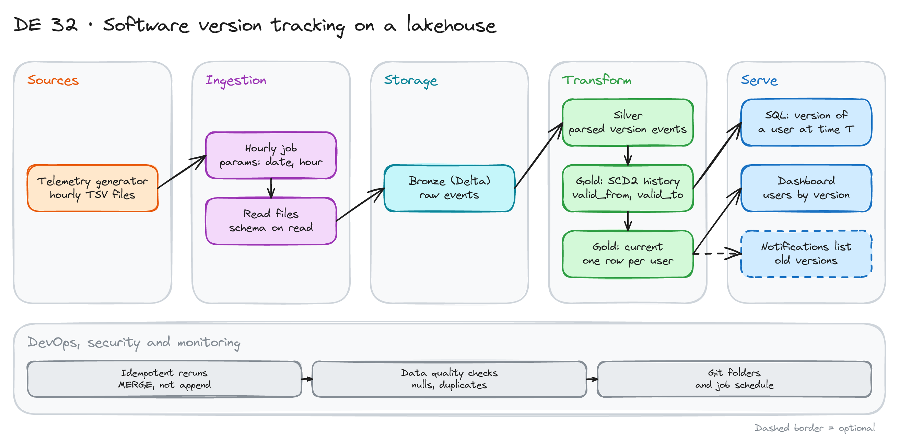

# Software Version Tracking on a Lakehouse

> **Draft.** The outline and the plan are ready. We have not run every step yet.

## Project card

| Level | Roles | Duration | Cost | Status |
|---|---|---|---|---|
| Middle | Data Engineer, Analytics Engineer | 5 assignments, ~3-4 h each | Free | Draft |

## Goal

A product sends telemetry events. Hourly files land in storage. The product team asks: which software version does each user run? When did they upgrade? Can we shut down the old version? You build a lakehouse pipeline with bronze, silver and gold layers. The gold layer keeps one current row per user and the full version history.

## What you will learn

- Process hourly files with a parameterized, repeatable job.
- Build bronze, silver and gold Delta tables.
- Model history with a slowly changing dimension (SCD Type 2).
- Use `MERGE` so reruns do not create duplicates.
- Answer "what version was in effect at time T" with SQL.
- Add data quality checks and schedule the job.

## Who it is for

- **Data Engineer**: you practice the medallion pattern and incremental loads on Delta.
- **Analytics Engineer**: you practice history tables and point-in-time queries.

## Tools and services

| Tool | Used for | Free option |
|---|---|---|
| Databricks Free Edition | Notebooks, jobs, Delta tables, volumes | Yes |
| PySpark and Spark SQL | Transformations | Yes |
| Delta Lake | Storage with `MERGE` | Yes |
| Python | Telemetry generator | Yes |
| Local alternative: PySpark + `delta-spark` in Docker | Run without Databricks | Yes |

## Architecture

The diagram is at the top of this page. Source file: [`images/architecture.excalidraw`](images/architecture.excalidraw). Open it at [excalidraw.com](https://excalidraw.com) to copy or edit it.

Data flow:

1. A Python script writes telemetry files in the folder layout `telemetry/YYYY/MM/DD/HH/*.tsv`.
2. An hourly job reads one hour and writes raw rows to the bronze table.
3. Silver keeps only `SoftwareVersion` events. It parses the JSON body and removes duplicates.
4. Gold has two tables: the version history (SCD2) and the current version per user.
5. SQL and a dashboard answer the product questions.

## Dataset

You generate the data. No download needed.

- **File format:** tab-separated text. One line is one event.
- **Columns:** `Category`, `Timestamp` (UTC), `ServiceName`, `SessionId`, `TransactionId`, `BodyMessage` (JSON string).
- **`BodyMessage` for a version event:** `{"Name": "SoftwareVersion", "UserId": "u123", "Version": "1.22.03", "Device": "ConsoleA"}`.
- **Noise:** 90% of events are other types (`SessionStart`, `Purchase`, `LevelUp`). The pipeline must skip them.
- **Size:** 1,000 users, 7 days, hourly files. Make some users upgrade, some downgrade, some never change.
- **Mess on purpose:** duplicate lines, events that arrive one hour late, a missing hour.

## Prerequisites

- A Databricks Free Edition account.
- Python and SQL.
- Do first: [Getting Started with Databricks](../../async-projects/05-getting-started-with-databricks/).
- New to Git, CLI or Docker? Start with [Surfalytics Module 0](https://www.youtube.com/watch?v=LJIiCLu2gr8&list=PLNCDg7zJiXhP5Z_-TXUdorz2n7sjYHHKE&index=1).

## Assignments

Work at your own pace. Each assignment shows the expected time.

### Assignment 1: Design and generate the data (~3 h)

**Goal:** A written design and a week of telemetry files.

**Steps:**

1. Answer three questions in a short design note: How do you store history? What limits does the technology have? How does a consumer read the data?
2. Write the generator. Make it accept a start date and a seed.
3. Generate 7 days of hourly files into a volume.

**Deliverable:** A design note (1 page) and the generator script.

**Done when:**

- [ ] The folder layout is `YYYY/MM/DD/HH`.
- [ ] The same seed gives the same files.
- [ ] The note says which table has one row per user.

### Assignment 2: Bronze ingestion (~3 h)

**Goal:** Load one hour at a time. Reruns are safe.

**Steps:**

1. Create the bronze Delta table, partitioned by ingest date and hour.
2. Write a notebook with parameters `date` and `hour`.
3. Skip the hour with a clear message when no files exist.
4. Add the source file name to each row.
5. Make reruns safe: delete the partition first or use `replaceWhere`.

**Deliverable:** The notebook and a log of two runs of the same hour.

**Done when:**

- [ ] The second run of the same hour does not change the row count.
- [ ] A missing hour does not fail the job.
- [ ] Bronze keeps the raw `BodyMessage` as it came.

### Assignment 3: Silver layer (~3 h)

**Goal:** Clean version events only.

**Steps:**

1. Filter `Name = 'SoftwareVersion'`.
2. Parse the JSON body into columns: `user_id`, `version`, `device`.
3. Remove duplicates: same user, version and timestamp.
4. Add checks: no null `user_id`, version matches a pattern like `1.22.03`.

**Deliverable:** The silver table and a count of rejected rows.

**Done when:**

- [ ] Silver has only version events.
- [ ] No duplicates for `(user_id, event_timestamp)`.
- [ ] Rejected rows are counted, not lost without a trace.

### Assignment 4: Gold history with SCD2 (~4 h)

**Goal:** Full version history and the current version for every user.

**Steps:**

1. Create `user_version_history` with `user_id`, `version`, `device`, `valid_from`, `valid_to`, `is_current`.
2. Use `MERGE` to close the old row and open a new row when the version changes.
3. Ignore events that repeat the same version.
4. Handle a late event: an older event that arrives after a newer one.
5. Create the view `user_current_version` with one row per user.

**Deliverable:** The history table, the current view and a note on late events.

**Done when:**

- [ ] Each user has exactly one row with `is_current = true`.
- [ ] Periods of one user do not overlap.
- [ ] A rerun of the same hour does not add history rows.

**Hints:** Late events are the hard part. Decide: rebuild the history of that user, or reject events older than the current period. Write your choice.

### Assignment 5: Questions, quality and schedule (~3 h)

**Goal:** Answer the product questions. Run the job every hour.

**Steps:**

1. Write SQL for: current active versions, users by version and device, the version of a user at a given time.
2. Answer: can we shut down version X? How many users would be affected?
3. Add a Databricks job that runs the three notebooks in order each hour.
4. Add one dashboard with the version distribution.

**Deliverable:** SQL file, dashboard screenshot and a job run history.

**Done when:**

- [ ] The point-in-time query returns one version per user.
- [ ] The job runs 3 hours in a row without errors.
- [ ] The dashboard matches your SQL numbers.

## Final result

- A lakehouse pipeline with bronze, silver and gold, SCD2 history and a schedule.
- Put the repo on GitHub. Add the diagram and the design note.
- Interview answer: "I tracked software versions per user from hourly telemetry. I kept history with SCD2 and `MERGE`, so reruns and late events do not break the data."

## Clean up

Nothing to clean up on Databricks Free Edition. Delete the generated files if you want the space back.

## Resources

- [Delta Lake MERGE](https://docs.delta.io/latest/delta-update.html): the syntax.
- [Databricks Free Edition](https://www.databricks.com/learn/free-edition): sign up.
- [Slowly changing dimensions](https://en.wikipedia.org/wiki/Slowly_changing_dimension): Type 2 explained.

## Community solutions

Share your repo in Discord. We add the best ones here.

- <Name>: <link>
