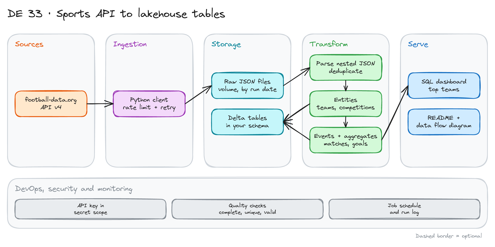

# Sports API to Lakehouse Tables

> **Draft.** The outline and the plan are ready. We have not run every step yet. Check the API plan limits before you start.

## Project card

| Level | Roles | Duration | Cost | Status |
|---|---|---|---|---|
| Middle | Data Engineer | 4 assignments, ~2-4 h each | Free | Draft |

## Goal

You pull football data from a public API. The API limits how fast you can call it. You handle the limit and failures. You save the raw files. Then you turn them into clean tables: entities, events and aggregates. You add data quality checks and write the documentation.

## What you will learn

- Call a REST API with an API key, rate limits and retries.
- Make a pipeline that survives failures and can resume.
- Save raw JSON files and keep them for replay.
- Parse nested JSON into tables with Spark.
- Build entity, event and aggregate tables.
- Add data quality checks and document your choices.

## Who it is for

- **Data Engineer**: you practice the full path from API to tables on a small, safe dataset.

## Tools and services

| Tool | Used for | Free option |
|---|---|---|
| [football-data.org](https://www.football-data.org/) API | Source | Free plan (limited competitions and calls) |
| Python (`requests`) | API client | Yes |
| Databricks Free Edition | Notebooks, Delta tables, volumes | Yes |
| PySpark and Spark SQL | Transformations | Yes |
| Local alternative: PySpark + DuckDB | Run without Databricks | Yes |

## Architecture

The diagram is at the top of this page. Source file: [`images/architecture.excalidraw`](images/architecture.excalidraw). Open it at [excalidraw.com](https://excalidraw.com) to copy or edit it.

Data flow:

1. A Python client calls the API. It waits when the call limit is near.
2. Raw JSON responses go to a volume, in a folder per run date.
3. Spark reads the files, parses nested fields and removes duplicates.
4. Entity tables: `teams`, `competitions`. Event table: `matches`. Aggregate tables: goals and matches per team.
5. Checks run after each load. A SQL dashboard shows the result.

## Dataset

- **Source:** [football-data.org](https://www.football-data.org/), API v4. Sign up for a free API key. It comes by email.
- **Endpoints:** `/v4/competitions`, `/v4/teams`, `/v4/competitions/{id}/teams`, `/v4/competitions/{id}/matches`.
- **Limits:** the free plan covers a short list of competitions. It allows a low number of calls per minute (about 10 at the time of writing). Check the plan page. The API answers `429` when you go over.
- **Size:** small. Thousands of rows. The challenge is the call limit, not the volume.

## Prerequisites

- A Databricks Free Edition account.
- Python and SQL.
- Do first: [Getting Started with Databricks](../../async-projects/05-getting-started-with-databricks/).
- New to Git, CLI or Docker? Start with [Surfalytics Module 0](https://www.youtube.com/watch?v=LJIiCLu2gr8&list=PLNCDg7zJiXhP5Z_-TXUdorz2n7sjYHHKE&index=1).

## Assignments

Work at your own pace. Each assignment shows the expected time.

### Assignment 1: Ingest with a rate limit (~3 h)

**Goal:** Save raw JSON for competitions, teams and teams per competition.

**Steps:**

1. Get the API key. Store it as a secret, not in the notebook.
2. Write a client function with a timeout, a header for the key and a pause between calls.
3. Call the three endpoints. Loop over all competitions you can access.
4. Save each response as a JSON file: `raw/<run_date>/<endpoint>/<id>.json`.

**Deliverable:** The client code and the folder of raw files.

**Done when:**

- [ ] The run finishes without a `429` error.
- [ ] Each file name shows the endpoint, the id and the run date.
- [ ] The key is not in Git or in the notebook output.

### Assignment 2: Failures and reruns (~2 h)

**Goal:** The pipeline survives bad days.

**Steps:**

1. Add retries with backoff for `429` and `5xx` errors.
2. Handle missing data: an empty response, a `404`, a competition outside your plan.
3. Skip files that already exist, so a rerun resumes where it stopped.
4. Test it: stop the run in the middle, then start it again.

**Deliverable:** A short log of a failed run and the resumed run.

**Done when:**

- [ ] A second run does not call the API for files you already have.
- [ ] One bad competition does not stop the whole run.
- [ ] The log says which calls failed and why.

### Assignment 3: Tables with Spark (~4 h)

**Goal:** Entities, events and aggregates in Delta.

**Steps:**

1. Read the raw files with Spark. Parse nested fields (area, season, score).
2. Create `teams` and `competitions` with `id`, `name` and key attributes.
3. Create `matches` with home team, away team, date and score.
4. Create aggregates: matches played and goals for and against per team and competition.
5. Remove duplicates. Explain your choice of key.

**Deliverable:** The tables and a schema note in the README.

**Done when:**

- [ ] `teams.id` and `competitions.id` are unique.
- [ ] Every match points to a team that exists.
- [ ] Goals in the aggregate equal goals in `matches`.

### Assignment 4: Quality, schedule, documentation (~3 h)

**Goal:** Someone else can trust and run your work.

**Steps:**

1. Add checks: completeness (no empty tables), integrity (valid team ids), validity (score is not negative). Use SQL or [Databricks DQX](../24_databricks_dqx_demo/).
2. Fail the job on a broken check.
3. Create a Databricks job that runs ingestion and transformation in order.
4. Write the README: setup, how to run, assumptions, design choices.
5. Add a data flow diagram.

**Deliverable:** A job run, the checks and the README.

**Done when:**

- [ ] A bad row makes a check fail on purpose.
- [ ] The README lets a new person run the project.
- [ ] The diagram matches what you built.

## Final result

- An API pipeline with rate limits, retries, raw storage, clean tables and checks.
- Put the repo on GitHub. Add the diagram and the schema note.
- Interview answer: "I ingested a rate-limited API. The pipeline retries, resumes after a failure and keeps raw files. Spark builds the entity, event and aggregate tables, and checks guard the quality."

## Clean up

Nothing to clean up on Databricks Free Edition. Delete the API key if you do not need it.

## Resources

- [football-data.org documentation](https://www.football-data.org/documentation/quickstart): endpoints and limits.
- [Databricks DQX](https://databrickslabs.github.io/dqx/): data quality checks.
- [Spark: JSON files](https://spark.apache.org/docs/latest/sql-data-sources-json.html): read nested JSON.

## Community solutions

Share your repo in Discord. We add the best ones here.

- <Name>: <link>
