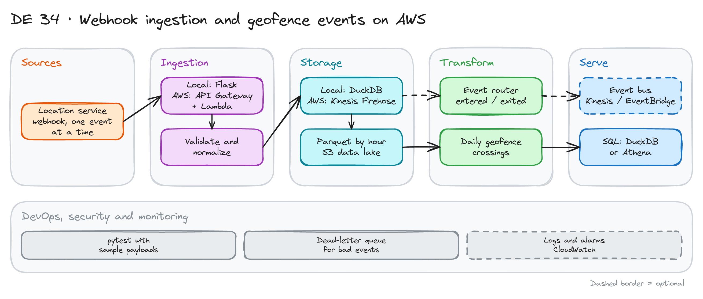

# Webhook Ingestion and Geofence Events on AWS

> **Draft.** The outline and the plan are ready. We have not run every step yet. The AWS part is a design. Deploying it is optional.

## Project card

| Level | Roles | Duration | Cost | Status |
|---|---|---|---|---|
| Middle | Data Engineer | 5 assignments, ~2-4 h each | Free (AWS is optional) | Draft |

## Goal

Delivery drivers run routes every day. A third-party app sends their GPS location to your service by webhook, one event at a time. You build a service that receives, checks and stores these events. You send special events (a driver enters or leaves a geofence) to an event bus. You build and test it locally. Then you design the same system on AWS.

## What you will learn

- Build a webhook endpoint that validates and normalizes events.
- Store events as flat rows in DuckDB and as Parquet files by hour.
- Route events by type to an event bus.
- Make the service safe: signature check, duplicates, bad payloads.
- Aggregate events into a daily metric.
- Design the AWS version with API Gateway, Lambda, Kinesis, S3 and Athena.

## Who it is for

- **Data Engineer**: you practice event ingestion, the first step of every streaming platform.

## Tools and services

| Tool | Used for | Free option |
|---|---|---|
| Python + Flask (or FastAPI) | Webhook service | Yes |
| DuckDB | Local storage and SQL | Yes |
| PyArrow | Write Parquet files | Yes |
| pytest | Tests with sample payloads | Yes |
| LocalStack (optional) | Fake AWS on your laptop | Yes |
| AWS: API Gateway, Lambda, Kinesis, Firehose, S3, Glue, Athena | Production design, optional deploy | Free tier covers a small test |

## Architecture

The diagram is at the top of this page. Source file: [`images/architecture.excalidraw`](images/architecture.excalidraw). Open it at [excalidraw.com](https://excalidraw.com) to copy or edit it.

How local maps to AWS:

| Local | AWS |
|---|---|
| Flask webhook | API Gateway + Lambda |
| In-process queue or file | Kinesis Data Streams |
| DuckDB table and Parquet files | Firehose to S3, queried with Athena |
| Event router function | EventBridge rule or Kinesis consumer |
| Log file | CloudWatch |

Data flow:

1. The location service sends `POST /webhook` with one event.
2. The service checks the signature and the shape. Bad events go to a dead-letter file.
3. It flattens the event and writes it to DuckDB and to a Parquet file for the hour.
4. For `user.entered_geofence` and `user.exited_geofence` it also sends the event to the event bus.
5. A daily query counts geofence crossings.

## Dataset

You generate the events with a script.

- **Event types:** `user.updated_trip` (location update), `user.entered_geofence`, `user.exited_geofence`.
- **Payload:** `event.type`, `event.createdAt`, `event.location` (GeoJSON point: `coordinates` = `[longitude, latitude]`), `event.user._id`, `event.user.trip` (`_id`, `startedAt`, `metadata.route_session_type`).
- **Size:** 100 drivers, 1 event per driver per minute for one day, about 150,000 events.
- **Mess on purpose:** duplicate events, missing fields, a wrong signature, a very old `createdAt`.

## Prerequisites

- Python, Git, a terminal and SQL.
- Optional: an AWS account for deployment.
- New to Git, CLI or Docker? Start with [Surfalytics Module 0](https://www.youtube.com/watch?v=LJIiCLu2gr8&list=PLNCDg7zJiXhP5Z_-TXUdorz2n7sjYHHKE&index=1).

## Assignments

Work at your own pace. Each assignment shows the expected time.

### Assignment 1: Webhook service and tests (~3 h)

**Goal:** A service that accepts good events and rejects bad ones.

**Steps:**

1. Set up the project with `uv` or Poetry. Write a `POST /webhook` endpoint.
2. Verify a signature header made with a shared secret.
3. Validate the payload: required fields, types, valid coordinates.
4. Write `pytest` tests with good and bad sample payloads.

**Deliverable:** The service and the tests.

**Done when:**

- [ ] A good event returns `200`.
- [ ] A bad signature returns `401`. A bad payload returns `400`.
- [ ] Bad events are saved in a dead-letter file with the reason.

### Assignment 2: Normalize and store (~3 h)

**Goal:** Flat rows in DuckDB.

**Steps:**

1. Flatten the event to columns: event id, type, time, user id, latitude, longitude, trip id, session type.
2. Add `process_timestamp` and `process_hour` columns.
3. Insert into a DuckDB table. Skip duplicates by event id.
4. Query the data: events per hour and per type.

**Deliverable:** The table schema and three queries.

**Done when:**

- [ ] Sending the same event twice stores it once.
- [ ] Timestamps are stored in UTC.
- [ ] You can count events per hour with SQL.

### Assignment 3: Parquet files by hour (~2 h)

**Goal:** A small data lake on disk.

**Steps:**

1. Write events to Parquet files in `lake/date=YYYY-MM-DD/hour=HH/`.
2. Write in batches (for example every 100 events or every minute), not one file per event.
3. Read the lake with DuckDB and compare counts with the table.

**Deliverable:** The writer code and a count check.

**Done when:**

- [ ] The lake count equals the table count.
- [ ] Files are not tiny. Explain your batch size.
- [ ] Partition folders follow the event time.

### Assignment 4: Route geofence events and aggregate (~3 h)

**Goal:** Send special events to a bus. Build a daily metric.

**Steps:**

1. When the type is entered or exited geofence, send the event to a bus. Locally use a queue or a file. With LocalStack use Kinesis through `boto3`.
2. Write a query for geofence crossings per day and per driver.
3. Test: only geofence events reach the bus.

**Deliverable:** The router code and the daily query.

**Done when:**

- [ ] Location updates do not reach the bus.
- [ ] The daily count matches your generator settings.
- [ ] A bus failure does not lose the stored event.

### Assignment 5: AWS production design (~3 h)

**Goal:** A design a team could build.

**Steps:**

1. Draw the AWS design: API Gateway, Lambda, Kinesis Data Streams, Firehose to S3 as Parquet, Glue catalog, Athena, EventBridge for geofence events.
2. Add safety: a dead-letter queue (SQS), signature check in Lambda, throttling, encryption.
3. Write the plan for scale: what happens at 100 times more events? List the main cost drivers.
4. Optional: deploy a small version with Terraform or AWS SAM. Delete it after.

**Deliverable:** A diagram and a 1-page design note.

**Done when:**

- [ ] The note covers duplicates, late events, retries and cost.
- [ ] Each local part maps to an AWS service.
- [ ] You wrote one thing that can fail and how you detect it.

## Final result

- A tested webhook service, a small lake, an event router and an AWS design.
- Put the repo on GitHub. Add the diagram and the design note.
- Interview answer: "I built a webhook ingestion service. It validates events, removes duplicates, stores Parquet by hour and routes geofence events to a bus. I mapped each part to AWS services."

## Clean up

Local: nothing to clean up. If you deployed to AWS, delete the stack (`terraform destroy` or SAM delete) and check the bill after one day.

## Resources

- [Amazon Kinesis Data Firehose](https://docs.aws.amazon.com/firehose/latest/dev/what-is-this-service.html): delivery to S3.
- [Amazon Athena](https://docs.aws.amazon.com/athena/latest/ug/what-is.html): query Parquet on S3.
- [LocalStack](https://docs.localstack.cloud/): AWS services on your laptop.

## Community solutions

Share your repo in Discord. We add the best ones here.

- <Name>: <link>
